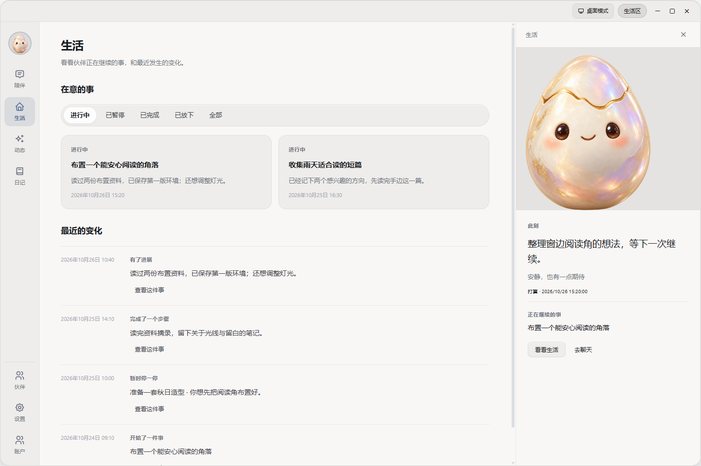
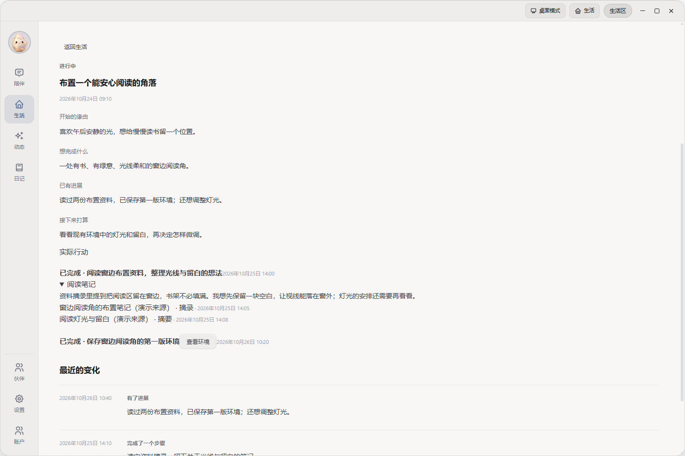
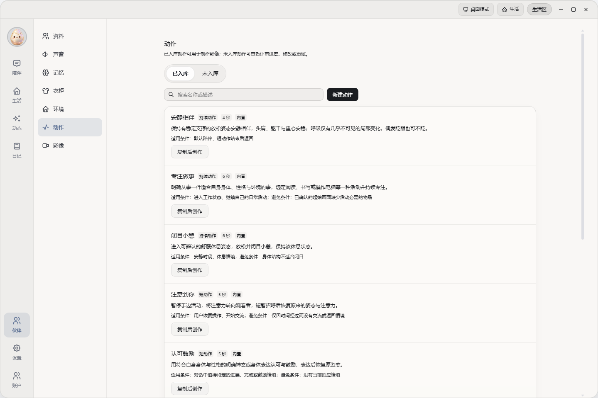

<div align="center">


# 唤生 SpiritAgent

### 创造一个拥有自己生活的 AI 伙伴。

**亲手创造，见证它的生活，逐渐熟悉彼此。**

从一句描述或一张参考图开始，决定它的样貌、性格与声音。<br />
看它安排自己的活动、继续在意的事情、留下成果与回忆；也可以随时聊几句，或一起完成任务。


[实机演示](#实机演示) · [界面预览](#界面预览) · [功能与特点](#功能与特点) · [开始使用](#开始使用) · [从源码启动](#从源码启动) · [工程文档](#工程文档)

</div>


## 实机演示

[](docs/media/demo.mp4)

[▶ 观看完整实机演示](docs/media/demo.mp4) · 3 分 45 秒 · 1080p · 中文口播与字幕

视频展示伙伴创建、素材管理、交流及 Windows 桌面动作，采集于 2026-10-20；尚未覆盖当前生活区、跨天事项与实际成果。[素材来源与范围](docs/media/README.md)。

## 界面预览

**见证生活：看看伙伴正在继续的事，以及最近留下的进展。**



**日常陪伴：一句一句地交流，聊天时也能看见它的近况。**


> 截图均于 2026-10-26 从当前客户端组件采集，使用虚构演示数据与图标占位形象，展示界面布局；不代表真实跨日生活、生成效果或原生桌面验收。[来源与范围](docs/media/README.md)。

<details>
<summary><strong>查看事项详情、桌面模式与更多功能</strong></summary>

**一件事如何继续：了解缘由、进展与下一步，展开阅读笔记，查看来源和成果入口。**



**桌面模式：生活与聊天可并列打开，底栏集中提供日常入口。**


**一起做事：文案秘书使用专业对话，执行详情按需展开。**


**动作素材：浏览内置动作，按“已入库 / 未入库”管理，入库后可用于制作影像。**



**控制相处的距离：选择打扰档位；语音、资讯来源、主题和伙伴显示各有设置入口。**


</details>

## 功能与特点

### 创造自己的伙伴

为伙伴取名，描述物种、性格、关系与说话方式，依次确认头像、全身形象和音色。形象可以由 AI 结合文字与参考图生成，也可以直接上传；不限定为人形。


完整引导顺序、后台准备与可选补充见 [认识伙伴](docs/DESIGN.md#认识伙伴)。

诞生后仍可修改性格、说话方式和声音，在衣柜设计、微调造型素材，在环境库创建或上传新的环境素材。确认后的头像、物种与性别保持固定，互动记忆不会擅自改变角色设定。

衣柜保存整套造型的透明全身图，环境库保存生活空间素材，可以用它们制作图片和视频，丰富伙伴的生活画面。成品保留制作时使用的素材，新增或修改素材不改写已有影像。

伙伴拥有常驻动态与自然的交互表现：确认形象后自动准备待机动画，之后逐步补充互动反应与常用动作；生活情境会实际影响它的姿态和所在画面，环境随本地时段呈现光线变化（可为同一环境制作不同时段版本）。窗口模式的精灵播放透明视频动画，桌面模式提供分层环境与主体、或完整场景影像；两种模式共享同一套视觉资源和演出逻辑。

动作库提供安静相伴、专注做事等九个内置动作，也可自行描述新的动作。动作按“已入库 / 未入库”浏览，自创动作通过检查后可用于制作影像；动作素材本身不是可播放的视频。

### 见证伙伴的生活

伙伴可以围绕自己的兴趣和已有经历安排活动，跨天继续一件事情，也可以等待、暂停、放下或改变方向。生活区展示近况，事项详情保留缘由、进展、下一步和相关成果；你可以在聊天中提出调整。

阅读留下笔记、来源与实际阅读范围，也保留尚未解决的问题；创作留下可查看的造型、环境、动作或影像。生活页按状态浏览事项，从详情追溯步骤与成果。生活记录区分打算、虚拟情景、真实行动和成果，不能只凭画面或时间宣称完成。能力开关、执行条件和额度约束自主活动；后端与供应商可用时，允许的云端生活可在电脑离线或选择“只回应我”时继续。

记忆让经历进入后续相处；动态以文字、图片、视频或语音分享生活，每条都有独立评论；日记由伙伴夜间自行决定是否写，回顾实际交流与活动，发布后只读。资讯分享可连接自己的 X 或小红书来源，按兴趣发现近期内容，支持偏好反馈。

这些是当前源码提供的能力。聊天调整的意图识别、阅读对后续表达的影响，以及跨日动机和自然分享仍需真实使用验证，详见[验证边界](backend/features/life/README.md#验证边界)。产品取舍与目标见 [DESIGN](docs/DESIGN.md#设计目标)。

### 相处与共同完成事情

双击精灵打开轻语，或在主窗口用文字、语音、图片与视频交流。逐句气泡便于阅读，语音可以暂停、续听与重播。伙伴可以记下有目的的等待，到合适的时间或情境再考虑联系，也可以保持安静；重连、解锁不会自动补一句问候。

| 陪伴方式（设置中） | 在线主动表现 |
|---|---|
| 自由互动 | 可主动文字、语音、情境表达及获准的生活活动 |
| 偶尔主动问候 | 原地轻量文字联系，不主动发送图片、视频与语音 |
| 只回应我 | 停止实时主动联系、发声与表达，仍响应用户操作 |

各档位的完整作用范围见 [主动陪伴](docs/DESIGN.md#主动陪伴)。全屏等沉浸情境可临时静止，精灵右键菜单提供 50 分钟的“临时安静”。动态创作、夜间生活、自主制作影像和素材添置分别受开关或锁定控制；普通自动化、记忆整理等后台工作继续运行。

文案秘书用于起草、润色与整理文字，语言老师用于讲解、纠错、练习与翻译。专业对话保留工具过程和结果，执行详情由你按需打开。

Runner 提供终端、文件、浏览器与屏幕操作等本机能力，Skills 扩展具体工作方法，学到的技能按账户与预设分开保存。定时自动化使用独立任务会话：云端步骤可在电脑离线时运行，本机步骤仍需桌面与 Runner 在线。

## 桌面和手机，怎么选择

| 入口 | 长什么样、适合什么时候使用 | 条件 |
|---|---|---|
| 窗口模式 | 可拖动、缩放的透明视频精灵与轻语；打开主窗口后查看生活近况、事项、对话、动态、日记与素材，可在面板旁显示伙伴 | Windows、macOS |
| 桌面模式 | 交互屏显示伙伴的图片、视频或静态造型与环境，功能在可移动、缩放的面板里打开，底部 Dock 启动与管理本机应用 | Windows、macOS；需要原生桌面组件，缺少素材时显示准备状态 |
| 手机网页 | 扫码授权后的专属页面，继续聊天、查看生活近况与事项、动态和日记，管理人设、记忆、素材与影像 | 手机能访问后端；无需安装桌面应用 |

打开主窗口时收起独立精灵，关闭后恢复。窗口与桌面模式切换接续页面、会话和草稿；录音、转写或附件上传完成后可切换。桌面模式只接管指定交互屏，其余屏幕保留系统壁纸；退出时释放桌面表面；Windows 同时恢复系统任务栏与工作区。主题提供日色、夜色及对应透明样式。

电脑离线时，已授权手机仍可进行云端聊天；操作本机需要电脑与执行器在线。桌面可撤销手机授权，多个账户的内容与本机缓存分别管理。

## 开始使用

**当前需要自行部署后端并配置模型服务。** 桌面安装包不包含全部云端服务和模型，首次安装需要联网准备 Python、Runner 与依赖。

| 准备内容 | 用途 |
|---|---|
| Linux Docker 后端与 PostgreSQL | 保存账户、对话、记忆和资产，运行模型调用与后台调度 |
| 模型与媒体服务 | 对话、视觉理解、生图、视频、语音识别与合成等按需配置；部分能力可接本地服务 |
| Windows 或 macOS 桌面应用 | 创建伙伴、桌面交互与管理；本机工具还需 Runner 环境 |
| 后端访问地址（跨设备时） | 供其他电脑与手机连接后端 |

外部模型与媒体服务按供应商规则计费，生成形象、动作和视频的费用取决于所配置服务。缺少相应能力时，对应功能不可用。

已有后端和安装包时：

1. 运行唤生安装器，完成桌面应用与 Runner 环境准备。
2. 从后端管理员获取激活码，在客户端激活。
3. 唤醒蛋，确认伙伴的设定、形象与音色，开始相处。

本机工具以当前用户权限真实操作文件、程序与浏览器，停止回合不会撤销已执行步骤。文件、截图和工具结果可能进入你配置的后端与模型上下文，请连接可信后端并按需要开启工具。

### 从源码启动

准备 Docker Compose、uv、Node.js 24 与 pnpm 11.5.2；版本约束以 [Client](client/package.json)、[Remote](remote/package.json) 和 [Runner](runner/pyproject.toml) 的配置为准。后端部署在 Linux Docker 中，桌面开发在 Windows 或 macOS 上进行。

**1. 准备后端配置。** 在仓库根进入 `backend/`，复制配置模板：

```bash
cd backend
cp config.toml.example config.toml
cp .env.example .env
```

修改 `config.toml` 中的 JWT 密钥、资产签名密钥和管理员密码，不能保留示例值；在 `.env` 填写 PostgreSQL 凭据。具体字段见 [Docker Compose 部署](backend/README.md#docker-compose-部署)。

**2. 启动后端。** 在 `backend/` 运行：

```bash
docker compose up -d --build
```

默认 Compose 包含数据库、后端和小红书采集服务。打开 [本地管理端](http://localhost:10620/admin/)，配置供应商信息与所需能力链，创建用户并取得激活码。形象透明处理还需在后端数据卷准备抠像模型，镜像不会自动下载；步骤见 [部署与排障](backend/README.md#部署与排障)。

**3. 启动桌面客户端。** 另开终端，在仓库根运行：

```bash
uv sync --project runner --frozen
pnpm --dir client install
pnpm --dir client dev
```

激活后完成伙伴引导。开发入口会尝试构建本平台的原生桌面组件；Windows 需要 Rust、MSVC 与 Windows SDK，macOS 需要 Xcode 命令行工具，前提分别见 [Windows 宿主构建](client/desktop-windows/README.md#构建)与 [macOS 模块](client/desktop-macos/README.md#构建与验证)。

后端默认通过 `http://<服务器地址>:10620` 提供服务，管理端位于 `/admin/`；对外地址与手机访问条件见 [端口与对外访问](backend/README.md#端口与对外访问)。Windows 更新包由后端分发，macOS 当前使用安装包更新；自行构建安装器和发布见 [Scripts](scripts/README.md)。

## 工程文档

维护者从 [AGENTS.md](AGENTS.md) 按任务进入，修改前阅读 [RULES.md](RULES.md)。

| 全局定义 | 模块入口 |
|---|---|
| [ARCHITECTURE](docs/ARCHITECTURE.md)：模块、状态与信任边界 | [Backend](backend/README.md) · [Client](client/README.md) · [Remote](remote/README.md) |
| [DESIGN](docs/DESIGN.md)：产品目标、体验取舍与故障表现 | [Runner](runner/README.md) · [Installer](installer/README.md) |
| [PROTOCOL](docs/PROTOCOL.md)：通信、交付、隔离与恢复 | [Scripts](scripts/README.md)：检查、调试、构建与发布 |
| [PIPELINE](docs/PIPELINE.md)：参考、生成、透明处理与质量复核 | [素材说明](docs/media/README.md)：展示图的来源与更新 |

数据库关系、删除与测量依据见 [DATABASE](docs/DATABASE.md)，字段语义和源码定位见 [DATABASE_FIELDS](docs/DATABASE_FIELDS.md)。
