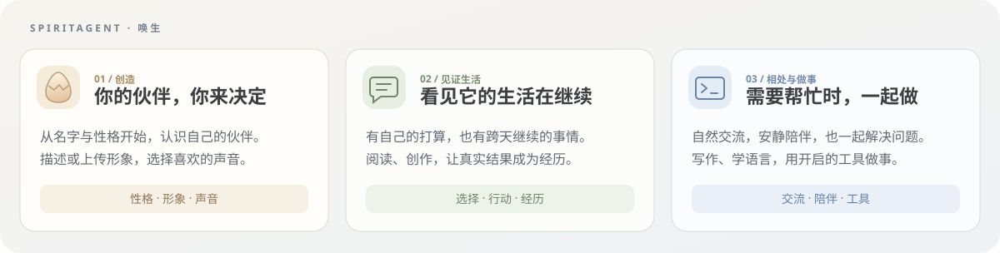
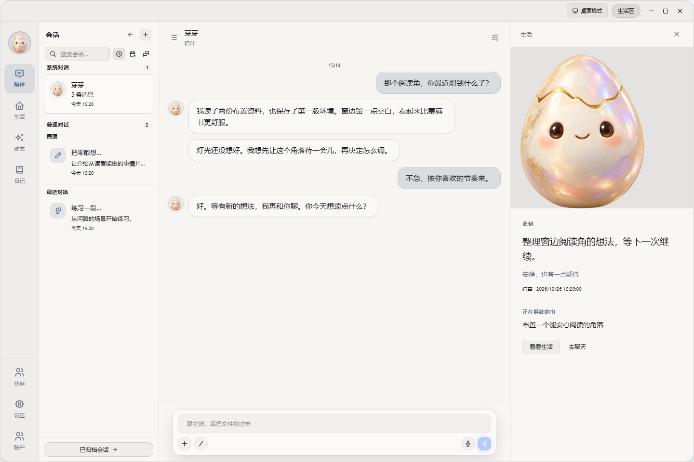
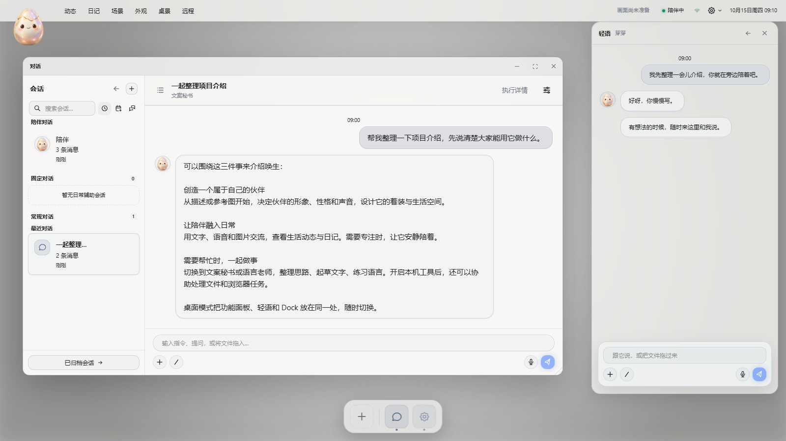
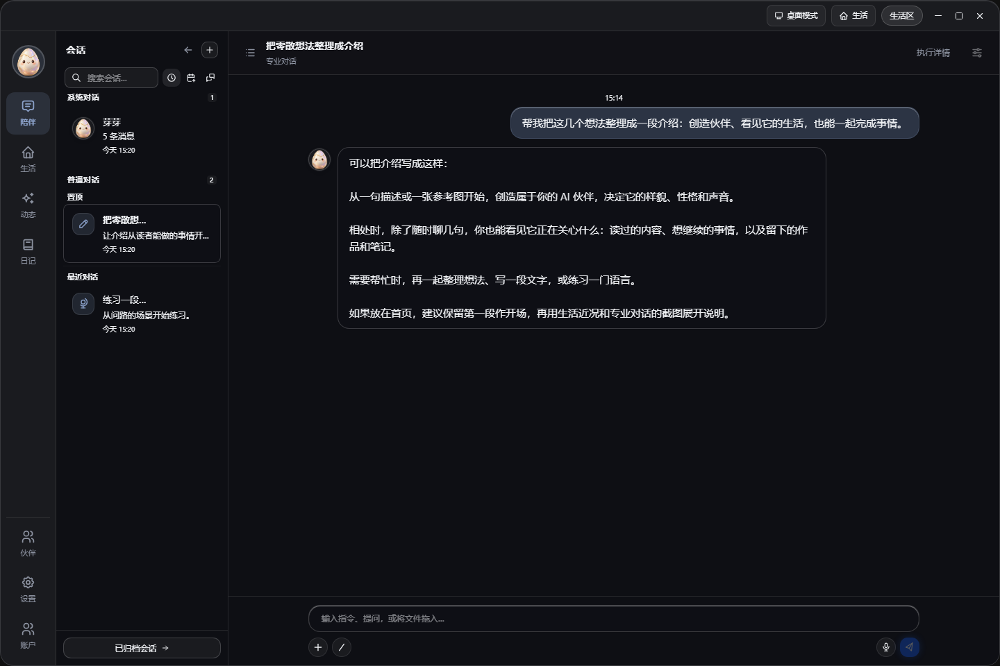
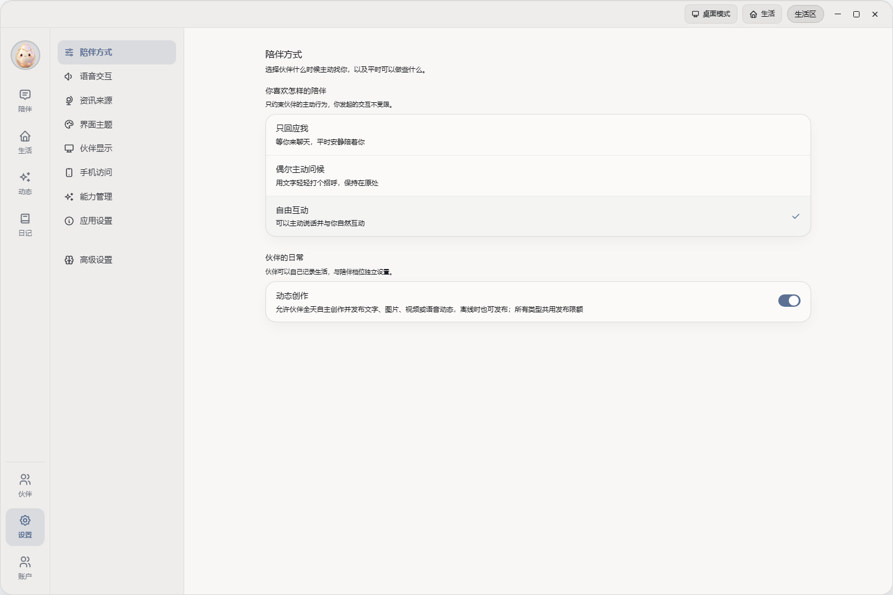
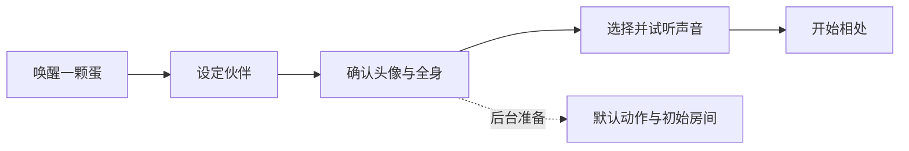

<div align="center">


# 唤生 SpiritAgent

### 让想象中的伙伴，来到你的桌面。

**亲手创造，持续相处，也能一起做事的 AI 伙伴。**

从一句描述或一张参考图开始，决定它的样貌、性格与声音。<br />
它住在桌面，陪你交流、积累记忆、分享自己的生活，也能使用你开启的工具协助完成任务。


[实机演示](#实机演示) · [界面预览](#界面预览) · [功能与特点](#功能与特点) · [开始使用](#开始使用) · [从源码启动](#从源码启动) · [工程文档](#工程文档)

</div>



## 实机演示

**从创建自己的角色，到设计外观、丰富动作，让伙伴来到真实桌面。**

[](docs/media/demo.mp4)

[▶ 观看完整实机演示](docs/media/demo.mp4) · 3 分 45 秒 · 1080p · 中文口播与字幕

视频依次展示伙伴创建、衣柜与声音、动态与日记、陪伴设置及手机访问入口，最后重点演示 Windows 桌面模式、动作库与动作预览。

> 2026-10-20 Windows 实机录屏剪辑。创建流程加速播放，功能页面按讲解停帧，桌面角色与动作预览保留实机画面。[素材来源与范围](docs/media/README.md)。

## 界面预览

**日常陪伴：一句一句地交流，随时切换会话和生活内容。**



**桌面模式（Windows）：实底任务面板与轻语并排，居中头像和底部彩色图标集中管理入口。**



> 本节 PNG 为客户端组件的浏览器截图，使用虚构演示数据与应用图标，未连接实际账户或调用模型。桌面图于 2026-10-16 更新，展示底栏、未读声波与实底面板；背景视频未就绪，未执行 Windows 原生桌面接管。其余截图保留 2026-10-15 的采集版本。[素材来源与更新说明](docs/media/README.md)。

<details>
<summary><strong>查看专业对话与互动设置</strong></summary>

**一起做事：文案秘书使用专业对话，执行详情按需展开。**



**控制相处的距离：选择回应偏好、打扰档位和自主行为。**



</details>

## 唤生能带来什么

你可以创造一个人类、动物或自创生灵，用文字与语音和它交流，为它设计着装与生活空间。相处中的信息会成为可查看、编辑和遗忘的记忆；伙伴还有独立的动态与日记。需要专注时让它安静陪着，需要帮忙时切换到写作、语言学习或工具任务。

| 你想做什么 | 在唤生里怎么做 |
|---|---|
| 有一个属于自己的桌面伙伴 | 确认形象和音色，设定相处方式，拖动或缩放桌面精灵 |
| 工作间隙聊几句 | 双击精灵打开轻语，或在主窗口用文字、语音、图片与视频交流 |
| 一起整理思路、写作和学习 | 使用文案秘书、语言老师或普通对话，保留各自的会话历史与记忆 |
| 看看伙伴自己的生活 | 浏览动态、评论互动、阅读第一人称日记；按需开启主动资讯分享 |
| 让 AI 协助操作电脑 | 开启本机工具与 Skills，在专业对话里查看执行过程和结果 |
| 离开电脑也能联系 | 在设置中扫码授权手机，用浏览器继续聊天、查看内容和管理伙伴 |

## 功能与特点

### 从一颗蛋开始，创造自己的伙伴

为伙伴取名，描述物种、性格、关系与说话方式，依次确认头像、全身形象和音色。形象可以由 AI 结合文字与参考图生成，也可以直接上传；不限定为人形。



诞生后仍可修改性格、说话方式和声音，在衣柜设计、微调与更换着装，在场景库创建或上传新的环境。确认后的头像、物种与性别保持固定，互动记忆不会擅自改变角色设定。

每套着装有自己的动作组，可以查看、搜索并按动作重做；不同动作可并行制作。重做的新素材先预览、确认采用，旧素材在此期间继续呈现。

### 有形象，也有持续相处的生活

| 能力 | 你能体验到什么 |
|---|---|
| 可动形象 | 透明图片姿态与视频动作，拖拽、缩放、屏幕边缘或窗口旁栖息；自主档可陪工、漫游与靠近 |
| 多种交流方式 | 文字、语音、图片与视频；逐句气泡，语音暂停、续听与重播，生成中的视频完成后更新原卡片 |
| 长期记忆 | 参考你的偏好与经历；查看依据、编辑或遗忘；每个预设的记忆互相隔离 |
| 生活动态 | 伙伴自主发布文字、图片、视频或语音，在每条动态的评论里继续交流，支持未读提醒 |
| 第一人称日记 | 夜间回顾实际交流与完成的活动，自主决定是否写日记；发布后只读，可在聊天里回顾 |
| 有来源的话题 | 开启后在夜间寻找近期内容，合适时分享原文链接；可以反馈“喜欢这类”或“少推荐这类” |

动态由独立调度创作，聊天和夜间规划不会直接触发发布。主动资讯需要后端配置可用的采集来源；默认免费来源支持 X 和小红书。

### 主动陪伴，由你控制距离

伙伴可以记下有目的的等待，到合适的时间或情境再考虑联系，也可以选择保持安静。重连、解锁不会自动补一句问候，过时安排不会强行兑现。

| 档位 | 在线主动表现 |
|---|---|
| 自主 | 可主动文字、语音、情境动作与移动 |
| 常规 | 原地轻量文字联系 |
| 静止 | 停止实时主动联系、发声、表达与移动，仍响应用户操作 |

全屏等沉浸情境可临时静止，精灵右键菜单提供 50 分钟的“临时安静”。动态创作、夜间生活、自主换装和场景变化分别受开关或锁定控制；普通自动化、记忆整理等后台工作不随静止档一起关闭。

### 需要做事时，也能一起完成任务

文案秘书用于起草、润色与整理文字，语言老师用于讲解、纠错、练习与翻译。专业对话保留工具过程和结果，执行详情由你按需打开。

Runner 提供终端、文件、浏览器与屏幕操作等本机能力，Skills 扩展具体工作方法，学到的技能按账户与预设分开保存。定时自动化使用独立任务会话：云端步骤可在电脑离线时运行，本机步骤仍需桌面与 Runner 在线。

## 桌面和手机，怎么选择

| 入口 | 长什么样、适合什么时候使用 | 条件 |
|---|---|---|
| 窗口模式 | 桌面精灵与轻语；打开主窗口后，集中查看对话、动态、日记、衣柜、场景和设置，可在面板旁显示伙伴 | Windows、macOS |
| 桌面模式 | 伙伴生活视频作为交互屏背景，功能在可移动、缩放的面板里打开，底部 Dock 启动与管理本机应用 | Windows、macOS；需要原生桌面组件和可用媒体 |
| 手机网页 | 扫码授权后的专属页面，继续聊天、查看动态与日记、管理人设、记忆、场景和衣柜 | 后端公网 HTTPS；无需在手机安装桌面应用 |

打开主窗口时收起独立精灵，关闭后恢复。窗口与桌面模式切换接续页面、会话和草稿；录音、转写或附件上传完成后可切换。桌面模式只接管指定交互屏，其余屏幕保留系统壁纸；退出时释放桌面表面；Windows 同时恢复系统任务栏与工作区。主题提供日色、夜色及对应透明样式。

电脑离线时，已授权手机仍可进行云端聊天；操作本机需要电脑与执行器在线。桌面可撤销手机授权，多个账户的内容与本机缓存分别管理。

## 开始使用

**当前需要自行部署后端并配置模型服务。** 桌面安装包不包含全部云端服务和模型，首次安装需要联网准备 Python、Runner 与依赖。

| 准备内容 | 用途 |
|---|---|
| Linux Docker 后端与 PostgreSQL | 保存账户、对话、记忆和资产，运行模型调用与后台调度 |
| 模型与媒体服务 | 对话、视觉理解、生图、视频、语音识别与合成等按需配置；部分能力可接本地服务 |
| Windows 或 macOS 桌面应用 | 创建伙伴、桌面交互与管理；本机工具还需 Runner 环境 |
| 公网 HTTPS（跨设备时） | 远程客户端与手机访问；仅本机测试可用回环 HTTP |

外部模型与媒体服务按供应商规则计费，生成形象、动作和视频的费用取决于所配置服务。缺少相应能力时，对应功能不可用。

已有后端和安装包时：

1. 运行唤生安装器，完成桌面应用与 Runner 环境准备。
2. 从后端管理员获取激活码，在客户端激活。
3. 唤醒蛋，确认伙伴的设定、形象与音色，开始相处。

本机工具以当前用户权限真实操作文件、程序与浏览器，停止回合不会撤销已执行步骤。文件、截图和工具结果可能进入你配置的后端与模型上下文，请连接可信后端并按需要开启工具。

### 从源码启动

准备 Docker Compose、uv、Node.js 24 与 pnpm 11.5.2；版本约束以 [Client](client/package.json)、[Remote](remote/package.json) 和 [Runner](runner/pyproject.toml) 的配置为准。后端部署在 Linux Docker 中，桌面开发在 Windows 或 macOS 上进行。

**1. 准备后端配置。** 在仓库根进入 `backend/`，复制配置模板：

```bash
cd backend
cp config.toml.example config.toml
cp .env.example .env
```

修改 `config.toml` 中的 JWT 密钥、资产签名密钥和管理员密码，不能保留示例值；在 `.env` 填写 PostgreSQL 凭据。具体字段见 [Docker Compose 部署](backend/README.md#docker-compose-部署)。

**2. 启动后端。** 在 `backend/` 运行：

```bash
docker compose up -d --build
```

默认 Compose 包含数据库、后端和小红书采集服务。打开 [本地管理端](http://localhost:10620/admin/)，配置供应商信息与所需能力链，创建用户并取得激活码。形象与动作制作还需在后端数据卷准备抠像模型，镜像不会自动下载；步骤见 [部署与排障](backend/README.md#部署与排障)。

**3. 启动桌面客户端。** 另开终端，在仓库根运行：

```bash
uv sync --project runner --frozen
pnpm --dir client install
pnpm --dir client dev
```

激活后完成伙伴引导。开发入口会尝试构建本平台的原生桌面组件；Windows 需要 Rust、MSVC 与 Windows SDK，macOS 需要 Xcode 命令行工具，前提分别见 [Windows 宿主构建](client/desktop-windows/README.md#构建)与 [macOS 模块](client/desktop-macos/README.md#构建与验证)。

默认后端 HTTP 只绑定本机回环地址。远程使用需配置公网 HTTPS，仓库提供可选 Caddy 配置，见 [HTTPS 与公网访问](backend/README.md#https-与公网访问)。Windows 更新包由后端分发，macOS 当前使用安装包更新；自行构建安装器和发布见 [Scripts](scripts/README.md)。

## 工程文档

维护者从 [AGENTS.md](AGENTS.md) 按任务进入，修改前阅读 [RULES.md](RULES.md)。产品介绍归本页，全局契约归 `docs/`，模块文档维护代码入口、约束与操作。

| 全局定义 | 模块入口 |
|---|---|
| [ARCHITECTURE](docs/ARCHITECTURE.md)：模块、状态与信任边界 | [Backend](backend/README.md) · [Client](client/README.md) · [Remote](remote/README.md) |
| [DESIGN](docs/DESIGN.md)：体验、设计理由与故障表现 | [Runner](runner/README.md) · [Installer](installer/README.md) |
| [PROTOCOL](docs/PROTOCOL.md)：通信、交付、隔离与恢复 | [Scripts](scripts/README.md)：检查、调试、构建与发布 |
| [PIPELINE](docs/PIPELINE.md)：参考、生成、透明处理与质量复核 | [素材说明](docs/media/README.md)：展示图的来源与更新 |
