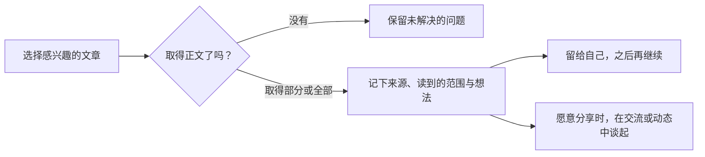
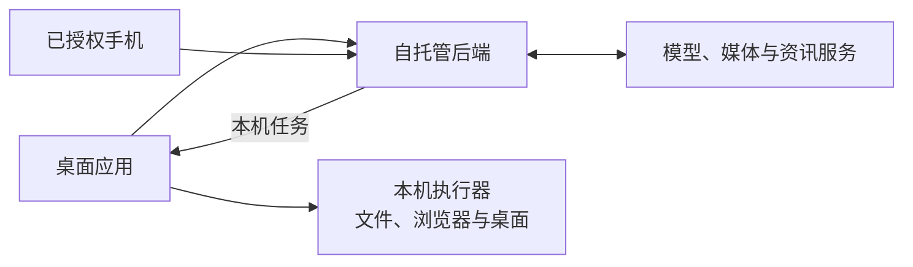

<div align="center">


# 唤生 SpiritAgent

**创造一个拥有自己生活的 AI 伙伴。**

从一句描述或一张参考图开始。你可以和它聊刚读过的文章，一起改一封信，也可以让它安静地继续自己的事。

[看实机演示](#实机演示) · [探索功能](#功能与特点) · [选择入口](#在哪里相处) · [开始使用](#开始使用)

</div>


## 实机演示

[](docs/media/demo.mp4)

[观看视频](docs/media/demo.mp4)（3 分 45 秒，中文口播与字幕），涵盖创建伙伴、功能浏览和 Windows 桌面交互。

## 功能与特点

| 你想做什么 | 可以怎样和伙伴相处 |
|---|---|
| **创造伙伴** | 取名并设定物种、性格和说话方式，生成或上传头像与全身形象。选择固定音色、设计或克隆声音，也可以从文字开始。 |
| **看看它在忙什么** | 伙伴可以按兴趣阅读或创作，跨天继续、暂停或放下一件事。在「生活」按主题或日期读近况，查看共同事项的进展、笔记、来源和作品。 |
| **聊一会儿** | 用文字、语音、图片或视频交流，也可拨打实时语音电话。伙伴可以决定是否接听，你可以调整主动联系频率。 |
| **留下回忆** | 浏览并评论伙伴分享的动态，阅读它的第一人称日记。在「伙伴 → 记忆」管理个人资料，查看、编辑或遗忘记忆。 |
| **布置生活空间** | 用衣柜、环境与动作素材制作图片或视频，也能导入自己的作品。把审核合格的环境或整景影像设为桌面默认壁纸。 |
| **一起做事** | 用文案秘书起草润色，和语言老师练习或翻译。可以安排云端定时任务，连接本机工具后可处理文件、操作浏览器和桌面。 |

安静相处时，伙伴也可以继续读文章或创作。以阅读为例：



## 在哪里相处

| 入口 | 适合的场景 | 使用条件 |
|---|---|---|
| **窗口精灵与主窗口** | 双击透明精灵打开轻语，在主窗口读长对话、看生活场景或整理素材。 | Windows 或 macOS |
| **桌面模式** | 在指定屏幕展示完整生活场景，用浮动面板交流，用 Dock 启动应用、切换窗口。 | Windows 或 macOS，使用安装包提供的原生组件 |
| **手机网页** | 扫码授权后继续聊天和通话，浏览生活、动态、日记与素材。 | 手机能访问后端即可使用云端功能 |



本机执行器（Runner）以你的用户权限操作；停止任务不会撤销已执行的步骤。文件、截图和工具结果可能进入后端与模型上下文，请只连接可信服务。

## 开始使用

1. 在 [Releases](https://github.com/yangjinming1062/SpiritAgent/releases) 下载 Windows `.exe` 或 macOS `.dmg`，联网运行安装器。
2. 输入管理员提供的激活码，按引导设定伙伴、确认形象和声音。环境与个人资料可稍后设置。
3. 在「设置 → 手机访问」选择「连接手机」，用手机扫码。手机需能访问后端，设备授权可在同页撤销。

自行托管时，先用 Linux Docker 部署服务，在 `/admin/` 配置模型、创建账户并取得激活码。手机和部分媒体供应商需要可达的服务地址。透明形象制作需要抠像模型，语音和媒体能力按需配置，费用取决于供应商。[Docker Compose 部署](backend/README.md#docker-compose-部署) · [对外访问](backend/README.md#端口与对外访问) · [抠像模型](backend/README.md#透明素材模型)

### macOS 覆盖安装

1. 退出正在运行的唤生。从项目的 Releases 页面下载目标版本的 `SpiritAgent-Setup-<版本>.dmg`，双击挂载。
2. 打开「终端」，键入 `open -n -a` 和一个空格。在访达中打开刚挂载的磁盘，将其中的「唤生」安装器拖入终端，再键入一个空格和 `--args --reinstall`，按回车进入安装界面。
3. 保持联网并按提示完成安装。启动唤生后，在「设置 → 关于」确认版本号。

### 从源码启动

后端就绪后，在桌面开发机安装 uv、Node.js 24、pnpm 11.5.2 和对应的原生工具链（[Windows](client/desktop-windows/README.md#构建) / [macOS](client/desktop-macos/README.md#构建与验证)），从仓库根目录运行：

```bash
uv sync --project runner --frozen
pnpm --dir client install
pnpm --dir client dev
```

## 工程文档

[产品设计](docs/DESIGN.md) · [架构图谱](docs/ARCHITECTURE_MAP.md) · [按任务查找工程文档](AGENTS.md) · [检查、构建与发布](scripts/README.md)
