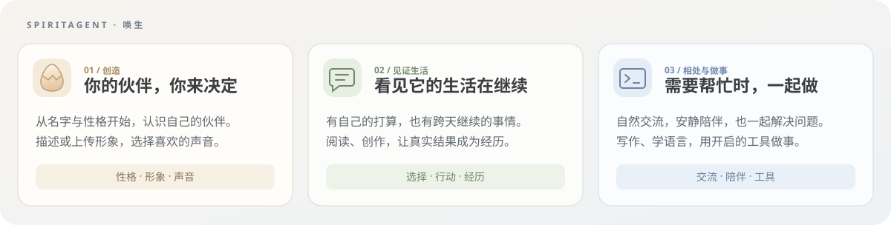
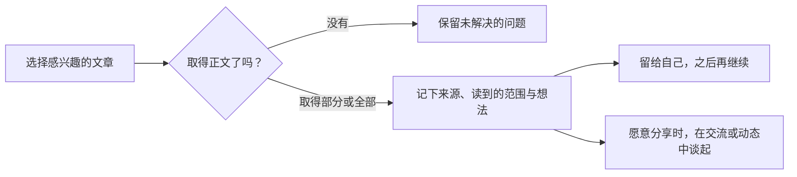
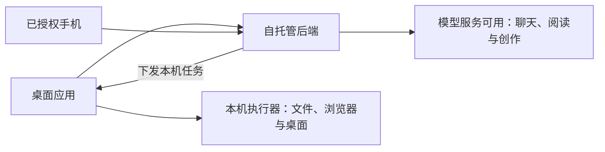

<div align="center">


# 唤生 SpiritAgent

**创造一个拥有自己生活的 AI 伙伴。**

从一句描述或一张参考图开始。你可以和它聊刚读过的文章，一起改一封信，也可以让它安静地继续自己的事。

[看实机演示](#实机演示) · [探索功能](#功能与特点) · [选择入口](#在哪里相处) · [开始使用](#开始使用)

</div>



## 实机演示

[](docs/media/demo.mp4)

[▶ 观看视频](docs/media/demo.mp4)（3 分 45 秒，中文口播与字幕）。录屏展示桌面交互，不是跨日生活的演示。

## 功能与特点

| 你想做什么 | 可以怎样和伙伴相处 |
|---|---|
| **创造伙伴** | 为它取名，设定物种、性格和说话方式；生成或上传头像与全身形象，试听声音，也可以先用文字相处。 |
| **看看它在忙什么** | 伙伴可以按兴趣阅读或创作，跨天继续、暂停或放下一件事。生活页展示它愿意分享的近况；共同事项能查看进展、笔记、来源和作品。 |
| **聊一会儿** | 用文字、语音、图片和视频交流，或拨打实时语音电话。伙伴可以接听，也可以不接；你可以调低主动问候频率，或选择不主动联系。 |
| **留下回忆** | 伙伴用动态分享文字、图片、视频或声音，你可以在每条动态下评论。它也可以在夜间写第一人称日记；你可以查看、编辑或遗忘记忆。 |
| **布置生活空间** | 在衣柜搭配造型，在环境库布置场景，用动作素材制作图片或视频，也可以收藏自己的影像。修改素材不会改写已有成品。 |
| **一起做事** | 找文案秘书起草和润色，和语言老师练习或翻译。定时任务可在云端执行；连接本机工具后，还能处理文件、操作浏览器和桌面。 |

**不主动联系，不等于停止生活。** 例如，伙伴读一篇文章时，你看到的取决于实际结果和它是否愿意分享：



## 在哪里相处

| 入口 | 适合的场景 | 使用条件 |
|---|---|---|
| **窗口精灵** | 让透明伙伴待在手边，双击打开轻语；需要读长对话或整理素材时打开主窗口 | Windows 或 macOS |
| **桌面模式** | 让伙伴生活在指定屏幕的场景中，用浮动面板交流，用 Dock 启动和管理本机应用 | Windows 或 macOS，需原生桌面组件 |
| **手机网页** | 扫码授权后继续聊天，浏览生活、动态、日记和素材 | 手机可访问后端；云端功能不要求电脑在线 |



本机执行器（Runner）以你的用户权限操作；停止任务不会撤销已执行的步骤。文件、截图和工具结果可能进入后端与模型上下文，请只连接可信服务。

## 开始使用

**安装包不含后端或模型服务。** 管理员需要部署 Linux Docker 后端、配置模型并提供激活码。媒体和语音能力按需配置，费用取决于供应商。

| 你手头有什么 | 下一步 |
|---|---|
| 安装包和激活码 | 联网运行 Windows 或 macOS 安装器，准备桌面应用、Python 与 Runner；输入激活码，跟随引导确认伙伴形象和声音。 |
| 要自行部署后端 | 按 [Docker Compose 部署](backend/README.md#docker-compose-部署) 配置数据库、签名密钥和管理员密码；在 `/admin/` 配置供应商、创建账户并取得激活码。制作透明形象还需准备[抠像模型](backend/README.md#透明素材模型)。 |
| 要让手机或其他电脑连接 | 配置[对外访问地址](backend/README.md#端口与对外访问)，确保设备可以访问；用桌面端授权手机，也可从桌面撤销授权。 |

### 从源码启动

后端就绪后，在桌面开发机安装 uv、Node.js 24、pnpm 11.5.2 和对应的原生工具链（[Windows](client/desktop-windows/README.md#构建) / [macOS](client/desktop-macos/README.md#构建与验证)），从仓库根目录运行：

```bash
uv sync --project runner --frozen
pnpm --dir client install
pnpm --dir client dev
```

## 工程文档

[产品设计](docs/DESIGN.md) · [架构图谱](docs/ARCHITECTURE_MAP.md) · [按任务查找工程文档](AGENTS.md) · [检查、构建与发布](scripts/README.md)
