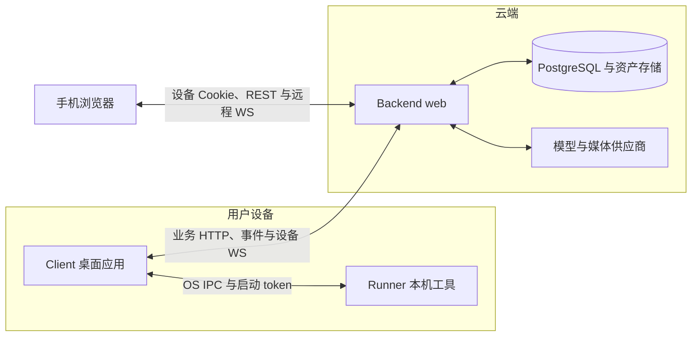

# 系统架构

本文维护模块职责、依赖方向、状态权威、部署与信任边界。按任务进入的阅读路由统一见 [AGENTS](../AGENTS.md)。

## 运行拓扑

- Backend 运行于 Linux Docker；Client、Runner、Installer 支持 Windows 与 macOS 原生运行。底层库的跨平台能力不等于产品平台支持。
- 主进程保管桌面身份、持有唯一聊天 WS 并桥接本机执行；所有渲染窗口通过受控 IPC 请求和订阅。Runner 不持后端凭据，模型调用由 Backend 执行。
- Client 提供窗口模式与 Windows、macOS 桌面模式，共用后台宿主和业务页面。窗口模式由主窗口、透明精灵与轻语承载；桌面模式在交互屏组合视频、系统桌面图标与透明界面。主进程通过统一宿主端口管理平台能力：Windows 独立 Rust helper 管理 Explorer 层级和底部预留，guardian 在异常时恢复系统界面；macOS 进程内 Node-API 模块设置窗口层级并通过辅助功能操作应用窗口，不修改系统工作区。界面行为归 [DESIGN](DESIGN.md#桌面模式)，原生边界分别归 [Windows 宿主](../client/desktop-windows/README.md)与 [macOS 模块](../client/desktop-macos/README.md)。
- 进程拆分隔离职责与凭据，不构成完整安全沙箱。

## 模块职责

| 模块 | 负责 | 不负责 |
|---|---|---|
| Backend | 对话编排、供应商调用、云端工具、角色与记忆、资产、调度及持久化 | 本机工具执行、桌面窗口与像素坐标 |
| Client | 桌面交互与渲染、登录凭据、本地设置、云端连接、Runner 生命周期及请求中转 | 云端业务状态的权威副本 |
| Remote | 手机浏览器交互与设备展示状态 | 桌面凭据、Runner 注册、本机执行和云端业务状态 |
| Runner | 本机终端、文件、浏览器等工具，报告实际能力 | 后端登录凭据、云端角色与会话状态 |

Installer 负责首次安装和环境修复；安装后的运行与更新由 Client 管理。安装载荷不包含完整离线运行环境，Python 与依赖准备仍需联网。

## 依赖方向

桌面 Client 与浏览器 Remote 独立构建，通过根 `shared/` 共用生成契约、HTTP 请求与 WS 协议核心；浏览器代码不依赖 Electron 桥或桌面运行时。

Backend 保持单进程的模块化单体，按账户、配置、会话、记忆、陪伴、外观、场景、动作、桌面生活、动态、日记、媒体、资产、自动化和更新组织业务。`entrypoints` 解析与鉴权，`workflows` 协调跨业务流程，`features` 拥有数据和规则，`runtime` 管理账户/连接运行态与任务，`infrastructure` 提供数据库、网络、供应商与文件处理；显式装配集中在 `bootstrap`。

跨模块只经公开操作、查询和事件协作，双向协调移入流程，反向通知通过明确装配的端口完成。ORM 归属、事务粒度与检查入口归 [Backend](../backend/README.md#模块依赖边界)。

[共享动作目录](../backend/features/action_library/README.md)拥有桌景自定义动作的定义、独立评审与目标调度意图，桌面生活拥有各套装素材、制作、采纳和播放。窗口模式使用衣柜当前穿着的静态全身图，程序管理移动及直接交互反馈；窗口模式不提供 AI 动作工具。

Runner 使用 `runner/spirit_agent_runner/` 平铺 Python 包，源码与安装版共用模块入口，入口和实现由一个 wheel 交付；[bootstrap](../runner/spirit_agent_runner/bootstrap.py) 是唯一组合根。运行时经工具定义调用能力，代码子调用使用注入的执行接口，文件能力通过执行能力的公开租约 API 访问环境。分层职责、依赖方向、资源所有权和验证入口归 [Runner](../runner/README.md#装配调用与资源)。

## 状态权威与副本

| 状态 | 权威来源 | 副本边界 |
|---|---|---|
| 角色、角色卡、会话、长期记忆、动态、日记 | Backend 数据库 | Client 与 Remote 展示和提交操作；不得用旧视图覆盖已提交数据 |
| 形象、外观、场景及激活关系 | Backend 数据库与资产存储 | Client 与 Remote 缓存字节和展示状态，缓存命中不改变激活关系 |
| 在途回合与会话互斥 | Backend 账户运行态 | 各连接独立持有重放与 ACK；Client 与 Remote 持恢复快照 |
| 共享动作定义、目标关联及排除状态 | Backend 共享动作目录表 | 两端展示共同名称与各版本真实进度，不将另一模式的成品视为本地可播 |
| 衣柜当前穿着与立绘 | Backend 衣柜表与资产存储 | Client 缓存图片并管理解码、alpha 命中与可见状态 |
| 桌景套装、制作草稿、当前成品与播放状态 | Backend 桌面生活表与资产存储 | Client 缓存图片、静音视频及播放回执，不决定套装、草稿或派生素材是否有效 |
| 可同步用户偏好 | Backend 配置 | Client 保存带用户归属的离线镜像；冲突按协议处理 |
| 激活凭据、本机连接和机密配置 | Client 主进程 | 仅向 Runner 提供执行所需配置，不向渲染层暴露凭据 |
| 窗口、位置、当前可见表面与账户视图快照 | Client 主进程 | 页面和会话草稿由视图维护并镜像到主进程，模式交接复核账户并等待目标恢复；Backend 不决定开窗、桌面坐标和窗口吸附 |
| 本机能力及执行结果 | Runner | Client 同步能力；Backend 注册表不是执行成功的证明 |
| 定时任务、陪伴意图、待投递事件 | Backend 数据库 | 在线、输入、锁屏等短期信号不作为持久事实 |
| 每日话题、已分享来源与反馈 | Backend 话题表 | 两端展示服务端绑定的来源快照；外部内容不独立证明用户事实 |

镜像、缓存和派生值必须可追溯权威来源；外观模块管理角色卡资料、分析和并发编辑，初始化流程协调跨业务资产衔接。媒体模块管理制作与句柄，消费模块分别管理气泡绑定、发布、采纳和播放。

## 跨模块数据流

### 通信选择

Backend 与 Client 通过 HTTP 受理全部业务操作，通过 WebSocket 交付实时事件、连接控制与设备指令。两端共用生成契约和 HTTP、连接恢复核心；Client 主进程持有凭据和连接，各窗口只提交类型化操作与订阅事件。Client 与 Runner 使用本地 OS IPC 承载 WebSocket 帧，由 Client 建立端点、Runner 主动连接。
本地 IPC 避免标准输出污染协议，也不暴露 TCP 监听端口；它仍需要端点权限和启动 token。

Remote 由 Backend 同源托管，使用独立设备身份、REST 与 WS；云端功能不依赖桌面在线，本机调用仍走 Client 与 Runner。身份与恢复规则见 [远程访问](PROTOCOL.md#远程访问)。

### 工具与表达

本机调用沿 `Backend → Client → Runner → Client → Backend` 返回；模型给出意图，各边界校验权限、能力和参数。Backend 产生语义，Client 决定可见表面、动画与位置；正文不是控制通道。调用身份、结果未知与恢复定义归 [PROTOCOL](PROTOCOL.md#本机工具)。

## 调度与异步交付

### 有界主动回合

数据库保存意图与等待条件，时间或情境满足且通过闸门后才启动受意图有效期约束的回合，等待期间不持续推理。普通自动化使用独立任务会话，主动陪伴复用陪伴主会话；夜间流水线只处理陪伴域。三者的交付与恢复统一见 [调度](PROTOCOL.md#调度)。

### 事件持久化

- 需共同生效的业务状态与异步通知在同一事务写入 outbox。
- 数据库通知只负责唤醒，持久化事件行负责恢复；聊天流另走会话 emitter。
- 共享业务通知交付同账户的在线端，桌面执行与主动回合指令仅由桌面接收。各连接独立 ACK，离线端重连后回源；过期主动回合请求例外清理。
- 认领成功或发送成功都不证明端到端恰好执行一次。

### 打扰档位与情境

Client 计算生效档位、可见性、锁屏与空闲信号；Backend 用新鲜信号执行闸门，不推测桌面状态。档位约束实时主动打扰，生活创作与夜间活动另有政策；具体作用范围由 [DESIGN](DESIGN.md#主动陪伴) 定义。

### 部署与运行时边界

Backend web 按单副本部署。WebSocket、运行时会话、工具等待表、用户锁、接口限流计数及连接重放均有进程内状态。

默认 Compose 在本机回环地址暴露 HTTP，可选 Caddy 服务提供公网 HTTPS；数据库、资产与更新包分别持久化。公网配置和模型服务部署操作归 [Backend](../backend/README.md#部署与排障)。
Cron 的数据库竞争认领和 outbox 持久化不代表整个 web 服务可水平扩展。增加副本或 worker 前，必须解决连接路由、回合互斥、调用关联、任务恢复和连接所有权；不能只修改容器数量。

## 身份、资产与记忆

### 角色与资产

角色卡绑定确认图，人设管理人格，衣柜管理造型，窗口场景管理环境；生成、激活和渲染分离。桌景拥有冻结资料、目标尺寸、制作草稿与当前成品，不随窗口场景或衣柜变化。同着装且原始视觉来源一致的 AI 桌景共享自定义动作语义，各套装分别制作和读取生效资源；参考职责见 [PIPELINE](PIPELINE.md#身份造型与参考输入)，跨模式资格见 [PROTOCOL](PROTOCOL.md#桌面生活视频与模式隔离)。

### 表达归属

正文用于阅读与朗读，语音元数据用于演绎，心情用于身份区，视觉表达用于动画，空间决策用于移动意图。任何一条通道的失败都不能伪造另一条通道的成功。

### 记忆与叙事

长期记忆及模型可读派生事实按预设隔离，同预设跨会话共享。作用域、异步继承与访问证据规则归 [PROTOCOL](PROTOCOL.md#预设记忆与学习作用域)。

检索事实与生活叙事分离，伙伴自身记录不能独立证明用户事实。时区、语言与渲染资产可按用户共享，陪伴人格、关系、情绪与日记仅用于陪伴。

## 信任边界与安全

- Backend 保管供应商凭据并校验资源归属，不执行模型生成代码或为其启动执行容器；Client 主进程保管桌面登录凭据，Runner 只持本地准入 token 与执行所需配置。
- 渲染桥和工具入口独立校验权限，提示词不能替代准入。Runner 不是任意代码安全沙箱；路径与网络检查只降低风险，文件、截图和工具结果可能进入云端上下文。
- 更新、配置、保留参数与备份边界见 [安全契约](PROTOCOL.md#安全更新与备份)。

## 模块入口

[Backend](../backend/README.md) · [Remote](../remote/README.md) · [Client](../client/README.md) · [Runner](../runner/README.md) · [Installer](../installer/README.md) · [Scripts](../scripts/README.md)
