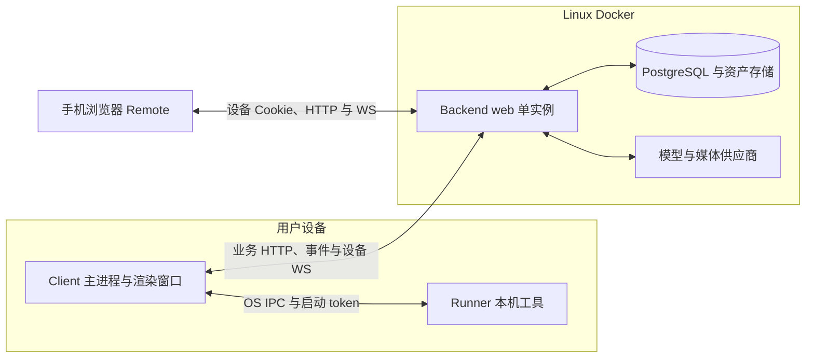

# 系统架构

本文定义进程职责、依赖方向、状态权威与信任边界。产品取舍见 [DESIGN](DESIGN.md#设计目标)，任务导航见 [AGENTS](../AGENTS.md)，通信和恢复语义见 [PROTOCOL](PROTOCOL.md)。

## 运行拓扑

Backend 部署于 Linux Docker；Client、Runner、Installer 支持 Windows 与 macOS。库本身支持的平台不等于产品支持。安装器负责首装和环境修复，安装后的运行与更新归 Client；Python 与依赖准备仍需联网。

Client 主进程持有桌面身份与唯一云端 WS，渲染窗口经受控 IPC 请求和订阅。Runner 只执行本机能力，不持后端凭据；模型调用在 Backend。进程拆分隔离职责和凭据，不构成任意代码安全沙箱。

## 模块职责

| 模块 | 拥有的职责 | 边界 |
|---|---|---|
| Backend | 生活决策与执行、对话、角色、记忆、供应商调用、资产、调度和持久化 | 不操作桌面坐标，不执行模型生成代码 |
| Client | 桌面身份、本地设置、窗口和呈现、云端连接、Runner 生命周期与调用中转 | 展示和镜像云端状态，不成为其权威副本 |
| Remote | 浏览器设备身份、账户内容交互与页面状态 | 不持桌面凭据，不注册本机能力或报告桌面活动 |
| Runner | 终端、文件、浏览器等本机工具及真实能力清单 | 不管理云端角色、会话与账户凭据 |

## 依赖方向

Backend 是单进程模块化单体：`entrypoints` 解析和鉴权，`workflows` 协调跨业务流程，`features` 拥有数据和规则，`runtime` 管理运行态、连接和任务，`infrastructure` 提供数据库、网络、供应商和文件处理，`bootstrap` 显式装配。跨业务经公开操作、查询 DTO 和事件协作；双向协调放入 workflow，反向通知通过装配端口。ORM 与事务边界见 [Backend](../backend/README.md#模块依赖边界)。

Client 与 Remote 独立构建，经根 `shared/` 复用生成契约、HTTP 与连接恢复核心。浏览器代码不依赖 Electron、桌面 store 或 IPC；Client 主进程不导入依赖窗口环境的渲染层代码。

Runner 的源码和安装版共用一个 Python 包及 wheel，[bootstrap](../runner/spirit_agent_runner/bootstrap.py) 是组合根。运行时通过工具定义调用能力，代码子调用复用注入的执行入口；资源归属与允许依赖见 [Runner](../runner/README.md#装配调用与资源)。

## 状态权威与副本

| 状态 | 权威与副本边界 |
|---|---|
| 角色、会话、长期记忆、偏好和话题 | Backend 数据库；两端展示或提交修改，缓存不得覆盖较新已提交值 |
| 生活状态、事项、步骤与事实事件 | 生活领域及关联业务成果；记忆是可重建投影，浏览和播放不推进生活事实 |
| 造型、环境、动作定义与成品版本 | 所属业务及资产引用；定义、素材、制作、采纳和显示各自独立 |
| 制作控制与供应商尝试 | 共享 jobs 与业务详情、独立远端尝试；本地删除或取消不证明远端结束 |
| 呈现与播放 | 影像领域的具体版本、冻结素材与回执；客户端缓存字节不证明显示成功 |
| 动态、日记、评论与附件 | entries 保存内容，posts/journal 管理创作政策；日记记忆索引不成为第二份正文 |
| 在途回合、工具等待及连接 | Backend 账户运行态；连接独立持有重放和 ACK，持久请求账本承接受理身份 |
| 激活凭据、窗口、位置与当前表面 | Client 主进程；视图按账户镜像草稿及阅读位置，Backend 不决定开窗和坐标 |
| 本机能力与执行结果 | Runner；Client 同步清单，Backend 注册表不证明执行成功 |
| 定时任务、陪伴意图与待投递事件 | Backend 数据库；在线、锁屏、空闲等信号仅作为新鲜运行条件 |

模型资料、冻结快照、缓存与派生索引都须追溯上述来源。物理关系和删除理由见 [DATABASE](DATABASE.md)，字段入口见 [DATABASE_FIELDS](DATABASE_FIELDS.md)。

## 跨模块数据流

### 生活决策与执行

生活判断读取 `LifeContext`、人格、记忆与结果证据，保存生活变化和类型化下一步；执行工作流在时间、事项状态、权限和额度检查后调用已有业务能力。实际成果与步骤在采纳事务内结算，事件唤醒复查并投影到伙伴记忆。聊天、动态和日记按各自任务消费这些资料。

生活与呈现分别存储：呈现工作流只选择已有相符画面或静态素材，显示回执不证明阅读、创作或事项完成。接口与恢复见 [生活契约](PROTOCOL.md#生活状态与生活事件)，实现入口见 [生活领域](../backend/features/life/README.md)。

### 通信选择

业务操作统一使用 HTTP，事件、连接控制和设备指令使用 WS；HTTP 不依赖 WS 在线。本地 OS IPC 承载 Client/Runner 的 WebSocket 帧，避免标准输出污染和额外 TCP 端口，仍须端点权限及启动 token。

Remote 由 Backend 同源托管，使用独立设备身份；云端功能不依赖桌面在线，本机步骤仍通过 Client/Runner。身份和会话恢复分别见 [通信契约](PROTOCOL.md#通信与连接身份)与[远程访问](PROTOCOL.md#远程访问)。

### 工具与表达

本机调用沿 `Backend → Client → Runner → Client → Backend` 返回；各边界校验身份、参数和能力。Backend 生成语义，Client 决定表面、动画及位置，聊天正文不承担控制指令。业务调用身份、未知结果和取消见 [本机工具](PROTOCOL.md#本机工具)。

## 调度与异步交付

### 有界主动回合

陪伴意图保存目的和等待条件，满足条件且通过在线、档位等闸门才进入陪伴主会话；等待不持续推理。普通自动化使用独立任务会话，夜间处理陪伴域。三者的交接、期限和副作用恢复见 [调度](PROTOCOL.md#调度)。

### 事件持久化

需共同生效的状态与通知在同一事务写 outbox，数据库通知只负责唤醒，事件行负责恢复；聊天流另由会话 emitter 交付。同账户各连接独立 ACK，设备指令只交桌面。认领、发送和 ACK 均不保证端到端副作用恰好一次，具体水位与回源规则见 [序号与恢复](PROTOCOL.md#序号与恢复)。

### 打扰档位与情境

Client 计算档位、表面可见性、锁屏与空闲；Backend 只用新鲜信号判断实时主动资格。生活执行、动态、素材添置和夜间各有政策，作用范围见 [DESIGN](DESIGN.md#主动陪伴)。

### 部署与运行时边界

Backend web 只支持单副本：会话、工具等待、用户锁、接口限流与连接重放均含进程内状态。Cron 竞争认领和 outbox 持久化不能单独支持水平扩展；增加副本前须解决连接路由、回合互斥、调用关联和恢复所有权。

默认 Compose 通过宿主 `10620` 提供 HTTP/WS，数据库、资产与更新包分别持久化。独立更新器只负责 `backend` 代码拉取、构建和重启；自身、采集服务及拓扑变化仍手工升级。部署与操作见 [Backend](../backend/README.md#部署与排障)。

## 身份、资产与记忆

### 角色与资产

人格、确认身份、造型、环境和动作定义分别归属；动作不绑定某份成品。影像版本冻结组合和文件引用，源素材修改或删除不改写已发生的画面，重做须成功采纳才切换版本。参考分工见 [PIPELINE](PIPELINE.md#身份造型与参考输入)，呈现资格见 [PROTOCOL](PROTOCOL.md#影像成品与模式隔离)。

### 表达归属

正文供阅读与朗读，语音元数据供演绎，心情更新身份区，影像指令走独立通道；位置由 Client 的拖拽、归位和几何恢复处理。任何通道失败都不能伪造另一通道成功。

### 记忆与叙事

即时历史按会话保存，长期资料按账户和预设隔离；伙伴自身叙事不证明用户事实。共享语言、时区和渲染资产不扩大人格、关系、情绪和日记的使用范围，规则见 [记忆作用域](PROTOCOL.md#预设记忆与学习作用域)。

## 信任边界与安全

Backend 保管供应商及资讯来源凭据并校验资源归属；Client 主进程保管桌面凭据，Runner 只取得执行所需配置。本机工具以用户权限操作，文件、截图和结果可能进入云端模型，提示词和进程拆分不能替代授权、路径或网络检查。

更新器持 Docker socket、仓库写权限及只读部署密钥，只接受经共享 Unix socket 转发的管理员请求；它不参与业务流量，也不绕过 fast-forward 和本地修改保护。凭据落盘、更新验签和备份边界统一见 [安全契约](PROTOCOL.md#安全更新与备份)。

## 模块入口

[Backend](../backend/README.md) · [Remote](../remote/README.md) · [Client](../client/README.md) · [Runner](../runner/README.md) · [Installer](../installer/README.md) · [Scripts](../scripts/README.md)
