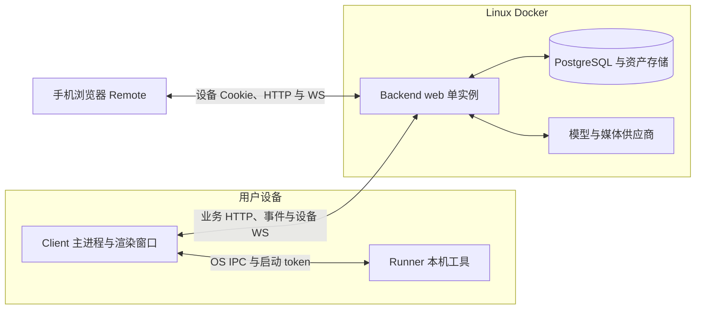
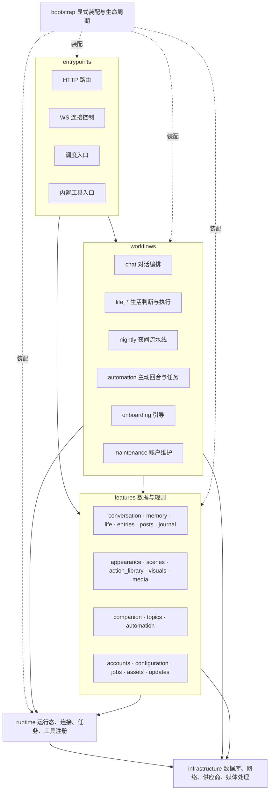
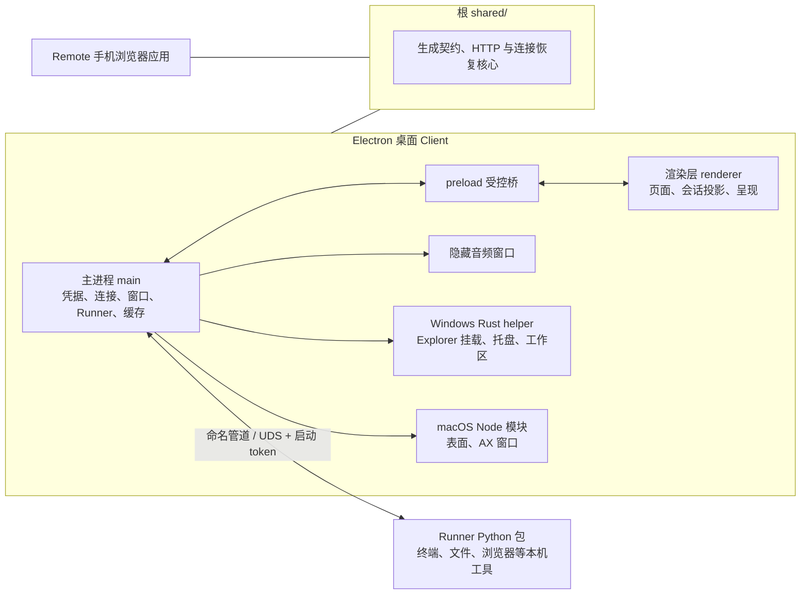
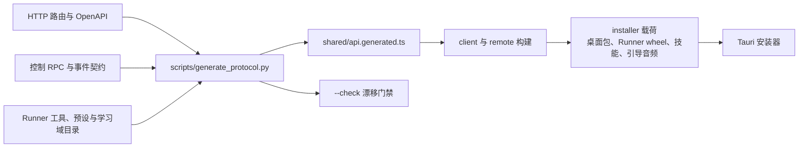
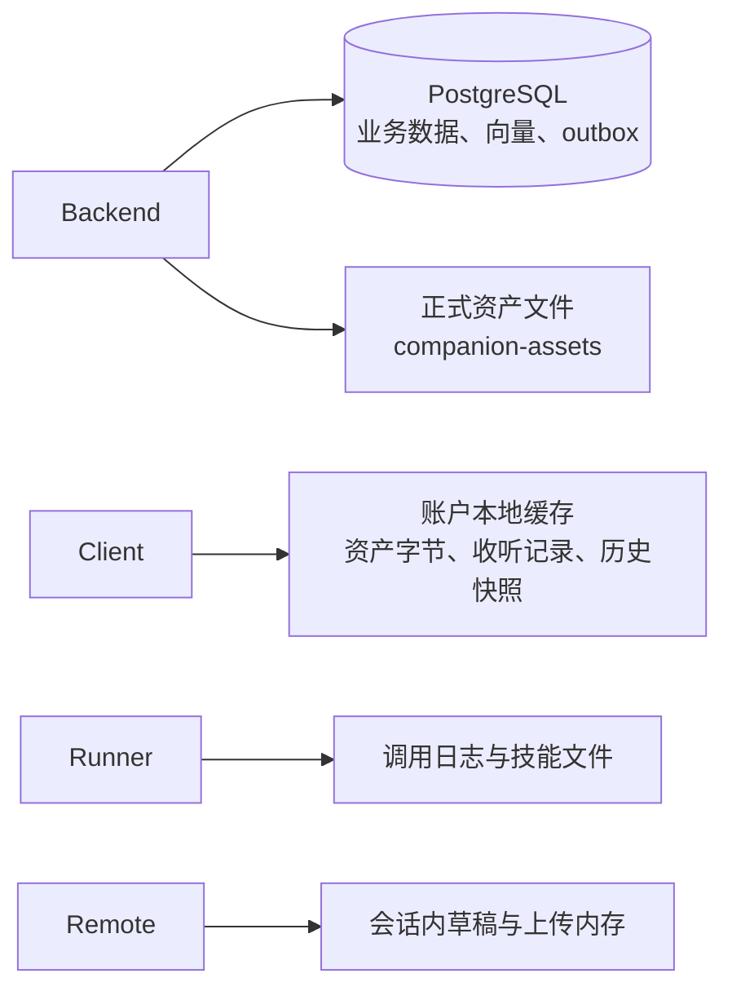
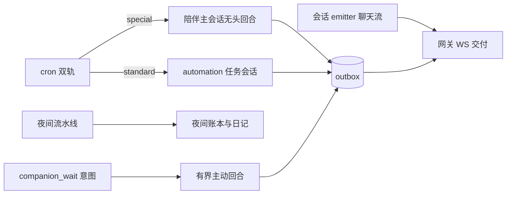
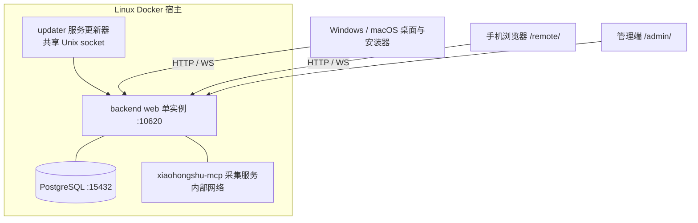

# 项目架构图谱

本页用图示展示系统拓扑、模块分层、构建装配与部署形态；各图只呈现结构关系，语义、约束与契约以链接的目标文档为准。进程职责与状态权威见 [ARCHITECTURE](ARCHITECTURE.md)，数据关系见 [DATABASE](DATABASE.md)，生成链见 [PIPELINE](PIPELINE.md)。

## 系统运行拓扑

进程职责、状态权威与信任边界见 [ARCHITECTURE](ARCHITECTURE.md)。

## 后端分层与模块

依赖方向与边界检查见 [ARCHITECTURE](ARCHITECTURE.md#依赖方向) 与 [Backend](../backend/README.md#模块依赖边界)；各业务模块入口见 [Backend 任务入口](../backend/README.md#任务入口)。

## 客户端、Remote 与 Runner

主进程准入与资源生命周期见 [client/main](../client/main/README.md)，渲染层分层见 [client/renderer](../client/renderer/README.md)，工具装配见 [Runner](../runner/README.md)，跨端身份与恢复见 [本机工具](PROTOCOL.md#本机工具)。

## 契约生成与交付构建

跨端映射与调用语义见 [通信契约](PROTOCOL.md#通道分工)，构建与发布命令见 [Scripts](../scripts/README.md)。

## 数据与状态存储

实体关系与删除语义见 [DATABASE](DATABASE.md)，字段归属见 [DATABASE_FIELDS](DATABASE_FIELDS.md)，缓存边界见 [资产访问与缓存](PROTOCOL.md#资产访问与缓存)。

## 调度与事件交付

档位闸门与交接规则见 [调度](PROTOCOL.md#调度)，事件路由与恢复见 [事件路由](PROTOCOL.md#事件路由)与[序号与恢复](PROTOCOL.md#序号与恢复)。

## 部署形态

单副本边界、端口与运维见 [部署与运行时边界](ARCHITECTURE.md#部署与运行时边界) 与 [Backend 部署](../backend/README.md#部署与排障)。
