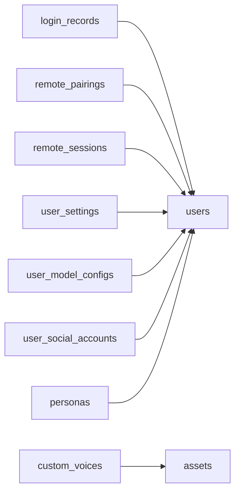
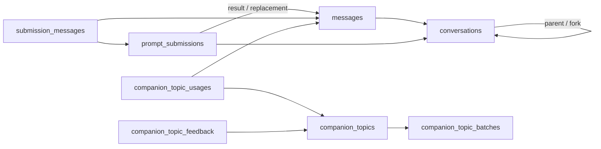
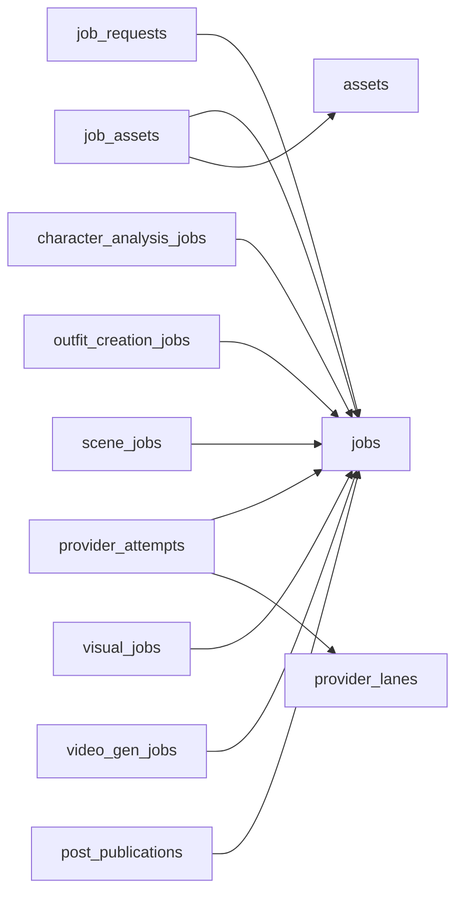
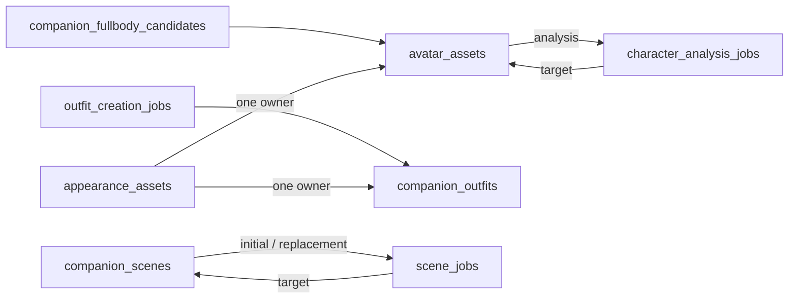
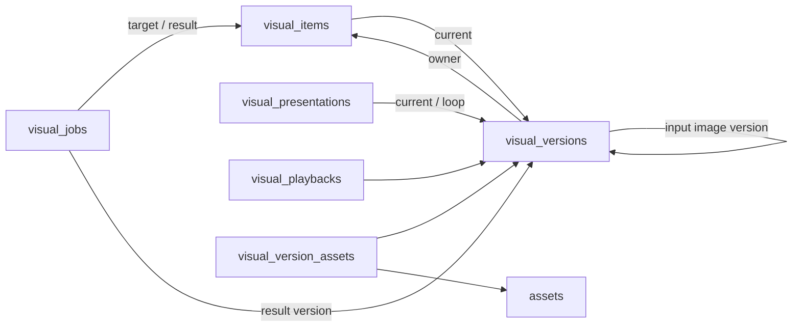
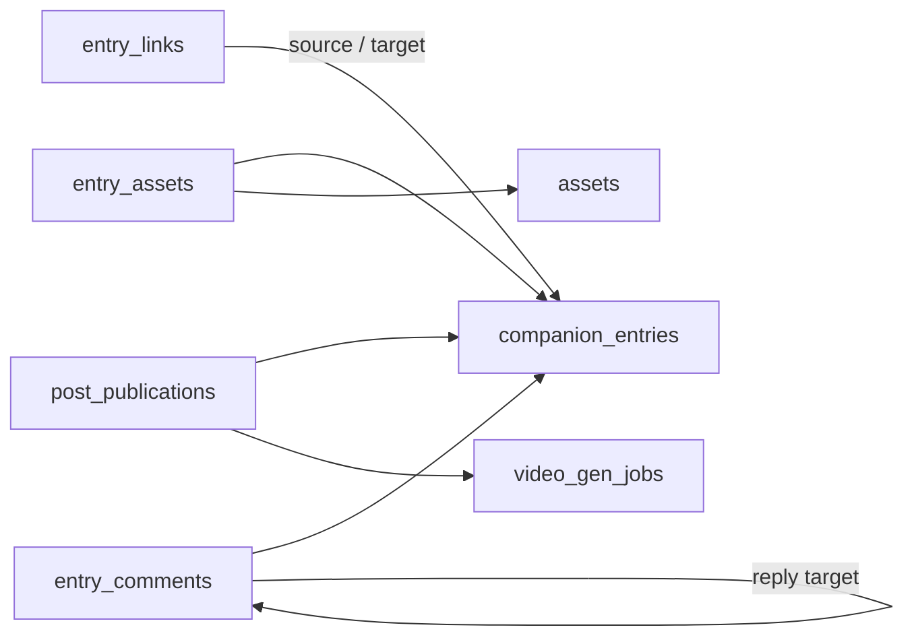
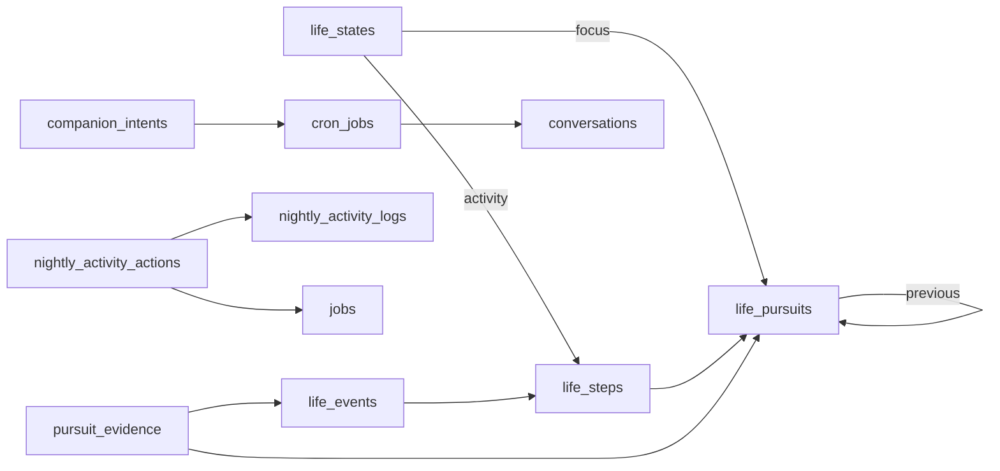
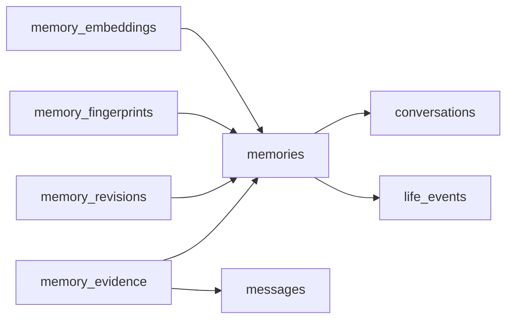

# 数据库设计与关系图

本文解释实体拆分、关系约束、删除与查询设计。字段定位见 [DATABASE_FIELDS](DATABASE_FIELDS.md)，完整结构以 [ORM 注册](../backend/bootstrap/models.py)和 [0001 基线](../backend/alembic/versions/0001_baseline.py)为准。跨模块行为和备份格式由 [PROTOCOL](PROTOCOL.md)定义。

数据库使用 PostgreSQL、`vector` 和 `pg_trgm`；部署版本与单实例条件见 [Backend](../backend/README.md#docker-compose-部署)及[运行时边界](ARCHITECTURE.md#部署与运行时边界)。下图只保留解释所有权、循环或恢复所需的关系，箭头由引用方向指向目标，省略重复用户外键和普通文件关联；不是第二份完整 schema。

## 共同约束

- 活关系用外键或关联表；冗余账户字段经 [schema.py](../backend/infrastructure/schema.py)展开联合外键，预设仍由业务读写校验。稳定命名供 Alembic 比对。
- 归属、状态与筛选条件使用明确列，可变输入和冻结文档使用业务校验的 JSONB。实体主键、`source_key` 和请求幂等键各有用途，见[公共字段](DATABASE_FIELDS.md#公共字段与关系入口)。
- 一个用例在短事务内提交状态、关系、资产引用及 outbox；模型和供应商等待在事务外。领域锁管理普通并发，账户维护隔离整体删除和恢复。

## 账户、配置与分发

桌面登录、手机授权和管理员会话有不同撤销范围。用户普通设置、模型配置、资讯来源凭证分开，避免普通同步暴露机密；扫码登录修订与在用凭证修订各自隔离迟到结果。人格只管理定义和政策，生活及实际呈现另有权威状态。系统参数、管理员会话和更新版本是全局记录，不借产品账户归属授权。

## 会话、消息与话题

会话拥有上下文边界，消息拥有原文与交付快照，受理账本拥有请求身份和结果关系；整批输入与关联一起提交，断线后可查询原请求。依附子会话随父删除，独立分叉只失去来源指针。

消息文件和本地声音版本用关系表保护，回收不扫描正文 JSON 猜引用。会话统计由[语句级触发器](../backend/features/conversation/statistics.py)批量维护，预设或父会话改变时重算；计数更新不改变活动时间，恢复从消息重建。话题资料、实际分享和显式反馈独立，选材不代表分享。

## 任务、供应商尝试与资产

任务详情复用 `jobs` 主键。共享父表只管理执行控制，业务详情管理输入、目标和采纳；请求身份与制作身份分离，允许多个请求复用在途工作，也允许后续新请求制作相同组合。任务种类须匹配唯一详情。

供应商尝试独立保存远端占用和未知事实，本地取消或删除不能证明其结束。资产库存保存文件属性与回收待办，领域外键和多文件关联保护引用；路径快照不代替活关系。采纳与回收共用资产行锁，落盘到引用提交之间由写入租约保护，锁顺序与补偿见 [资产模块](../backend/features/assets/README.md)。

## 身份、衣柜、环境与动作

确认身份统一管理自动特征、人工覆盖和修订，候选/分析失败不撤销已发布身份。衣柜、环境和动作是可复用定义，各自与制作过程分离；新制作失败保留当前素材。环境保存上传源和展示图，不保存“启用环境”；实际显示由呈现领域记录。

## 影像与不可变版本

稳定成品与不可变版本分开，成功重做才切当前指针。呈现、播放、输入图及制作结果引用实际版本，源素材修改或删除不改写已发生画面；静态呈现另保存待显示/已显示快照及受保护素材引用。

成品/版本成对外键校验版本所属成品，不能仅凭同账户交换引用；循环指针允许分阶段写入，提交时须完整。图片内容去重与请求幂等分别处理，旧版本按活引用回收，不按年龄直接删除。

## 动态、日记与评论

动态和日记共享正文、阅读状态与附件，因此使用内容实体；创作与发布政策仍由 posts/journal 拥有。日记日期唯一性、来源动态与评论回复通过关系校验。列表只读取评论数量，正文独立分页；日记记忆索引可从正文重建。

## 生活、夜间与调度

当前生活、持续事项、执行步骤和事实事件分开；结果外键及完成证据连接实际成果。阅读成果长期保留，不放入临时检查点。`life_action_admissions` 独立保存请求额度和提交事实，防止覆盖恢复重置额度或重投；删除结果指针不抹掉已发生事实。

夜间账本按本地业务日保存阶段与实际动作。Cron 管计划，陪伴意图管有界等待和回合，在线信号不成为长期事实。行为和恢复分别见 [生活](PROTOCOL.md#生活状态与生活事件)及[调度](PROTOCOL.md#调度)。

## 记忆、证据与向量

当前内容、原始证据、修订、遗忘指纹和向量独立，列表只读摘要，详情按需加载。分类/槽位是业务字段，展示话题不承担类型判定。遗忘清除内容和摘录，抑制指纹继续阻止从同一证据重学。

向量可重建：先限定账户、预设、模型、实际维度和内容版本，再精确排序；当前规模不维护近似索引。正文与补向量分别提交，索引失败不撤销正文，语义依据见 [记忆模块](../backend/features/memory/README.md)。

## 必要历史

| 对象 | 保留理由与边界 | 权威入口 |
|---|---|---|
| 终态任务 | 明确终态且清理完成后，检查点/临时引用七天、诊断九十天；保留请求身份、终态与必要结果以维持幂等，未知和未清理工作不按期限压缩 | [jobs/service.py](../backend/features/jobs/service.py) |
| 影像版本与播放 | 当前或仍引用的版本持续保护；已结束播放七天后释放占用，再回收无引用版本 | [visuals/asset_references.py](../backend/features/visuals/asset_references.py) |
| 记忆修订与指纹 | 修订保留最近二十次；明确遗忘清除正文、摘录和修订，指纹可失去原记录仍保留抑制作用 | [records.py](../backend/features/memory/records.py)、[memory_store.py](../backend/features/memory/memory_store.py) |

## 删除与恢复

| 关系 | 删除后必须保持 |
|---|---|
| 账户 → 所属数据 | 先进入维护态并收敛任务/文件；不可把远端未知当作未执行 |
| 会话 → 消息；内容 → 评论/附件/引用 | 依附数据级联，保留的评论回复先解除被删目标 |
| 源素材 → 冻结版本；事项/步骤 → 事实 | 可解除来源和结果指针，冻结内容及事实保留 |
| 资产、声音版本 → 活引用 | 有引用时限制删除，关系释放与文件回收分阶段执行 |
| 任务 → 远端尝试 | 可解除本地关系，远端占用独立核对 |
| 记忆 → 依附索引 | 证据、修订和向量随正文清理，遗忘指纹可继续保留 |

导入按依赖排序写入：任务详情复用父任务新主键，循环关系先写可空指针再连接；复合外键仅重映射目标主键分量，归属和配对仍须校验。最小终态任务用于请求幂等，不代表仍有可执行详情。

空库操作见 [配置与迁移](../backend/README.md#配置与迁移)，备份选择、文件校验、覆盖范围和未知结果统一见 [备份契约](PROTOCOL.md#备份校验与覆盖恢复)。

## 查询设计与验证记录

列表采用稳定游标和明确投影，关联批量读取，精确总数按需查询。索引服务消息顺序、用户预览、内容时间线、任务恢复、生活事件和记忆作用域；不把全部子对象装入无界联合结果。

以下是 **2026-10-25 隔离本机 PostgreSQL** 的测量，SQL 次数包含业务校验与 outbox，排除事务控制、鉴权和外部等待；延迟不含网络、供应商与客户端呈现，不是线上 SLA。未测量的格以“—”表示。

| 用例 / 样本 | SQL 次数 | P50 | P95 |
|---|---:|---:|---:|
| 文本／带媒体动态列表，含未读和评论数量 | 1 / 2 | — | — |
| 带媒体动态详情与首批评论 | 3 | — | — |
| 待核对发布任务页，含视频状态 | 最多 2 | — | — |
| 文本／图片与旁白发布，含完整事实及 outbox | 9 / 10 | — | — |
| 完整历史分页，100,001 条消息 | 2 | — | 10.39 ms |
| 会话列表，单会话 100,000 消息 | 1 | 2.50 ms | 2.99 ms |
| 会话列表，1,000 会话共 100,000 消息 | 1 | 3.66 ms | 4.06 ms |
| 会话列表，100,000 条纯助手消息 | 1 | 2.38 ms | 2.78 ms |
| 生活上下文 | 3 | — | — |
| 影像列表，1,000 份成品／版本、每页 30 条 | 默认 1；含总数 2 | 2.63 ms | 4.52 ms |
| 制作任务列表／可播放目录 | 各 1 | — | — |
| 新影像／活跃影像重做采纳，含完整事实及 outbox | 9 / 10 | — | — |
| 记忆列表 | 2 | 8.46 ms | 10.64 ms |
| 记忆详情 | 3 | 7.32 ms | 9.11 ms |
| 作用域内精确向量检索 | — | 15.27 ms | 20.28 ms |

会话与记忆延迟取预热后的 25 次查询，影像取 20 次。会话列表的计划只读取页内预览索引：集中样本一行、分散样本每个候选一行、纯助手样本零行，不再扫描正文统计。记忆样本为 20 账户共 40,000 条，被测作用域有 2,000 条记忆及等量 1536 维向量；这是测试配置，不是存储维度限制。影像计时包含 DTO 构造。发布的媒体已在生成进度中登记，采纳仍锁定资产并核对文件；首次建立生活状态也在发布预算内。

隔离验收覆盖空库升级／重建、ORM 比对、部分索引、会话统计触发器、outbox 提交／回滚唤醒，以及跨账户拒绝、大 ID、并发受理、循环关系、备份重复导入、遗忘和资产回收竞争。恢复后统计从消息重建，声音版本仍受引用保护。镜像空库启动、健康接口、Remote、管理端及 OpenAPI 已验证；真实供应商质量、桌面呈现和部署负载须分别验收。
