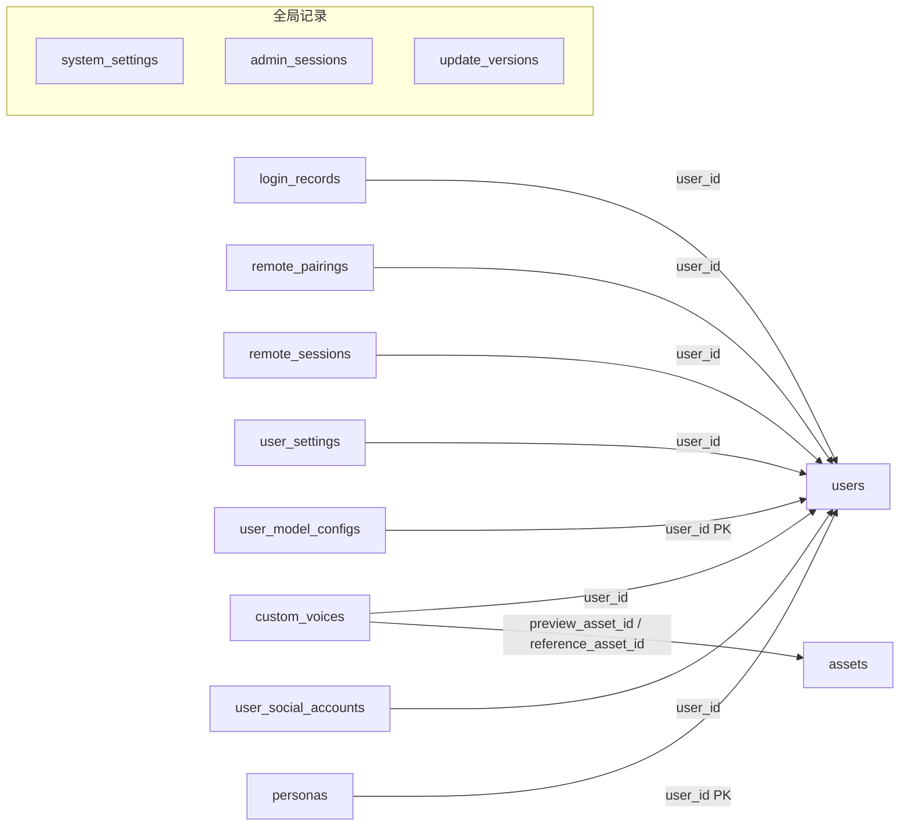
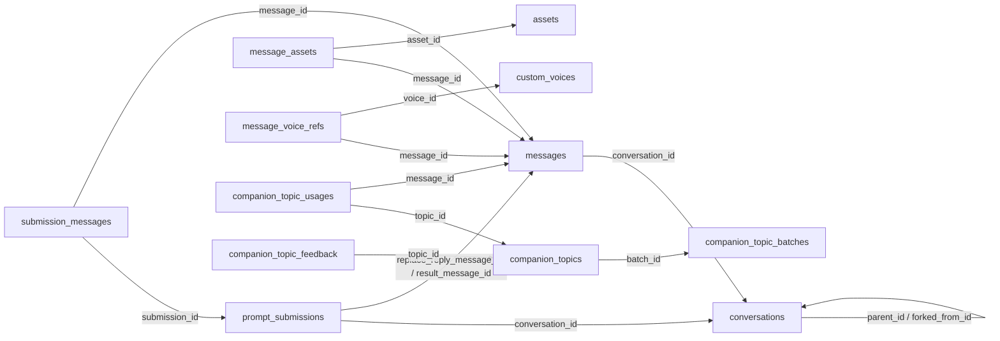
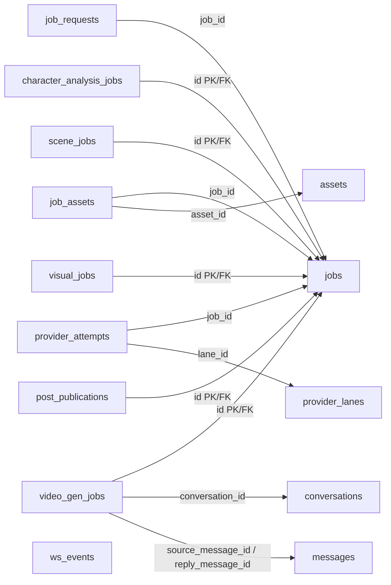
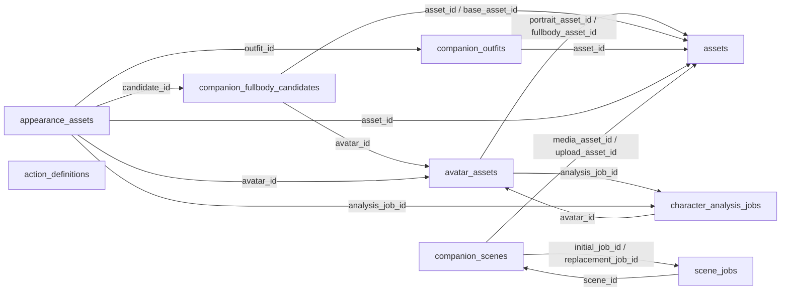
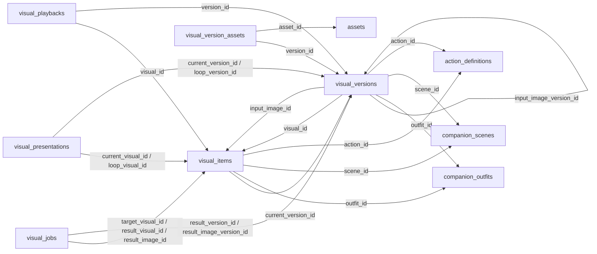
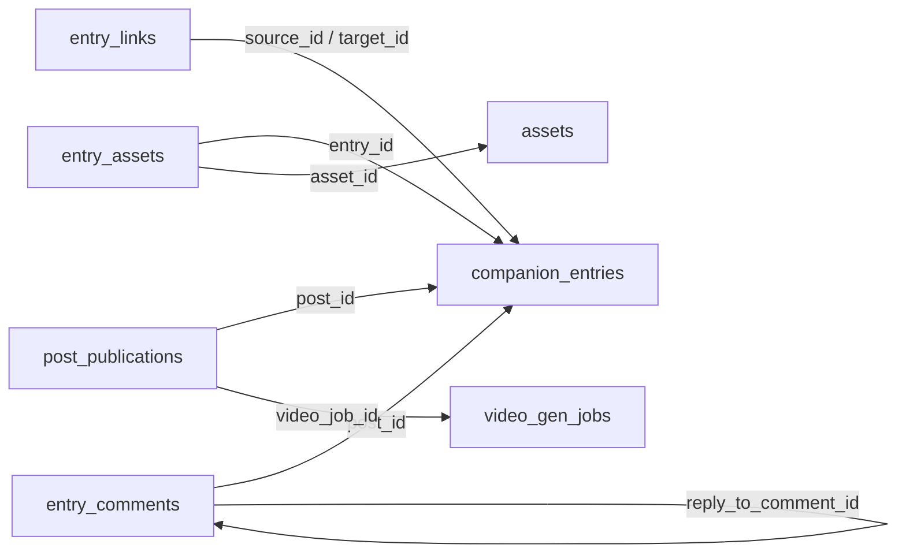
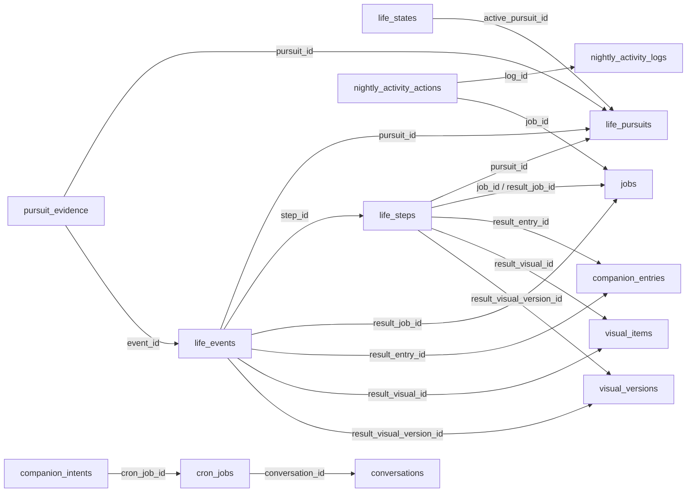
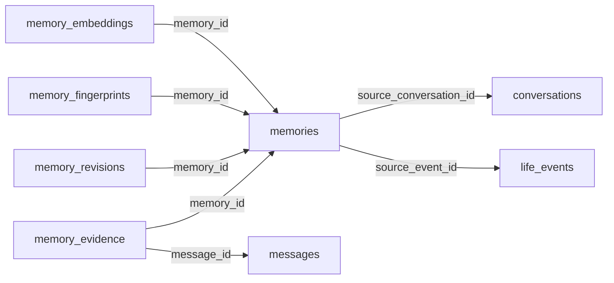

# 数据库设计与关系图

本文维护实体边界、设计理由、关键删除语义和查询测量。字段含义与权威源码入口见 [字段语义字典](DATABASE_FIELDS.md)，完整结构以 [ORM 注册](../backend/bootstrap/models.py)和 [0001 基线](../backend/alembic/versions/0001_baseline.py)为准。产品行为归 [DESIGN](DESIGN.md)，跨端与恢复契约归 [PROTOCOL](PROTOCOL.md)。

数据库使用 PostgreSQL、`vector` 与 `pg_trgm`，当前有 **63 张应用表**，不含 Alembic 版本表。设计面向单账户单伙伴和小范围使用；后端单实例边界见 [ARCHITECTURE](ARCHITECTURE.md#部署与运行时边界)。

## 共同约束

- 实体 ID、可移植身份、任务详情和一对一用户扩展有不同用途，统一入口见 [公共字段字典](DATABASE_FIELDS.md#公共字段与关系入口)；API 编码遵循 [ID 语义](PROTOCOL.md#id-语义)。
- 活关系使用外键或关联表；冗余账户字段通过联合外键校验。预设隔离仍在业务读写边界核对。归属约束由 [schema.py](../backend/infrastructure/schema.py)统一装配。
- 归属、状态和常用筛选字段使用明确列，变化较多的参数和冻结文档使用经过业务校验的 JSONB。时间戳带时区，业务日期按用户时区计算。
- 一个业务用例使用短事务，同步提交状态、关系、资产引用及 outbox；供应商等待在事务外。普通写入锁相关领域，账户维护负责整体隔离。模块所有权和共享任务例外归 [Backend](../backend/README.md#模块依赖边界)。

图中箭头由引用表指向被引用表，标签为关联字段；跨图同名节点代表同一张表，省略重复的用户外键。任务详情的主键同时引用 `jobs`。

## 账户、配置与分发

登录、设备授权和管理员身份有不同的撤销范围，因此分别建模。用户配置按键保存结构化值，模型配置与资讯来源凭证独立，后两者不进入普通设置同步。资讯来源按账户与平台唯一，凭证修订保护采集与迟到结果，独立登录修订允许扫码期间继续使用原凭证；系统运营参数的编码与水合见[配置字段字典](DATABASE_FIELDS.md#账户配置与设备身份)。伙伴定义只管理人格和政策，生活与实际呈现各有独立状态。

## 会话、消息与话题

会话保存归属和上下文边界，消息保存原文及交付快照，请求账本保存受理身份和结果关系；批量输入与关联一次提交，连接中断不要求重新执行。依附子会话随父删除，分叉只保留可失去的来源指针。

文件和本地声音版本通过关联表保护，回收不扫描消息 JSON 推断引用。会话统计由 [语句级触发器](../backend/features/conversation/statistics.py)按批增减；预设或父会话改变时重算，计数更新不改变活动时间。统计不进备份，恢复消息即可重建。话题批次、来源、实际分享和反馈独立保存；选材不等于分享，外部内容不等于用户事实。

## 任务、供应商尝试与资产

共享任务保存通用执行控制，业务详情保存专有输入、目标和结果。执行与采纳分离，允许调整阶段和供应商参数而不为每个流程复制任务状态；具体恢复条件仍由业务所有者决定。请求身份与制作身份分开，使多个请求能复用在途工作，又不阻止新请求再次制作同一组合。

供应商尝试与本地任务分别保存：本地取消或删除不能证明远端已经结束，未知提交必须保留核对依据。资产集中登记文件属性与回收状态，固定引用用外键，多文件用领域关联表；展示路径和冻结快照不能替代活引用。采纳与回收共用资产行锁，尚未交接的文件另受写入租约保护；具体锁顺序和失败重试见 [资产模块](../backend/features/assets/README.md)。

## 身份、衣柜、环境与动作

确认形象合并自动特征、人工覆盖及统一修订，避免头像与角色资料各自变化。分析任务和待采纳候选独立，分析失败不撤销已发布身份。衣柜、环境和动作各自是可复用实体，不按组合复制定义；当前素材与制作过程分开，新制作失败继续使用已采纳结果。

## 影像与不可变版本

稳定成品身份与不可变产物分开，重做成功后才原子切换当前版本。呈现、播放、输入图和制作结果均引用实际版本，源素材改变或删除不会改写已发生的画面事实。

成品／版本联合外键还校验版本所属成品，不能只凭同账户互换引用；循环指针允许分阶段写入，提交时必须完整。图片内容去重和请求幂等分开处理。历史版本是否可回收取决于当前、呈现、播放及任务引用，不能只看版本年龄。

## 动态、日记与评论

动态与日记共享正文、发布时间、阅读状态和附件，因此合并为内容实体；创作与发布政策仍分别归 posts、journal。日记日期唯一性、来源动态和评论回复用明确约束表达。内容列表只读评论数量，评论独立分页；日记记忆索引从已发布正文重建，不成为第二份内容权威。

## 生活、夜间与调度

当前生活、持续事项、执行步骤和事实事件分别保存。步骤连接真实任务，结果和完成证据使用实体关系；计划、受理和当前桌面画面都不能替代完成证据。删除任务或成品只解除结果指针，不抹掉已发生事实。

夜间日志按本地业务日期组织，动作关联实际任务以支持恢复核对。Cron 与陪伴意图分别管理计划调度和有界主动回合；短期在线信号不是长期生活事实。行为边界见 [生活契约](PROTOCOL.md#生活状态与生活事件)和[调度契约](PROTOCOL.md#调度)。

## 记忆、证据与向量

当前内容、原始证据、修订、遗忘指纹和向量分开，管理列表只读摘要，详情按需加载。分类、槽位和来源显式存储，展示话题不承担业务类型判定。

向量是可重建索引，查询先限定账户／预设、模型、实际维度和内容版本，再作精确排序；当前规模采用作用域内精确检索，不维护近似索引。正文与补向量分别提交，补齐失败不撤销正文。遗忘清除内容和摘录，保留抑制指纹以阻止从相同证据重学；证据与维护规则见 [记忆模块](../backend/features/memory/README.md)。

## 必要历史

| 对象 | 保留边界与原因 | 实现入口 |
|---|---|---|
| 已知终态任务 | 完整检查点及临时引用默认保留七天，详细诊断保留九十天；请求身份、终态和必要结果继续维持幂等。未知提交及未完成清理不按期限压缩 | [jobs](../backend/features/jobs/service.py)与各业务清理入口 |
| 影像版本与播放 | 当前或仍被使用的版本持续保留；已结束播放记录七天后释放版本占用，再回收无引用版本 | [visuals](../backend/features/visuals/service.py) |
| 记忆修订 | 保留最近二十次；明确遗忘清除正文、摘录与修订 | [memory](../backend/features/memory/models.py)、[records](../backend/features/memory/records.py) |
| 遗忘指纹 | 可失去原记忆指针，仍保留防止旧证据重学所需的抑制身份 | [memory_store](../backend/features/memory/memory_store.py) |

## 删除与恢复

| 关系 | 删除语义 |
|---|---|
| 账户内记录 | 账户维护先收敛任务并处理文件，再清除所属记录 |
| 会话 → 消息、内容 → 评论／附件／引用 | 依附数据级联删除；保留的评论回复须先解除被删目标 |
| 原素材 → 冻结版本、事项／步骤 → 事实 | 来源或结果指针置空，冻结内容和已发生事实保留 |
| 资产、声音版本 → 活跃引用 | 引用存在时限制删除；解除引用与文件回收按事务边界分阶段执行 |
| 任务 → 供应商尝试 | 可解除本地任务及账户关联，远端占用和未知结果继续独立核对 |
| 记忆 → 证据／修订／向量 | 依附数据随记忆清理；遗忘指纹可以继续保留 |

恢复的物理关系按依赖排序：任务详情复用父任务的新主键，循环关系先写可空指针再统一连接。复合外键只对引用目标主键的分量重映射身份，其余分量继续校验归属或配对。任务种类必须匹配唯一业务详情；合法的最小终态身份用于维持幂等，不代表仍有可执行详情。

空库建立见 [配置与迁移](../backend/README.md#配置与迁移)；备份选择、覆盖、文件校验及未知结果处理以 [备份契约](PROTOCOL.md#备份校验与覆盖恢复)为准。

## 查询设计与验证记录

列表使用稳定游标和明确投影，关联按批读取，精确总数按需查询。索引围绕消息顺序、用户消息预览、内容时间线、任务恢复、生活事件及记忆作用域设置；联合查询不能把所有子对象装进无界结果。

以下是 **2026-10-25 隔离本机 PostgreSQL** 的测量，SQL 次数包含业务校验与 outbox，排除事务控制、鉴权和外部等待；延迟不含网络、供应商与客户端呈现，不是线上 SLA。未测量的格以“—”表示。

| 用例 / 样本 | SQL 次数 | P50 | P95 |
|---|---:|---:|---:|
| 文本／带媒体动态列表，含未读和评论数量 | 1 / 2 | — | — |
| 带媒体动态详情与首批评论 | 3 | — | — |
| 待核对发布任务页，含视频状态 | 最多 2 | — | — |
| 文本／图片与旁白发布，含完整事实及 outbox | 9 / 10 | — | — |
| 完整历史分页，100,001 条消息 | 2 | — | 10.39 ms |
| 会话列表，单会话 100,000 消息 | 1 | 2.50 ms | 2.99 ms |
| 会话列表，1,000 会话共 100,000 消息 | 1 | 3.66 ms | 4.06 ms |
| 会话列表，100,000 条纯助手消息 | 1 | 2.38 ms | 2.78 ms |
| 生活上下文 | 3 | — | — |
| 影像列表，1,000 份成品／版本、每页 30 条 | 默认 1；含总数 2 | 2.63 ms | 4.52 ms |
| 制作任务列表／可播放目录 | 各 1 | — | — |
| 新影像／活跃影像重做采纳，含完整事实及 outbox | 9 / 10 | — | — |
| 记忆列表 | 2 | 8.46 ms | 10.64 ms |
| 记忆详情 | 3 | 7.32 ms | 9.11 ms |
| 作用域内精确向量检索 | — | 15.27 ms | 20.28 ms |

会话与记忆延迟取预热后的 25 次查询，影像取 20 次。会话列表的计划只读取页内预览索引：集中样本一行、分散样本每个候选一行、纯助手样本零行，不再扫描正文统计。记忆样本为 20 账户共 40,000 条，被测作用域有 2,000 条记忆及等量 1536 维向量；这是测试配置，不是存储维度限制。影像计时包含 DTO 构造。发布的媒体已在生成进度中登记，采纳仍锁定资产并核对文件；首次建立生活状态也在发布预算内。

隔离验收覆盖空库升级／重建、ORM 比对、部分索引、会话统计触发器、outbox 提交／回滚唤醒，以及跨账户拒绝、大 ID、并发受理、循环关系、备份重复导入、遗忘和资产回收竞争。恢复后统计从消息重建，声音版本仍受引用保护。镜像空库启动、健康接口、Remote、管理端及 OpenAPI 已验证；真实供应商质量、桌面呈现和部署负载须分别验收。
