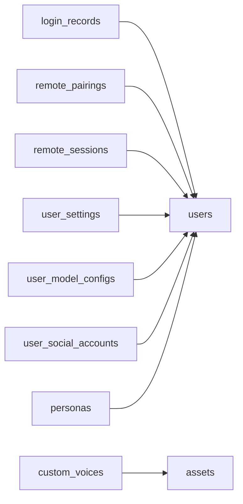
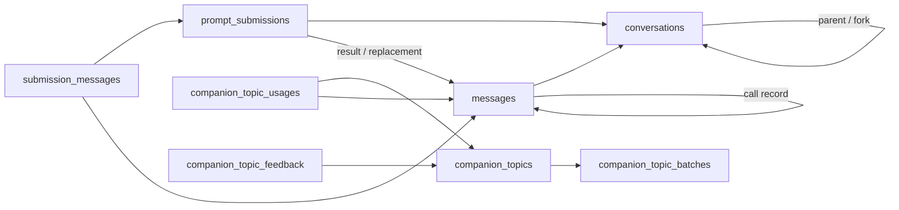
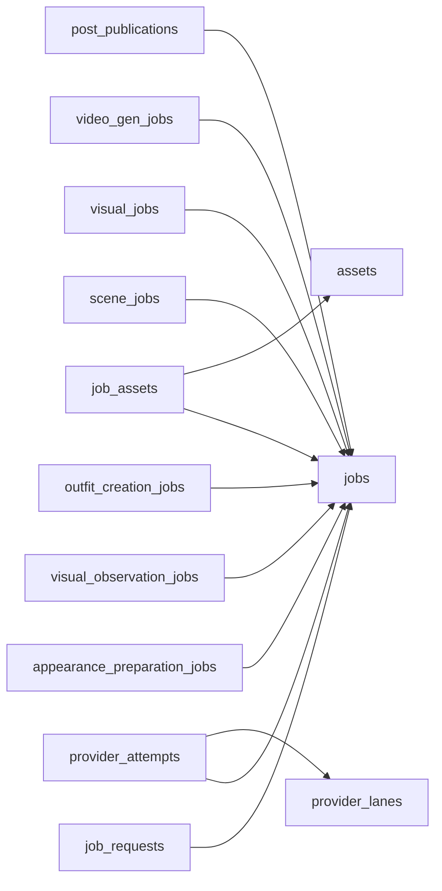
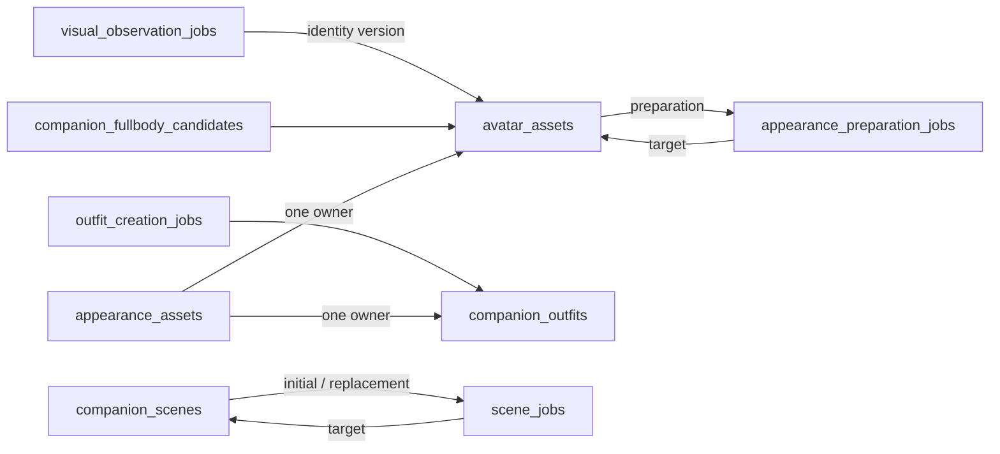
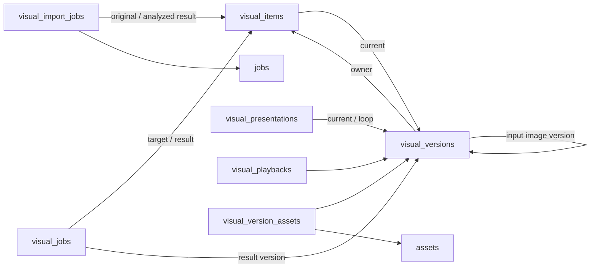
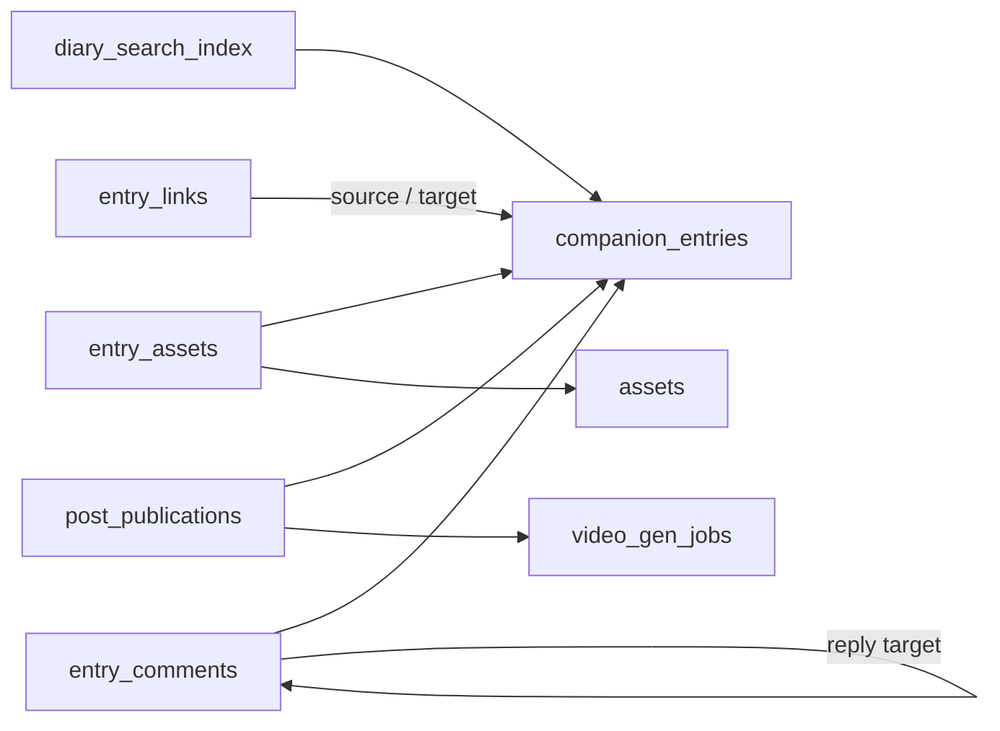
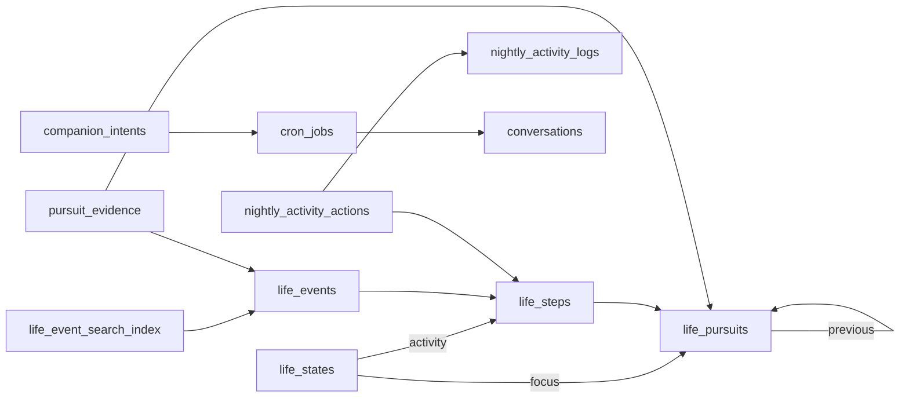
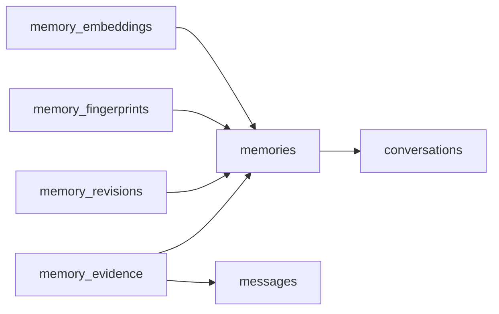

# 数据库设计与关系图

本文解释实体拆分、关系约束、删除与查询设计。字段定位见 [DATABASE_FIELDS](DATABASE_FIELDS.md)，完整结构以 [ORM 注册](../backend/bootstrap/models.py)和[迁移序列](../backend/alembic/versions)为准。跨模块行为由 [PROTOCOL](PROTOCOL.md)定义。

数据库使用 PostgreSQL、`vector` 和 `pg_trgm`；部署版本与单实例条件见 [Backend](../backend/README.md#docker-compose-部署)及[运行时边界](ARCHITECTURE.md#部署与运行时边界)。下图只保留解释所有权、循环或恢复所需的关系，箭头由引用方向指向目标，省略重复用户外键和普通文件关联；不是第二份完整 schema。

## 共同约束

- 活关系用外键或关联表；冗余账户字段经 [schema.py](../backend/infrastructure/schema.py)展开联合外键，预设仍由业务读写校验。稳定命名供 Alembic 比对。
- 归属、状态与筛选条件使用明确列，可变输入和冻结文档使用业务校验的 JSONB。实体主键与请求幂等键各有用途，见[公共字段](DATABASE_FIELDS.md#公共字段与关系入口)。
- 一个用例在短事务内提交状态、关系、资产引用及 outbox；模型和供应商等待在事务外。领域锁管理普通并发，账户维护隔离整体删除和恢复。

## 账户、配置与分发

桌面登录、手机授权和管理员会话有不同撤销范围。用户普通设置、模型配置、资讯来源凭证分开，避免普通同步暴露机密；扫码登录修订与在用凭证修订各自隔离迟到结果。人格只管理定义和政策，生活及实际呈现另有权威状态。系统参数、管理员会话和更新版本是全局记录，不借产品账户归属授权。

## 会话、消息与话题

会话拥有上下文边界，消息拥有原文与交付快照，受理账本拥有请求身份和结果关系。通话记录与原发言同属会话，联合外键保证归属并在记录删除时清理关联行。整批输入与关联一起提交，断线后可查询原请求。依附子会话随父删除，独立分叉只失去来源指针。

含通话历史的数据库需保留支持独立通话记录的 schema。迁移 `0003` 在通话数据存在时拒绝降级，以免旧版本把通话内容当作普通消息展示。

消息文件和本地声音版本用关系表保护，回收不扫描正文 JSON 猜引用。会话统计由[语句级触发器](../backend/features/conversation/statistics.py)维护，计数规则见[查询设计与验证](#查询设计与验证)。话题资料、实际分享和显式反馈独立，选材不代表分享。

## 任务、供应商尝试与资产

任务详情复用 `jobs` 主键。共享父表只管理执行控制，业务详情管理输入、目标和采纳；请求身份与制作身份分离，允许多个请求复用在途工作，也允许后续新请求制作相同组合。任务种类须匹配唯一详情。

供应商尝试独立保存远端占用和未知事实，本地取消或删除不能证明其结束。资产库存保存文件属性与回收待办，领域外键和多文件关联保护引用；路径快照不代替活关系。采纳与回收共用资产行锁，落盘到引用提交之间由写入租约保护，锁顺序与补偿见 [资产模块](../backend/features/assets/README.md)。

## 身份、衣柜、环境与动作

确认图及独立身份版本归头像行；透明准备与内部观察各有持久任务，失败不撤销身份。Persona 保存可选人物背景，初始化完成进度独立于字段是否非空。衣柜、环境和动作是可复用定义，各自与制作过程分离；新制作失败保留当前素材。环境保存上传源和展示图；实际显示由呈现领域记录。

头像行的当前文件外键可切换，`appearance_assets` 累计持有被替换的正式身份图，避免历史原图失去引用；衣柜与影像可共享同一个资产登记。图片文件以不可变路径区分，无独立图片版本表，视觉身份版本只随明确确认/采纳推进，用于生成与候选的并发校验。

动作的可用性由评审状态决定，不另存入库布尔值。通用内置定义通过账户内唯一 `preset_key` 补齐，自创动作该值为空；名称不承担唯一身份。`source_key` 是动作素材的业务来源键：素材包导入按它去重，撤销导入按它校验归属。`request_key` 是用户确认提交的幂等键：同一次确认重试按它返回原动作，不重复登记与评审。

聊天图片以 `image_gen_jobs` 继承共享任务，按槽位保存媒体与消息绑定；`appearance_image_jobs` 保存头像与全身公共图片链的接续点，业务采纳与任务完成共同提交。`media_manual_operations` 保存人工采用或重做的原输入、候选依据、请求身份及调度交接，`media_continuations` 保留业务依赖及原继续身份。业务所属任务通过 `owner_job_id` 关联，账户归属仍用 `user_id`。全身候选持有检查证据与人工依据，`fullbody_review_jobs` 只管理冻结参考及执行；手动和自主造型通过请求来源分离权限。待复核没有完成时间，任务资产引用持续生效。

## 影像与不可变版本

三类可播放资产（`actor` / `scene` / `cinematic`，冻结职责与资格语义见 [影像契约](PROTOCOL.md#影像成品与模式隔离)）共用稳定成品与不可变版本，成功重做才切当前指针；差别由冻结输入的判别联合（`snapshot_json.source.kind`）与 `asset_kind` 列承载，不建三套表。原件路径、哈希和分析记录是任何成品都可带的附加信息；分析期间才使用 `source.kind=analysis`，完成后恢复为对应的普通来源，上传和生成共用同一成品模型及播放规则。`visual_import_jobs` 继承共享任务，长期保留内容理解、素材匹配、整理结果和用户选择；分析与关联采纳追加不可变版本，不改写已经呈现的版本。

呈现、播放、输入图及制作结果引用实际版本，源素材修改或删除不改写已发生画面；静态呈现另保存待显示/已显示快照及受保护素材引用。呈现行的 `composition_json` 是当前有效基础画面的舞台组合（layered 分层引用环境层与主体层 / cinematic 整片引用），携带持续画面的选择来源与生活驱动组合的生活上下文；`intent_json` 是生活情境投影——两者都是呈现配置，不构成第二份生活事实。播放账本按指令记录来源、建立的持续画面选择来源及生活上下文，开播回执据此推进组合。

成品/版本成对外键校验版本所属成品，不能仅凭同账户交换引用；循环指针允许分阶段写入，提交时须完整。图片内容去重与请求幂等分别处理，版本按活引用回收，不按年龄直接删除。

## 动态、日记与评论

动态和日记共享正文、阅读状态与附件，因此使用内容实体；创作与发布政策仍由 posts/journal 拥有。日记日期唯一性、来源动态与评论回复通过关系校验。列表只读取评论数量，正文独立分页；日记独立检索索引可从正文重建。

## 生活、夜间与调度

当前生活、持续事项、执行步骤和事实事件分开；结果外键及完成证据连接实际成果。阅读成果长期保留，不放入临时检查点。`life_action_admissions` 独立保存请求额度和提交事实；删除结果指针不抹掉已发生事实。

生活事件和日记各有可重建检索文本与向量，来源和索引以账户联合外键约束，文本改变立即撤销旧向量；只比较内容指纹、模型与实际维度一致的向量。

夜间账本按本地业务日保存阶段与实际动作。Cron 管计划，陪伴意图管有界等待和回合，在线信号不成为长期事实。行为和恢复分别见 [生活](PROTOCOL.md#生活状态与生活事件)及[调度](PROTOCOL.md#调度)。

## 记忆、证据与向量

当前内容、原始证据、修订、遗忘指纹和向量独立，列表只读摘要，详情按需加载。分类/槽位是业务字段，展示话题不承担类型判定。遗忘清除内容和摘录，抑制指纹继续阻止从同一证据重学。

向量可重建：先限定账户、预设、模型、实际维度和内容版本，再精确排序；当前规模不维护近似索引。正文与补向量分别提交，索引失败不撤销正文，语义依据见 [记忆模块](../backend/features/memory/README.md)。

## 必要历史

| 对象 | 保留理由与边界 | 权威入口 |
|---|---|---|
| 终态任务 | 明确终态且清理完成后，检查点/临时引用七天、诊断九十天；导入分析等长期资料使用保留角色，引用随业务精确替换或任务删除释放。保留请求身份、终态与必要结果以维持幂等，未知和未清理工作不按期限压缩 | [jobs/service.py](../backend/features/jobs/service.py) |
| 影像版本与播放 | 当前、仍引用及每份冻结身份/造型/动作/画幅的最新合格自动演出版本持续保护；已结束播放七天后释放占用，再回收无引用且不承担自动回退的版本 | [visuals/asset_references.py](../backend/features/visuals/asset_references.py) |
| 记忆修订与指纹 | 修订保留最近二十次；明确遗忘清除正文、摘录和修订，指纹可失去原记录仍保留抑制作用 | [records.py](../backend/features/memory/records.py)、[memory_store.py](../backend/features/memory/memory_store.py) |

## 删除与恢复

| 关系 | 删除后必须保持 |
|---|---|
| 账户 → 所属数据 | 先进入维护态并收敛任务/文件；不可把远端未知当作未执行 |
| 会话 → 消息；内容 → 评论/附件/引用 | 依附数据级联，保留的评论回复先解除被删目标 |
| 源素材 → 冻结版本；事项/步骤 → 事实 | 可解除来源和结果指针，冻结内容及事实保留 |
| 资产、声音版本 → 活引用 | 有引用时限制删除，关系释放与文件回收分阶段执行 |
| 任务 → 远端尝试 | 可解除本地关系，远端占用独立核对 |
| 记忆 → 依附索引 | 证据、修订和向量随正文清理，遗忘指纹可继续保留 |

账户删除在维护态收敛任务与文件后执行，不可把远端未知当作未执行。删除成功不再恢复该账户的业务任务；失败保留账户并解除维护后恢复。循环关系（如场景与其制作任务、影像与当前版本）先写可空指针再连接；复合外键的归属分量始终校验。

空库操作见 [配置与迁移](../backend/README.md#配置与迁移)；删除与账户维护边界见 [PROTOCOL](PROTOCOL.md#安全更新与账户维护)。

## 查询设计与验证

列表采用稳定游标和明确投影，关联批量读取，精确总数按需查询。索引服务消息顺序、用户预览、内容时间线、任务恢复、生活事件和记忆作用域；不把全部子对象装入无界联合结果。

会话列表使用派生统计与页内用户预览索引，不扫描消息正文统计。消息的插入、更新、删除和上下文归属变化由事务触发器维护计数；正文与结构化媒体共同决定普通助手行是否可见，陪伴回复按已保存气泡计数，计数更新不改变活动时间。恢复后统计从消息重建。

数据库验证使用隔离 PostgreSQL，覆盖空库升级／重建、ORM 比对、部分索引、会话统计触发器、outbox 提交／回滚唤醒，以及跨账户拒绝、大 ID、并发受理、循环关系、被遗忘权和资产回收竞争。查询测量注明样本规模、作用域、向量维度、预热和统计范围；供应商等待、网络、客户端呈现与部署负载分别验证。检查入口见 [Scripts](../scripts/README.md#按改动选择验证)。
