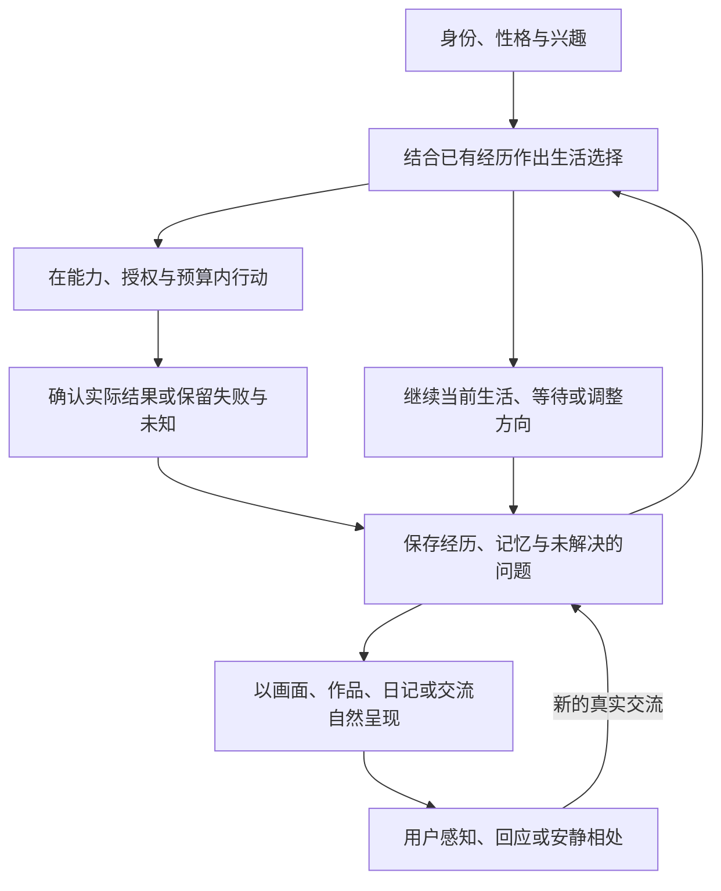

# 伙伴体验设计

本文定义产品目标、设计原则、用户可见行为与故障表现，是产品取舍的依据。接口、字段与恢复流程由全局技术文档和源码维护；产品目标不等于已经通过真实运行验收的能力。

## 设计目标

唤生 SpiritAgent 让用户创造一个拥有自己生活的 AI 伙伴。核心目标是：**伙伴通过自己的生活和行为，让用户感受到它是一个持续存在的个体。**

身份与性格为生活提供起点，经历使它有理由继续、等待或改变方向，交流让用户逐渐认识这些变化。专业能力帮助双方完成事情；形象与媒体让生活可感知。产品取舍以这段关系是否连贯、可信、尊重用户为依据。

### 设计原则

| 取舍依据 | 对设计的要求 |
|---|---|
| 生活的自主性与连续性 | 获准范围内可以没有新指令也继续自己的事情；动机承接性格、兴趣和过往结果，允许无行动、失败、等待、暂停与转向 |
| 经历的可信性 | 明确区分打算、虚拟情景、执行与成果；不把画面、时间流逝或未知结果当作经历，用户和来源作者的经历不转归伙伴 |
| 相处的分寸 | 生活可以继续而不持续打扰；主动联系遵守档位与情境，未回复不构成催促理由，等待不持续推理 |
| 表达的必要性 | 交流、作品、动态、日记与画面服务当前情境；优先复用资源，不以生成数量、动画频率或任务数量衡量存在感 |

自主活动应保留个人动机和是否分享的选择，也可以与用户共同完成目标。陪伴与专业任务共享身份形象，历史按会话、记忆按预设隔离；专业任务不自行成为生活经历。系统状态不用伙伴第一人称，未取得模型表达不编造台词；机械反馈与预制语音只用于下文约定的直接交互和降级。

### 生活闭环

这张图表达产品因果关系，不要求每轮走完全部环节。选择可以不执行，成果可以暂不分享；一次步骤成功也不自动完成整个目标。只有具备相应证据的记录才能成为事实，尚未解决的问题在下一次选择时仍需保留。模块与状态归属见 [ARCHITECTURE](ARCHITECTURE.md)，执行与恢复边界见 [生活契约](PROTOCOL.md#生活状态与生活事件)。

### 当前能力与体验验收

当前已具备生活状态、跨天事项、受约束的行动执行、成果与来源记录、记忆回流和多端浏览。具体体验见[持续生活](#持续生活)，验证边界见[生活模块](../backend/features/life/README.md#验证边界)。这些机制不等于长期行为质量已经验证。

验收关注三件事：变化能否由过去经历解释；安静和重启之后能否接续先前的事情；成果能否自然影响后续选择、聊天和日记。用户不打开执行详情也能察觉这些变化，才说明生活真正进入了相处。跨日观察与故障场景见 [持续生活验收](../scripts/README.md#持续生活验收)；后续迭代优先修复断点，新增能力须说明收益及其权限、费用和打扰影响。

## 认识伙伴

### 引导与后台准备

引导依次完成激活、角色资料、头像、全身形象和声音，最后可选补充用户资料。先认识伙伴，再进入管理功能；激活后自动打开引导，完成前无关闭入口，重启从未完成步骤继续。默认造型、角色卡、初始环境与少量基础动态素材后台准备，失败不阻断资料采集与问候；先获得静态形象即可开始交流。

| 阶段 | 交互边界 |
|---|---|
| 角色 | 名字、生灵描述和说话方式必填，其余可跳过；逐题保存，可返回修改，物种支持自由描述；关系影响相处而非外形 |
| 形象 | AI 制作和用户提供的素材都进入同一影像成品流程；头像和全身分别确认，确认前可调整 |
| 声音 | 固定音色、设计、克隆均可试听；确认声音或明确先用文字完成引导，之后不重复询问 |
| 用户 | 全部选填，跳过或删除后不重新启动引导；生日只接受真实日期 |

题目聚焦单一操作，正文按需滚动，主要按钮固定可见；Enter 推进、Shift + Enter 换行，输入法选字不推进。问题可播放预制语音，等待与失败用系统说明。初次问候遵守主动档位和有效期，失败或过期保持安静；生产与恢复见 [PROTOCOL](PROTOCOL.md#头像全身与确认)。

### 制作过程与结果反馈

声音、形象、衣柜、环境、动作和影像共用以下体验，后续章节只说明差异：

- 输入与预览可滚动，主要操作固定；同一阶段只表达一次，错误和恢复入口靠近对应操作，不铺顶部状态条或遮住旧成品。
- 只显示真实阶段，区分排队、制作、待确认与已生效，不模拟百分比或预计完成时间。长等待补充耗时说明，不据此中断供应商任务。
- 只锁定冲突操作，切页保留输入和在途任务；离页会中断的流程提前说明，后台完成不自动跳页、播放或采用。
- 加载失败只重试加载，制作失败保留输入与已有结果；未知结果先核对原任务。结束本地等待不等于取消或失败，不能据此重新付费提交。
- 制作、确认、采用和实际显示各自反馈，错误不伪装成完成。取消以服务端确认为准，迟到结果仍按原任务和账户处理。

恢复契约归 [PROTOCOL](PROTOCOL.md#影像成品与模式隔离)，供应商选择和重试归 [PIPELINE](PIPELINE.md#供应商选择与失败恢复)。

### 伙伴声音

“伙伴 → 声音”显示当前声音、试听及固定音色／AI 设计／克隆页签；引导优先推荐，管理页提供完整列表与筛选。设计与克隆保留最近确认方案，切换固定音色后仍可重新使用。

设计先生成可编辑描述，再生成试听；反馈只改变涉及特征。克隆支持录音或上传，推荐 5–30 秒清晰人声，最长 60 秒。试听使用固定示例句，只有确认才替换当前声音，修改描述或样本须重新试听。

隐藏或离页停止录音与播放，已提交的生成在当前账户窗口会话中继续，返回接续候选；换号释放资源并隔离迟到结果。录音与上传期间禁止模式交接，重启恢复已确认方案。持久化与取消见 [音色契约](PROTOCOL.md#音色设计与克隆)。

### 形象获取与确认

头像侧重面容，全身延续已确认身份；全身阶段恢复已有草稿，用户提交后才生成。预览后可微调、重生成或选近期候选，头像确认页不另设上传入口。输入仅服务本次绘图，失败保留，成功加载对应预览后清空。

直接上传不调用生图，多帧使用第一帧；采纳即确认。全身原图保存后即可继续声音步骤，透明处理与默认造型后台完成。形象参考仅辅助生成；额外光线与构图参考只调整画面、不改变身份，按已有参考条件提供。

微调、重生成和外部制作分别提供明确入口与不可用原因，外部制作可复制提示词、查看或另存参考。生成策略和参考约束归 [PIPELINE](PIPELINE.md#微调与重新生成)。

### 身份锁定与角色卡

全身确认后锁定头像、物种与性别，询问阶段提前告知；名字、性格、关系、说话方式、声音及用户资料仍可修改。添置素材和重做影像不重新孵化。

角色卡从确认图整理固定外形，资料页展示原图、特征和分析状态，无需额外问答。基本资料与角色卡各有编辑器：关闭保留草稿，取消放弃修改，切页和模式交接接续草稿，后台更新不覆盖输入；并发保存先核对最新内容。文字可编辑、清空或恢复自动值，仅辅助生成；重新提取保留人工覆盖，图片仍是身份依据。采纳与并发规则见 [PIPELINE](PIPELINE.md#角色卡与并发写入)。

### 资产准备与复核

角色卡分析失败保留确认图，暂停依赖它的新生成并提供重试；默认造型通过透明验收后入柜。初始环境未就绪时用可读底板说明状态，不延迟伙伴诞生，之后可重试或新建。

影像检查失败保留旧成品，提供继续检查或重新制作；日常聊天、动态与夜间媒体自动核查，避免逐张确认打断相处。验收标准归 [PIPELINE](PIPELINE.md#身份评分与发布复核)，首次显示与加载降级见[呈现与模式](#呈现与模式)。

## 持续生活

### 选择、行动与经历

伙伴结合性格、记忆、近况和结果决定保持活动或调整事项。事项保留缘由、目标、进展与下一步；可读计划不代表已执行，需要行动时通过已开启能力和额度推进。当前支持影像、环境、造型、动作设计和内容阅读，具体范围由 [生活契约](PROTOCOL.md#生活状态与生活事件)定义。

阅读承接伙伴的兴趣、事项与已有认识，留下实际所得和仍未解决的问题，允许没有新发现。笔记可以影响之后的选择、聊天或日记，不要求立即分享，也不把用户或来源作者的经历转成伙伴自己的经历。

等待、失败、暂停与放下仍属于经历；转向保留新旧目标的联系，迟到成果继续归属原事项。完成必须有足以支持目标的成果，不能用时间或一个步骤成功替代整项目标。

后端与供应商可用时，允许的云端生活可在客户端离线或静止档继续。主动联系和选新画面另守档位与显示条件；浏览不触发行动，重连也不重新开始生活。

### 生活状态与呈现

生活区展示伙伴的第一人称近况与聚焦事项；生活页展示事项叙事、行动叙事和按时间保存的变化。结构化状态、执行描述、等待原因与诊断属于系统上下文，不直接成为用户文案。伙伴叙事由模型结合角色、记忆和真实结果生成；角色本身正在从事工程或其它专业活动时，可以使用该主题的自然词汇。没有叙事时只显示中性状态，不由程序补写伙伴台词。近况继续区分打算、虚拟情景、行动与成果，阅读笔记显示来源和实际范围；尚无内容用中性说明，加载失败保留旧内容并可重试。

生活与聊天独立浏览。生活区的聊天入口只定位主陪伴会话与输入框，保留草稿、不发送消息。用户可在聊天中调整事项；用户暂停须由用户明确要求恢复，普通闲聊不代表恢复要求，指向不明时先澄清。

窗口和桌面适配同一生活决定：有相符影像时桌面播放完整成品，窗口显示静态投影；没有成品时可用已有造型与环境，不强制制作视频。画面不证明活动发生，库内预览和重做也不改变生活或正式呈现。

## 日常入口与账户

### 窗口与会话

窗口模式由精灵、轻语和唯一主窗口承载。开主窗口收起精灵与轻语，隐藏或关闭后恢复精灵，最小化沿用系统行为。首次进入陪伴，其后按账户恢复页面和会话，通知与文件投喂的明确目标优先；切页、隐藏保留草稿和已提交任务。

陪伴、生活、动态、日记为日常入口，伙伴管理、设置与账户为次级入口。头像回到陪伴主会话，专业和任务会话经会话列表切换；未读归各自内容，实际可读后才确认。设置按用户任务分组，能力管理和应用设置在组内分页，页签固定、正文滚动，保存失败保留输入。

生活区由窗口外壳装配，与聊天内容独立。宽窗并排、窄窗抽屉，可换侧或收起；专业与任务会话默认收起，允许显式展开。形象完整等比适配，拖动画面移动窗口；隐藏、最小化、锁屏及收起不确认呈现。页面、生活浏览位置、对话草稿与阅读位置随账户和模式交接接续，轻语只承载聊天。技术所有权见 [Client](../client/main/README.md#桌面承载与恢复)。

### 桌面模式

Windows 与 macOS 均可从主窗口、精灵菜单、托盘或设置进入。模式交接接续页面、会话、草稿和阅读位置，目标恢复成功才离开来源，失败回原模式；录音、转写和上传阻止交接，已提交任务继续。首装与异常后首启留在窗口模式。

只在交互屏承载生活画面和底栏，其他屏保留系统桌面。底栏头像居中打开陪伴，左侧管理应用，右侧进入生活、动态、日记、伙伴与设置；窄屏两侧分别滚动。聊天、生活、动态、日记、伙伴与设置共用一个内置窗口，切换功能时自动替换旧页面；主对话是陪伴、专业与任务的唯一承载。待读主动消息以头像上方气泡提示，静止、锁屏或功能打开期间抑制；聊天声音独立于背景。

桌面模式只保留一个内置功能窗口，可移动、缩放、最小化与最大化；切换功能时沿用当前窗口的位置、大小和最大化状态，旧页面按关闭语义卸载。首次进入不擅自恢复上次打开的窗口，显式跳转和模式交接除外。控制面板互斥，支持 Esc、失焦和外部点击关闭，主动关闭归还焦点，切换程序不抢前台。底栏采用主题玻璃效果，正文与表单保持实底可读。

| 系统边界 | 用户体验 |
|---|---|
| 桌面图标 | 保留 Finder／Explorer 的图标、框选、键盘和拖放；透明空白穿透，外部程序可以覆盖产品界面 |
| Windows | 底栏预留系统工作区并集成本屏原生托盘，沿用图标显隐和原生操作；不跨屏搬移托盘或接管额外任务栏面板；原生前景随主题，第三方位图保留原色；退出恢复任务栏与预留，不撤销用户整理的图标位置 |
| macOS | 底栏避让 Dock 与菜单栏，不缩小其他应用工作区；目录和启动无需辅助功能，运行窗口投影、关闭及跨屏迁移需要；无法核实首次最小化窗口的 Space 时不猜测，无法处理的全屏或模态窗口提示用户处理 |
| 多屏与异常 | 优先首选可用屏，缺屏回退但保留首选；切屏先释放旧屏，拔交互屏回窗口，重接不自动接管；退出、换号、更新或鉴权失效释放承载，保留外部程序摆放；挂载或托盘恢复不可靠时回窗口并说明原因 |

应用目录支持搜索、键盘操作、拖入与失效修复，启动和固定分开。Dock 只展示当前虚拟桌面交互屏的真实窗口；优先恢复本屏窗口，其次迁移异屏窗口，无窗口才启动，未能定位如实提示。关闭保留系统保存提示，不波及其他屏；Windows 保留 Jump List。可信启动与运行投影归 [PROTOCOL](PROTOCOL.md#桌面呈现与本机启动器)。

背景使用当前有效静态素材或完整影像，全屏、锁屏和降低动态时停止动态播放，恢复不抢焦点；桌面不显示独立精灵。平台实现见 [Windows](../client/desktop-windows/README.md)、[macOS](../client/desktop-macos/README.md)，实机验收归 [Scripts](../scripts/README.md)。

### 激活与账户切换

激活卡片置顶但不阻断卡片外操作，未提交可取消。添加账户暂收起伙伴，取消或失败回当前账户，成功按新账户恢复；未完成引导则继续引导。账户菜单显示用户名及必要的后端区分，明确移除在子菜单直接执行。

退出与换号保留账户缓存，移除才删除目标缓存；移除当前账户先恢复系统桌面，再进入激活。凭据、会话代次与迟到结果隔离归 [PROTOCOL](PROTOCOL.md#凭据落盘)。

### 主题与图片查看

夜色、日色及透明样式不改变伙伴形象；正文、表单与确认弹窗保持实底可读，浮层避免下层文字叠影，不铺全屏暗罩。降低动态和透明度时提供可用降级。

图片灯箱用全窗暗底，支持适配、指针中心缩放、拖拽、双击切换、复制与另存；背景、关闭按钮或 Esc 退出，带语音图片也可查看。触屏捏合尚不支持，使用工具栏缩放。

### 桌面更新

关于页发现版本后由用户下载，下载与本机组件准备成功才允许立即重启，不自动重启。失败显示所处阶段并可重试；macOS 暂无应用内更新，如实说明不可用。安装与信任边界见 [更新契约](PROTOCOL.md#自更新签名)。

## 形象与衣柜

### 身份与素材

头像与全身确认身份，衣柜保存可变造型，环境提供生活空间。造型不能改变五官或物种，普通聊天绘图不改写素材或呈现；素材的生成依赖与使用范围见 [PIPELINE](PIPELINE.md#资产依赖)。

### 浏览与设计

衣柜展示自主添置开关与静态造型素材，详情查看图片和描述；新装在独立页面设计，新建只建立可恢复草稿，明确生成或上传才制作。确认入柜使素材可供选择，不自动生成视频或改变画面；已有草稿不因角色资料更新被强制丢弃。

不同造型可独立制作，完成不跳离正在浏览的项目；跨窗口新图加载成功后才能确认。描述失败可单独补全，不妨碍已确认图片使用。用户创建不受自主添置开关限制；已冻结影像不随源素材删除改变，其余等待与失败行为沿用[制作反馈](#制作过程与结果反馈)。

## 环境素材

### 环境库与创建

环境不决定造型或活动，避免重复描绘伙伴本人，允许其他人物、动物或艺术陈设。初始房间后台准备，后续可搜索、创建、上传和维护。

创建默认 AI，可附参考，外部制作按需展开；显示交付尺寸，上传保留原文件。详情直接提供编辑、重生成、取消与删除，正常状态自动刷新，仅加载失败时提供重试。参考和交付规格见 [PIPELINE](PIPELINE.md#场景创建与描述)。

已就绪的环境可以直接制作动态环境（循环视频）；也可以为同一环境补做黎明、白天、黄昏、夜间等时段版本，呈现时按本地时间优先使用匹配版本，没有版本就继续用现有环境并施加轻量色调。时段只是画面光线表现，不代表伙伴的作息，也不会因时间进入新时段而自动生成新媒体。

### 编辑与重生成

图片与描述齐备后才能入库，所有来源都经过同一套内容核对与成品流程。描述分析失败保留候选，可重试分析；创建任务可手动补全，重生成继续保留旧成品。编辑描述先保存，再按新描述重绘；成功原位更新图片与描述并保留标题，失败或取消不替换旧图。

复用不消耗生图额度，自主新增另受开关与政策限制，见 [PROTOCOL](PROTOCOL.md#场景素材与自主添置)。

## 动作库

“伙伴 → 动作”在桌面端和手机端分为“已入库 / 未入库”，默认展示已入库，不区分用户提出还是伙伴自主创作。已入库包含通用内置动作和通过评审的自创动作，供影像制作选择；未入库展示等待、评审、资料不足、未通过及技术失败，并提供对应处理。程序异常不表示动作内容被拒绝。

动作库提供九种通用内置动作：安静相伴、专注做事、闭目小憩、注意到你、认可鼓励、舒展身体、喝口水、整理仪容、跳一小段。定义只读；入库不生成图片或视频，实际制作仍须符合伙伴身体、用品与环境条件。

每个动作可展开查看已制作的媒体实现：条目标注所属造型，符合当前身份、造型、显示画幅且文件完整的实现标记为可用；其他条目标注当前不可用，用户可检查成品或手动制作。伙伴首次就绪后自动准备少量基础动态（默认待机优先，随后逐步补充互动反应与常用循环），对应工作项在影像页标识为“基础动态准备”，同时显示动作名称与实际任务状态；补充准备不阻塞首次使用，也不因重启、重开窗口重复付费。

自创动作修改后移回未入库，通过后再次入库；无实际修改不重评，既有影像不受定义变更影响。技术失败可手动重试原动作，资料不足可补充后重评，内容未通过须修改再提交，不提供强制通过。等待和评审期间禁止修改或重复提交，允许删除；后台刷新保留编辑草稿和编辑起点。评审与恢复契约见 [动作素材](PROTOCOL.md#动作素材与影像播放)。

## 影像

影像库是用户与伙伴共同积累的视觉作品与表现资源库，保存伙伴身份、造型、环境和动作组合制作的图片或视频，也收藏用户喜欢的原始影像；视频制作产生的合格起始图可独立入库。聊天配图与素材参考图不自动混入影像库。制作流程归 [PIPELINE](PIPELINE.md#组合影像制作)，冻结版本、工作项与播放事实归 [PROTOCOL](PROTOCOL.md#影像成品与模式隔离)。

### 影像库与制作工作项

桌面和手机提供“创建影像”和“上传影像”两个入口。创建时选择已有着装、环境与已入库动作，完整场景可制作图片或视频；透明主体和动态环境沿用各自的视频流程。用户主动制作不受伙伴自主制作开关限制，受理后从工作项查看进度，离页或重开继续沿原任务恢复。

上传支持 PNG、JPEG、WebP、GIF 图片与 MP4、MOV、WebM 视频，先完整保存原件，再自动分析画面与动作；视频封面只用于浏览，重复文件返回已有作品及原分析任务。高置信度匹配优先关联已有着装、环境与动作；真实可提取的新素材通过检查后整理入库，自创动作继续经过动作评审，用户可修正关联、跳过或撤销本次入库。图片只确认可见姿态，不由单张图片建立连续动作；遮挡或缺失的服装、身体和房间不会被补画。分析和整理失败保留原件与已完成结果，可取消、继续或重新分析；存在歧义时展示依据并请用户选择。只有通过身份、实际语义、适用条件及文件检查的版本才允许呈现；收藏与素材入库本身不代表已呈现或产生生活经历。来源、文件名、尺寸、时长及检查结果可查看，上传作品不基于虚构的生成组合重做。

影像库提供浏览、预览与重做，预览不改变正式呈现。成品与制作工作项分开展示，重做保留旧作，成功更新所选影像，不联动重做其他影像；工作项按动作与目标类型标识，队列中的多次制作可相互区分，排队、暂停、失败和结果待核对保持真实反馈。自主制作近期失败的动作进入短暂退避，避免连续重复提交；用户仍可手动重试。

素材库共用紧凑预览、搜索及创建入口，不重复标题和数量；按素材画幅等比展示，返回保留筛选。影像详情展示组合与成品，目标和实际尺寸只写像素宽高，不把放大说成原生分辨率。

### 呈现与模式

完成激活与引导后，窗口生活区和精灵优先显示当前造型的透明主体视频，缺少合格视频时退回静态造型；桌面可显示分层环境与主体，也可播放完整图片或视频。持续画面保持可用，短动作结束、失败或中断后回到当前仍有效的基础画面；生活情境已经变化时不恢复过时动作。切换先加载，失败保留旧图，首次缺少资源显示准备或失败状态；换号不能露出旧账户画面。

受理不表示已经显示，静态投影不表示视频动作发生。重连和窗口重建只恢复有效目标，不补播过期短动作；描述当前可见内容时采用实际呈现，不能借用未显示的视频道具或动作。跨模式回执与静态恢复规则见 [PROTOCOL](PROTOCOL.md#影像成品与模式隔离)。

### 自主制作

伙伴按生活需要选择是否制作，优先使用已有成品；空库允许第一次创作，不要求先有画面。生活变化不自动补齐所有素材组合，素材更新、浏览、重连和模式切换也不触发制作。预算、幂等和未知结果核对归 [生活契约](PROTOCOL.md#生活状态与生活事件)，主动呈现遵守[档位与情境](#主动陪伴)。

## 对话与语音

### 消息呈现

陪伴按回应偏好选择文字或语音，同轮可以混合；媒体内联展示，窗外用简短提醒引导查看。语音支持暂停、断点续听、重播和展开台词，完整收听才清除未听；文字不提供 TTS 按钮，专业会话不朗读。客户端启动时准备声音输出并保持至退出，播放前不因闲置重复预热；启动尚未准备完成或输出异常恢复时可短暂加载，准备期间不推进台词与收听进度。

自动播放仅作用于可见会话的新语音，失焦或打开菜单不阻止播放；锁屏或录音时停止。手动暂停停止连播，恢复历史、启用偏好和音频更新不补播积压。点播其他内容保存断点，新语音不打断当前播放。关闭全部会话视图则停止；断点在本机跨窗口与重启保留。

编辑进入草稿并保留只读附件，较早消息提交前确认删除后续历史，取消和失败保留草稿。未读、未听、历史替换与重试语义见 [PROTOCOL](PROTOCOL.md#会话与消息)。

### 交付节奏与打断

陪伴只呈现最终确认的台词，日常回应按句成泡，不为凑数量拆分；语音随各气泡就绪交付。专业会话可展示过程与工具记录。情绪由文字、声音和身份区表达，台词不混入动作控制标签或括号旁白；明确要求的故事、剧本、译文和引用保留必要叙述。

用户连发在停止输入约四秒后合并提交，继续输入或组字重新计时，未发送草稿不参与；批次到期等待前轮结束，不能因前轮结束提前发送。输入为空时按钮停止回合，主动停止立即提交已排队消息。

隐藏、切页、切会话、锁屏、发送和开始录音时保存播放断点并清空连播队列，录音期间不自动播放。交付与历史边界归 [PROTOCOL](PROTOCOL.md#结构化回复与终端交付)。

### 语音保存与恢复

语音依赖云端，故障不阻断文字；演绎只影响朗读，不修改正文或决定心情。演绎修复或合成最终失败时直接显示原台词，播放失败保留重试。存储与幂等规则见 [语音契约](PROTOCOL.md#语音保存与重试)。

### 专业预设与记忆归属

陪伴承接角色生活，文案秘书和语言老师按任务交付，不强制多方案或练习。系统仅自动建立唯一陪伴主会话，以伙伴名称显示、不可删除或改名；其他预设需手动创建，普通会话可搜索、置顶、归档、重命名或删除，创建后不换预设。

历史按会话独立，同预设共享长期记忆；记忆管理按预设保留列表与草稿，显式保存，遗忘需确认。陪伴个人资料清空表示遗忘，管理其他预设不授权当前对话读取。推理参数可按会话覆盖并恢复全局默认；配置与记忆作用域见 [PROTOCOL](PROTOCOL.md#配置所有权与云同步)。

### 远程页面

桌面“手机访问”提供一次性扫码授权、链接和设备管理。手机浏览器可聊天、查看生活和内容、管理伙伴及素材，数据与桌面同账户；首次引导仍在桌面，云端功能不依赖电脑在线，本机操作需要 Client 与 Runner。

页面显示连接与授权状态，手机可退出，桌面可撤销设备；桌面换号不改变已授权手机的账户。后台或短暂断网不取消已受理对话，返回补齐历史；录音先确认再发送，不支持时说明原因并保留文字入口。配对有效期、撤权与任务停止的区别见 [远程契约](PROTOCOL.md#远程访问)。

## 主动陪伴

### 在线档位

| 档位 | 在线主动表现 |
|---|---|
| 自主 | 可主动文字、语音、情境表达及获准的活动 |
| 常规 | 轻量文字联系，不主动发送聊天媒体或视觉表达 |
| 静止 | 不主动联系、发声或表达，仍响应用户操作 |

档位约束实时打扰，生活执行、动态、日记、素材创作和普通自动化另守各自开关与额度。手动静止不被活动覆盖；全屏等沉浸情境可临时静止。精灵右键的“临时安静”持续 50 分钟，不改偏好、不跨设备同步、重启仍有效；可提前结束，手动选择任一档位也结束计时。

### 等待与主动表达

主动回合先安静判断，决定开口才出现台词；沉默不产生台词、打字态或工具活动，历史维护不算表达。伙伴可以保存有目的的等待，到时再判断是否联系，不因未回复循环催促。

用户发言优先，过时安排不补发，重连和解锁不自动问候。精灵不可见时不弹旁边提示或播放主动台词，消息保留未读；恢复可见后提醒，进入所属会话才清除。气泡靠近形象头部，随移动缩放并避开屏幕边缘。

### 主动信息分享

伙伴可在夜间结合双方兴趣寻找近期外部内容；每天至多保留五条有来源的发现，按实际取得的正文、描述或字幕表达。可以不分享，或在合适交流中引用原文链接。常规与自主档均可低频考虑，静止档抑制白天打扰。

用户可反馈“喜欢这类”“少推荐这类”并撤销，反馈只影响选择，不自动回复，沉默不视为不喜欢。X 需用户配置 Cookie，小红书扫码登录；未配置不检索，清除登录停止后续采集，不撤销已取得内容。来源时间、保存与过期边界见 [PROTOCOL](PROTOCOL.md#主动信息与来源分享)。

### 夜间生活

夜间窗口内可规划少量有理由的活动，也可以不活动；未执行计划不写成经历，失败互相隔离。总控关闭停止计划与执行，记忆整理、动态互动、反思和日记仍可进行，具体能力开关继续生效。

已提交制作可跨窗口收尾，未启动的夜间活动不在白天补跑。夜间不弹实时通知；次日联系只保留缘由，当天在线且非静止时再决定是否开口，过时作废。窗口与恢复规则见 [PROTOCOL](PROTOCOL.md#调度)。

### 自主表达与呈现

情境表达与自主选择新画面要求自主档、对应表面可见且解锁，情境表达另需空闲。收起或隐藏精灵停止其主动表达，主窗口生活区和桌面各按自身显示资格处理，迟到结果重新核对。

动态表现设置独立于档位：关闭动态仅显示静态画面，轻量动态保留安静循环、只自动选择轻微动作并降低轮换频率，标准动态允许符合情境的持续动作与完整互动反应，轻量动态仍可播放用户明确触发的适当反应；临时安静不停止静音的待机动画，“安静陪伴”与“停止运动”是两种用户意图。客户端表现导演选择常驻、互动和生活媒体，统一演出调度控制执行：单击伙伴、对话中的身体反应得到即时回应（复用已有反应视频，由冷却与有界队列控制）；生活变化按活动类别和媒体实际表现、环境及道具条件匹配画面，只使用与当前活动真正相符的素材，没有匹配时保持安静，不把无关视频当成当前生活，演出不伪造经历——计划中的活动不会被表现成正在进行。正式演出依次执行，用户直接操控优先，普通生活演出不会打断正在进行的重要互动；连续点击合并并受冷却限制，过时请求不补播。短动作期间暂停常驻轮换，结束后按最新情境恢复；常驻轮换优先选择久未出现的循环，尽量在自然时间边界切换。关闭动态、隐藏或切换模式时收尾，重新显示不重复旧动作。环境画面随本地时段呈现轻度的明暗与色温变化；已制作时段版本的环境优先使用匹配版本，此时不再叠加色调。时段变化是桌面演出，不改变伙伴真实作息，也不触发生活活动。生活判断确定当前活动与情境，表现导演据此选择已有媒体；画面选择不成为新的生活事实。已有静态目标的重连、窗口重建和模式恢复不要求自主档；资格与回执详见 [PROTOCOL](PROTOCOL.md#影像成品与模式隔离)。

## 窗口精灵表现与移动

以下规则只适用于窗口模式的透明精灵。桌面模式不创建精灵舞台，呈现由影像的持续画面和短动作播放承载。

### 状态与播放优先级

透明精灵优先播放当前呈现目标的合格主体视频，加载失败或没有合格视频时使用静态造型。Presentation Director 根据当前生活情境选择持续画面，Performance Scheduler 管理优先级、抢占、恢复和回执；桌面模式使用同一套演出语义呈现分层环境或完整场景。拖拽等机械交互优先，短动作结束或失效后回到仍与当前生活相符的基础画面。

### 拖拽与直接交互

拖拽沿用当前造型，提起、落地、接取和长按用容器形变即时反馈；释放可播放预制语音，不调用推理。图片或视频拖入精灵进入轻语，混有其他文件则整批进入主窗口陪伴会话。主窗口生活画面拖动只移动窗口，不操纵已收起的精灵。命中与资源所有权见 [渲染层](../client/renderer/README.md#直接交互与命中)。

### 位置、移动与缩放

用户拖拽立即接管，释放按可见轮廓收回视口并保存栖息地，允许空中停留；拔屏和分辨率变化做必要回收。位置、比例和移动方式独立，正文不解析坐标。

比例以用户设置为基准平滑变化，放大以轮廓脚底为原点，静止档不主动放大。精灵菜单“一键归位”恢复默认位置和比例；托盘同名操作移回主屏、恢复默认位置但保留比例。精灵置顶避让全屏等沉浸情境，用户直接操作不受主动档位限制。

## 记忆、动态与日记

记忆为后续判断提供有来源的事实，动态与日记承载伙伴叙事。普通闲聊不逐条变成长期偏好，叙事不能反过来证明用户事实；范围与证据约束归 [PROTOCOL](PROTOCOL.md#预设记忆与学习作用域)。

### 生活动态

动态是独立社交时间线，可自主发布文字、图片、视频和语音，离线时也可创作；诞生和素材变化不产生模板记录。用户可评论或删除本人评论，不能编辑动态或伙伴回复；每条动态有独立评论上下文，并按实际交流时间承接。

动态和日记共用清晰的标题、卡片与内容布局，媒体手动点播。动态正文可展开，评论常驻，回复进行中与失败可见；日记只读、按日期浏览，窄窗日历在正文上方。未读只在内容实际展示后确认，隐藏、失焦和锁屏保留提醒，状态随账户同步。

发布不写入聊天历史、不弹聊天通知。动态有独立调度与开关，聊天和夜间规划不直接发布；视频结果未知先查询原任务，取得结果后复核发布条件。额度、互动和发布恢复见 [PROTOCOL](PROTOCOL.md#动态与日记)。

### 第一人称日记

伙伴在夜间自行决定是否写日记，以刚结束的本地自然日为单位回顾真实交流、互动与已完成活动，可表达感受但不补写未发生经历。发布后只读并静默提示未读，用户可在后续对话按日期或话题谈起。

即使不写日记，也可以反思关系、偏好和相处方式；新的明确表达可修正旧理解，但不擅自改写既定人设。日记的事实来源和记忆投影见 [PROTOCOL](PROTOCOL.md#动态与日记)。

## 故障体验

| 故障 | 用户可见处理 |
|---|---|
| 云端断连 | 保留等待状态，恢复后补齐业务内容，不补播问候 |
| 本机能力不可用 | 保留云端交流，执行本机任务时说明暂不可达 |
| 资产加载或制作失败 | 保留可用形象和输入，区分加载、下载与生成重试 |
| 登录或权限失效 | 提供处理入口，停止无效重连并隔离旧账户结果 |
| 语音或听写失败 | 已成功的台词回到文字；播放可重试，听写保留已有输入，不冒称已播放 |

失败、等待和未知分别表达，不用表演掩盖未完成。普通界面不展示原始堆栈，诊断留在开发者入口；各模块恢复操作由相应协议与 README 维护。
