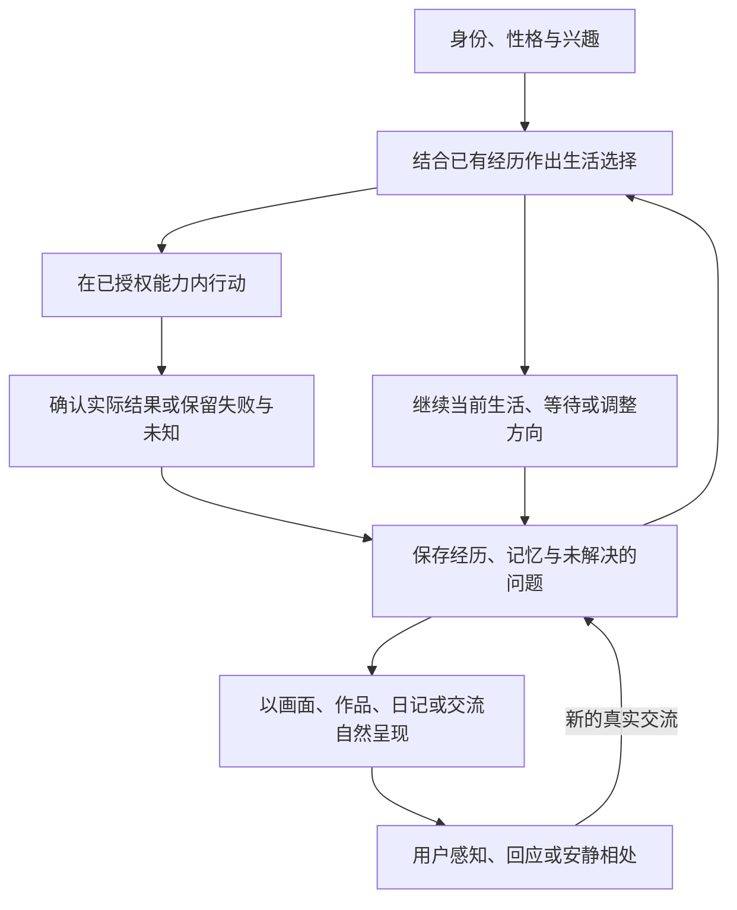

# 伙伴体验设计

本文定义产品目标、设计原则、用户可见行为与故障表现，是产品取舍的依据。接口、字段与恢复流程由全局技术文档和源码维护；产品目标不等于已经通过真实运行验收的能力。

## 设计目标

唤生 SpiritAgent 让用户创造一个拥有自己生活的 AI 伙伴。核心目标是：**伙伴通过自己的生活和行为，让用户感受到它是一个持续存在的个体。**

身份与性格为生活提供起点，经历使它有理由继续、等待或改变方向，交流让用户逐渐认识这些变化。专业能力帮助双方完成事情；形象与媒体让生活可感知。产品取舍以这段关系是否连贯、可信、尊重用户为依据。

### 设计原则

| 取舍依据 | 对设计的要求 |
|---|---|
| 生活的自主性与连续性 | 获准范围内可以没有新指令也继续自己的事情；动机承接性格、兴趣和过往结果，允许无行动、失败、等待、暂停与转向 |
| 经历的可信性 | 明确区分打算、虚拟情景、执行与成果；不把画面、时间流逝或未知结果当作经历，用户和来源作者的经历不转归伙伴 |
| 相处的分寸 | 生活可以继续而不持续打扰；主动联系遵守档位与情境，未回复不构成催促理由，等待不持续推理 |
| 表达的必要性 | 交流、作品、动态、日记与画面服务当前情境；优先复用资源，不以生成数量、动画频率或任务数量衡量存在感 |

自主活动应保留个人动机和是否分享的选择，也可以与用户共同完成目标。陪伴与专业任务共享身份形象，历史按会话、记忆按预设隔离；专业任务不自行成为生活经历。系统状态使用中性说明。伙伴决定是否参与交流，台词与情境动作依据当时的人设、经历和相处资料生成。

### 生活闭环

选择不一定导致行动，成果也不必分享。一次步骤成功不代表整个目标完成；未解决的问题仍可影响下一次选择。

### 体验验收

不打开执行详情，用户能否看出伙伴为什么改变主意、如何在安静或重启后接续一件事，以及阅读或创作怎样影响之后的交流？用[持续生活验收](../scripts/README.md#持续生活验收)观察这些变化。

## 认识伙伴

### 引导与后台准备

激活后自动进入引导，完成前不能关闭，逐步保存，重启接续。先设定伙伴，再介绍自己。默认造型、视觉观察与基础动态在后台准备，用户完成引导即可用静态形象开始交流。

| 阶段 | 交互边界 |
|---|---|
| 角色 | 名字、生灵描述和说话方式必填，其余可跳过；逐题保存，可返回修改，物种支持自由描述；关系影响相处而非外形 |
| 形象 | AI 制作和用户提供的素材都进入同一影像成品流程；头像和全身分别确认，确认前可调整 |
| 声音 | 固定音色、设计、克隆均可试听。确认声音或选择暂用文字后进入环境步骤 |
| 环境 | 可选；描述、上传或先用默认环境，受理即可继续，结果后台完成，之后在环境库查看与维护 |
| 我的资料 | 最后一页直接展示称呼（姓名或昵称）、性别、生日、兴趣爱好和补充说明。每项选填，用户选择「保存并开始」或「暂时跳过」后进入产品。之后可在「伙伴 → 记忆 → 我的资料」补填、修改或清除 |

题目聚焦单一操作，正文按需滚动，主要按钮固定可见；Enter 推进、Shift + Enter 换行，输入法选字不推进。建档界面用中性文字，等待与失败用系统说明。建档后伙伴依据当前情境决定是否先开口，并遵守主动档位和有效期；生产与恢复见 [PROTOCOL](PROTOCOL.md#头像全身与确认)。

### 制作过程与结果反馈

声音、形象、衣柜、环境、动作和影像共用以下体验，后续章节只说明差异：

- 输入与预览可滚动，主要操作固定；同一阶段只表达一次，错误和恢复入口靠近对应操作，不铺顶部状态条或遮住旧成品。
- 只显示真实阶段，区分排队、制作、待确认与已生效，不模拟百分比或预计完成时间。长等待补充耗时说明，不据此中断供应商任务。
- 只锁定冲突操作，切页保留输入和在途任务；离页会中断的流程提前说明，后台完成不自动跳页、播放或采用。
- 加载失败只重试加载，制作失败保留输入与已有结果；未知结果先核对原任务。结束本地等待不等于取消或失败，不能据此重新付费提交。
- 制作、确认、采用和实际显示各自反馈，错误不伪装成完成。取消以服务端确认为准，迟到结果仍按原任务和账户处理。

恢复契约归 [PROTOCOL](PROTOCOL.md#影像成品与模式隔离)，供应商选择和重试归 [PIPELINE](PIPELINE.md#供应商选择与失败恢复)。

### 伙伴声音

“伙伴 → 声音”显示当前声音、试听及固定音色／AI 设计／克隆页签；引导优先推荐，管理页提供完整列表与筛选。设计与克隆保留最近确认方案，切换固定音色后仍可重新使用。

设计先生成可编辑描述，再生成试听；反馈只改变涉及特征。克隆支持录音或上传，推荐 5–30 秒清晰人声，最长 60 秒。试听使用固定示例句，只有确认才替换当前声音，修改描述或样本须重新试听。

隐藏或离页停止录音与播放，已提交的生成在当前账户窗口会话中继续，返回接续候选；换号释放资源并隔离迟到结果。录音与上传期间禁止模式交接，重启恢复已确认方案。持久化与取消见 [音色契约](PROTOCOL.md#音色设计与克隆)。

### 形象获取与确认

头像侧重面容，全身延续已确认身份；全身阶段恢复已有草稿，用户提交后才生成。预览后可微调、重生成或选近期候选，头像确认页不另设上传入口。输入仅服务本次绘图，失败保留，成功加载对应预览后清空。

直接上传不调用生图，多帧使用第一帧；采纳即确认。全身原图保存后即可继续声音步骤，透明处理与默认造型后台完成。形象参考仅辅助生成；额外光线与构图参考只调整画面、不改变身份，按已有参考条件提供。

微调、重生成和外部制作分别提供明确入口与不可用原因，外部制作可复制提示词、查看或另存参考。生成策略和参考约束归 [PIPELINE](PIPELINE.md#微调与重新生成)。

### 人物设定与视觉身份

全身确认后锁定头像、物种与性别，询问阶段提前告知；名字、性格、关系、说话方式、声音及用户资料仍可修改。添置素材和重做影像不重新孵化。

人物设定统一放在 Persona。年龄、职业和背景经历全部选填，支持任意物种的自由描述；引导集中在一个可跳过的步骤，之后可在资料页补充或清除。背景属于人物设定，不冒充实际生活事件，也不自动改造确认图。资料编辑关闭保留草稿、取消放弃修改，切页与模式交接接续输入；并发保存须核对最新内容。

资料页保留头像与全身图查看，不提供外形特征编辑器。确认图是视觉身份依据；系统内部可整理可见结构及活动条件供对话和规划参考，观察未知或失败不影响形象使用。版本与采纳见 [PIPELINE](PIPELINE.md#视觉身份与内部观察)。

### 资产准备与复核

透明素材准备失败保留确认原图并提供重试；默认造型通过透明验收后入柜。视觉观察独立重试，不阻断引导、问候或视觉制作。初始环境未就绪时用可读底板说明状态，不延迟伙伴诞生，之后可重试或新建。

伙伴自己制作的长期资产通过检查后入库，本次制作失败时继续使用旧成品。用户亲自制作的资产如果只有画质仍存疑，可在详情自愿查看、采用候选或重做。上传原件直接收藏，自动演出另有资格检查。聊天和动态由伙伴自行修正和选片。聊天在原消息中显示成品或简短的制作状态，动态页只发布选定的作品。

## 持续生活

### 选择、行动与经历

伙伴结合性格、已有环境和经历，延续自己的兴趣、习惯或问题。一次有意义的观察、选择或转折可成为生活轨迹中的一段；同一主题可以跨日继续，也可以从独处时的想法发展成实际阅读或创作。安静和休息是正常状态。有新变化才留下新记录。伙伴可以同时保持几个兴趣、习惯或观点，也可以因为新的经历修订其中一项。独处时形成的分寸会影响聊天、手势和动态评论。用户设定的核心身份与基本性格仍是成长起点。

虚拟日常只写伙伴独处时的生活。谈到用户时保留真实交流的范围，共同经历需要实际参与的记录，替用户安排或等待需要明确约定。与话题有关的独处日常可以进入聊天和日记，表达时交代虚拟情境。主动联系继续遵守独立的时机与档位。

持续事项保留缘由、目标、进展与下一步；计划按已开启能力和事项进展推进，实际成果由业务确认。当前支持影像、环境、造型、动作设计和内容阅读。能力边界见 [生活契约](PROTOCOL.md#生活状态与生活事件)。

阅读承接伙伴的兴趣、事项与已有认识，留下实际所得和仍未解决的问题，允许没有新发现。笔记可以影响之后的选择、聊天或日记，不要求立即分享，也不把用户或来源作者的经历转成伙伴自己的经历。

等待与失败在对应事项中如实可见，伙伴仍可继续其它主题。暂停、恢复、放下等真正改变方向的决定进入生活轨迹。转向保留新旧目标的联系，迟到成果继续归属原事项。完成需要足以支持整个目标的成果。

后端与供应商可用时，允许的云端生活可在客户端离线或静止档继续。主动联系守打扰档位，静音画面守显示条件与动态偏好；浏览不触发行动，重连也不重新开始生活。

### 生活状态与呈现

自主生活默认留在伙伴自己的经历中。伙伴可以把造型、环境、动作或影像先留给自己，后来只谈制作时的感受，也可以把当时完成的原件分享给用户。一次阅读或创作也可能使伙伴想起对方。它能为这段经历选择联系的时间，到时根据最新的相处再作决定。用户参与的真实交流、明确约定及发起操作的结果沿原入口可查。生活区展示与近况同源的最近经历及当前聚焦事项。

桌面和手机的近况按账户本地日期，从新到旧读伙伴分享的经历。虚拟日常、交流、事项进展和成果各有标记。用户可以搜索关键词或日期，也可以从一条经历追看同主题的前后变化、阅读来源和作品。「在意的事」汇集各种状态的公开事项，点进一件事先读进展，再按需展开实际行动。返回时接续原来的阅读位置。只有事项时，首页直接显示最近更新的一件；经历和事项都为空时，显示一句说明。读取失败可以就地重试，刷新期间保留可读内容。伙伴叙事由模型生成，证据齐备而缺少叙事时使用中性状态。

生活与聊天独立浏览。生活区的聊天入口只定位主陪伴会话与输入框，保留草稿、不发送消息。用户可在聊天中调整事项；用户暂停须由用户明确要求恢复，普通闲聊不代表恢复要求，指向不明时先澄清。

窗口和桌面适配同一生活决定：有相符影像时桌面播放完整成品，窗口显示静态投影；没有成品时可用已有造型与环境，不强制制作视频。画面不证明活动发生，库内预览和重做也不改变生活或正式呈现。

## 日常入口与账户

### 窗口与会话

窗口模式由精灵、轻语和唯一主窗口承载。开主窗口收起精灵与轻语，隐藏或关闭后恢复精灵，最小化沿用系统行为。首次进入陪伴，其后按账户恢复页面和会话，通知与文件投喂的明确目标优先；切页、隐藏保留草稿和已提交任务。

陪伴、生活、创作、伙伴为日常入口，设置与账户为次级入口；生活包含近况、动态与日记，创作包含影像、造型、环境与动作。头像回到陪伴主会话，专业和任务会话经会话列表切换；未读归各自内容，实际可读后才确认。设置按用户任务分组，能力管理和应用设置在组内分页，页签固定、正文滚动，保存失败保留输入。

生活区由窗口外壳装配，与聊天内容独立。宽窗并排、窄窗抽屉，可换侧或收起；专业与任务会话默认收起，允许显式展开。形象完整等比适配并居中，拖动画面移动窗口；环境已更换或删除时不能继续显示上一个环境；隐藏、最小化、锁屏及收起不确认呈现。页面、生活浏览位置、对话草稿与阅读位置随账户和模式交接接续，轻语只承载聊天。技术所有权见 [Client](../client/main/README.md#桌面承载与恢复)。

### 桌面模式

Windows 与 macOS 均可从主窗口、精灵菜单、托盘或设置进入。模式交接接续页面、会话、草稿和阅读位置，目标恢复成功才离开来源，失败回原模式；录音与上传阻止交接，已提交任务继续。首装与异常后首启留在窗口模式。

只在交互屏承载生活画面和底栏，其他屏保留系统桌面。底栏头像对齐交互屏中线，有未读时点击查看、没有未读时只呈现伙伴。聊天入口紧邻头像右侧，打开主对话。左侧管理应用，右侧进入生活、创作、伙伴与设置；窄屏两侧分别滚动。聊天、生活、创作、伙伴与设置共用一个内置窗口，切换功能时自动替换旧页面；主对话是陪伴、专业与任务的唯一承载。待读主动消息以头像上方气泡提示，静止、锁屏或功能打开期间抑制；聊天声音独立于背景。

桌面模式只保留一个内置功能窗口，可移动、缩放、最小化与最大化；切换功能时沿用当前窗口的位置、大小和最大化状态，旧页面按关闭语义卸载。首次进入不擅自恢复上次打开的窗口，显式跳转和模式交接除外。控制面板互斥，支持 Esc、失焦和外部点击关闭，主动关闭归还焦点，切换程序不抢前台。底栏用低矮的斜边玻璃托板承载图标，鼠标滑过时当前图标与邻近图标随距离放大和抬升。减少动态时使用静态反馈，正文与表单保持实底可读。

| 系统边界 | 用户体验 |
|---|---|
| 桌面图标 | 保留 Finder／Explorer 的图标、框选、键盘和拖放；透明空白穿透，外部程序可以覆盖产品界面 |
| Windows | 底栏预留系统工作区。本屏原生托盘随右翼滚动，两行对齐连续托板右端，与功能图标之间留白。上行显示折叠箭头和应用图标，下行显示输入法、网络、音量、电池和时间。时钟沿用系统时间格式，点按可打开原生日历。托盘沿用系统显隐和原生操作，无法分行时沿用系统布局。原生前景随主题，第三方位图保留原色，退出恢复任务栏与预留。 |
| macOS | 底栏避让 Dock 与菜单栏，不缩小其他应用工作区；目录和启动无需辅助功能，运行窗口投影、关闭及跨屏迁移需要；无法核实首次最小化窗口的 Space 时不猜测，无法处理的全屏或模态窗口提示用户处理 |
| 多屏与异常 | 优先首选可用屏，缺屏回退但保留首选；切屏先释放旧屏，拔交互屏回窗口，重接不自动接管；退出、换号、更新或鉴权失效释放承载，保留外部程序摆放；挂载或托盘恢复不可靠时回窗口并说明原因 |

应用目录支持搜索、键盘操作、拖入与失效修复，启动和固定分开。Dock 只展示当前虚拟桌面交互屏的真实窗口；优先恢复本屏窗口，其次迁移异屏窗口，无窗口才启动，未能定位如实提示。关闭保留系统保存提示，不波及其他屏；Windows 保留 Jump List。可信启动与运行投影归 [PROTOCOL](PROTOCOL.md#桌面呈现与本机启动器)。

背景使用当前有效静态素材或完整影像；用户可在影像详情中把场景或完整场景成品设为账户默认壁纸，桌面无有效播放指令时优先显示它，影像重做后跟随该条目的当前版本。临时播放结束后回到默认壁纸，未设置或默认素材失效时回到普通基础画面。全屏、锁屏和降低动态时停止动态播放，恢复不抢焦点；桌面不显示独立精灵。平台实现见 [Windows](../client/desktop-windows/README.md)、[macOS](../client/desktop-macos/README.md)，实机验收归 [Scripts](../scripts/README.md)。

### 激活与账户切换

激活卡片置顶但不阻断卡片外操作，未提交可取消。添加账户暂收起伙伴，取消或失败回当前账户，成功按新账户恢复；未完成引导则继续引导。账户入口随模式归属，窗口模式在侧栏菜单、桌面模式在桌面设置；显示用户名及必要的后端区分，移除在选中账户后直接执行。

退出与换号保留账户缓存，移除才删除目标缓存；移除当前账户先恢复系统桌面，再进入激活。凭据、会话代次与迟到结果隔离归 [PROTOCOL](PROTOCOL.md#凭据落盘)。

### 主题与图片查看

夜色、日色及透明样式不改变伙伴形象；正文、表单与确认弹窗保持实底可读，浮层避免下层文字叠影，不铺全屏暗罩。降低动态和透明度时提供可用降级。

图片灯箱用全窗暗底，支持适配、指针中心缩放、拖拽、双击切换、复制与另存；背景、关闭按钮或 Esc 退出，带语音图片也可查看。触屏使用工具栏缩放。

### 桌面更新

关于页发现版本后由用户下载，下载与本机组件准备成功才允许立即重启，不自动重启。失败显示所处阶段并可重试；macOS 检查不可用时如实报告，更新经安装包完成。安装与信任边界见 [更新契约](PROTOCOL.md#自更新签名)。

## 形象与衣柜

### 身份与素材

头像与全身确认身份，衣柜保存可变造型，环境提供生活空间。造型不能改变五官或物种，普通聊天绘图不改写素材或呈现；素材的生成依赖与使用范围见 [PIPELINE](PIPELINE.md#资产依赖)。

### 浏览与设计

衣柜展示自主添置开关与静态造型素材，详情查看图片和描述；新装在独立页面设计，新建只建立可恢复草稿，明确生成或上传才制作。确认入柜使素材可供选择，不自动生成视频或改变画面；已有草稿不因角色资料更新被强制丢弃。

不同造型可独立制作，完成不跳离正在浏览的项目；跨窗口新图加载成功后才能确认。描述失败可单独补全，不妨碍已确认图片使用。用户创建不受自主添置开关限制；已冻结影像不随源素材删除改变，其余等待与失败行为沿用[制作反馈](#制作过程与结果反馈)。

## 环境素材

### 环境库与创建

环境不决定造型或活动，避免重复描绘伙伴本人，允许其他人物、动物或艺术陈设。初始房间后台准备，后续可搜索、创建、上传和维护。

创建默认 AI，可附参考，外部制作按需展开；显示交付尺寸，上传保留原文件。详情直接提供编辑、重生成、取消与删除，正常状态自动刷新，仅加载失败时提供重试。参考和交付规格见 [PIPELINE](PIPELINE.md#场景创建与描述)。

已就绪的环境可以直接制作动态环境（循环视频）；也可以为同一环境补做黎明、白天、黄昏、夜间等时段版本，呈现时按本地时间优先使用匹配版本，没有版本就继续用现有环境并施加轻量色调。时段只是画面光线表现，不代表伙伴的作息，也不会因时间进入新时段而自动生成新媒体。

### 编辑与重生成

图片与描述齐备后才能入库，所有来源都经过同一套内容核对与成品流程。描述分析失败保留候选，可重试分析；创建任务可手动补全，重生成继续保留旧成品。编辑描述先保存，再按新描述重绘；成功原位更新图片与描述并保留标题，失败或取消不替换旧图。

伙伴先查看已有环境，有新用途时可在自主添置开关允许的范围内创建，见 [PROTOCOL](PROTOCOL.md#场景素材与自主添置)。

## 动作库

“创作 → 动作”在桌面端和手机端分为“已入库 / 未入库”，默认展示已入库，不区分用户提出还是伙伴自主创作。已入库包含通用内置动作和通过评审的自创动作，供影像制作选择；未入库展示等待、评审、资料不足、未通过及技术失败，并提供对应处理。程序异常不表示动作内容被拒绝。

动作库提供通用内置动作，定义只读；入库不生成图片或视频，实际制作仍须符合伙伴身体、用品与环境条件。内置与自创动作的稳定身份与目录以 [presets.py](../backend/features/action_library/presets.py) 为准。

每个动作可展开查看已制作的媒体实现：条目标注所属造型，符合当前身份、造型、显示画幅且文件完整的实现标记为可用；其他条目标注当前不可用，用户可检查成品或手动制作。伙伴首次就绪后自动准备少量基础动态（默认待机优先，随后逐步补充互动反应与常用循环），对应工作项在影像页标识为“基础动态准备”，同时显示动作名称与实际任务状态；补充准备不阻塞首次使用，也不因重启、重开窗口重复付费。

新建与修改动作同样以一句描述开始，先看整理结果再保存并进入评审。自创动作修改后移回未入库，通过后再次入库；无实际修改不重评，既有影像不受定义变更影响。技术失败可手动重试原动作，资料不足可补充后重评，内容未通过须修改再提交，不提供强制通过。等待和评审期间禁止修改或重复提交，允许删除；后台刷新保留编辑草稿和编辑起点。评审与恢复契约见 [动作素材](PROTOCOL.md#动作素材与影像播放)。

## 影像

影像库是用户与伙伴共同积累的视觉作品与表现资源库，保存伙伴身份、造型、环境和动作组合制作的图片或视频，也收藏用户喜欢的原始影像；视频制作产生的合格起始图可独立入库。聊天配图与素材参考图不自动混入影像库。制作流程归 [PIPELINE](PIPELINE.md#组合影像制作)，冻结版本、工作项与播放事实归 [PROTOCOL](PROTOCOL.md#影像成品与模式隔离)。

### 影像库与制作工作项

镜头服务于伙伴此刻的活动和表达。安静陪伴的常驻画面优先稳定，察觉、回应或互动可以用半身、近景和适时的运镜，让视线、表情和手势看得清楚。剪接延续人物和动作的空间关系，循环接点自然衔接，叠入舞台时保持连贯。

桌面和手机都可创建或上传影像。素材按原画幅展示，返回时保留搜索和筛选。详情列出来源、实际像素尺寸与检查结果，不把放大称为原生分辨率。

| 操作 | 用户看到什么 |
|---|---|
| 创建 | 用一句话描述画面，确认造型、环境和动作计划后才开始制作。手动创建不受自主制作开关限制；离页后仍能找到原工作项。 |
| 上传 | PNG、JPEG、WebP、GIF 或 MP4、MOV、WebM 原件直接收藏，不重绘或剪辑。重复上传打开已有作品。详情按着装、环境和动作显示匹配、提取或补全的结果，生成推测须标明。 |
| 纠正素材 | 只处理有歧义、失败或待选的条目，其余继续。可更换关联、跳过、撤销本次入库、取消或继续分析；失败保留原件与已完成结果。 |
| 预览与重做 | 预览不改变当前画面。生成作品重做成功后只更新所选作品；工作项按动作、目标及真实状态区分。自主制作失败会短暂退避，用户仍可手动重试。上传原件不按生成作品重做。 |
| 自动演出 | 收藏不等于可自动播放。详情说明阻塞原因与处理入口，不允许人工绕过审核。取得资格后也只在造型、场景和动态设置匹配时选用，不打断当前画面。 |

### 呈现与模式

完成激活与引导后，窗口生活区和精灵优先显示当前造型的透明主体视频，缺少合格视频时退回静态造型；桌面可显示分层环境与主体，也可播放完整图片或视频。持续画面保持可用，短动作结束、失败或中断后回到当前仍有效的基础画面；生活情境已经变化时不恢复过时动作。切换先加载，失败保留旧图，首次缺少资源显示准备或失败状态；换号不能露出旧账户画面。

受理不表示已经显示，静态投影不表示视频动作发生。重连和窗口重建只恢复有效目标，不补播过期短动作；描述当前可见内容时采用实际呈现，不能借用未显示的视频道具或动作。跨模式回执与静态恢复规则见 [PROTOCOL](PROTOCOL.md#影像成品与模式隔离)。

### 自主制作

伙伴按生活需要选择是否制作，优先使用已有成品；空库允许第一次创作，不要求先有画面。生活变化不自动补齐所有素材组合，素材更新、浏览、重连和模式切换也不触发制作。执行受理、幂等和未知结果核对归 [生活契约](PROTOCOL.md#生活状态与生活事件)，主动呈现遵守[档位与情境](#主动陪伴)。

## 对话与语音

### 全双工通话

拨号后承载窗口临时切换为竖版通话窗并隐藏自身标题栏：窗口模式调整主窗口，同时收起会话列表、主导航与生活区；桌面模式调整聊天内窗，收起会话列表。挂断后恢复原尺寸、位置、最大化状态与标题栏。通话页上方主要为伙伴形象，下方集中姓名、状态、音量波形、计时与静音、字幕开关、挂断入口；开启字幕后，文字浮在形象区底部，默认关闭，文字降级仍会显示。拨号时显示等待接听。伙伴结合自己的作息、生活和近期交流判断要不要接听，接听后才启用麦克风。接通后用户可以持续说话，伙伴在倾听和讲话之间自然切换；伙伴讲话时麦克风仍保持工作，用户插话会立即停止当前播放并开始新的回合。界面显示连接、等待、未接听、倾听、思考、讲话、静音和结束状态，并提供取消拨号、静音与结束入口。

通话沿用当前会话的人格、记忆、生活背景、工具权限和已确认音色，通话中已经说出的发言可供后续对话接续。挂断后回到原会话，草稿和阅读位置保留；时间线只新增一条通话时长，点击可另页查看双方已经说出的文字。通话占用会话期间，其他窗口或设备发来的消息不受理，内容保留为草稿并提示挂断后再发送。挂断、离开会话、窗口隐藏、手机切到后台、锁屏、换号及断线均停止采集和播放。

### 消息呈现

伙伴收到消息后可以回应、表达拒绝、保持安静，或留下稍后处理的意图。保持安静和生成失败有各自的状态。开口时按回应偏好选择文字或语音，同轮可以混合；媒体内联展示，窗外用简短提醒引导查看。语音支持暂停、断点续听、重播和展开台词，完整收听才清除未听；文字不提供 TTS 按钮，专业会话不朗读。客户端启动时准备声音输出并保持至退出，播放前不因闲置重复预热；启动尚未准备完成或输出异常恢复时可短暂加载，准备期间不推进台词与收听进度。

自动播放仅作用于可见会话的新语音，失焦或打开菜单不阻止播放；锁屏或录音时停止。手动暂停停止连播，恢复历史、启用偏好和音频更新不补播积压。点播其他内容保存断点，新语音不打断当前播放。关闭全部会话视图则停止；断点在本机跨窗口与重启保留。

编辑进入草稿并保留只读附件，较早消息提交前确认删除后续历史，取消和失败保留草稿。未读、未听、历史替换与重试语义见 [PROTOCOL](PROTOCOL.md#会话与消息)。

### 交付节奏与打断

陪伴只呈现最终确认的台词，日常回应按句成泡，不为凑数量拆分；语音随各气泡就绪交付。专业会话可展示过程与工具记录。情绪由文字、声音和身份区表达，台词不混入动作控制标签或括号旁白；明确要求的故事、剧本、译文和引用保留必要叙述。

用户连发在停止输入约四秒后合并提交，继续输入或组字重新计时，未发送草稿不参与；批次到期等待前轮结束，不能因前轮结束提前发送。输入为空时按钮停止回合，主动停止立即提交已排队消息。

隐藏、切页、切会话、锁屏、发送和开始录音时保存播放断点并清空连播队列，录音期间不自动播放。交付与历史边界归 [PROTOCOL](PROTOCOL.md#结构化回复与终端交付)。

### 语音保存与恢复

语音依赖云端，故障不阻断文字；演绎只影响朗读，不修改正文或决定心情。演绎修复或合成最终失败时直接显示原台词，播放失败保留重试。存储与幂等规则见 [语音契约](PROTOCOL.md#语音保存与重试)。

### 专业预设与记忆归属

陪伴承接角色生活，文案秘书和语言老师按任务交付，不强制多方案或练习。系统仅自动建立唯一陪伴主会话，以伙伴名称显示、不可删除或改名；其他预设需手动创建，普通会话可搜索、置顶、归档、重命名或删除，创建后不换预设。

历史按会话独立，同预设共享长期记忆；记忆管理按预设保留列表与草稿，显式保存，遗忘需确认。陪伴个人资料清空表示遗忘，管理其他预设不授权当前对话读取。推理参数可按会话覆盖并恢复全局默认；配置与记忆作用域见 [PROTOCOL](PROTOCOL.md#配置所有权与云同步)。

### 远程页面

桌面“手机访问”提供一次性扫码授权、链接和设备管理。手机浏览器可聊天、查看生活和内容、管理伙伴及素材，数据与桌面同账户；首次引导仍在桌面，云端功能不依赖电脑在线，本机操作需要 Client 与 Runner。

页面显示连接与授权状态，手机可退出，桌面可撤销设备；桌面换号不改变已授权手机的账户。后台或短暂断网不取消已受理对话，返回补齐历史；录音先确认再发送，不支持时说明原因并保留文字入口。配对有效期、撤权与任务停止的区别见 [远程契约](PROTOCOL.md#远程访问)。

## 主动陪伴

### 在线档位

| 档位 | 在线主动表现 |
|---|---|
| 自主（设置中的“自由互动”） | 可主动文字、语音、情境表达及获准的活动 |
| 常规（“偶尔主动问候”） | 轻量文字联系，不主动发送聊天媒体或视觉表达 |
| 静止（“不主动联系”） | 暂停主动联系，用户仍可以发消息或拨打通话 |

档位约束实时打扰，生活执行、动态、日记、素材创作和普通自动化分别遵守各自的执行与授权条件。手动静止不被活动覆盖；全屏等沉浸情境可临时静止。精灵右键的“临时安静”持续 50 分钟，不改偏好、不跨设备同步、重启仍有效；可提前结束，手动选择任一档位也结束计时。

### 等待与主动表达

主动回合先安静判断，决定开口才出现台词；沉默不产生台词、打字态或工具活动，历史维护不算表达。伙伴可以保存有目的的等待，到时再判断是否联系，不因未回复循环催促。

用户发言优先，过时安排不补发，重连和解锁不自动问候。精灵不可见时不弹旁边提示或播放主动台词，消息保留未读；恢复可见后提醒，进入所属会话才清除。气泡靠近形象头部，随移动缩放并避开屏幕边缘。

### 主动信息分享

伙伴可在夜间结合双方兴趣寻找近期外部内容；收藏有依据且值得留意的发现。之后聊到相关话题时，也可以想起以前收藏的内容，保留原文日期和链接，按实际取得的正文、描述或字幕表达。常规与自主档均可低频考虑，静止档抑制白天打扰。

用户可反馈“喜欢这类”“少推荐这类”并撤销，反馈只影响选择，不自动回复，沉默不视为不喜欢。各来源按平台提供的登录方式连接（配置 Cookie 或扫码登录）；未配置不检索，清除登录停止后续采集，不撤销已取得内容。来源时间、保存与使用范围见 [PROTOCOL](PROTOCOL.md#主动信息与来源分享)。

### 夜间生活

伙伴按自己的性格与习惯形成通常作息，遇到当天有理由的事可以早些休息或晚睡。桌面入夜逐渐安静，伙伴睡着时显示连贯的安睡画面，有对应静帧时可安静地保留睡姿。夜间收到消息或来电时，伙伴可以继续睡，也可以决定醒来交流。在同一段交流里持续清醒，聊完再根据当时情境决定回去睡、安静陪伴或做一点自己的事。到自己的起床时间，持续可见的桌面自然过渡到当天活动；稍后才打开客户端时直接显示此刻的状态。

夜间批处理可以整理记忆、反思和写日记，也可在授权范围内推进有理由的事项。已提交制作可跨窗口收尾，未启动的夜间活动等重新判断。夜间安排联系时，伙伴可以选定过几天再问候，也可以决定事情何时已经过时。只有用户在线、仍在约好的时段且适合开口时，才送出问候。作息与后台流程见 [调度](PROTOCOL.md#调度)。

### 自主表达与呈现

桌面随作息和正在发生的生活选择环境和动作。同一活动可以维持一段时间，偶尔换一个姿势。环境和光线与生活相符时优先显示合适的整景，也可独立接续环境和主体。用户选定的默认壁纸是常用背景，适合的生活画面可以暂时替换它。首次缺少可播素材时，用已有场景和合适静帧维持安静的画面。

“不主动联系”和临时安静让伙伴在安静中照常换景与睡醒。用户也可单独关闭自动换片，只保留明确互动和点播，或关闭动态只显示静帧。轻量动态优先使用动作幅度小的持续画面，明确互动仍可有短动作。短动作结束后接回当前生活，锁屏和恢复遵循当时的显示资格。画面随作息或活动变化，生活经历仍按已有事实确认。恢复、时段选择和回执见 [影像契约](PROTOCOL.md#影像成品与模式隔离)。

## 窗口精灵表现与移动

以下规则只适用于窗口模式的透明精灵。桌面模式不创建精灵舞台，呈现由影像的持续画面和短动作播放承载。

### 状态与播放优先级

透明精灵优先播放当前呈现目标的合格主体视频，加载失败或没有合格视频时使用静态造型。表现导演根据当前生活情境选择持续画面，演出调度管理优先级、抢占、恢复和回执（机制见 [PROTOCOL](PROTOCOL.md#影像成品与模式隔离)）；桌面模式使用同一套演出语义呈现分层环境或完整场景。拖拽等机械交互优先，短动作结束或失效后回到仍与当前生活相符的基础画面。

### 拖拽与直接交互

拖拽沿用当前造型，提起、落地、接取和长按用容器形变即时反馈；点击、拖拽释放和打开会话等事件可交给模型，伙伴可以保持安静，或按当时的情境说一小句、从可用素材里选择动作。图片或视频拖入精灵进入轻语，混有其他文件则整批进入主窗口陪伴会话。主窗口生活画面拖动只移动窗口，不操纵已收起的精灵。命中与资源所有权见 [渲染层](../client/renderer/README.md#直接交互与命中)。

### 位置、移动与缩放

用户拖拽立即接管，释放按可见轮廓收回视口并保存栖息地，允许空中停留；拔屏和分辨率变化做必要回收。位置、比例和移动方式独立，正文不解析坐标。

比例以用户设置为基准平滑变化，放大以轮廓脚底为原点，静止档不主动放大。精灵菜单“一键归位”恢复默认位置和比例；托盘同名操作移回主屏、恢复默认位置但保留比例。精灵置顶避让全屏等沉浸情境，用户直接操作不受主动档位限制。

## 记忆、动态与日记

记忆沉淀交流中有长期价值的信息、偏好与可修正的相处理解；生活历史保存活动、事项、阅读所得及结果，动态与日记承载伙伴叙事。生活和日记各自支持日期与主题搜索，伙伴可以查询历史并承接后续选择；日常流水和统计不直接写入认知记忆。普通闲聊不逐条变成长期偏好，叙事不能反过来证明用户事实；范围与证据约束归 [PROTOCOL](PROTOCOL.md#预设记忆与学习作用域)。

### 生活动态

动态是独立社交时间线，可自主发布文字、图片、视频和语音，离线时也可创作；诞生和素材变化不产生模板记录。用户可评论或删除本人评论，不能编辑动态或伙伴回复；每条动态有独立评论上下文，并按实际交流时间承接。

动态和日记共用清晰的标题、卡片与内容布局，媒体手动点播。动态正文可展开，评论常驻，回复进行中与失败可见；日记只读、按日期浏览，窄窗日历在正文上方。未读只在内容实际展示后确认，隐藏、失焦和锁屏保留提醒，状态随账户同步。

伙伴选出想分享的经历时就能构思动态，可以合写、选一段或暂时放下。先前讲过的经历，后来有了进展或新的感受，也可以再谈。没有预先选好的片段也可独立创作，发布时保持安静。伙伴出镜的图片和视频通过全部必要检查后才分享。其他作品优先交付完全通过的版本，修正后仍有次要瑕疵时可选用主体和主题正确的一版。没有可用主媒体时结束本次创作；动态页展示已经发布的生活内容。发布与恢复见 [PROTOCOL](PROTOCOL.md#动态与日记)。

### 第一人称日记

伙伴在夜间自行决定是否写日记，以刚结束的本地自然日为单位回顾真实交流、已完成活动和记录过的独处日常。独处日常写明虚拟情境，感受保留自己的视角。发布后只读并静默提示未读，用户可在后续对话按日期或话题谈起。

即使不写日记，也可以反思关系、偏好和相处方式；新的明确表达可修正旧理解，但不擅自改写既定人设。日记的事实来源和检索边界见 [PROTOCOL](PROTOCOL.md#动态与日记)。

## 故障体验

| 故障 | 用户可见处理 |
|---|---|
| 云端断连 | 保留等待状态，恢复后补齐业务内容，不补播问候 |
| 本机能力不可用 | 保留云端交流，执行本机任务时说明暂不可达 |
| 资产加载或制作失败 | 保留可用形象和输入，区分加载、下载与生成重试 |
| 登录或权限失效 | 提供处理入口，停止无效重连并隔离旧账户结果 |
| 语音或听写失败 | 已成功的台词回到文字；播放可重试，听写保留已有输入，不冒称已播放 |

失败、等待和未知分别表达，不用表演掩盖未完成。普通界面不展示原始堆栈，诊断留在开发者入口；各模块恢复操作由相应协议与 README 维护。
