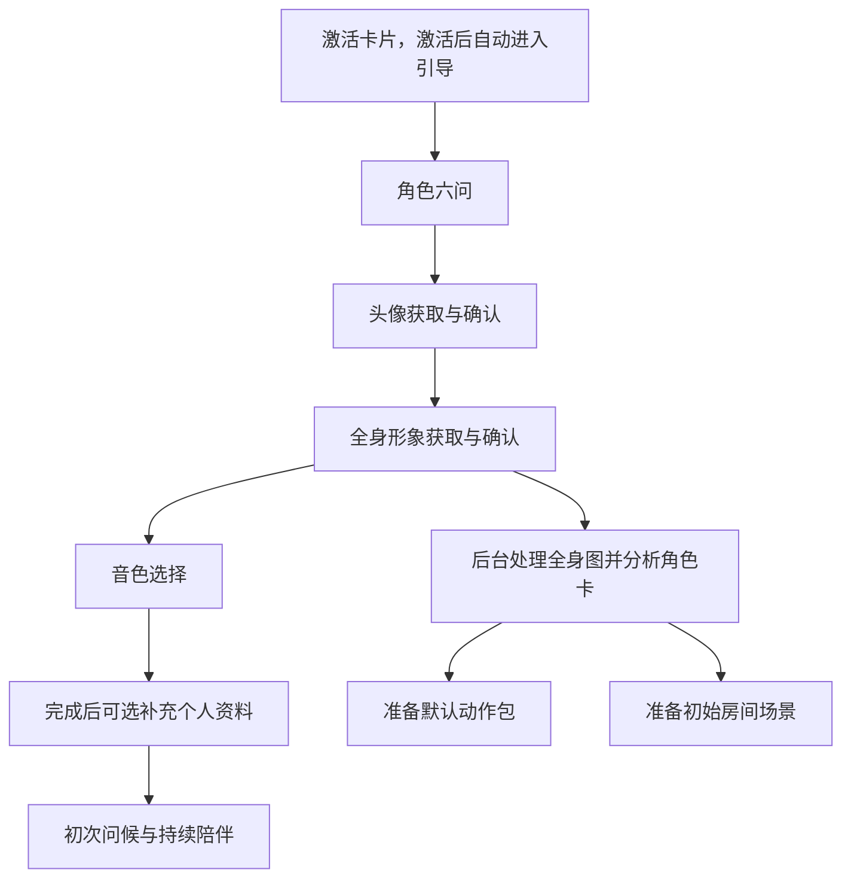

# 伙伴体验设计

本文定义用户可见行为、设计理由和故障表现。接口、字段与恢复流程由全局技术文档和源码维护。

## 设计目标

- 持续陪伴重视自然回应与稳定身份；工作体验重视过程可见与结果可信。两者共享形象，即时对话历史按会话独立，画像与记忆按预设分开。
- 生命感服从打扰档位、锁屏和降低动态偏好。系统通知不冒用伙伴口吻，未取得推理结果时不编造台词。
- 机械反馈与预制兜底只用于本文明确允许的场景；失败时保留可用呈现并说明真实状态。

## 认识伙伴

### 引导与后台准备

- 引导从认识伙伴开始，不先呈现技术配置表。未激活时自动打开激活卡片；激活后自动打开引导；引导没有关闭入口，完成前保持打开。
- 动作包与场景在后台准备，失败不阻断后续信息采集与问候；等待过程与其余引导重叠。
- 引导按“认识伙伴、确认形象、选择声音”展示进度，形象默认用 AI 制作，上传是次要入口。选择声音或明确先用文字聊天后完成引导，重启不重复询问；个人资料在完成页选填。初次问候由伙伴经主动回合生成，遵循[主动陪伴](#主动陪伴)档位，两小时内有效；失败或过期保持安静。
- 引导每页突出当前问题和下一步操作，降低理解成本。简单录入按内容收缩，形象和声音制作按需展开，正文超过可用高度时内部滚动，主要操作始终可见。角色和声音偏好问答输入后按 Enter 继续，多行答案按 Shift + Enter 换行；中文输入法选字时不推进。切题及选择预设后聚焦输入框，首题不显示返回入口。界面不额外显示快捷键及必填、可跳过标签；必填答案为空时禁用下一步，可选题显示跳过按钮。

| 资料阶段 | 内容 | 必填、跳过与修改 |
|---|---|---|
| 角色 | 名字、物种、性别、关系、性格、说话风格，依次询问 | 名字、生灵描述、说话风格必填，其余可跳过；回答即时保存，可返回修改 |
| 音色 | 选择固定音色、AI设计或录音／上传克隆声音，均可试听 | 确认后保存，也可先用文字聊天；后续在“伙伴 → 声音”修改 |
| 用户 | 称呼、性别、生日、爱好、补充信息 | 全部可选；跳过、缺失或后续删除不重新启动引导，可在记忆管理补填 |

- 资料问题同时提供文字和预制语音；音色试听使用固定示例句；生成、保存等等待与失败状态以系统说明呈现。
- 称呼类型只提示类别，生灵标签只提供示例，允许自由描述物种或自创角色。
- 关系影响相处方式，不参与外貌生成；生日用日期选择器，只接受真实日期。
- 重启恢复未完成的角色、形象与音色步骤。

### 制作过程与结果反馈

声音、形象、衣柜、窗口背景、动作和桌面背景共用制作反馈：输入与预览在正文中滚动，主要操作独立于正文并固定在制作区底部。同一操作的当前阶段只表达一次：按钮已显示阶段时，旁边仅保留离页、耗时等补充说明；按钮未表达的具体阶段由相关文字与图标呈现。错误与恢复入口放在相关操作或预览旁，不显示制作状态横幅，也不预留顶部状态区域。已保存或正在使用等常态由原有标签和按钮表达；开始制作、适配和确认的说明放在相关内容与按钮旁。仅锁定会与本次任务冲突的编辑、提交或采用操作，其他素材与页面仍可浏览；已有成品不因重做而被等待遮罩遮住。

进度只呈现实际已知的阶段，排队、分析、制作、等待用户操作、待确认与已生效分别表达；不模拟百分比或预计完成时间。持续等待超过 30 秒补充耗时说明，不据此判定失败或中断制作。离页会中断的流程提前说明，可后台继续的任务提供返回查看的说明。

错误留在对应制作区，保留输入与已有结果。预览加载失败只重试加载；制作失败按实际恢复能力继续，结果未知先核对原任务，不直接重复提交。未取得请求回执时允许查看最新列表并明确结束本地等待提醒，该操作不宣称原请求失败或已取消，迟到结果仍按原任务归属处理。制作完成、等待确认和实际生效分别呈现，采用与启用继续遵循各自资产规则。

### 伙伴声音

“伙伴 → 声音”顶部展示当前声音和试听入口，选择、设计和克隆声音直接作为页签切换。管理页完整展示音色列表与筛选，首次引导先展示推荐音色。设计与克隆分别保留最近确认的方案，切换固定音色后仍可重新使用。

- “AI设计”根据已填写的角色资料生成简短、具体的声音描述，依次显示设计描述、生成试听和试听与使用阶段。描述生成后立即可读，试听制作仍显示独立进度；用户可手动修改后重新试听，也可展开调整意见让 AI 调整，反馈只改变涉及的特征。
- 克隆支持麦克风录音和上传音频，可先播放原音，再克隆试听。建议使用 5–30 秒清晰人声，最长 60 秒。
- 试听统一使用示例句，主操作按阶段提供生成试听、调整并试听或使用这个声音，确认使用后才替换当前声音；修改描述或样本后须重新试听。播放失败不撤销候选，生成失败保留编辑内容和原音色。取消等待服务端确认，取消未确认时保留待核对状态，不能直接重复制作。
- 切换页面或隐藏窗口时停止录音与播放，已经提交的声音设计与克隆在当前窗口的账户会话中继续，返回后接续输入、进度与试听候选；后台完成不自动播放或采用。明确取消时请求中止原任务，换号或清理账户时释放会话任务并隔离迟到结果。录音与上传期间暂不能切换窗口／桌面模式。重启恢复已确认方案。

### 形象获取与确认

头像与全身均提供 AI 生成和直接上传，完成后依次进入全身、音色步骤。

| 场景 | 用户可见行为 |
|---|---|
| AI 生成前 | 头像描述侧重面容与辨识细节；全身描述侧重体型、服饰与稳定姿态，沿用已确认头像的面容与物种 |
| AI 生成后 | 当前图与近期候选一并显示，可选择候选继续调整或确认；头像确认步骤内不提供上传入口 |
| 进入全身步骤 | 恢复已有草稿；无草稿时直接填写可选描述，底部突出生成，用户提交后才制作；有预览后底部突出确认，微调与重新生成收于调整区，上传作为次要入口 |
| 直接上传 | 无需先获取提示词，不调用生图；多帧图片使用第一帧；采纳即确认。全身原图保存确认后即可选择声音，透明化和默认外观在后台准备，失败可从角色资料重试。上传头像或选择“继续当前头像”后进入全身步骤 |
| 本次描述 | 仅用于本次绘图；失败或重新加载时保留，成功加载预览后清空本次提交的输入 |
| 参考图 | 形象参考图用于借鉴外形，不直接成为头像；已有形象参考图时，重新生成可再附“光线与构图参考”，只调整光线、色调与构图，不改变身份，没有形象参考图时不提供 |
| 加载或确认失败 | 预览失败只重试加载；确认失败回到本步骤并说明原因。先恢复已保存图片，再决定是否重试生成，不展示原始异常 |
| 外部制作 | 按需展开提示词和参考资料，支持复制提示词、查看与另存参考图 |

“微调”与“重新生成”是两个显式操作，界面说明作用及不可用原因。微调优先延续当前图片的生成方式，重新生成尝试下一种；界面不要求用户理解供应商选择。结构、姿态与执行条件见 [PIPELINE](PIPELINE.md#微调与重新生成)。

### 身份锁定与角色卡

- 询问物种与性别时告知形象确认后不可更改；全身确认后锁定头像、物种与性别。名字、性格、说话风格、关系、音色和用户资料仍可修改；换装与视频重建不重新孵化。
- 系统从两张确认图整理固定外形，无需新增问答或逐项确认。“伙伴 → 资料”直接展示基本资料、角色卡原图及头部和身体特征，文字正常换行，分析状态与失败重试直接可见。
- 基本资料和角色卡分别在编辑弹窗中修改，正文滚动，保存与取消固定于底部；关闭弹窗保留草稿，取消放弃该编辑器的修改。切换页面和窗口模式保留未提交草稿，返回后可再次进入编辑，后台更新不覆盖草稿，并发修改先核对最新内容。角色卡文字可编辑、清空或恢复自动值，仅辅助后续生成；已确认图片仍是外形依据。重新提取保留手改内容。
- 可变造型在衣柜管理。角色卡提取与技术采纳流程见 [PIPELINE](PIPELINE.md#角色卡与并发写入)。

### 资产准备与复核

| 情况 | 呈现与处理 |
|---|---|
| 角色卡分析失败 | 保留确认图，暂停依赖它的新生成；显示状态与重试入口，不要求用户补填资料 |
| 默认动作包核查通过 | 自动启用；衣柜显示进度、失败原因与重试 |
| 整包或单独制作的动作有疑点 | 整包保留预览、不自动启用；单个动作在衣柜对应详情采纳；桌面伙伴区域顶部有内容时显示待确认数量，进入后直接预览和处理，加载失败提供重试 |
| 日常聊天、动态与夜间媒体 | 宽松自动核查，有明确偏差时有界重生成，最终使用已知最佳候选，不逐张打断用户确认 |
| 场景壁纸 | 检查是否重复描绘伙伴本人；失败与恢复见[场景说明](#场景与当前环境) |
| 场景尚未就绪 | 背景显示可读底板与准备状态，不延迟伙伴诞生；初始场景失败后可在场景页重试或新建 |

评分与恢复见 [PIPELINE](PIPELINE.md#供应商选择与失败恢复)，尚未就绪的形象按[呈现与降级](#呈现与降级)处理。

## 日常入口与账户

### 窗口与会话

窗口模式由精灵、轻语和唯一主窗口承载。打开主窗口收起精灵/轻语，隐藏或关闭时恢复精灵，最小化按系统行为；页面切换和隐藏保留草稿，不取消已提交任务。首次进入陪伴，以后按账户恢复页面与会话，通知和投喂的显式目标优先。

主窗口以对话、伙伴、动态、日记、设置组织功能。对话页有搜索、置顶、归档与新建入口，任务会话只读，执行详情按需展开；窄窗口会话列表覆盖内容，选择后收起。未读归所属会话，动态/日记独立提示，内容实际可读才确认。

主窗口侧边伙伴可选择显示和方向，切换不移动内容面板；拖动伙伴移动窗口。最大化、隐藏、锁屏或空间不足时临时收起，恢复不改变用户偏好。按完整人物轮廓等比适配，动作轮廓变化不逐帧缩放。

设置按陪伴、回应录音、显示、设备和应用账户组织，技术参数收进高级设置；保存失败保留修改。伙伴资料、声音、衣柜和记忆归伙伴入口，页面选择按账户恢复。窗口几何与状态交接归 [Client](../client/main/README.md#桌面承载与恢复)。

### 桌面模式

仅支持 Windows，从主窗口、精灵菜单、托盘或设置切换。模式切换承接页面、会话、主对话草稿和阅读位置，恢复成功才交接，失败回来源；录音、转写和上传时说明暂不能切换，已提交任务继续。

视频背景与悬浮底栏只出现在交互屏，其他屏保持 Windows 桌面。头像始终位于屏幕中线，打开陪伴，右键管理账户；左侧为应用目录、固定与运行程序，右侧依次为伙伴、动态、日记、设置及整排 Windows 原生系统托盘。两侧按内容扩展并保持头像居中，窄屏各自横向滚动，右侧产品图标与托盘共用滚动区域。未读与未听状态清晰可见，降低动态时使用静态提示。

原生托盘图标、系统信息和日期时间与产品图标共用底栏玻璃背景，不保留独立系统底色条。原生文字与系统图标前景随应用明暗主题切换；第三方位图保留原图及品牌颜色，以浅色圆角小底片保证深色背景下可辨认。托盘继续处理原生操作，沿用 Windows 的图标显隐设置与隐藏图标菜单；交互屏只集成本屏原有的托盘内容，不跨屏搬移系统内容，不把 TrafficMonitor 等额外任务栏面板并入托盘。右下控制入口独立于底栏；无法可靠呈现、定位或恢复托盘时恢复窗口模式并说明原因。

右下控制面板显示时间、连接、桌景、交互屏、打扰档位及返回窗口/退出。面板互斥并支持 Esc、失焦和外部点击收起，主动关闭归还焦点，切到其他程序不抢前台。功能以单实例内部窗口打开，可移动、缩放、最小化和最大化；重启按账户恢复窗口的开关、层级与最小化状态，已关闭的窗口保持关闭，显式跳转和模式交接按目标打开。正文与表单有不透明可读底色，底栏保留主题玻璃效果。

Dock 只投影当前虚拟桌面交互屏的实际窗口，合并同程序，后台/托盘不入动态区。固定入口保留，未固定项末窗关闭后消失。点击优先恢复本屏最近窗口，否则把异屏窗口及必要模态框移来；无窗口才启动。新启动和任务菜单窗口定位交互屏，无法定位如实提示；关闭沿用程序保存提示，不波及其他屏。

应用目录可搜索、键盘导航、启动和固定；拖入程序/快捷方式或浏览文件可添加，固定区可排序/取消，失效项可重选。启动不自动固定，失败保留可操作面板，提交启动不表示窗口已出现。目录覆盖与可信执行边界见[启动器契约](PROTOCOL.md#桌面呈现与本机启动器)。

主对话可切换陪伴、专业和只读任务，轻语固定陪伴主会话。两处共享消息与收听，当前合格视图取得录音及新语音资格；打开/恢复主对话收起轻语，用户仍可再展开。聊天声音独立于静音背景。

原生文件、文件夹、快捷方式与回收站在视频上方，保留 Explorer 图标样式、排序、框选、键盘和拖放，透明空白不挡桌面输入。底栏与功能打开时置前，其他程序可覆盖；系统仅为底栏预留底部空间，菜单不扩大预留。Windows 可随工作区调整图标，退出不强制还原旧坐标，保留用户整理。

背景用套装画幅，少量裁切或完整保留并补背景，管理预览与播放一致；无视频先用确认图/封面，无素材显示准备入口。全屏、锁屏或减少动态时暂停，恢复不抢焦点。桌面模式不显示独立透明精灵。

启用优先保存的可用屏幕，首次或缺屏按入口/鼠标位置回退且保留首选；手动切屏先恢复旧屏。拔交互屏回窗口，重接不自动接管。退出、换号、鉴权失效、更新或异常释放底部预留并恢复任务栏，保留外部程序摆放。恢复快捷键冲突时拒接管；异常后的首启先恢复系统并留窗口模式，首装默认窗口模式。

挂载检查失败保留窗口并说明原因。原生实现与发布验收分别见 [desktop-host](../client/desktop-host/README.md)、[Windows 桌面验收](../scripts/README.md#windows-桌面验收)。

### 激活与账户切换

激活卡片置顶但不阻断卡片外操作，未提交可取消。账户菜单支持添加、切换和明确移除，显示用户名及必要的后端区分；在移除子菜单中选择账户后直接移除，不弹确认框。添加账户时收起当前伙伴，取消后恢复；失败保留当前账户，成功切换回精灵并按目标账户恢复，引导未完成时进入引导。

退出/换号保留各账户缓存，明确移除才删目标缓存。移除非当前账户不影响当前会话；移除当前账户恢复系统桌面后进入激活。凭据与迟到请求隔离见 [PROTOCOL](PROTOCOL.md#凭据落盘)。

### 主题与图片查看

主题提供夜色、日色与对应透明样式，不改变形象；场景背景与内容底色共同保持消息、文字与代码可读。降低动态、透明度及系统偏好须有可用降级。表单与确认弹窗使用跟随明暗主题的实底卡片，避免下层文字叠影；菜单等浮层保留可读表面，不铺全屏暗罩；图片灯箱保留暗底。

共用图片查看覆盖对话图片、场景、外观、参考与引导：以整个窗口为暗底放大查看，适配原图、指针中心缩放、拖拽、双击切换、复制与另存；点背景、关闭或 Esc 退出。对话中的带语音图片与待确认图片同样可点击查看，查看不改变确认状态。触屏捏合暂不支持，使用工具栏缩放。

### 桌面更新

设置「关于」页发现新版本后由用户选择下载；下载完成且本机组件准备就绪才提供「立即重启」，失败时说明卡在检查、下载还是安装并可重试，不自动重启。macOS 暂不提供应用内更新，检查会如实提示失败。

## 形象与衣柜

### 身份、穿着与动态能力

头像与全身确认身份，衣柜管理造型，动作包提供透明图片/视频表现，场景提供窗口环境；普通聊天绘图不更改这些生效资产。换装不改变五官或物种，记忆学习不重生身份，参考依赖见 [PIPELINE](PIPELINE.md#资产依赖)。

系统动作服务待机、拖拽、行走和探身，按需补齐；动态动作由伙伴结合性格与情境提案，可重复使用。图片保持静态姿态，视频支持循环/单次，拖拽与探身默认图片。素材按着装隔离，可查看并调整；没有手动表演入口，制作完成不自动表演，有效的等待意图按[播放契约](PROTOCOL.md#动作目录与播放)兑现。

### 浏览、设计与穿着

衣柜入口突出自主换装开关、当前穿着和成品使用。选择着装进入该套预览与动作列表，设计新装使用独立页面；新建只打开可恢复的本地草稿，明确生成或上传后才制作。就绪着装可直接穿上，缺基础动作时提供准备/恢复入口。

新装确认入柜自动准备基础动作，保留当前穿着，完成后由用户选择穿上。首套初始化按身份核查自动启用。已有动作重做先预览确认，期间保留当前素材；采用素材与切换穿着分开，不提供版本列表。未制作的行走/探身不误报生成中，其他着装仍可操作。

失败保留描述、参考和草稿，加载失败只重试加载，结果未知先查原任务。锁定只限制自主穿着/添置，用户仍可操作；穿着中的着装不能删除，有动作包时页面说明删除限制。制作与采用归 [PIPELINE](PIPELINE.md#用户自备图)、[PROTOCOL](PROTOCOL.md#媒体复核与激活)。

### 呈现与降级

窗口模式仅在已激活且完成引导后显示伙伴：使用已就绪动作包，未就绪且无缓存时显示蛋形。未激活、激活卡片打开或引导期间均隐藏角色形象与蛋形。同账户启动或重新激活后复用最近成功缓存；重做、候选待确认或拒绝期间继续使用已采纳素材。

降级区分准备中、生成失败和加载失败，分别提供衣柜处理或重试加载，不以坏资产清空可用伙伴。外观描述失败由用户选择补全。桌面模式使用独立桌景，切换失败保留原显示，首次无素材显示底色与准备状态，不能将准备误报播放。

## 场景与当前环境

### 场景库与创建

场景是主窗口生活空间，避免重复描绘伙伴本人，可包含其他人物、动物或艺术陈设；环境不决定穿着和活动。初始房间后台准备，后续从场景库搜索、创建和使用，详情支持大图预览、编辑、重生成及删除。

桌面客户端的场景详情按当前状态直接展示编辑、重生成、取消任务与删除，不放入折叠菜单。生成状态与成品自动更新，正常流程不提供手动刷新；场景信息或图片加载失败时提供对应的重试入口。

创建默认 AI，填写环境和可选参考，外部制作按需展开；显示固定生活空间尺寸，上传保留源文件并派生展示图。用户创建后手动启用，伙伴只有有效申请和政策允许才自动切换。参考及产物规格见 [PIPELINE](PIPELINE.md#场景创建与描述)。

### 编辑、重生成与启用

| 操作或状态 | 对资产与当前环境的影响 |
|---|---|
| 图片与描述齐备 | 才可启用；自动生成必须通过重复伙伴检查，不合格候选不发布 |
| 描述分析失败 | 保留候选，只重试分析；创建任务也可手动补全，重生成继续使用旧成品 |
| 生成等待 | 持续显示真实进度，直到完成或明确报错 |
| 编辑标题或描述 | 先保存；随后可依据更新后的描述重生成图片 |
| 重生成进行中 | 原场景旧图和当前背景继续可用 |
| 重生成成功 | 原位更新图片与环境描述，保留用户标题；若当前正在使用该场景则刷新背景，不重新执行切换 |
| 重生成失败或取消 | 保留旧图 |

### 自主变化与锁定

- 锁定暂停自主新增与切换，仍允许用户在场景页面手动创建与切换。
- 自主变化须有情景依据，并遵守锁定与[夜间政策](#夜间生活)；场景变化不直接打扰用户，不受打扰档位限制。普通创作、旅行讨论或假设不代表环境已改变。
- 复用已有场景不消耗生图额度，计费与授权见 [PROTOCOL](PROTOCOL.md#场景启用与授权)。

### 桌面生活视频

桌景以独立套装库管理，冻结创建时角色、着装和环境；换装、场景切换或来源删除不改变它。新建只打开可离开和恢复的创建草稿，首次进入桌面没有成品时显示待选择素材及创建入口。列表以封面、当前状态和使用或继续制作为主；安静相伴首次生效前，状态及继续制作始终指向它，之后直达待处理动作。播放设置折叠管理自主切换与固定动作；详情在素材可预览时展示画面，当前步骤的操作固定在底部，草稿与当前成品的使用入口明确区分，重命名、删除收进更多操作。

制作按选择素材 → 确认画面 → 制作视频 → 预览使用引导。首步直接提供 AI 制作、自备图片和自备视频，预选有效场景、着装和显示器并提供名称；用户明确提交后才建立套装并制作安静相伴，取消文件选择保留草稿。AI 或上传图片都须由用户确认后制作视频；安静相伴视频生效后，才自动同步同着装的其他动作。预设活动默认只需点击按钮，名称、画面要求、运动调整和自定义活动收进「高级定制」，已有定制内容可查看和清除。场景、着装以预览卡展示，独立选择面板支持搜索，场景库支持分页；选择只更新创建参考，不切换窗口穿着或背景。参考缺失时可前往准备后返回草稿。

系统先确定活动需要的姿态、器物和空间，再准备并检查画面；不合格时有限次自动修复，只有合格候选交给用户选择「确认并制作视频」或「换一张」。已确认的共用画面满足活动条件时直接沿用，条件不足则为该活动准备专用画面并重新确认。画面变化清除旧确认，也可只改视频运动；普通失败提供一个恢复按钮，系统选择继续检查、修复画面或继续视频。身体结构不支持活动时说明原因并提供选择其他活动。

独立状态区显示真实制作阶段、排队、暂停、失败或结果待核对状态，不覆盖预览、不编造百分比或完成时间。失败概述保持简短，停止步骤、可读原因和恢复方式在正文中呈现；规划、检查或修复失败仍可查看当前成品，未合格草稿不作为待确认图片展示。制作视频时沿用已确认图片；重做画面尚无新图时可显示标注「当前成品」的原封面。待确认图片可点击放大查看。预览加载失败与制作结果分开提示，可单独重新加载；暂停保留进度，未知结果先核对，不能重复提交。

创建选择已连接屏幕，以其像素冻结目标；推荐标签按当前对照屏宽高比计算，不修改分辨率、交互屏或当前套装，不推荐仍可用。目标尺寸与实际尺寸仅显示像素宽高，与适配提示一同放在预览下方，不把放大当原生分辨率。输入按账户保存，切页/重启可继续，放弃只删草稿。

每画面保留当前和一个草稿。新动作尚无素材时不展示预览标题或大块空占位，待画面需要确认、独立画面已确认并进入视频制作或候选视频就绪后再展示。动作直接复用已确认的安静相伴基础图时，省略图片确认步骤及重复静态预览，提示沿用原画面并显示视频制作进度；若检查后转为独立画面制作，恢复图片预览与确认。已有成品重做时保留当前视频预览，真实素材的加载与失败状态独立呈现。首次普通视频检查通过后生效，已有替换、适配上传及微调先预览采用；期间保留当前。安静相伴是共用画面活动的基础图，更新后真正依赖它的动作标待更新、禁播，已有启用项自动重做并待采用，失败可单项处理，不撤销新基准；独立画面活动保持可用。

比例不符可保留、适配或取消，适配先本地少量裁边，超限才 AI 扩展/参考视频调整；原文件保留，图片重确认、视频待采用。微调预览显示时长和不可用原因，不自动截短或变速。桌面静音，上传/微调以真实首帧建基准并淡化转场；详细画幅和技术约束见 [PIPELINE](PIPELINE.md#桌面生活视频)。

动作分持续状态和短活动，适应实际确认图的身体、器物和空间；启用套装默认安静相伴，其他动作采用后加入可用素材，不主动切换当前动作，由伙伴按情境自主选择，制作页不提供单独点播。活动专用画面以淡入淡出衔接，短动作结束、失败或中断返回有效持续状态。“添加动作”只列出尚需完成制作的动作，已有成品或待采用视频从候选列表移除；待更新动作仍可继续制作。候选全部完成后隐藏添加入口，既有动作仍在详情中查看、复核和重做，自定义活动保留在高级定制中。自主评估可维持当前，固定/关自主/锁屏/全屏/降低动态继续抑制表演，跳舞等结合对话邀请选择；预设与节奏真源见 [桌面预设](../backend/features/desktop_life/prompts.py)及[模块入口](../backend/features/desktop_life/README.md)。

制作其他套装不抢占桌面，切换先加载、失败保留原图；删除当前回可用默认，无默认提示准备，默认删除不补建。聊天、自主和夜间只读启用套装确认画面，计划不能跨模式/套装兑现；状态及恢复归 [PROTOCOL](PROTOCOL.md#桌面生活视频与模式隔离)。

## 对话与语音

### 消息呈现

回应偏好影响台词文字/语音选择，同轮可混合。文字直接阅读，操作集中右键菜单；语音默认显示播放条，可展开台词、从头或断点继续，完整播完清未听，重播不退回未听。媒体以内联卡片交付，窗外提醒提供简短文字和查看入口。

自动播放只作用于合格可见会话的新语音，手动暂停同时停连播；历史恢复、开偏好和音频更新不补播积压。已开始播放在桌面菜单/失焦时可继续，关闭该会话全部视图则停止；收听与断点本机跨窗口/重启保存。文字无 TTS 入口，专业会话不提供朗读。

未读和未听独立，时间用本地 24 小时制，不写正文。编辑进入草稿并保留只读附件，较早消息发送前确认丢后续，取消恢复、失败留草稿；失败回复可重试且不重复工具。权限、替换回答和恢复归 [PROTOCOL](PROTOCOL.md#会话种类与历史修改)。

### 交付节奏与打断

- 陪伴只交付确认后的终端台词，不展示工具中间轮临时正文；专业会话可实时展示过程，历史保留终端答复与工具记录。气泡和业务消息的映射见[回复契约](PROTOCOL.md#结构化回复与终端交付)。
- 日常陪聊按一句一条的节奏发送，连续多句话各自成泡，单句不凑数量；语音按气泡顺序就绪后逐个交付。情绪通过自然措辞或语音演绎表达，画面与连续动作可由可用的图片、视频或动作能力承载，台词不附括号旁白；用户明确要求的书面故事、剧本、译文或引用保留必要的叙述和排版。
- 心情在身份区，视觉动作与空间行为各自呈现，旁白和控制标签不进入正文；资产生成与实际表演的区别见[动态能力](#身份穿着与动态能力)。
- 用户连发后约四秒停止输入才合并提交；继续输入、组字或发送重新计时，未发送草稿不参与。到期批次等待前轮结束，前轮完成不缩短未到期等待。
- 输入非空时发送，空时停止；主动停止立即提交已排队消息。点播其他语音保存当前断点；隐藏聊天、切页、切会话、锁屏、发送和开始录音时保存断点并清空连播队列，录音期间不自动播放。新收到的语音追加到队列，不打断当前语音。

### 语音保存与恢复

语音输入输出依赖云端，失败不阻断文字。演绎只作用于语音气泡的朗读，不混入台词或决定心情。演绎修复或语音合成最终失败时直接显示原台词，不以语音故障代替已成功的回复。历史沿用保存的音频；音频缺失同样显示台词，已有音频播放失败仍可重试播放；保存与幂等见[语音契约](PROTOCOL.md#语音保存与重试)。

### 专业预设与记忆归属

陪伴服务角色交流与生活记忆，文案秘书交付可用文本，语言老师提供讲解、纠错和练习。列表分为“系统对话”和“普通对话”：系统只自动创建唯一的陪伴主会话，显示伙伴当前角色名，资料尚不可用时显示“我的伙伴”，承接轻语与主动消息，不可删除、改名、置顶或归档。其他预设不自动创建对话；手动新建可选陪伴或专业预设，均为可删除、改名、置顶与归档的普通对话。话题历史独立，同预设共享长期记忆，创建后不改预设。

专业回复按任务需要组织，不强制每轮多方案或练习。系统与普通对话默认跟随全局推理与对话设置，当前会话可单独覆盖温度、推理深度和压缩阈值，恢复默认后重新跟随全局，技术定义归 [PROTOCOL](PROTOCOL.md#配置所有权与云同步)。

记忆管理按预设切列表、计数、筛选和草稿，搜索和分页找到条目后编辑；保存/取消分开，后台更新不覆盖草稿，遗忘须确认。陪伴域另有个人资料表单，清空既有字段表示遗忘，管理其他域不授权当前对话读取。证据、版本及隔离归 [PROTOCOL](PROTOCOL.md#预设记忆与学习作用域)。

### 远程页面

设置的「设备与能力」提供手机扫码入口、链接和已授权设备管理。扫码后直接在手机浏览器打开当前账户的专属页面，以聊天、伙伴、动态和设置四个底部入口承载内容；所有内容与桌面共享。云端聊天可在电脑离线时继续，本机操作须桌面与 Runner 在线。

二维码显示剩余有效期，扫码使用后失效，刷新替换旧码。手机显示连接状态和授权到期时间；桌面换号不改变已连接手机的账户。手机可主动退出，桌面可撤销单台或全部手机。撤销后关闭设备连接并禁止新操作；已经受理的对话仍由账户继续执行，已有副作用不回滚。若要停止回合，须在仍有权限的对话入口显式停止。

手机切后台或短暂断网后，已受理对话继续执行；返回时补齐历史和进度。录音转写先进入输入框确认，拒绝麦克风权限时仍可输入文字。页面内提供提醒，首次引导在桌面完成。授权和恢复细节见 [远程访问](PROTOCOL.md#远程访问)。

## 主动陪伴

### 在线档位

| 档位 | 在线主动表现 |
|---|---|
| 自主 | 可主动文字、语音、情境表达、移动及允许的生活活动 |
| 常规 | 原地轻量文字联系，不主动发送聊天图片、视频、语音、视觉表达或移动；独立生活动态按其开关执行 |
| 静止 | 不主动联系、发声、表达或移动，只响应用户操作 |

手动静止不被桌面活动覆盖；全屏和游戏等沉浸情境可临时静止。档位只约束会打扰用户的主动行为；用户聊天、任务请求、普通自动化、夜间整理，以及发布动态、写日记、提出动作等不直接打扰用户的活动不受档位限制，各自按相应规则执行。

临时安静从桌面精灵右键菜单开启，持续 50 分钟：期间按静止生效，但不改变档位偏好；到期回到届时的偏好与沉浸情境，应用重启不中断计时。可从菜单提前结束，在设置中选择任一档位也会结束。临时安静只作用于本机，不随偏好跨设备同步。

### 等待与主动表达

- 主动回合先安静判断，决定开口后才出现自然台词；沉默不产生台词历史、打字态或工具活动。历史压缩属于维护，可保存摘要，不代表伙伴主动说话。
- 伙伴可保存有目的的等待，时间或情境满足后再考虑交流，不因用户未回复循环催促。
- 重连和解锁不自动问候，过时安排不补发；用户发言优先于未交付的主动表达。
- 精灵隐藏、最小化或收起时不弹出精灵旁提示、不播主动台词；主动消息保留为未读，精灵重新可见后以待读气泡提示，进入所属会话才清除。
- 桌面提示气泡贴近可见形象的头部，随角色移动与缩放；右侧空间不足时放到左侧，并保持在屏幕内。

### 主动信息分享

伙伴可在夜间根据双方兴趣与近期交流寻找外部内容，每天保留最多五条有来源的发现。只采集最近 24 小时发布的内容，取得的正文、描述或现成字幕决定可表达的事实；当天可以不分享，也可以在不同情境中使用全部发现。

常规档和自主档有未分享内容时均可低频考虑交流，是否开口仍由伙伴根据情境决定。分享原文使用链接卡片，用户可选择“喜欢这类”“少推荐这类”并撤销；反馈只调整选择，不自动触发回复，未回应不解释为不喜欢。信息检索默认关闭，开启后仍遵循夜间总控；静止档限制白天主动打扰。

### 夜间生活

- 夜间整理只在夜间窗口启动、恢复和开始后续工作；已提交的制作可以跨窗口完成，不在白天补跑其他夜间活动。
- 夜间总控控制计划及其执行，关闭后仍可整理记忆、动态互动、反思和日记；场景、着装与动态创作开关分别生效。
- 伙伴可选择少量有理由的活动，也可不活动；未完成计划不写成经历，失败互相隔离，已完成结果供日记与后续联系回顾。

夜间更新不弹实时通知；次日联系先保留交流缘由，届时再决定是否开口与如何表达。联系须在线且非静止，只在目标本地日内有效，不强行兑现过时安排。调度与恢复见 [PROTOCOL](PROTOCOL.md#调度)。

### 自主动作与空间智能

情境表达与空间智能须自主档、精灵可见且解锁，情境表达另需空闲；两者各有开关、分别生效。精灵经托盘、快捷键或右键菜单隐藏、最小化，或被完整入口、轻语收起时视为不可见：不发起推理，已发出的空间咨询结果作废，表达也不在不可见期间播放。LLM 低频选择已有动作，由动作承载情绪，不另发情绪通道。

空间智能可选择陪工、漫游、靠近或不动；不动及推理失败均保持静止。智能关闭才用本地空间规则，且不生成开场白；靠近搭话保持低频，台词与动作分离。

## 窗口精灵表现与移动

以下规则只适用于窗口模式的透明精灵。桌面模式不创建精灵舞台，动作由桌面生活视频的持续状态和短暂播放状态承载。

### 状态与播放优先级

| 裁决对象 | 优先顺序 |
|---|---|
| 持续状态 | 断连 → 交互 → 工作 → 说话 → 思考 → 倾听 → 情绪 → 空闲 |
| 动作画面 | 拖拽 → 行走 → 探身 → 表达 → 待机 |

- 日常状态、情境表达、直接交互与空闲微动分别驱动表现；呼吸、眨眼不因此发消息或出声。
- 交互与情绪是短暂反馈，可临时覆盖说话或工作，结束后恢复仍有效的持续状态；其他低优先级更新不能打断说话或工作。
- 表达动作只在待机姿态上呈现：探身中收到表达先退出探身，播完再恢复；新的表达请求抢占正在播放的表达；精灵不可见或锁屏时中断。
- 只兑现当前形象支持的动作，无手动播放入口。视频 loop 默认一次，once 播完回基础状态；同动作再播从头开始，相同素材路径也须切换。图片随对应基础状态显示和切换，不通过播放计时结束。
- 落地、接取、长按等机械反馈由容器形变实现。

### 拖拽与直接交互

默认拖拽素材是一张被提起、身体松弛下垂的透明姿态图片；拖拽中持续呈现，松手即切回当前基础动作。拖拽、长按（约半秒）、文件拖入与右键有可区分的即时反馈；拖拽释放使用机械动画与预制语音，不调用推理。纯图片/视频拖入精灵进入轻语，混有其他文件则整批转主窗口的陪伴对话。主窗口打开后由侧边伙伴呈现，拖动它移动整个窗口，不操纵收起的精灵。手势与命中实现见[渲染层](../client/renderer/README.md#直接交互与命中)。

### 位置、移动与缩放

位置、移动方式与比例独立组合，不从聊天文本解析坐标。

- 用户拖拽立即接管并取消自动路径，松手处成为跨重启保存的栖息地（包括空中释放）；陪工、漫游与任务位置是临时位置。
- 拖拽释放时，实际轮廓至少四分之一越出左右边缘才保存为贴边栖息，否则收回全身；贴边时向屏内探身，回家仍恢复贴边。
- 窗口栖息绑定决策时选中的普通窗口，在直边中段探身；切换焦点或暂时覆盖不改变绑定，窗口关闭、最小化、探测失败或无可用落点时回家。缺少对应探身素材时自动请求补齐（付费生成；每个外观包每侧只建一次任务，失败不自动重新付费，需在衣柜重做），素材或定位不可用时保持普通栖息。
- 普通落位保留全身；探身露出完整头部或主要识别部位，保留可拖拽区域，气泡随露出范围定位。完整身体表演先移出遮挡，结束后返回仍有效的栖息位置。
- 姿态由动作素材呈现；拔屏或分辨率变化后重算落位，除必要恢复外不瞬移。
- 比例以用户设置为基准并即时生效，空间适应与表达放大平滑且不能过小；静止档、栖息与探身时不放大。
- 精灵右键“一键归位”让精灵回到默认位置并把默认比例重置为 1；托盘同名操作把精灵窗移回主屏并让精灵回到默认位置，不改比例。
- 自主档可陪工、漫游和靠近，常规与静止不自动换位，静止仍可拖拽。本机工具直接执行，伙伴的自主走位独立于工具调用；用户任务不受主动档位限制。
- 引导、屏幕变化、窗口情境和拖拽均可能改变位置；避免频繁走动或遮挡工作，精灵置顶但全屏应用等约定情形除外。

## 记忆、动态与日记

检索记忆保存有依据的长期事实，动态与日记呈现生活叙事。普通闲聊不逐条变成长期偏好，助手叙事不反向充当用户证据；专业会话只沉淀本域资料。

### 生活动态

动态是伙伴自主创作的独立社交时间线，可发布文字、图片、视频或语音，用户离线时也可发布；诞生、换装与场景切换不自动产生模板记录。

- 动态由独立主动调度创作，聊天和夜间规划不触发发布。用户可评论、删除本人评论；不能编辑动态或删除伙伴回复。
- 每条动态有自己的评论上下文，创作与回复共享身份、用户资料、有效记忆、相处理解、心情和当日陪伴对话，依据发布、评论和回复时间自然承接互动。正文和评论独立保存，互动可由夜间整理回顾。
- 列表可滚动并加载较早动态；卡片内常驻评论区与输入框，图片点击放大查看，回复显示进行中或失败状态，失败可重试。媒体由用户点播，不弹聊天通知。
- 动态与日记沿用伙伴页的标题层级、内容边距和卡片样式。动态正文可展开与收起，日记按日期翻阅；窄窗口下日历位于正文上方，页面统一滚动。
- 有未读动态时，动态菜单图标显示红点。进入页面并成功加载后清除本次已有提醒，前台浏览时新展示的动态自动已读；隐藏、最小化、失焦或锁屏期间保留未读。已读状态随账号同步，加载或确认失败时保留提醒。

提交结果未知的视频动态显示待核对入口，用户可查询、预览并决定采纳或放弃；排队或执行中的任务持续等待终态，不自动发布尚未采纳的内容。

自主创作使用一个开关，各媒体类型仍需相应供应商能力；发布、额度与日期归属见 [PROTOCOL](PROTOCOL.md#动态与日记)。

### 第一人称日记

日记由伙伴在夜间自主判断是否发布，按刚结束的用户本地自然日归集，以第一人称总结当天交流、动态互动和已完成活动，将情绪、感受与记忆自然融入正文；可以不写，发布后只读。发布保持静默，有未读内容时日记菜单显示红点，查看规则与动态一致；进入后新增的日记在正文展示时才确认已读。用户可以在后续陪伴对话中按日期或话题谈起日记内容。

伙伴还会结合全天互动，更新自己对双方关系、各自喜好和相处方式的理解；即使不写日记也可以反思。新的明确表达可以修正旧看法，这些理解不会改写既定人设。

## 故障体验

| 故障 | 可见反馈与处理 |
|---|---|
| 云端断连 | 明确等待状态；恢复时平滑回到正常，不补播问候 |
| Runner 不可用 | 保留陪聊，任务请求时说明本机暂不可达 |
| 资产不可用 | 按显示降级顺序保留形象，区分重试加载、下载与生成 |
| 登录或权限问题 | 提供明确处理入口，不持续无效重连 |
| 语音或听写失败 | 合成失败直接显示台词；播放失败允许重试，听写失败保留文字输入，不冒称已经播放 |

工具失败与结果未知分别说明，不能用表演掩盖没有完成。普通界面不显示原始堆栈；详细诊断留给开发者视图。
