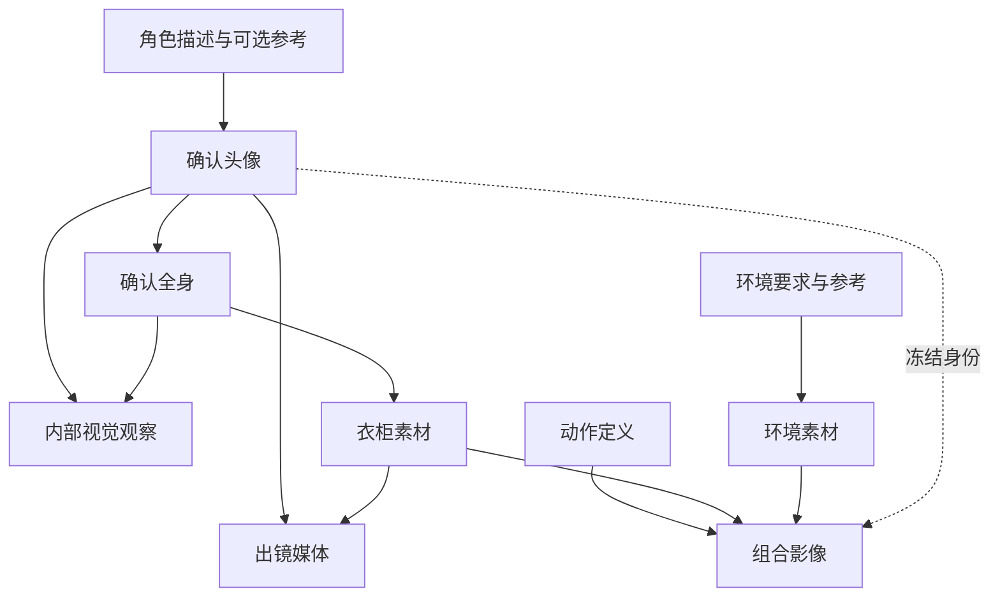

# 形象生成能力链

本文定义参考资料分工、制作阶段、供应商选择和媒体质量恢复。成品身份、发布与呈现的跨模块契约归 [PROTOCOL](PROTOCOL.md#伙伴与资产)，源码导航见各模块 README。

## 资产依赖

箭头表示资料依赖，不表示自动制作。首次全身生成/上传以当前确认头像和本次要求为输入；确认全身后建立视觉身份版本，默认造型尚未就绪时登记本地透明准备，内部观察按身份版本独立登记。视觉制作只检查确认图与所需素材，不等待观察成功。环境生图不接角色身份，仅重复伙伴检查使用确认图。生成、检查、用户采纳和实际显示分别生效。

## 身份、造型与参考输入

### 固定身份与可变造型

| 资料 | 权威用途 |
|---|---|
| 头像 | 面容、五官、脸型、物种与头部特征；关系定位不作为外貌 |
| 全身种子图 | 补足比例、结构和肢体；默认造型由已验收全身图形成 |
| 衣柜图 | 完整造型、发型、妆容、衣物和随身物品；身体参考职责取决于其全身来源 |
| 人物设定 | 供对话与生活判断；年龄、职业和背景不自动注入图像身份约束 |
| 内部视觉观察 | 带来源版本与不确定性的文字理解，只供无图的对话和规划，不参与生图或身份检查 |

新出镜媒体和影像按造型来源确定两图分工：来源匹配当前全身时，头像负责面容/头部、衣柜图负责身体/造型；不匹配时，当前全身负责完整身份、旧衣柜图仅负责造型。修改人物设定不改变参考分工，全身参考替换头像位置，不叠第三张身份图。仅明确采纳全身候选可改变身体身份，头像面容/物种继续固定。

参考职责、身份和检查依据随任务冻结，恢复不重选当前衣柜。组合影像使用单首帧供应商时，先将这组资料对齐为本任务外观参考，不能丢掉身份职责。编辑底图只承担画面修改，候选仍以原冻结身份、造型和环境检查，派生图不能自证身份；检查结论绑定原参考摘要，基准变更后重新检查。服装图先转写为设计文字，不直接成为身份参考；转写失败可按纯文字生成。

冻结正式图片使用原文件路径及资产关联，不复制参考字节；图片链、视频任务和队列持久保存路径，实际调用前才读取和编码。头像、全身种子图以账户根目录中的随机文件名区分新旧，更新保留旧正式原图；文件共享及保留边界见[资产生命周期](../backend/features/assets/README.md#引用交接)。

默认造型从已确认的[实际呈现快照](PROTOCOL.md#影像成品与模式隔离)取得：完整画面提供造型时配当前全身身份图，静态素材按冻结来源选身份图；画面取景和遮挡不能代替完整身份。文字 `outfit_override` 仅本次生效并关闭冲突造型参考；视频显式造型图配当前全身，不读取未选素材。装配入口为 [visual_identity.py](../backend/features/appearance/visual_identity.py)。

### 头像与全身

视觉模型根据实际参考、资料和反馈判断身体、材质及待机姿态，缺少视觉能力明确失败；不按物种/骨骼枚举套姿态，也不由身体推断性格。头像统一白底、正面、光照和留白，采用真实拍摄质感，不开放画风选择；纯文字形象不预设人类年龄；人物年龄设定不自动转为外形要求，用户本次明确绘图要求仍有效。

纯文字头像结合物种、性别和性格，有参考时只改明确特征。首次全身使用确认头像、本次要求和可选身体参考，后续重绘使用当前全身图保留未涉及的身体特征；候选仍对照确认头像复核面容与物种，生成完整入画、可稳定待机的透明图；指导不覆盖明确要求或头像身份，绘图要求不回写人格。

### 全身与造型透明成品

全身、衣柜及其微调/自备图均交付真实透明 PNG。生成按能力请求透明或纯白背景；下载后验实际 alpha、前景和边缘，合格保留原 alpha，不合格对同一结果做 ISNet 抠像再验，不追加付费生成。造型候选先透明化再检查，棋盘格和近乎不透明 alpha 均不能通过。

全身图的边缘不透明可能来自角色贴边，也可能是背景残留，只记录质量提示并保留图片供用户预览、确认；候选采纳和默认造型准备沿用同一规则。有效前景与足量透明背景仍须通过校验。

[图片处理](../backend/infrastructure/video_processing/image.py)保留原尺寸、位置和构图，不套动作图缩放/补边。生图前核对抠像模型，上传先校验字节；失败保留原草稿/正式状态，不发布不合格结果。首次引导可先保存并确认用户全身原图继续声音步骤，角色准备任务完成透明处理后才制作默认造型/后续资产；失败保留原图恢复。

### 造型设计与连续反馈

重生成同时向身体判断和生图提供原设计、按时间排列的成功反馈及本次反馈；本次只覆盖涉及维度。微调以上一草稿为底，只传当前反馈，不重复身体判断；草稿全身来源变更须重生成。全身重绘可用已有身体资料作未修改部分默认，明确调整和兼容参考优先，头像不变。

成功草稿才保存反馈历史。成品描述记录实际衣物、颜色、轮廓、发型和配饰，供后续组合使用；描述有独立状态，失败由用户补全，不自动重复付费，下游冻结已知资料，明确分析失败按图像参考兜底。入口见[造型服务](../backend/features/appearance/README.md)。

### 场景创建与描述

场景只提供环境/陈设/光线；生成参考不接角色身份，允许其他人物、动物或艺术陈设，但须排除伙伴本人及可辨认倒影、肖像、雕像。[重复检查](../backend/features/media/scene_review.py)单独对照确认图，不以同物种或一般轮廓判重复。

普通场景制作依次保存候选、检查画幅/重复伙伴、适配尺寸、分析描述。目标固定 2560×1440、16:9，选择可用原生档再等比裁切/缩放，不拉伸；目标、源和展示尺寸分开，放大不等于原生清晰度。影像导入的环境补全以原始采样帧的画幅选择可用尺寸。门禁不通过不发布，检查/描述失败留原候选续处理；描述可按流程手动补全。

上传保留原件并派生展示图，不做重复伙伴检查。标题/描述只写实际画面，其他角色不成为伙伴经历，已有环境不绑定身份修订；并发、生效和重试见[场景契约](PROTOCOL.md#场景任务与原位换图)。

### 场景图片重绘

重绘使用[同一装配器](../backend/features/scenes/prompt_assembly.py)，只冻结已保存描述和目标，不追加旧创建要求、旧环境图或衣柜。新候选完成检查/适配/描述后原位采纳，恢复复用当前阶段；具体提交、编辑和取消归场景契约。

### 组合影像制作

各类资产所需的身份、素材、计划、画幅和要求由 workflow 冻结；工作项和成品分离，重做/预算/版本交接遵循[影像契约](PROTOCOL.md#影像成品与模式隔离)。制作入口见 [visuals](../backend/features/visuals/README.md)，按资产类型选择路径：主体动画不绑定环境，角色完整入画，逐帧抠像并用真实时变 alpha 编码 WebM；依赖桌椅或复杂固定接触的动作应制作完整场景影像。普通环境视频复用素材作为首尾帧；制作请求可携带可选 `day_phase`，此时先沿现有图片链制作对应光线的起始图，再制作循环视频。时段目标、图片链进度与视频共用原工作项和恢复预算，重做沿用原时段；原环境约束布局与物品，起始图与目标约束光线，视频复核读取这些参考及抽样帧，不新增伙伴活动。完整场景影像沿用下表能力，不强制透明处理。

默认动态准备由后端在造型首次就绪与实际采用时触发：先制作默认待机循环，成功后按固定顺序渐进补充互动反应与常用循环，任一项失败即终止本轮；准备前先按身份、造型、动作版本与自动可播资格核对可复用成品。制作完成不等于可自动播放：成品保留在影像库供查看与手动使用，检查依据随成品版本冻结；待机循环没有合格成品时结束本轮，其余动作只记录原因并继续，稳定请求身份保证重启、窗口切换与循环结束不重复付费。

| 阶段 | 产物与失败边界 |
|---|---|
| 制作计划 | 核对身体能力、物品、空间、姿态及接触；无可用起始图时，计划和修复按冻结身份、当前造型与环境的职责读取参考。计划归该组合，修复或只重做视频不重新选目标。用户明确要求与活动必要条件须满足，模型自拟且非必要的精确姿态、左右手与时点属于实现细节，不单独作为失败依据 |
| 身份/造型对齐 | 全身图锁定身体、独立造型图只提供穿着时，先生成并检查任务内派生造型参考，再制作姿态图；头像与当前身体来源一致的衣柜图直接按分工使用。身份基准始终为原冻结来源，不回写衣柜。对齐与姿态分别存链状态/哈希，所选图片供应商同时约束对齐，会增加必要调用 |
| 起始图 | 身份和画面要求均通过才入库；已有合格图满足动作条件可复用。身份不合格从参考重造，身份合格而条件不足优先修候选；检查问题是修复资料，不覆盖用户要求 |
| 活动准备检查 | 对照实际起始图核对目标、用品、支撑和时长；物品/姿态不足回图像修复并清旧检查与输入绑定，时长不足在支持范围重规划，身体无法支持则失败 |
| 视频制作 | 循环使用同一合格图作首尾，短动作固定首帧并自然收束；进入公共队列，检查合格后发布视频，起始图独立为图片成品 |

计划、次数、候选、检查和转场随进度保存。检查暂不可用或返回不完整时先续审原候选，同一检查依据下复用有效的明确判定，重新观察无法判断的维度，补齐缺失检查及依据，不重新生图；冻结任务不改用当前参考或要求；新参考或新要求下的重新评估建立独立依据和操作身份，预算耗尽等待显式重试。图片重做从原冻结素材重新制作，视频仅改运动时沿用合格起始图。图片仅装配活动准备条件，起始图生成、修复和复核直接保留最初制作要求，不只依赖计划转述；角色视频由[请求装配器](../backend/features/visuals/prompt_assembly.py)直接使用冻结的动作目标、角色性格、必要物品与用户要求，让视频模型自行决定具体表演，不转发中间模型或旧检查点中的逐部位脚本，也不预写面部细节。通用要求与视频调整分别保存，新要求只覆盖涉及维度；复核依据实际目标、必要条件与用户明确要求，不把中间规划细节当成额外目标。未知提交与阶段复用统一见[持久化与恢复](#持久化与恢复)。

画幅受理时冻结，在满足输入/时长的原生档中选择最接近目标的尺寸，可低于目标；同分优先较少像素/裁切和配置顺序，计算归 [media_geometry.py](../backend/infrastructure/media_geometry.py)。模型档位去别名，实际尺寸从产物读取，适配仅限内居中裁切/等比缩放，无可用画幅在付费前失败。输出按旋转/SAR 还原显示尺寸，保存静音 MP4（主体动画为透明 WebM）、真实首帧和封面。

播放、预览、封面及过渡统一按实际媒体/视口比例：铺满裁切不超过对应边长10%才居中铺满，否则完整显示并用同画面模糊铺底；暂停、循环和切换共用规则，不以制作几何模式强行留边。

### 用户原件分析与素材提取

上传先保存原始图片或视频，随后由 [visual_imports.py](../backend/workflows/visual_imports.py) 编排内容理解、素材候选检索与复核、像素提取或生成补全、受控入库及呈现审核。原件不会因分析被重绘或截短；视频按真实可解码帧时间采样并保存相对时间标记，短片、低帧率与可变帧率不按名义时长猜测尾帧，透明视频保留样本 alpha；图片不证明连续动作。原生透明主体视频可派生统一帧率的透明交付与真实逐帧遮罩、首末帧和锚点，另存原件供查看及内容去重；没有真实透明通道时不能直接归为主体动画。动图按实际帧序列分析，缺少时间信息时保留不确定性；动图原件可预览，舞台自动呈现仅采用可控的静态图片或视频。提示词与完整请求装配分别归 [import_prompts.py](../backend/features/visuals/import_prompts.py) 和 [import_reasoning.py](../backend/features/visuals/import_reasoning.py)，图像顺序显式标注原始帧、身份参考、候选素材或提取结果，格式修复只编辑已有结果，不重新作视觉决定。

检索结合结构化内容与轻量颜色/空间视觉向量取得同类候选，最终复核读取真实素材图，向量分数不直接授予复用资格。直接提取裁切真实像素，完整主体另做既有透明处理；无匹配且原像素不完整时自动生成补全：环境以原图约束可见布局并移除人物，着装以伙伴身份和原图服装为不同参考。候选分别检查环境一致性、身份、服装和透明边缘，并说明不可见部分由生成推测。图片动作自动整理为可见的持续姿态；视频连续动作须有时间证据，均通过既有定义评审。人物图片必须给出可供选择的静态状态语义，不能因没有连续运动而省略播放条件。分析参考按原件采样精度读取，相同图片保留多种职责标签而不重复传输；环境匹配与提取复核只读取原画面和环境候选，身份参考只用于需要核对伙伴的任务。持久进度、撤销、冻结版本和恢复边界归 [影像契约](PROTOCOL.md#影像成品与模式隔离)。

### 出镜图片与视频

聊天/动态本人出镜媒体按[固定身份与可变造型](#固定身份与可变造型)冻结参考，缺必需资料在提交前失败。普通视频保留有序身份/造型参考，以目标效果、角色气质及必要条件描述内容，具体表演由视频模型决定；对话系统说明、视频工具参数与动态创作共用[视频目标指引](../backend/infrastructure/ai/media_guidance.py)。普通视频不先造校准首帧，也不把多参考降为单首帧；组合视频由合格起始图驱动。

局部造型覆盖有依据地合并，只影响本次产物；视频 `reference_image` 是该次造型参考，其他主体保持各自参考职责。动态旁白是独立音轨，不承诺口型。提示词定义见[公共媒体](../backend/features/media/prompts.py)，交付绑定归[媒体引用](PROTOCOL.md#媒体引用验图与原位交付)。

### 提示词与供应商输入

真实拍摄质感、编辑原图质感和首帧连续性分别按任务装配，摄影质感差异不当身份冲突。组合图片中尚未通过检查的候选不能锁定错误的 CG 质感；修复继续满足真实摄影目标，保留人物与环境的有效设计。描述目标所需的可见状态、动作与衔接，安静可为完整目标；保留明确速度/频率/幅度/顺序，次级运动有事实依据。循环要求接点连续，无法闭合时改用短动作或持续阶段，不要求全身每处都运动。

参考按原顺序承担身份、造型、环境或编辑职责，不拼图、不丢资料。公共要求只装配一次，尺寸由请求规划，透明依供应商能力；缺输入容量、编辑、多图、首尾帧、画幅或时长支持在付费前过滤。审核改写保留硬约束，无法保留则失败；评审缺陷不直接塞进制作指令，千问视频关闭智能扩写。写作规范归 [RULES](../RULES.md#提示词设计与修改规范)。

## 编辑、上传与身份采纳

### 微调与重新生成

`mode` 显式区分重生成与真实编辑。编辑须有反馈、可读底图和供应商能力，不接附加参考，不满足明确失败，不能静默重绘；身份条件化不等于编辑能力，定义见[供应商基类](../backend/infrastructure/ai/providers/base.py)及[图片链](../backend/features/media/image_generation.py)。

局部修改保留其他内容，姿态/轮廓改变允许必要接触、遮挡、褶皱与光影联动，仍受身份/构图约束。造型可改稳定姿态但不改身体，出镜按活动取景，动作图固定相机且完整入画。重生成及外部提示词须有原设计或有效反馈，全空在付费前拒绝。

### 用户自备图

外部提示词与内部生成共用必需参考和画面要求，使用通用描述而非工程或供应商私参。自备图跳过生图，仍走字节、透明、存储与采纳检查；用户采纳不等于程序验证身份。

外观仅确认已存草稿，入柜不直接改变显示。环境外部制作创建待上传草稿，上传分析后显式保存，取消保留草稿。字节和并发接口见[头像全身与确认](PROTOCOL.md#头像全身与确认)，未知任务沿统一恢复。

### 全身候选采纳

已确认伙伴的重绘、微调和自备全身先成为候选。透明验收及直接对照确认头像的面容/物种复核通过后，才可明确采纳；身体可以按本次要求调整。复核失败保留候选，可重试复核而不重新生图。旧身份版本的候选不能采纳。

采纳原子替换全身引用并递增视觉身份版本，头像保持固定；已有造型和影像不自动重建，后续制作按新身份与旧造型分工，环境不绑定身体身份。

### 视觉身份与内部观察

确认原图以不可变路径保存，透明处理只产生默认造型等派生素材，不改写身份原图。首次确认和后续明确采纳才推进 `identity_revision`；人设修改、观察重试和透明准备不推进版本。出镜任务冻结原参考、哈希、参考职责和身份版本，恢复不重选当前资料，发布前再次核对身份。

[后台任务](../backend/features/appearance/background_tasks.py)独立管理透明素材准备与视觉观察。观察一次读取确认双图，只记录可见外观、结构、活动条件和未知项，不从衣服、遮挡或局部轮廓补全身体，不推断年龄、职业、性格或实际能力。观察按身份版本去重，每份最多尝试三次；失败保持未知，迟到旧版本结果不生效。它不是身份定义，也不进入图像或视频生成提示词。

初始化准备可独立重试，重启续原任务。默认造型实际就绪后，通过同事务事件衔接内置动作与有限基础动态准备，不依赖观察状态。

## 供应商选择与失败恢复

### 能力筛选

按所属任务链检查实际参考、编辑、首尾帧、时长和分辨率，审阅使用同任务 LLM；原生透明声明不代替 alpha 验收。首次依配置顺序，组合影像先按原生尺寸匹配排序；微调优先原模型，重生成从当前实际成品来源下一项开始，最多一圈。来源随最终选择保存，图片/视频分别记录，不能取最后尝试项；恢复沿冻结链/游标。

#### 本地 ComfyUI

本地图片适配支持文字、多参考和透明；编辑画布随首张参考，条件生成按请求比例。暂时查询失败续原 `prompt_id`，不重交，参考存留由部署方保护。具体工作流、loader、批量和采样配置见[适配器](../backend/infrastructure/ai/providers/local/image.py)，部署归 [Backend](../backend/README.md#本地供应商)。

### 质量选择

角色画面的质量以角色还原度与自然度为准；具体表情或动作形态本身不构成质量失败，判定不还原或不自然须有可见证据。身份检查只判断固定外形，服装、姿势、环境和文字另按任务目标审阅。出镜图/影像画面须同时满足身份、目标与自然度检查；自然度独立核对比例与连接、支撑接触、遮挡、尺度及受光融合，不能以衣物和布景一致代替。视频还须最终复核；头像、全身与衣柜按各自预览确认流程，环境走独立门禁。定性结论契约归 [review_contracts.py](../backend/features/media/review_contracts.py)，候选选择与失败分类归 [chain.py](../backend/features/media/chain.py)。

| 结果 | 允许的下一步 |
|---|---|
| 明确生成失败 | 每供应商/位置一轮，沿剩余链前进 |
| 提交未知 | 停后续付费，批量缺额同样保留未知，不补重投 |
| 下载或本地处理失败 | 恢复同结果，不直接再生成；损坏视频可在确认生成损坏后沿链，本机探测故障不算损坏 |
| 审阅中断或结果不完整 | 停追加生成；持久任务保留候选与证据供人工选择，也可显式续审缺失或不确定维度，已有明确判断保持 |
| 检查服务审核拒绝 | 显示审核原因，调整要求或参考后再制作，不按格式错误反复修正 |
| 有合格部分 | 批量独立交付合格槽位；其余保留为待处理，不缩减原目标。人工采用所选候选，重新生成只作用于选定槽位 |

必需审阅配置在生图前检查；目标、参考职责、审阅模式和结果冻结，恢复复用决定，视觉判断或人工放行不覆盖技术门禁。头像/全身/造型遇明确审核拒绝可沿原链做一次合规改写。非出镜视频缺探测工具的例外由调用方定义，不泛化至出镜交付。

### 全局视频队列

所有视频入口在准备输入后进入持久队列，以供应商类型和实际密钥指纹分组，同组跨账户/配置/功能共享一个名额、顺序执行，不同组并行。提交至远端确定终态占额，下载/处理/检查/发布不占；队列保存引用与指纹，不复制密钥，公开只给独立 ID。

未接单限流保队首并按 `Retry-After` 或有界退避持久冷却，取消/重启不绕过、不回退供应商、不重做前置或重计额；明确失败沿冻结链到下一组队尾。未提交时重解凭据，变更则重排；已提交固定原端点/密钥，凭据不可得等待核对，不用新密钥查旧句柄。

未知占用有句柄续查、无句柄人工核对，确定终态前不重发。成功状态暂缺下载地址时，先对同一句柄有限复查，仍缺地址则保留阻塞并由队列续查，不向业务交付空地址。已知地址下载失败保留原结果，业务继续原下载及检查，不重新提交制作。排队可取消离队，接单后队列独立收尾；业务暂停停止领取未提交尝试，已提交尝试继续核对远端并由恢复沿原尝试接收结果；维护阻新提交但核对继续。删除/恢复仍保必要匿名占用，业务消费终态后才按保留规则清理。管理核对归 [PROTOCOL](PROTOCOL.md#视频排队与结果核对)，策略归[队列服务](../backend/features/media/video_queue/service.py)。

### 一致性检查与发布复核

视觉模型分别判断身份、制作目标和自然度，结论采用[媒体检查与发布](PROTOCOL.md#媒体检查与发布)定义的定性结论，必须附可见依据，不输出主观相似度分数。必要维度由任务决定；全部明确通过才合格，任一明确冲突不合格，其余待复核。服务不可用、格式错误和审核拦截独立记录，不冒充内容判断。合理表情、透视、遮挡和摄影风格变化不单独构成冲突。

图片按实际成品检查，视频读取首尾和中间采样，组合视频保留九帧；任一采样帧的明确身份冲突不能被其它帧抵消，稀疏采样不能证明未采样瞬间稳定。身份依据始终来自冻结原参考，派生首帧不能覆盖原始冲突。全身候选采纳只核对头像固定的面容与物种，允许本次身体调整。

检查前冻结实际送检图片、参考职责、要求、策略与内容哈希。续审读取同一证据，只补缺失或重新判断 `review`；有效的 `pass/fail` 不因普通执行进度变化而失效。已冻结任务不自动改用当前伙伴资料。自动流程按既有供应商和候选顺序选择首个全部合格结果，合格后停止生成；无法判断停止自动生成，保留候选和证据。人工界面提供候选选择与重新生成，采用建立独立的人工依据，不修改原模型判断；生成新一轮候选有独立操作身份，不能把旧候选重新当作新结果交付。

检查资格、业务采纳和自动呈现分别生效，业务采纳不等于自动演出资格。自动使用的默认拒绝与门禁归[媒体检查与发布](PROTOCOL.md#媒体检查与发布)。

### 持久化与恢复

付费前保存冻结供应商、参考、游标与阶段，返回后保存句柄/结果，审阅后保存选择；预登记路径、原子写文件。视频尝试按生成身份与游标唯一登记；登记后业务检查点中断时，恢复先查原尝试，不因当前配置变动而跳过已付费工作。凭据实时解析，旧句柄不能发往变更端点。

| 已存进度 | 恢复方式 |
|---|---|
| 句柄 | 暂时故障退避续查；鉴权/计费问题等核对，不因耗时重交 |
| URL/内联结果 | 先保存后下载；传输有界重试，坏格式、超限、过期或磁盘失败不重生 |
| 文件/审阅决定 | 复用已有后处理与结论，不从头制作 |
| 未提交的下一项 | 沿冻结输入及原游标继续 |
| 未知提交 | 停后续付费并保占用，有最佳候选可留但不伪造终态 |
| 选择已提交 | 清落选/不交付素材，保共享和恢复引用 |

恢复不重读当前身份、衣柜或模型顺序；取消、采纳和引用交接由业务定义。网络自动重试与持续等待统一见[模型失败与重试预算](PROTOCOL.md#模型失败与重试预算)。

## 动作素材定义与评审

动作定义以可复用的目标效果为中心，只补充必要用品、支撑接触、活动成立必需的过程与收束，以及用户明确要求；具体表演由视频模型结合角色性格和实际画面决定，不预编排面部操作、固定手势或逐秒脚本。聊天工具、生活规划与夜间设计共用 [动作设计指引](../backend/features/action_library/prompts.py)，评审不因缺少非必要的表演细节而拒绝目标清晰的定义。定义包含适用条件、持续/短动作类型和时长，另携带结构化调度语义：`semantic_tags` 描述动作本身含义、`performance_role` 区分常驻/持续/反应、`motion_intensity` 标记动作幅度、`interruptible` 说明是否允许中断。语义标签描述动作而非使用场景，使用场景归适用条件。定义不绑定造型、环境或成品，同一动作可用于多种组合。

实际媒体语义由现有视频抽样评审根据首帧和视频采样给出，随已选候选保存，并冻结到成品版本的 `source.media_semantics`；重做或定义编辑不追改历史版本。它记录实际活动、可见行为、动作幅度、环境和物品条件及明确排除项，不能照搬通用动作的全部用途。例如“专注做事”的阅读视频不能自动代替创作视频。无法用当前活动和环境标签确认的必要条件令 `auto_selectable=false`，仍可由用户明确选择；未知语义不自动调度。身份、身体结构、当前造型和主体合成元数据继续由舞台目录准入校验。

成品目录的收录资格与版本选择见[影像成品与模式隔离](PROTOCOL.md#影像成品与模式隔离)；影像库保留各版本供查看和手动选择。

### 定义与评审

自创动作每次提交冻结角色身体资料和动作含义，评审按顺序读取完整全身图及头像，判断动作是否明确、符合身体结构及目标时长；组合制作再判断具体空间/用品。内置定义为通用活动，不冻结个人身份或执行这轮语义评审。入库、编辑和失败处理统一见[动作契约](PROTOCOL.md#动作素材与影像播放)。

### 恢复与资产引用

自创定义、状态与冻结参考结构由 schema 校验；仅技术失败记录允许 `review_source_json={}`，等待显式重评。已知评审结论复用，恢复不制作。冻结评审参考独立持有文件引用，来源删除不回收它。入口见[动作模块](../backend/features/action_library/README.md)，文件删除归[资产生命周期](../backend/features/assets/README.md)。

## 验证

### 完整提示词链检查入口

检查单位是实际完整请求及消费结果，包含供应商原生字段；用户资料、中间模型和图片都不扩大授权。按下列源码定位完整装配，分支细节以当前实现为准：

| 任务 | 装配/消费入口 | 必查差异 |
|---|---|---|
| 头像/全身 | [prompt_assembly](../backend/features/appearance/prompt_assembly.py)、[fullbody_reference_prompt](../backend/features/appearance/fullbody_reference_prompt.py)、[avatar_service](../backend/features/appearance/avatar_service.py) | 纯文字/单参考/双参考、重绘/编辑/外部制作、首次确认/候选采纳 |
| 身份/造型 | [后台准备](../backend/features/appearance/background_tasks.py)、[outfit_service](../backend/features/appearance/outfit_service.py) | 确认图与派生素材分离、非阻塞观察、身份版本、反馈顺序、透明化、成品描述和双语 |
| 环境 | [场景装配](../backend/features/scenes/prompt_assembly.py) | 文字/环境参考/自备图、重复伙伴、描述/重绘、源图与展示图 |
| 出镜媒体 | [visual_identity](../backend/features/appearance/visual_identity.py)、[聊天图片](../backend/workflows/chat/images.py)、[视频任务](../backend/features/media/video_jobs.py) | 静态/完整呈现、来源变更、造型覆盖、多参考、验图与身份变更 |
| 组合影像 | [creation](../backend/features/visuals/creation.py)、[generation](../backend/features/visuals/generation.py) | 计划、对齐/姿态、修复、尺寸/时长、未知提交与冻结恢复 |
| 动态/评论 | [publication](../backend/features/posts/publication.py)、[replies](../backend/features/posts/replies.py) | 发布目的/媒体、完整背景/线程边界、事件时间、删除与重试 |
| 本机工具 | [Runner 装配](../runner/spirit_agent_runner/bootstrap.py)、[清单生成](../runner/spirit_agent_runner/runtime/tools.py) | 本地/SSH、平台/禁用、配置代次、学习域和代码子调用 |
| 审阅/回退 | [character_images](../backend/features/media/character_images.py)、[identity_review](../backend/features/media/identity_review.py) | 身份与目标分别校验、低分/缺证据/不可用、拒绝改写和恢复 |

### 验收范围

- 参考变更覆盖身份/造型分工、顺序、覆盖优先级、来源/修订变化及并发；编辑/上传核对前置守卫与采纳，不能只检查单块提示词。
- 透明处理覆盖原生 alpha、白底、棋盘格、近乎不透明、无前景和抠像失败，检查原尺寸、边缘及失败时原状态。视频透明/遮罩处理变更须验真实编码、完整时间轴及 Chromium 合成，能力声明和静态抽帧不足。
- 环境覆盖固定交付尺寸、横/超宽/竖上传等比适配、源图保留、含伙伴和无关人物/动物/雕像、检查不可用及全部候选重复；显示器变化不改请求，编辑画布仍按其底图规则。
- 图像/视频按本次目标另查姿势、衣物、用品、环境和文字；安静/循环视频检查全身、支撑、衣物的时间变化及接点，身份高分和少量成功不证明质量稳定。
- 恢复覆盖提交未落库、轮询/下载中断、未知及迟到结果，核对付费次数、原身份与引用；可加载、模拟、真实供应商和实际显示分别报告。

对比提示词时保存脱敏完整请求、参考顺序/哈希、模型、种子、采样、实际尺寸及失败样本；上游改写也保留输入/原始输出。仅文档改动核对事实和链接，不触发付费制作，命令归 [Scripts](../scripts/README.md)。
