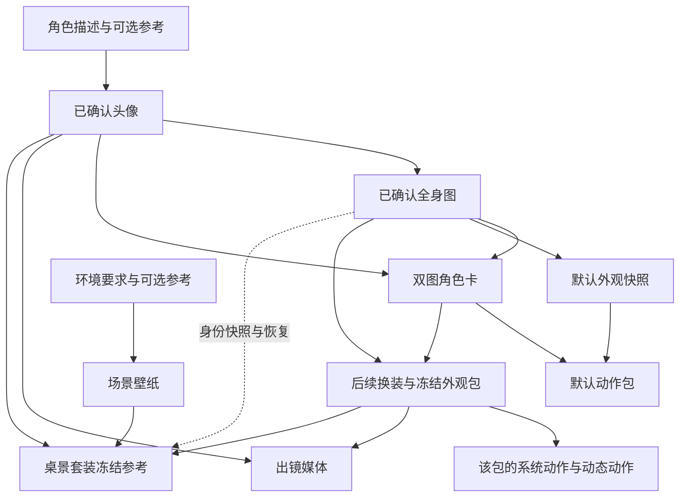

# 形象生成能力链

本文维护身份与造型参考、生成编排、供应商能力、产物质量及制作恢复；资源启用与交付由 PROTOCOL 定义。

## 资产依赖

- 图中的箭头表示生成资料依赖；角色卡就绪前，换装与出镜媒体不能生成。场景生图不接收角色身份，发布前另用当前确认图检查是否重复描绘伙伴；已有壁纸不绑定身份修订。生成、用户采纳、资产激活与实际播放分别处理。

## 身份、造型与参考输入

### 固定身份与可变造型

| 输入或产物 | 必须保持的语义 |
|---|---|
| 头像图 | 由角色描述与可选图像生成，提供面容、五官、脸型、物种和头部标志特征；关系定位不作为外貌属性 |
| 全身种子图 | 由头像、角色资料和可选身体参考补全身体比例、身体结构和肢体轮廓，生成真实透明 PNG、完整入画、稳定的性格化 idle 姿态 |
| 当前着装图 | 从全身种子图派生的完整全身外观，包含当前服装、发型、妆容、鞋履、配饰与随身物品；按下述全身来源承担身体或造型参考 |
| 默认外观 | 全身确认时复制为独立的当前着装图快照，默认动作包直接从该快照生成 |
| 换装草稿 | 全量重绘以全身种子图提供身体基线；视觉模型判断可穿戴部位、材质与姿态，不添加原本没有的器官 |

- 新出镜媒体、动作包和桌景按着装的全身来源冻结两张参考的职责：来源匹配时用“头像图 + 着装图”，分别提供面容头部、身体与造型；来源与当前全身种子不同时用“当前全身图 + 着装图”，分别提供完整身份与身体、仅造型。仅角色卡文字修订不改变来源分工。角色卡只补充相容描述，文字冲突或空白不授权重塑、补造或删除图中部位。
- 全身种子图还用于派生着装、身份版本校验和恢复；作为完整身份参考时替换头像位置，不增加第三张角色参考。参考角色与评分依据随请求冻结，已有任务恢复和已完成资产不重新按当前衣柜选择分工。桌景确认后以该画面为后续视频依据。
- 供应商只接受单张姿态或首帧参考时，先按上述两图分工，在已有的一次校准中生成本任务的统一外观参考，再继续后续动作链。
- 仅用户重绘并明确采纳全身候选可改变身体身份；头像的面容与物种仍固定。换装、文字编辑和日常媒体均无此权限。

- 服装、发型、发色、妆容与配饰属于可变造型，由外观描述承载。
- 用户服装参考图先与文字整合为着装描述，不直接作为换装生图的身份参考；整合失败可按纯文字生成。
- 默认造型的出镜媒体须取得可读的身份参考和着装图。文字造型覆盖只消费头像；视频显式造型图搭配当前全身身份参考，两者都不查询或读取未使用的默认着装。

### 头像与全身

视觉 LLM 按实际参考、外貌、性格与反馈判断身体、材质及待机姿态；缺少视觉模型明确失败。不设物种、骨骼或性格枚举，性格标签依据角色资料，不由身体结构推断。

头像结合本次要求与物种、性别、性格；有参考图时只改明确特征，不另注入物种和性别。统一追加白底、正面、光照和留白；头像统一按真实拍摄的人像呈现，不提供画风选择，纯文字头像默认年轻外貌（角色卡没有年龄字段）。全身扩展用确认头像、本次要求及可选身体参考，视觉指导不覆盖明确要求或头像身份；绘图要求不写入人设或角色卡。当前着装图由确认全身图派生，沿用头像面容并替换当前造型，供后续媒体使用。

### 全身与着装透明成品

- 全身、换装、微调及自备图统一保存真实透明 PNG，默认外观复制已验收的全身图。确认与候选采纳再次验收透明成品，不能把画出的棋盘格或仅带近乎不透明 alpha 的图片当作透明图。
- 生成沿所属任务的图片链顺序调用，支持原生透明时请求透明背景，其余请求纯白背景。下载后按实际 alpha、前景覆盖率及边缘检查：有效透明图保留原 alpha，不合格图对同一产物执行 ISNet 抠像并再次检查；透明度失败不追加付费生成。换装候选先透明化，再做身份评分。
- [共享图片处理](../backend/infrastructure/video_processing/image.py)保持原尺寸、主体位置和构图，不使用动作图的缩放或补边。全身与着装生图前检查抠像模型；上传在字节校验后处理，抠像或验收失败明确报错，不安装不合格图片、不改变原状态。

### 换装与连续反馈

- 重新生成时，身体判断与最终生图都接收原设计、按时间排列的已接受反馈及本次反馈；新反馈仅覆盖涉及维度，其余修改与基础身份保留。微调以上一版草稿为底图，只传本次反馈，不做身体判断。
- 反馈历史随成功草稿保存。草稿的全身来源变化时，须按新全身图重生成，不能继续微调。
- 全身重绘同时消费已有身体资料与当前着装；身体资料只作未修改部分默认，明确调整及兼容第二参考优先，头像特征不变。
- 命名后的造型描述供后续桌面、视频与出镜媒体使用，保留主要衣物、颜色、轮廓、发型与辨识配饰，不只概括风格。描述有独立状态，失败由用户选择手动补全，不自动重复付费；默认动作脚本首次调用前等待描述完成并冻结，开始制作后不实时回填；明确失败按参考图兜底，等待与恢复见[生成服务](../backend/features/appearance/README.md)。

### 场景创建与描述

场景只提供环境、陈设、光线与氛围，不提供伙伴身份或穿着。参考只承担环境线索，允许其他人物、动物和艺术陈设；自动生成须排除伙伴本人及可辨认的倒影、肖像和雕像，避免与窗口精灵重复。生图不接收伙伴身份图，独立[视觉检查](../backend/features/media/scene_review.py)才使用当前确认身份作比对，不能仅凭相同物种或一般轮廓判定重复。

制作按生成 → 保存候选 → 画幅/重复伙伴检查 → 尺寸适配 → 描述分析推进。目标为固定 2560×1440、16:9，选择可用原生画幅再等比居中裁切和缩放，禁止拉伸；分别记录目标、原始和展示尺寸，不把放大当原生清晰度。

未通过画幅或身份重复门禁的候选不得发布；检查不可用和描述失败保留候选，只重试相应步骤，不重新生图。上传保留原文件并派生展示图，不做重复伙伴检查；创建任务通过检查后可手动补全描述。标题和描述只记录实际画面，环境中的其他角色不成为伙伴事实；已有壁纸不绑定身份修订。状态和启用归 [PROTOCOL](PROTOCOL.md#场景任务与原位换图)。

### 场景图片重绘

重绘与创建共用 [场景装配器](../backend/features/scenes/prompt_assembly.py)，冻结已保存描述和目标尺寸，不附加旧创建要求、旧场景图或衣柜造型。新候选完成检查、适配和描述后原位提交，输入与供应商进度用于恢复，未知提交不重发；提交、编辑与取消契约见[场景任务与原位换图](PROTOCOL.md#场景任务与原位换图)。

### 桌面生活视频

桌景在创建时冻结角色、着装、环境及目标尺寸，来源关系只用于追溯。默认套装从初始化来源建立一次，删除后不自动补建。当前/草稿、基准失效、采用、播放和备份归 [PROTOCOL](PROTOCOL.md#桌面生活视频与模式隔离)；制作入口及资源归属见 [桌面生活](../backend/features/desktop_life/README.md)。

AI 制作按具体活动规划 → 静态图及检查 → 用户确认 → 运动设计 → 视频检查 → 采用推进。规划结合预设目标、冻结角色和环境及可选用户定制，固定具体活动、起始姿态、必要物品和运动要求；图片与视频沿用同一计划，「换一张」、画面修复及仅重做视频不重新选择活动。通用画面要求与后续视频调整分别保存，较新要求只覆盖明确涉及的维度；视频参考调整另外冻结本次增量，仅适配画幅不重复应用既有相对运动要求。确认图决定实际可见人物、造型、空间和物品，旧文字只补充相容信息。自主提案与实际制作使用同一参考职责，设计说明不冒充用户邀请。

活动画面启用必需的身份与生成目标检查，核对计划要求的物品、空间、姿态和接触关系，只有合格候选进入用户确认。检查暂不可用时保留候选，恢复先续审原图。身份不合格时从冻结参考重新生成；身份合格但活动条件不足时优先修正候选，检查问题作为独立修复资料，不改写用户定制。每次用户发起的预算只允许一轮供应商链和至多一轮针对性修复，次数、候选与检查结果持久化；耗尽后等待显式重试，预算与未知提交恢复归 PROTOCOL。

共用基准先按计划检查，合格时复用其确认；条件不足时为当前活动制作独立画面，保持冻结身份、服装和环境，按需要调整姿态与用品。运动设计继续检查实际确认图的可行性，画面不足时退回修复并清除旧确认与脚本；供应商时长不足时按支持范围重规划，身体结构无法支持时明确失败并请求选择其他活动。实际衔接方式随草稿和成品分别保存，独立活动采用淡化转场。

完整身体身份来源首次制作新构图时，先在任务内将原身份与旧造型对齐，经身份及画面要求检查后冻结为派生造型参考，再制作姿态图；原身份始终来自套装冻结来源，不用派生图替换身份基准或回写衣柜。对齐与姿态分别保存链状态，恢复复用已知素材与决定，检查暂不可用只续审原候选，未知提交不重发；派生参考按内容哈希复核并随草稿持有。用户选择的图片供应商同时约束对齐，无可复用结果时增加图片及检查调用。头像来源、已有姿态续跑、编辑、扩图和上传沿各自原流程。

图片、普通视频及视频参考制作以冻结桌面像素为目标，在满足输入、画幅和时长条件的原生档中选择尺寸最接近的一档，允许低于目标；保留原比例时对照桌面内的等比显示区域。同等接近时优先较少像素、较少裁切和原配置顺序，评分统一由[媒体几何](../backend/infrastructure/media_geometry.py)计算。默认模型链按尺寸匹配排序；微调、重做及冻结恢复遵循[供应商选择](#能力筛选)，各模型内部仍按最近尺寸选档。

供应商档位按原生规格去除别名，标称尺寸仅用于规划，实际尺寸从成品读取。原生与交付尺寸分别保存，适配只作限内居中裁切和等比缩放；没有可用原生画幅在付费前失败。循环视频和共用画面的短动作使用同一确认图作首尾，独立单次视频只固定首帧并按活动自然收束。结果按旋转和 SAR 还原显示尺寸，产出静音 MP4、真实首帧和封面；不套用透明、全身或原地动作约束。

上传应用方向后比较比例，用户先选择保留、适配或取消。适配优先本地小幅裁切，超限才进入图片扩展或视频参考制作；保留原文件，图片重确认、适配视频待采用。图片扩展冻结保护区和回贴位置，恢复原图后检查扩展占位边，不合格候选不能作为最佳低分保底。

视频微调直接使用所选原片和修改要求，不重新生成静态图；供应商须同时支持视频参考及实际输入规格，付费前检查容器、编码、显示尺寸、比例、帧率、体积和时长，不自动截短或变速。原片、参考输入和输出分别保存，结果始终待采用并用淡化转场；安静相伴采用时以真实首帧更新基准。供应商限制归 [MiniMax 视频适配器](../backend/infrastructure/ai/providers/minimax/video.py)。

上传视频原始字节独立保留，本地裁切副本保留时长、帧率和音轨，桌面播放静音。完整解码验证技术可用，首帧正确应用旋转/SAR并保持无损；缩略封面不能代替生成基准。首尾不同片段淡化切换，相容共享基准可在循环接点衔接。稀疏采样不能证明整片节奏和客户端接点，须实际完整播放检查。

桌面播放、管理预览、封面及过渡帧统一按实际媒体与视口比例呈现，不由制作时的 `geometry_mode` 强制留边。铺满所需裁切不超过对应边长的 10% 时居中裁切全屏；差异更大时等比居中完整显示，媒体元素仅占实际内容区域，周围持续以同一画面模糊铺底。正常播放、暂停、循环及切换使用同一画幅规则。

### 出镜图片与视频

本人出镜媒体按[全身来源](#固定身份与可变造型)选择并冻结身份与造型参考，普通视频保留实际需要的有序参考，不降为首帧或丢身份图。必需的参考缺失或读取失败在提交前明确结束。

`outfit_override` 仅作用于本次媒体，有依据地合并局部要求；覆盖时不复用冲突着装图。视频显式 `reference_image` 承担本次造型图职责，其他主体按其参考保留身份与造型；具体装配见 [媒体提示词](../backend/features/media/prompts.py)。

普通视频以有序参考提供身份/造型，提示词安排环境和随时间推进的镜头，不生成校准首帧；[动作视频](#图片描述脚本与姿态图)由姿态图驱动。动态旁白是独立音轨，不保证口型。未知提交沿[恢复规则](#持久化与恢复)处理。

### 提示词与供应商输入

图像与视频采用真实拍摄质感，用真实光源、自然取景和有依据的运动描述画面，不提供画风选择；身份评分不把摄影质感差异当身份冲突。编辑和窗口动作沿用既有图像质感，首帧视频沿首帧；参考职责与共享文本见 [媒体提示词](../backend/features/media/prompts.py)。

描述目标所需的可见状态、必要动作和衔接，持续安静本身可为完整目标。明确要求的速度、频率、幅度和顺序须保留，次级变化有动作或环境依据；循环要求接点的可见状态连续，不能自然闭合的变化使用单次动作或可持续阶段，不要求所有部位都有运动。评审缺陷清单不作为制作指令，正文作品不冒充现实拍摄经历。

参考按点位承担身份、造型、环境或编辑职责，保留原生顺序，不拼图。缺少必需参考/编辑/多图能力、画幅、时长或输入容量的供应商在付费前被过滤，不截断描述或丢参考。透明请求由供应商能力装配，外部全身/着装提示词明确真实 alpha，头像白底。

公共画面要求只装配一次，像素尺寸由请求规划，千问视频关闭智能扩写。审核改写须保留身份和硬约束，不能安全保留则失败。已保存任务复用制作描述、脚本和句柄，完整检查入口见[验证](#完整提示词链检查入口)。

## 编辑、上传与身份采纳

### 微调与重新生成

必传 `mode` 区分全量重绘 `regenerate` 与真实编辑 `edit`。编辑须有反馈、可读底图且供应商支持，不接受附加参考，不满足就失败，不能静默重绘。身份条件化不是编辑能力，筛选见 [供应商基类](../backend/infrastructure/ai/providers/base.py)、[图片链](../backend/features/media/image_generation.py)。

局部属性保留未涉及内容；姿态/朝向/轮廓修改允许必要的接触、遮挡、褶皱和光影联动，仍受固定身份与构图约束。换装可改稳定姿态，不能借此改变身体结构；出镜媒体按新活动取景，动作图保留固定相机和完整入画。

换装重生成须有原设计、已接受反馈或新反馈，全部为空在提示词整合和付费前拒绝；外部提示词入口使用同一条件。

### 用户自备图

外部提示词与内部生图共用点位参考和画面要求，缺必需资料同样失败；提示词不依赖内部概念或供应商专有参数。自备图跳过生图，进入点位存储、检查和确认，不宣称程序已验证身份；实际字节校验归 [PROTOCOL](PROTOCOL.md#头像全身与确认)，全身/着装须经[透明处理](#全身与着装透明成品)。

外观确认只采用已保存草稿并自动受理基础动作，制作与穿着分开，启用归[媒体复核与激活](PROTOCOL.md#媒体复核与激活)。场景外部提示词创建待上传记录，上传后分析、不自动启用，取消不清当前环境。未知任务按[统一恢复](#持久化与恢复)处理。

### 全身候选采纳

- 已确认角色的全身生成、微调和自备图采纳先保存为候选图，身体特征分析完成后由用户预览并明确采纳。
- 候选只基于就绪的角色卡：分析成功会递增修订，分析中或失败时产生的候选必然无法采纳，因此生成、自备图采纳和提示词入口在调用模型或供应商前拒绝，须先在角色卡完成分析；已有候选在角色卡离开就绪后同样无法采纳，须重新生成。
- 采纳允许改变身体比例与结构，原子替换当前全身参考和角色卡的身体字段，清除旧身体覆盖值；头像提取的面容字段不变。
- 候选分析失败可单独重试，采纳前不改变当前身份。
- 旧外观和动作包仍可展示，旧动作素材持续呈现至新包就绪；新生成不得把旧外观立绘当作身体身份参考，也不自动付费重建既有资产。采纳前制作的动作包不能再启用，当前已启用的继续使用至更换；场景壁纸不绑定角色身份。

### 角色卡与并发写入

全身确认登记持久化分析任务：头像提取头部，全身图提取身体，定义见[模型](../backend/features/appearance/character_card_models.py)与 [CHARACTER_CARD_EXTRACTION](../backend/features/appearance/prompts.py)。

- 两部分成功后原子发布并启动初始资产；来源未变只补失败部分，重启恢复中断任务。模型等待不设时长上限且不持事务，回写核对身份、源路径及批次。
- 重提取保留已发布资料，成功合并最新用户覆盖；下游只消费生效特征。普通媒体与换装不反写角色卡，全身采纳只更新身体。
- 保存文字不重绘资产。全身/外观重绘写入与草稿确认核对修订，拒绝过期结果；动作任务身份失效后的收敛见 [恢复与资产回收](#恢复与资产回收)。已就绪的动作包仍可手动启用：只有头像或已采纳全身图变化后才按冻结全身身份图拒绝，角色卡文字修订与重新提取不影响。聊天与动态出镜媒体在生成期间角色卡修订变化时丢弃结果，不交付。
- 外观记录生成/确认时的全身来源；仅文字修订不触发视频参考重绘，全身图改变时建包前使用当前全身图校准身份，冻结外观图保留造型。
- 自备图替换草稿冻结当前身份图与角色卡修订，透明处理后和确认时复核，身份变化拒绝提交；这代表用户采纳，不代表程序验证身份。

## 供应商选择与失败恢复

### 能力筛选

生成沿所属任务的图片/视频链按参考、编辑、首尾帧、时长和分辨率过滤，身份评分与复核使用同任务 LLM。原生透明只发给声明支持的供应商，PNG 或能力声明不代替 alpha 验收。

首次默认依配置顺序，桌景按[桌面显示尺寸](#桌面生活视频)匹配原生档位后排序。微调优先原模型，重新生成从当前实际成品模型下一项开始，单次最多一圈；来源随选中候选保存，不取最后尝试项。图片/视频分别记来源，仅重做视频复用确认图，恢复仍沿冻结链和游标。

#### 本地 ComfyUI

固定 Qwen-Image Turbo 工作流支持文字、多参考与透明输出，编辑画布随第一张参考，条件化生成依请求比例。暂时查询失败沿原 `prompt_id` 续查，不重新提交；参考图存留由部署方保护。工作流、loader、批量和采样参数以 [适配器](../backend/infrastructure/ai/providers/local/image.py) 为准，部署见 [Backend](../backend/README.md#本地供应商)。

### 质量选择

身份评分只衡量固定外形，服装、姿态、环境与文字是否完成另作目标判断。聊天与动态的出镜图片、动作包统一参考及共享动作新制姿态图在同一次视觉审阅中取得独立身份分和目标结论；只有身份达门槛且目标通过的候选可以提前停止并交付，明确目标偏离继续剩余供应商。批量按位置保留合格结果，全部未通过时明确失败，不自动交付最佳低质候选。聊天与动态的出镜视频沿冻结链按身份择优，只有选中最佳候选的有效身份分达门槛才自动交付；低分或评分不可用时保留原视频与已有决定，停止自动交付。动态进入待确认，由用户预览后采纳或放弃；聊天报告失败，不自动附上视频。已取得的合格最佳候选不因后续未知提交或下载失败而丢弃。其余用户确认型图片和视频仍沿所属流程择优，耗尽保留最佳，同分取较早；场景另走确定性画幅和重复伙伴检查。阈值与通用失败分类归 [chain.py](../backend/features/media/chain.py)，图片目标门槛归 [图片质量链](../backend/features/media/character_images.py)，视频自动交付归 [视频任务](../backend/features/media/video_jobs.py)。

每家每位置尝试一轮。明确生成错误可前进下一供应商，未知提交立即停止；下载和本地处理失败不能直接触发再次付费。批量任务可交付已通过项，未知缺额保留未知状态并阻止重复提交。必需的图文审阅配置在生图前检查；运行中审阅暂不可用时停止追加生成。持久任务保留原图，未取得视觉决定时可续审原图，续审不再生图；已取得但格式不完整的决定保留并明确失败，不重新判定。同步任务的未交付资产按所属调用方回收，人工确认型流程按各自规则择优。目标、参考职责、审阅模式与结果随任务冻结，恢复复用已有结论，技术门禁不因身份分数被绕过。头像/全身/换装的明确审核拒绝可按所属链做一次合规改写。

视频需核查可解码性。成品损坏可按剩余链前进，本机文件或探测工具故障不当作生成损坏；非出镜视频在无探测工具时的交付例外以调用方为准。恢复和清理见[持久化与恢复](#持久化与恢复)。

### 全局视频队列

所有视频入口在输入准备后进入公共持久队列，以供应商类型与实际 API 密钥指纹分组；同密钥跨配置/账户/功能共享一个名额，不同组并行，同组顺序执行。占用从提交持续到远端确定终态，下载、处理、评分和发布不占名额；密钥不复制入队列表，管理端只见独立队列 ID。

确定未接单的限流保留队首并持久冷却，遵循 `Retry-After` 或有界退避；取消/重启不绕过，不推进供应商、不重做前置或重复计额。确定失败沿冻结链把下一尝试放目标队尾。策略及预算真源见 [队列服务](../backend/features/media/video_queue/service.py)。

未提交时重解凭据，密钥变化重新排队；已提交固定原端点/密钥，凭据不可取得等待核对，不能用新密钥查旧任务。未知提交保留占用，有句柄续查、无句柄人工核对，未确定终态不重发。排队取消可离队，已接单由队列独立收尾，维护阻新提交但继续核对原任务。

队列不进用户备份。业务/账户删除或恢复仍保留必要匿名占用至远端核对；终态到业务确认消费前保留，幂等记录及恢复引用按保留规则清理。用户状态和管理核对归 [PROTOCOL](PROTOCOL.md#视频排队与结果核对)，生命周期入口归[公共媒体](../backend/features/media/README.md)。

### 身份评分与发布复核

评分使用冻结身份图与事实资料，不用编辑指令或派生图代替身份基准。面容、物种、比例/结构明显冲突，以及无出镜或证据不足，均不应过门槛；合理透视、遮挡和可变造型不单独构成冲突，文字概括不能盖过图像证据。

动作每项独立择优，视频回退复用首帧；发布前图片检查单张，视频抽首/中/末帧做严格身份复核，单动作补齐及重做相同。复核存疑保留素材供预览，不重生成整包，采用与启用归 [PROTOCOL](PROTOCOL.md#媒体复核与激活)。

### 持久化与恢复

任务冻结供应商顺序、模型/端点与点位参考；付费提交前保存游标和阶段，返回后保存句柄/结果，评分后保存选择。凭据实时解析，端点变化不向新地址查旧句柄。可恢复素材采用预登记路径及原子写入。

| 已有进度 | 恢复边界 |
|---|---|
| 句柄 | 暂时故障退避续查原任务，明确鉴权/计费等问题等待核对，不因耗时重交 |
| 结果 URL/内联图片 | 先保存再下载；传输故障有界重试，坏格式、超限、过期及磁盘错误不重新生成 |
| 落盘素材或选择决定 | 复用对应后处理/评分结果，不从头制作 |
| 下一供应商尚未提交 | 沿冻结输入和原游标继续 |
| 付费提交未知 | 停后续付费，保留占用与原句柄，有最佳可保留，没有则明确未知 |
| 最终选择已提交 | 清落选及不再交付素材，保留共享参考和恢复所需引用 |
| 备份恢复 | 不把执行进度直接还原成付费运行任务 |

恢复不重新读取身份、造型或供应商顺序；各业务的取消、采用与引用交接见对应模块，网络重试归 [PROTOCOL](PROTOCOL.md#模型失败与重试预算)。

## 动作资产制作

### 资产与外观包

动作资产与视频作品分离：`action_design` 登记可反复使用的动作能力，匹配着装的窗口与桌景版本分别制作；`video_generate` 是一次性交付内容。窗口版本使用固定镜头、完整入画、透明背景与无音轨，桌景版本使用所属套装的环境和构图。

动作组冻结头像、角色卡修订、参考图与哈希、外观描述及画布；原位重做保留组与动作身份，制作使用冻结快照。共享来源键比较原始身份和着装参考，不使用对齐角色图或桌景成品图；不同着装独立评估生成。同一动作定义在各目标可调整构图、姿态及道具安排，保留核心动作含义，不合并产出。稳定组与当前/候选素材、并行及重做资格归 [动作目录与播放](PROTOCOL.md#动作目录与播放)，组内制作并发预算与任务保护见 [动作编排](../backend/features/actions/README.md#采纳与发布)。

### 系统动作与动态动作

系统槽位、必需项及素材类型由 [动作定义](../backend/features/actions/models.py) 维护，语义见 [SYSTEM_ACTION_SEMANTICS](../backend/features/actions/generation/script.py)。整包只制必需项，行走和探身按需补齐；系统槽位不经提案评审，动态动作经独立评审并有稳定身份。

静态拖拽/探身图不带视频参数；视频按设计时长和真实帧输入能力选择可用整秒档与最高原生分辨率，冻结链、时长和分辨率后再写脚本，不能为分辨率省循环尾帧。计划见[生成命令](../backend/features/actions/generation/commands.py)。

左右探身分别制作，成品校准遮挡线与识别区，失败可入目录但禁遮挡；轮廓由 alpha 推导。拖拽图是被提起、身体随重力下垂的单个瞬间，不承地；呈现和缺几何的降级见[播放契约](PROTOCOL.md#动作目录与播放)。

### 评审与制作

#### 提案与评审

- 受理冻结原始视觉来源和动作规格，在同账户、同着装和同来源内统一去重、复用及独立评审。受理锁与数据库唯一约束收敛并发，同名已登记或制作中的定义不重复评审或提交；自主创建仍检查开关，动作时长须在合法整秒范围内。
- 独立 LLM 在后台评审（approve / reuse / defer / reject），输入为冻结参考、角色及着装资料与同来源已有动作定义。批准后由跨模块流程登记窗口动作及全部匹配桌景版本，新匹配桌景补齐已有定义。共享定义、目标状态和调度意图持久化，手动待制作目标不会因重启自动生成；接口与恢复归[共享动作目录](../backend/features/action_library/README.md)。
- 共同设计说明核心活动、起始状态、必要道具与接触、节奏及收束；评审判断用途、重复和可实现性，各目标的制作脚本再安排具体姿态与构图。允许可独立操作的必要小型道具，不因原参考缺少该物品而拒绝，也不删去道具后批准另一个活动；固定身份与身体结构保持一致。新共享桌景版本由桌景模块采用独立起始画面，既有版本保留其衔接设置。
- 各目标分别制作、检查与发布，一个版本失败不重做已完成的版本。同步桌景的图片通过身份和动作目标检查后自动进入视频，检查失败或不可用时停止并显示原因；自动继续策略随制作状态保存。用户逐步制作仍保留图片确认流程，所有重做继续保留已有成品及候选采纳要求。

#### 图片描述、脚本与姿态图

- 图片任务使用独立的静态描述请求，视觉 LLM 根据冻结参考、角色资料与需求描述一张完整动作姿态图片的姿态、神态、受力和衣物关系，输出供图片生成消费，不要求运动脚本、首尾帧、时间推进或循环接点。
- 视频任务由视觉 LLM 按冻结参考、角色资料与规格生成起始姿态和运动描述；系统与动态动作都以自然、符合角色性格的表现为目标，只描述完成动作所需的神态与运动。两者都传 `description`，`system_slot` 只供服务端使用；适用/避免条件只影响表演分寸。
- 视频姿态图只画起始时刻，运动描述从该姿态接续，按合并后的有效动作说明与反馈保留明确的动作、频率、单次动作时长、速度和幅度；总片长与播放方式仍取冻结规格。按需标注阶段或近似时间，保持姿态的动作描述持续状态。
- 共享窗口动作的新姿态图同时包含原活动目标，核对身体姿态、必要道具和操作关系。候选先完成透明处理与确定性留白准备，再保存并进行身份与目标检查，均通过后提交视频；可机械补足的边距不消耗下一家生图尝试。检查接收从同一候选像素计算的几何事实，按程序值判断数值留白；透明候选叠加固定中灰诊断底供模型观察边缘，原资产保持不变，仍独立核对完整身体、动作、必要道具和背景残留。候选、冻结输入、准备策略和检查决定保存在原图片链，检查暂不可用时“继续制作”只续审已有图，通过后继续首次视频；已有明确失败决定不能重新判定，须显式重做。恢复已有图片链沿用其冻结输入，已完成姿态及视频不批量重生成。
- 视频请求包含关键帧（loop 另以同一关键帧作末帧）、运动描述、画面骨架及外形文字，不混入参考模式图片；首帧是身份与造型的唯一依据，外形文字使用视频专用的精简条款，只补充相容信息，冲突时以首帧为准。最终请求单列原始有效反馈，待机另加安静要求，中间脚本不能自行扩大活动目标；逐动作反馈只覆盖整包反馈涉及的同一维度。其余脚本输入与姿态描述不传入，文字不得依赖未传入资料。单动作反馈按动作键隔离（`action_feedback`），本次提交替换、空串清除，整包反馈保留；结构重试带校验错误，时长与播放方式取冻结规格。

| 类型 | 图像与视频 | 后处理 |
|---|---|---|
| drag／左右探身图片 | 按静态图片描述生成完整姿态图 | 透明 PNG、静态命中遮罩与单张身份复核；探身另做单图定位校准 |
| 系统 idle 视频 | 经图像编辑准备透明关键帧，沿用冻结参考中的基本待机姿态 | 按视频规格处理 |
| 其他视频动作 | 经图像编辑派生透明起始姿态图，必要道具随角色保留；共享动作的新姿态图须通过身份与目标检查 | 按视频规格处理 |
| loop 视频 | 供应商须支持首末帧且同锚，首尾连续 | 保留完整片段，只过机械门禁，不选段或重造接点 |
| once 视频 | 约束身份与起始，自然收束 | 保留完整片段，只过机械门禁 |

#### 图片交付

- 图片动作仅依赖视觉描述、图像生成与透明处理能力，单独重做图片动作（drag、探身）不选择、校验或调用视频供应商。生成图片经身份评分、透明处理和共同画面门禁后，按单张成品严格身份复核；制作尝试、人工复核与已采纳素材的交接规则与视频相同。
- [图片处理](../backend/infrastructure/video_processing/image.py)接收 PNG 或静态 WebP 的真实 alpha；上传图片须自带有效透明背景并通过主体与贴边门禁，不调用生图或付费抠像。生成图可经[姿态图准备](../backend/infrastructure/video_processing/frames.py)保留 alpha 或本地抠像，并以透明补边补足留白。
- 图片按包宽高比扩出容纳源像素的最小透明画布，水平居中、底边对齐，不缩小或放大主体；输出 PNG 成品、无损透明 WebP 封面、静态 alpha 命中遮罩及内容轮廓。

#### 视频与交付

- 关键帧落盘后再提交视频；使用按首帧/首尾帧与片长筛选并分别冻结最高可用分辨率的 `video_gen` 链。建整包前先检查视频链、视觉链、图像编辑链与抠像模型；就绪包原位重做、失败包续跑、探身补齐与动态动作受理也先检查抠像模型；后台制作（评审后启动与重启恢复）在参考校准、脚本、姿态图与每次视频提交前再次检查，缺失时在付费前失败并保留进度，已有句柄的任务照常续查下载，已有可用候选时按最佳收尾。
- [关键帧准备](../backend/infrastructure/video_processing/frames.py)保留有效 alpha，仅对不透明图抠像；抠像后无有效透明背景或可见角色时拒绝提交视频。前景按边距要求等比缩放并居中，不补造源图裁掉的身体；提示词与图像处理共用边距定义。原始候选与透明关键帧分别保存，准备中断可复用候选。
- 视频接口不保证保留 PNG alpha，提交时将关键帧合成纯白底，透明原图独立保留；循环动作首尾帧使用同一准备结果。
- 提示词固定首帧身份与造型、镜头、全身余量、原地动作与纯净背景，画面无台词或音效。设计与提交时长按供应商能力取整秒档；后处理完整保留模型产物，不检查成品时长上下限或与目标时长的偏差，也不自动裁剪。目录、播放计时与命中遮罩使用成品实际时长和帧数。
- 下载后按实际 alpha 决定保留透明通道或执行抠像，再经过[透明化与一致性](#透明化与一致性)检查；不拆分动作或倒放伪造。
- 同包统一逻辑画布比例与根锚点，视频统一交付帧率；生成片段按源视频像素扩出同宽高比的最小偶数画布，仅补透明边，不缩小或放大主体，再编码无音轨的透明 VP9/WebM。片段实际宽高随结果和目录保存；封面与命中遮罩从成品独立落盘。上传视频导入沿用请求的像素画布。
- 门禁通过后回写素材参数并合并新目录快照；动态动作失败不回退现有目录。

### 透明化与一致性

- [matting](../backend/infrastructure/video_processing/matting.py)负责透明视频解码与 ISNet 抠像。不透明的静态角色图以分割结果建立确定前景、确定背景和待估计边缘，再用 PyMatting 求解 alpha 与前景颜色，避免发丝间残留背景或边缘混色；不按白色阈值删除衣物和道具，确定的不透明主体保留原 RGB。细化仅处理前景邻域，并限制求解像素数；输出保持原画布，已有有效原生透明图直通。数值内核首次编译放在图片处理线程中，不阻塞服务启动；求解失败明确报错，沿原图片尝试恢复，不重新生图。
- 视频沿语义分割及有限时域稳定处理；逐帧抠像以及 [FFmpeg](../backend/infrastructure/video_processing/ffmpeg.py) 抽帧、完整解码与编码不设总耗时上限，按实际处理结果收尾。取消或停机通过 [run_blocking](../backend/infrastructure/async_io.py) 等待当前同步处理退出后再释放临时资源；元信息探测保留独立超时预算。视频供应商未承诺原生 alpha，模型缺失时拒绝付费生成。
- 画面门禁见 [quality](../backend/infrastructure/video_processing/quality.py)（可解码性、alpha、覆盖率、轮廓、贴边）。
- 发布前身份复核见[身份评分与发布复核](#身份评分与发布复核)；复核不背书动作语义，也不能保证未抽样帧完全无走样。
- WebM alpha 须用 `libvpx-vp9` 显式解码，容器声明不能代替像素校验。

同包约束：固定镜头、主体完整入画、身份与着装一致、无环境与他人。留白在关键帧阶段处理；生成视频贴边时拒绝，不通过缩放绕过裁切检查。

### 目录发布与并发

生成在事务外进行。完成后聚合已采纳素材 → 构建[动作目录](PROTOCOL.md#动作目录与播放) → CAS 推进版本并写 outbox。必需槽位不齐跳过发布。并发以 CAS 收敛：每次发布写路径唯一的 manifest 文件，落败方删除本次文件并按最新动作行重建重试，已发布文件不被覆盖；发布失败只重试发布。

manifest 只含按素材类型分支的数据、共同画布与视频播放技术参数；动作语义（`motion_description`、`use_when`、`avoid_when`）不进入目录、不下发客户端，只经动作快照、`action_search` 等模型上下文提供。实现见 [publishing](../backend/features/actions/publishing.py)。

### 恢复与资产回收

任务状态与阶段分开：恢复沿用冻结规格，有句柄续轮询，有源素材续对应图片或视频后处理，有已审素材续发布；图片描述与视频脚本的已完成批次独立保存，后继批失败或维护暂停不丢失已有描述。数据库采用短读 → 事务外等待 → 短写。

单动作「继续制作」只对有可恢复进度的失败尝试开放：复用确定的视频结果地址继续下载，复用可读源视频重试后处理，或复用完整候选继续检查与发布。保留脚本、素材和制作版本，不追加视频生成；动作组已就绪时同样可用，不阻塞其他动作。「重新生成」准备新的生成尝试，可能产生生成费用。

确定性素材门禁拒绝不可对同一素材反复继续，需明确重做，暂时下载、文件 I/O 与工具故障仍可恢复。用户拒绝时同事务作废对应的当前尝试，保留已采纳素材及仍待核对的远端任务；按钮装配与单项、整组恢复命令均核对拒绝记录，已拒绝候选不能重新进入复核，既有成品不自动重新生成。未知付费结果遵循 [统一恢复规则](#持久化与恢复)。

`catalog_version`、`metadata_revision` 与 `appearance_epoch` 分别用于目录 CAS、播放素材校验和穿着代次，不是产品历史版本。身份失效后只允许收敛已有句柄与落盘素材，阻止新的付费评审、描述、图像或视频提交和评分。目录发布失败保留已采纳素材和当前可用目录，不广播新目录或自动穿着；客户端媒体切换与命中见 [动作契约](PROTOCOL.md#动作目录与播放)。

删除非穿着外观会清理关联动作组及无引用资产。替换当前素材与目录时登记旧资产回收；旧目录、失败尝试与替换素材在宽限期后按实际引用复核，复核结论保留，已结束复核素材按保留期释放。删除资格与任务保护归 [动作契约](PROTOCOL.md#动作目录与播放)，遗漏文件回收、播放保护与保留期见 [资产访问与缓存](PROTOCOL.md#资产访问与缓存)；实现见 [资产生命周期](../backend/features/assets/README.md) 与 [动作回收](../backend/features/actions/asset_retirement.py)。

上传导入包（`create_pack_from_clips`）的合法动作可提供透明图片或视频，均须自带有效透明通道；图片按实际格式拒绝动画内容并过完整入画门禁。没有冻结参考与生成上下文，不做身份复核也不自动激活，重启、用户维护或停机中断的导入都标记失败，只能重新提交。

## 验证

### 完整提示词链检查入口

以实际请求为单位检查，服务端装配后还须核对供应商原生请求；角色资料、用户反馈、模型中间输出与图片均不扩大对应任务的权限。各链固定身份及造型优先级定义见[身份、造型与参考输入](#身份造型与参考输入)，以下表格只列导航与分支。

| 功能 | 输入 → 中间模型 → 最终消费 | 必查分支 |
|---|---|---|
| 头像 | 角色资料 → [头像提示词整理](../backend/features/appearance/prompt_assembly.py) → [头像生成](../backend/features/appearance/avatar_service.py) → 预览确认 | 纯文字、身份单图、身份＋呈现双图、微调、外部提示词、直接自备图 |
| 全身形象 | 头像、可选身体参考、身体默认资料与造型 → 身体判断 → [全身提示词](../backend/features/appearance/fullbody_reference_prompt.py) → 候选分析及采纳 | 首次补全、已确认重绘、编辑当前图或候选图、外部制作、上传；只有明确采纳更新身体身份 |
| 角色卡 | [分析任务](../backend/features/appearance/character_extraction.py)将头像与全身分别送入视觉提取（`avatar_service.extract_card_features`，与全身候选分析共用）→ 严格字段校验 → 自动值与用户覆盖合并 → [任务快照与渲染](../backend/features/appearance/character_card.py) | 部分分析失败重试、空白字段、覆盖恢复、头部／身体分工、旧任务修订校验 |
| 换装 | 文字＋可选服装图 → 着装转写 → 原设计与连续反馈 → 身体判断 → [换装生成](../backend/features/appearance/outfit_service.py) → 成品转写和命名 → 后续造型 | 新建、重绘、微调、参考转写失败、外部提示词、自备图、双语成品描述 |
| 生活场景 | 初始引导／手动／聊天工具／夜间的环境要求与固定窗口尺寸 → [场景装配](../backend/features/scenes/prompt_assembly.py) → 文生图或环境参考生成 → 重复伙伴检查 → 成品环境描述 → 当前环境；按已保存描述重绘并原位更新图片与描述 | 固定 16:9 交付、有无环境参考、伙伴本人和无关人物／动物／雕像、文图冲突、外部制作的源文件与展示图、分析重试保留候选、重绘中旧成品可用、重启冻结输入与未知提交 |
| 出镜图片 | [聊天工具说明](../backend/runtime/tools/prompts.py)经 [chat_images.py](../backend/workflows/chat/images.py) 冻结每张图的计划，或[动态发布](../backend/features/posts/publication.py) → [共用身份与造型装配](../backend/features/appearance/visual_identity.py) → 图片评分选择 → 对话／动态；聊天另有验图与一次带修正资料的重做 | 默认造型、仅造型图、显式覆盖、缺图、生成前后身份修订、单／双参考、验图与重做 |
| 出镜视频 | [视频工具](../backend/entrypoints/tools/builtin/video_generation_tool.py)或[动态发布](../backend/features/posts/publication.py) → 身份与造型参考装配 → [视频任务](../backend/features/media/video_jobs.py) → 身份抽帧评分 → 对话／动态 | 同图去重、显式造型图、文字覆盖、参考模式能力与分辨率、后台恢复 |
| 动态发布与评论 | 独立调度、完整共享背景、当前环境与72小时动态资料 → [独立创作](../backend/features/posts/publication.py) → 发布目的、正文与媒体制作计划 → 发布；本动态、目标评论、截至目标的线程资料及完整共享背景 → [回复](../backend/features/posts/replies.py) → 原线程评论 | 独立入口、四种内容类型、每日对话窗口、事件时间与间隔、主对话隔离、连续评论、删除与重试 |
| 本机工具说明 | Runner 各能力工具定义 → [显式装配](../runner/spirit_agent_runner/bootstrap.py) → [按调用配置生成清单](../runner/spirit_agent_runner/runtime/tools.py) → `tools.list` / `tools.sync` → Backend 模型请求；代码子调用共用执行边界 | 本地／SSH 动态说明、工具禁用、平台与浏览器后端过滤、配置代次、学习作用域及子调用预算 |
| 动作图片与视频 | 动态动作：共享设计与冻结身份／着装 → [独立评审](../backend/features/action_library/review.py)；系统槽位由建包、原位重做或探身补齐直接排入 → [逐动作描述](../backend/features/actions/generation/script.py) → 姿态图 → 图片成品或视频 → 机械门禁与严格身份复核 → 动作目录 | drag／左右探身图片无视频规格及运动脚本（探身另有单图定位校准）；idle／左右行走／动态动作视频、loop／once、单动作反馈、结构重试、冻结包快照 |
| 公共回退 | 完整提示词 → [审核改写](../backend/features/appearance/avatar_service.py)（仅头像、全身与换装）、[图片质量链](../backend/features/media/character_images.py)与[身份评分](../backend/features/media/identity_review.py) → 保存最佳候选或明确失败 | 安全改写空值、可见身份冲突、证据不足、低分、评分不可用、未知付费结果、恢复冻结输入 |

### 验收范围

参考与提示词变更检查双图提取分工、身份与造型边界、用户覆盖优先级、输入顺序及派生失效；覆盖部分失败重试、并发编辑、来源变化、重启与冻结视频快照。编辑与自备图变更检查前置守卫和采纳后的状态一致性。全身与着装处理覆盖原生透明、白底回退、棋盘格、近乎不透明 alpha、无可见前景及抠像失败，检查原尺寸、边缘质量、付费次数与失败时原状态。动作图片另检查原像素补边、PNG 成品及静态命中，上传覆盖静态 WebP、动画和不透明输入拒绝；视频处理变更检查真实透明片段（编码、完整时间轴、上传导入的显式切分、遮罩），不能仅凭能力声明通过验收；抠像与循环生成变更须检查浅色主体、透明背景、首尾衔接和真实供应商样本；交付产物还须检查 Chromium 实际透明合成。

恢复变更覆盖提交未落库、轮询中断、下载失败、未知结果及迟到结果。可加载性、视觉质量、模拟结果和真实供应商结果分别报告。

提示词 A/B 保留完整请求、参考图顺序与哈希、模型、随机种子、采样参数、实际输出尺寸及失败图；上游文本模型改写参与对照时也保存其输入与原始输出。身份评分不衡量姿势、服装、环境或文字是否完成，须按本次画面要求另外检查，不能用身份分数代替任务验收。场景验收覆盖固定 2560×1440 交付、横向／超宽／竖向上传的等比适配、源文件保留、显示器变化不改变请求，以及纯文字、环境参考、含伙伴参考、无关人物／动物／雕像和全部候选重复伙伴路径；增量编辑仍允许画布贴近编辑底图。

视频提示词设计可参考 [MiniMax-H3 官方 Skill](https://github.com/MiniMax-AI/MiniMax-H3/tree/main/skills/h3-prompt-writing) 的首帧、首尾帧与参考素材分工，以及 [HunyuanVideo-1.5 图生视频改写](https://github.com/Tencent-Hunyuan/HunyuanVideo-1.5/blob/main/hyvideo/utils/rewrite/i2v_prompt.py) 对额外动作和运镜的限制。只借用与当前任务相容的描述方法，不将其他模型的扩写策略、字段或参数套入供应商请求。安静视频须完整检查头肩、躯干、支撑点与衣物的时间变化及循环接点，少量成功样本和静态抽帧不能证明质量稳定改善。

仅修改文档时核对事实与链接，不要求重新触发付费生成。验证入口见 [Scripts](../scripts/README.md)。
