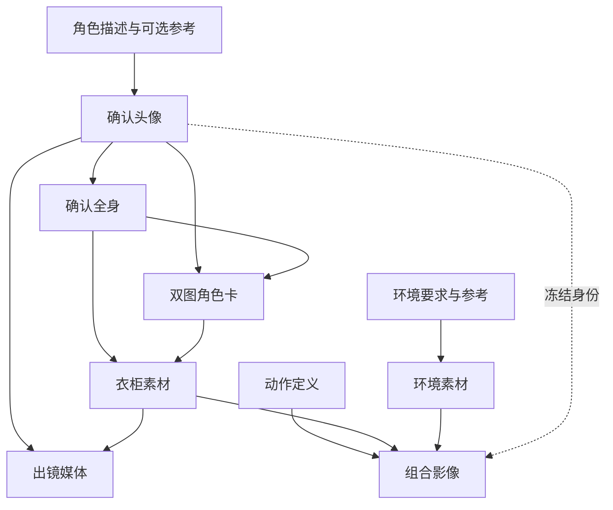

# 形象生成能力链

本文定义参考资料分工、制作阶段、供应商选择和媒体质量恢复。成品身份、发布、呈现和备份的跨模块契约归 [PROTOCOL](PROTOCOL.md#伙伴与资产)，源码导航见各模块 README。

## 资产依赖

箭头表示资料依赖，不表示自动制作。首次全身生成/上传以当前激活头像和角色资料为输入，不依赖尚未建立的角色卡；用户确认全身后才登记双图分析。首次分析完成前不能设计造型或制作出镜媒体，重新提取时可继续用已发布资料；已有身份的全身重做和候选采纳要求角色卡当前就绪。环境生图不接角色身份，仅重复伙伴检查使用确认图。生成、检查、用户采纳和实际显示分别生效。

## 身份、造型与参考输入

### 固定身份与可变造型

| 资料 | 权威用途 |
|---|---|
| 头像 | 面容、五官、脸型、物种与头部特征；关系定位不作为外貌 |
| 全身种子图 | 补足比例、结构和肢体；默认造型由已验收全身图形成 |
| 衣柜图 | 完整造型、发型、妆容、衣物和随身物品；身体参考职责取决于其全身来源 |
| 角色卡 | 头部/身体自动特征和用户覆盖，只补相容描述，不能借空白或文字冲突重塑图中部位 |

新出镜媒体和影像按造型来源确定两图分工：来源匹配当前全身时，头像负责面容/头部、衣柜图负责身体/造型；不匹配时，当前全身负责完整身份、旧衣柜图仅负责造型。只改角色卡文字不改变分工，全身参考替换头像位置，不叠第三张身份图。仅明确采纳全身候选可改变身体身份，头像面容/物种继续固定。

参考职责、身份和评分依据随任务冻结，恢复不重选当前衣柜。组合影像使用单首帧供应商时，先将这组资料对齐为本任务外观参考，不能丢掉身份职责。服装图先转写为设计文字，不直接成为身份参考；转写失败可按纯文字生成。

默认造型从已确认的[实际呈现快照](PROTOCOL.md#影像成品与模式隔离)取得：完整画面提供造型时配当前全身身份图，静态素材按冻结来源选身份图；画面取景和遮挡不能代替完整身份。文字 `outfit_override` 仅本次生效并关闭冲突造型参考；视频显式造型图配当前全身，不读取未选素材。装配入口为 [visual_identity.py](../backend/features/appearance/visual_identity.py)。

### 头像与全身

视觉模型根据实际参考、资料和反馈判断身体、材质及待机姿态，缺少视觉能力明确失败；不按物种/骨骼枚举套姿态，也不由身体推断性格。头像统一白底、正面、光照和留白，采用真实拍摄质感，不开放画风选择；纯文字默认年轻外貌，角色卡没有年龄字段。

纯文字头像结合物种、性别和性格，有参考时只改明确特征。全身使用确认头像、本次要求和可选身体参考，生成完整入画、可稳定待机的透明图；指导不覆盖明确要求或头像身份，绘图要求不回写人格。

### 全身与造型透明成品

全身、衣柜及其微调/自备图均交付真实透明 PNG。生成按能力请求透明或纯白背景；下载后验实际 alpha、前景和边缘，合格保留原 alpha，不合格对同一结果做 ISNet 抠像再验，不追加付费生成。造型候选先透明化再评分，棋盘格和近乎不透明 alpha 均不能通过。

[图片处理](../backend/infrastructure/video_processing/image.py)保留原尺寸、位置和构图，不套动作图缩放/补边。生图前核对抠像模型，上传先校验字节；失败保留原草稿/正式状态，不发布不合格结果。首次引导可先保存并确认用户全身原图继续声音步骤，角色准备任务完成透明处理后才制作默认造型/后续资产；失败保留原图恢复。

### 造型设计与连续反馈

重生成同时向身体判断和生图提供原设计、按时间排列的成功反馈及本次反馈；本次只覆盖涉及维度。微调以上一草稿为底，只传当前反馈，不重复身体判断；草稿全身来源变更须重生成。全身重绘可用已有身体资料作未修改部分默认，明确调整和兼容参考优先，头像不变。

成功草稿才保存反馈历史。成品描述记录实际衣物、颜色、轮廓、发型和配饰，供后续组合使用；描述有独立状态，失败由用户补全，不自动重复付费，下游冻结已知资料，明确分析失败按图像参考兜底。入口见[造型服务](../backend/features/appearance/README.md)。

### 场景创建与描述

场景只提供环境/陈设/光线；生成参考不接角色身份，允许其他人物、动物或艺术陈设，但须排除伙伴本人及可辨认倒影、肖像、雕像。[重复检查](../backend/features/media/scene_review.py)单独对照确认图，不以同物种或一般轮廓判重复。

制作依次保存候选、检查画幅/重复伙伴、适配尺寸、分析描述。目标固定 2560×1440、16:9，选择可用原生档再等比裁切/缩放，不拉伸；目标、源和展示尺寸分开，放大不等于原生清晰度。门禁不通过不发布，检查/描述失败留原候选续处理；描述可按流程手动补全。

上传保留原件并派生展示图，不做重复伙伴检查。标题/描述只写实际画面，其他角色不成为伙伴经历，已有环境不绑定身份修订；并发、生效和重试见[场景契约](PROTOCOL.md#场景任务与原位换图)。

### 场景图片重绘

重绘使用[同一装配器](../backend/features/scenes/prompt_assembly.py)，只冻结已保存描述和目标，不追加旧创建要求、旧环境图或衣柜。新候选完成检查/适配/描述后原位采纳，恢复复用当前阶段；具体提交、编辑和取消归场景契约。

### 组合影像制作

组合的身份、三份素材、计划、画幅和要求由 workflow 冻结；工作项和成品分离，重做/预算/版本交接遵循[影像契约](PROTOCOL.md#影像成品与模式隔离)。制作入口见 [visuals](../backend/features/visuals/README.md)，核心阶段如下：

| 阶段 | 产物与失败边界 |
|---|---|
| 制作计划 | 核对身体能力、物品、空间、姿态及接触；计划归该组合，修复或只重做视频不重新选目标 |
| 身份/造型对齐 | 新构图先生成并检查任务内派生造型参考，再制作姿态图；身份基准始终为原冻结来源，不回写衣柜。对齐与姿态分别存链状态/哈希，所选图片供应商同时约束对齐，会增加必要调用 |
| 起始图 | 身份和画面要求均通过才入库；已有合格图满足动作条件可复用。身份不合格从参考重造，身份合格而条件不足优先修候选；检查问题是修复资料，不覆盖用户要求 |
| 运动设计 | 对照实际起始图；物品/姿态不足回图像修复并清旧脚本和输入绑定，时长不足在支持范围重规划，身体无法支持则失败 |
| 视频制作 | 循环使用同一合格图作首尾，短动作固定首帧并自然收束；进入公共队列，检查合格后发布视频，起始图独立为图片成品 |

计划、次数、候选、检查和转场随进度保存。检查暂不可用先续审原候选，预算耗尽等待显式重试；图像/视频共用同一计划，通用要求与视频调整分别保存，新要求只覆盖涉及维度。未知提交与阶段复用统一见[持久化与恢复](#持久化与恢复)。

画幅受理时冻结，在满足输入/时长的原生档中选择最接近目标的尺寸，可低于目标；同分优先较少像素/裁切和配置顺序，计算归 [media_geometry.py](../backend/infrastructure/media_geometry.py)。模型档位去别名，实际尺寸从产物读取，适配仅限内居中裁切/等比缩放，无可用画幅在付费前失败。输出按旋转/SAR 还原显示尺寸，保存静音 MP4、真实首帧和封面。

播放、预览、封面及过渡统一按实际媒体/视口比例：铺满裁切不超过对应边长10%才居中铺满，否则完整显示并用同画面模糊铺底；暂停、循环和切换共用规则，不以制作几何模式强行留边。

### 出镜图片与视频

聊天/动态本人出镜媒体按[固定身份与可变造型](#固定身份与可变造型)冻结参考，缺必需资料在提交前失败。普通视频保留有序身份/造型参考并描述环境与时间过程，不先造校准首帧，也不把多参考降为单首帧；组合视频由合格起始图驱动。

局部造型覆盖有依据地合并，只影响本次产物；视频 `reference_image` 是该次造型参考，其他主体保持各自参考职责。动态旁白是独立音轨，不承诺口型。提示词定义见[公共媒体](../backend/features/media/prompts.py)，交付绑定归[媒体引用](PROTOCOL.md#媒体引用验图与原位交付)。

### 提示词与供应商输入

真实拍摄质感、编辑原图质感和首帧连续性分别按任务装配，摄影质感差异不当身份冲突。描述目标所需的可见状态、动作与衔接，安静可为完整目标；保留明确速度/频率/幅度/顺序，次级运动有事实依据。循环要求接点连续，无法闭合时改用短动作或持续阶段，不要求全身每处都运动。

参考按原顺序承担身份、造型、环境或编辑职责，不拼图、不丢资料。公共要求只装配一次，尺寸由请求规划，透明依供应商能力；缺输入容量、编辑、多图、首尾帧、画幅或时长支持在付费前过滤。审核改写保留硬约束，无法保留则失败；评审缺陷不直接塞进制作指令，千问视频关闭智能扩写。写作规范归 [RULES](../RULES.md#提示词设计与修改规范)。

## 编辑、上传与身份采纳

### 微调与重新生成

`mode` 显式区分重生成与真实编辑。编辑须有反馈、可读底图和供应商能力，不接附加参考，不满足明确失败，不能静默重绘；身份条件化不等于编辑能力，定义见[供应商基类](../backend/infrastructure/ai/providers/base.py)及[图片链](../backend/features/media/image_generation.py)。

局部修改保留其他内容，姿态/轮廓改变允许必要接触、遮挡、褶皱与光影联动，仍受身份/构图约束。造型可改稳定姿态但不改身体，出镜按活动取景，动作图固定相机且完整入画。重生成及外部提示词须有原设计或有效反馈，全空在付费前拒绝。

### 用户自备图

外部提示词与内部生成共用必需参考和画面要求，使用通用描述而非工程或供应商私参。自备图跳过生图，仍走字节、透明、存储与采纳检查；用户采纳不等于程序验证身份。

外观仅确认已存草稿，入柜不直接改变显示。环境外部制作创建待上传草稿，上传分析后显式保存，取消保留草稿。字节和并发接口见[头像全身与确认](PROTOCOL.md#头像全身与确认)，未知任务沿统一恢复。

### 全身候选采纳

已确认伙伴的重绘/微调/自备全身先成为候选，身体分析后由用户明确采纳。生成、外部提示词、自备图和采纳均要求角色卡当前就绪，分析中/失败付费前拒绝；旧候选在修订变化或离开就绪后失效，分析失败可单独重试。首次准备失败且角色资料尚未发布、默认造型尚未建立时，允许重新上传全身原图并重启初始准备；该路径直接替换初始化原图，不产生身份候选，也不开放普通生图/外部提示词绕过就绪校验。

采纳原子替换全身参考及身体字段，清旧身体覆盖，头像提取的头部不变。旧造型可继续显示，后续制作按新身份与旧造型分工，不自动重建素材；环境不绑定身体身份。

### 角色卡与并发写入

确认全身后登记持久分析：头像提取头部，全身提取身体，定义见[角色卡契约](../backend/features/appearance/character_card_contracts.py)。提取复用结构校验、一次格式修正和供应商回退，两部分成功才原子发布/衔接初始资产；来源未变只补失败部分，重启续原任务。模型调用不持事务，回写核对身份、路径和批次。

重提取保留旧资料，成功合并最新用户覆盖；下游只消费生效特征。保存文字不重绘，素材/媒体不反写角色卡。草稿提交核对修订，自备图透明处理后及确认时复核冻结身份，聊天/动态在生成期身份修订变化时不交付。造型的全身来源决定后续参考，文字修订不额外重造视频参考；身体变化才按当前全身校准，旧图保留造型职责。

## 供应商选择与失败恢复

### 能力筛选

按所属任务链检查实际参考、编辑、首尾帧、时长和分辨率，审阅使用同任务 LLM；原生透明声明不代替 alpha 验收。首次依配置顺序，组合影像先按原生尺寸匹配排序；微调优先原模型，重生成从当前实际成品来源下一项开始，最多一圈。来源随最终选择保存，图片/视频分别记录，不能取最后尝试项；恢复沿冻结链/游标。

#### 本地 ComfyUI

本地图片适配支持文字、多参考和透明；编辑画布随首张参考，条件生成按请求比例。暂时查询失败续原 `prompt_id`，不重交，参考存留由部署方保护。具体工作流、loader、批量和采样配置见[适配器](../backend/infrastructure/ai/providers/local/image.py)，部署归 [Backend](../backend/README.md#本地供应商)。

### 质量选择

身份检查只判断固定外形，服装、姿势、环境和文字另按任务目标审阅。出镜图/影像画面须同时满足身份门槛与目标，视频还须最终复核；头像、全身与衣柜按各自预览确认流程，环境走独立门禁。阈值/失败分类归 [chain.py](../backend/features/media/chain.py)。

| 结果 | 允许的下一步 |
|---|---|
| 明确生成失败 | 每供应商/位置一轮，沿剩余链前进 |
| 提交未知 | 停后续付费，批量缺额同样保留未知，不补重投 |
| 下载或本地处理失败 | 恢复同结果，不直接再生成；损坏视频可在确认生成损坏后沿链，本机探测故障不算损坏 |
| 审阅暂不可用 | 停追加生成；持久任务保留原图，尚无决定可续审，已取得但格式不完整的决定明确失败、不重新判定 |
| 有合格部分 | 批量可交付通过项；同步未交付资产归调用方回收，人工确认流程按其规则择优 |

必需审阅配置在生图前检查；目标、参考职责、审阅模式和结果冻结，恢复复用决定，技术门禁不被高身份分绕过。头像/全身/造型遇明确审核拒绝可沿原链做一次合规改写。非出镜视频缺探测工具的例外由调用方定义，不泛化至出镜交付。

### 全局视频队列

所有视频入口在准备输入后进入持久队列，以供应商类型和实际密钥指纹分组，同组跨账户/配置/功能共享一个名额、顺序执行，不同组并行。提交至远端确定终态占额，下载/处理/评分/发布不占；队列保存引用与指纹，不复制密钥，公开只给独立 ID。

未接单限流保队首并按 `Retry-After` 或有界退避持久冷却，取消/重启不绕过、不回退供应商、不重做前置或重计额；明确失败沿冻结链到下一组队尾。未提交时重解凭据，变更则重排；已提交固定原端点/密钥，凭据不可得等待核对，不用新密钥查旧句柄。

未知占用有句柄续查、无句柄人工核对，确定终态前不重发。排队可取消离队，接单后队列独立收尾；维护阻新提交但核对继续。删除/恢复仍保必要匿名占用，业务消费终态后才按保留规则清理，队列不进用户备份。管理核对归 [PROTOCOL](PROTOCOL.md#视频排队与结果核对)，策略归[队列服务](../backend/features/media/video_queue/service.py)。

### 身份评分与发布复核

以冻结身份图和事实评分，不用编辑要求或派生图当基准。面容、物种、结构明显冲突、未出镜或证据不足不能过门槛；合理透视/遮挡/造型变化不单独构成冲突，文字不能盖过图像证据。

图像单张检查，视频抽首/中/末帧严格复核；二者分别择优，视频回退复用首帧。失败阻发布且保留可恢复资料，补齐/重做沿同一规则，不联动其他影像。业务采纳与发布归[媒体检查与发布](PROTOCOL.md#媒体检查与发布)。

### 持久化与恢复

付费前保存冻结供应商、参考、游标与阶段，返回后保存句柄/结果，审阅后保存选择；预登记路径、原子写文件。凭据实时解析，旧句柄不能发往变更端点。

| 已存进度 | 恢复方式 |
|---|---|
| 句柄 | 暂时故障退避续查；鉴权/计费问题等核对，不因耗时重交 |
| URL/内联结果 | 先保存后下载；传输有界重试，坏格式、超限、过期或磁盘失败不重生 |
| 文件/审阅决定 | 复用已有后处理与结论，不从头制作 |
| 未提交的下一项 | 沿冻结输入及原游标继续 |
| 未知提交 | 停后续付费并保占用，有最佳候选可留但不伪造终态 |
| 选择已提交 | 清落选/不交付素材，保共享和恢复引用 |
| 备份导入 | 恢复资料，不直接还原为付费运行任务 |

恢复不重读当前身份、衣柜或模型顺序；取消、采纳和引用交接由业务定义。网络自动重试与持续等待统一见[模型失败与重试预算](PROTOCOL.md#模型失败与重试预算)。

## 动作素材定义与评审

动作定义保存活动、适用条件、持续/短动作类型和时长，不绑定造型、环境或成品。同一动作可用于多种组合，登记只建立定义，画面由组合制作产生。

### 定义与评审

定义说明起始状态、用品/接触、节奏和收束。名称供展示/检索，不是跨来源身份；不同内容允许同名，受理锁和业务匹配收敛重复请求。评审依据角色身体和动作含义并冻结，组合制作再判断具体空间/用品；中断暂缓、手动重试，不自动重新付费。编辑回待审，不追溯已生成成品。

### 恢复、备份与资产引用

已知评审决定复用，备份整体校验定义与参考，恢复不制作。冻结评审参考独立持有文件引用，来源删除不回收它。入口见[动作模块](../backend/features/action_library/README.md)，文件删除归[资产生命周期](../backend/features/assets/README.md)。

## 验证

### 完整提示词链检查入口

检查单位是实际完整请求及消费结果，包含供应商原生字段；用户资料、中间模型和图片都不扩大授权。按下列源码定位完整装配，分支细节以当前实现为准：

| 任务 | 装配/消费入口 | 必查差异 |
|---|---|---|
| 头像/全身 | [prompt_assembly](../backend/features/appearance/prompt_assembly.py)、[fullbody_reference_prompt](../backend/features/appearance/fullbody_reference_prompt.py)、[avatar_service](../backend/features/appearance/avatar_service.py) | 纯文字/单参考/双参考、重绘/编辑/外部制作、首次确认/候选采纳 |
| 角色卡/造型 | [character_extraction](../backend/features/appearance/character_extraction.py)、[outfit_service](../backend/features/appearance/outfit_service.py) | 头身分工、部分重试/覆盖、反馈顺序、透明化、成品描述和双语 |
| 环境 | [场景装配](../backend/features/scenes/prompt_assembly.py) | 文字/环境参考/自备图、重复伙伴、描述/重绘、源图与展示图 |
| 出镜媒体 | [visual_identity](../backend/features/appearance/visual_identity.py)、[聊天图片](../backend/workflows/chat/images.py)、[视频任务](../backend/features/media/video_jobs.py) | 静态/完整呈现、来源变更、造型覆盖、多参考、验图与身份变更 |
| 组合影像 | [creation](../backend/features/visuals/creation.py)、[generation](../backend/features/visuals/generation.py) | 计划、对齐/姿态、修复、尺寸/时长、未知提交与冻结恢复 |
| 动态/评论 | [publication](../backend/features/posts/publication.py)、[replies](../backend/features/posts/replies.py) | 发布目的/媒体、完整背景/线程边界、事件时间、删除与重试 |
| 本机工具 | [Runner 装配](../runner/spirit_agent_runner/bootstrap.py)、[清单生成](../runner/spirit_agent_runner/runtime/tools.py) | 本地/SSH、平台/禁用、配置代次、学习域和代码子调用 |
| 审阅/回退 | [character_images](../backend/features/media/character_images.py)、[identity_review](../backend/features/media/identity_review.py) | 身份与目标分别校验、低分/缺证据/不可用、拒绝改写和恢复 |

### 验收范围

- 参考变更覆盖身份/造型分工、顺序、覆盖优先级、来源/修订变化及并发；编辑/上传核对前置守卫与采纳，不能只检查单块提示词。
- 透明处理覆盖原生 alpha、白底、棋盘格、近乎不透明、无前景和抠像失败，检查原尺寸、边缘及失败时原状态。视频透明/遮罩处理变更须验真实编码、完整时间轴及 Chromium 合成，能力声明和静态抽帧不足。
- 环境覆盖固定交付尺寸、横/超宽/竖上传等比适配、源图保留、含伙伴和无关人物/动物/雕像、检查不可用及全部候选重复；显示器变化不改请求，编辑画布仍按其底图规则。
- 图像/视频按本次目标另查姿势、衣物、用品、环境和文字；安静/循环视频检查全身、支撑、衣物的时间变化及接点，身份高分和少量成功不证明质量稳定。
- 恢复覆盖提交未落库、轮询/下载中断、未知及迟到结果，核对付费次数、原身份与引用；可加载、模拟、真实供应商和实际显示分别报告。

对比提示词时保存脱敏完整请求、参考顺序/哈希、模型、种子、采样、实际尺寸及失败样本；上游改写也保留输入/原始输出。仅文档改动核对事实和链接，不触发付费制作，命令归 [Scripts](../scripts/README.md)。
