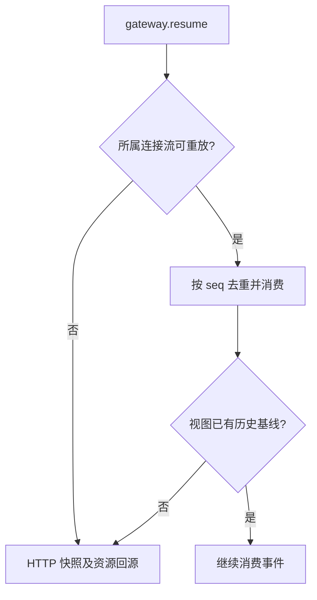
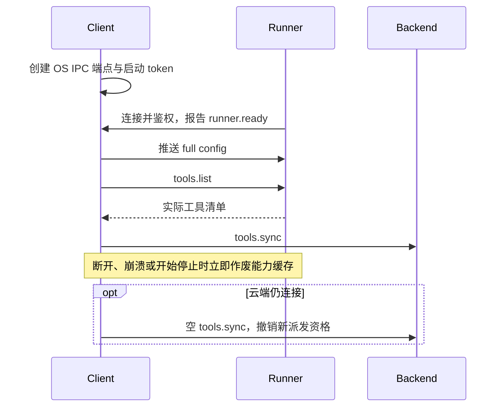

# 跨模块协议契约

本文维护通信、状态、交付、调度、安全和恢复的公共契约。字段、枚举及注册清单以链接的源码为准；模块内部实现由所属 README 维护。

## 通信与连接身份

### 传输与信封

| 链路 | 传输与身份 |
|---|---|
| Backend ↔ Client | 主进程以 Bearer JWT 调用 HTTP，取得一次性票据后连接 `/api/gateway/ws` |
| Remote ↔ Backend | `/remote/` 同源页面使用独立设备 Cookie，WS 同样先取得票据；权限见[远程访问](#远程访问) |
| Client ↔ Runner | Windows 命名管道/macOS UDS 承载 WebSocket 帧，本次启动 token 鉴权 |

云端控制和本地连接使用 JSON-RPC 2.0：请求有 `id`，响应返回同 ID 的结果或错误，通知没有 ID、不响应。HTTP、上传下载与 Electron IPC 不套 RPC 信封。云端心跳/ACK 是 RPC 请求，本地连接使用 WebSocket ping/pong。

### 登录、握手与心跳

`POST /api/gateway/ticket` 签发绑定登录记录的单次票据；每张在 60 秒内独立消费，首次握手尝试即作废，并发签发互不撤销。初始化失败或服务重启须重新签发，WS URL 只接受 `?ticket=`；日志隐藏票据和资产签名参数。握手与入站处理均校验用户及登录有效性，正常 JWT 刷新不撤销登录。

| 情况 | 客户端处理 |
|---|---|
| `4401` 票据失效 | 重新取得票据 |
| `1008` / `4403` 策略拒绝 | 停止自动重连并显示原因，保留登录 |
| `1012` 维护 | 退避重连；维护期间票据请求为 503 |
| `4000/heartbeat` | 按心跳失联恢复，间隔见 [GatewayConnection](../shared/gateway.ts) |
| 本站 HTTP 明确登录失效 | 退出账户；供应商错误不触发退出 |

注销、另一端激活或管理员停用会清理连接及本机等待，已受理回合仍按[恢复契约](#序号与恢复)收尾。控制方法和并发上限见 [RPC 契约](../backend/entrypoints/desktop/contracts.py)；超限以 `1013` 关闭，断连取消该连接的控制请求。自主/空闲咨询走 HTTP，同类在途请求合并，迟到结果重核上下文。

### 通道分工

HTTP 受理聊天提交、停止、快照、命令和资源操作；WS 交付事件与设备指令。HTTP 独立鉴权，不要求 WS 在线；请求失败不证明未受理，副作用恢复必须查询原身份。

路由的 `operationId` 与 `operation_policy` 定义身份、编码、载荷和等待策略。[协议生成器](../scripts/generate_protocol.py)从 OpenAPI、控制 RPC、事件、Runner 和预设目录生成[跨端映射](../shared/api.generated.ts)。调用方使用操作标识，主进程不接收渲染层任意业务路径。

聊天实时流归会话 emitter，与状态共同提交的异步通知归 outbox。Backend 不决定开窗和像素坐标，媒体交付不自动切换生活环境或呈现。

## 会话与消息

### 会话种类与历史修改

`kind` 区分系统与普通会话，取值只有 `special` 与 `standard`；任务会话是 `standard` 加自动化标志，不构成第三种取值。`special` 对应每用户唯一的陪伴主会话，其他预设不自动创建会话；手动创建的会话均为普通会话，包括陪伴预设。`system_preset_id` 决定不可变的预设和记忆域；自动化任务使用专属预设。创建须显式选择有效预设，挂载以服务端返回为准。预设目录是跨端约定的唯一来源，目录项决定提示词体、记忆域与工具边界。定义见 [presets](../backend/runtime/presets.py)、[models](../backend/features/conversation/models.py) 与 [schemas](../backend/features/conversation/schemas.py)。

| 操作 | 普通会话 | 系统对话 | 任务会话 |
|---|---|---|---|
| 发言、编辑、重试、更换回答、清空与压缩 | 允许 | 允许 | 拒绝 |
| 派生 | 允许 | 允许 | 拒绝 |
| 撤回 | 允许 | 拒绝 | 拒绝 |
| 改名 | 允许 | 拒绝 | 允许 |

任务会话的只读约束作用于会话正文：改名、删除、置顶与归档与普通会话相同。系统对话不可删除、改名、置顶或归档；列表标题从当前伙伴资料投影，角色改名与列表刷新通知同事务提交，搜索使用相同名称。普通会话使用自身标题。任务历史由自动化入口写入。所有入口共用会话互斥，删除前须停止整棵仍在运行的子任务树；停止和历史修改均不撤销外部副作用。

编辑只替换正常用户消息的文字并保留附件，在同一事务删除原消息及后续历史、写入新消息；修改较早消息须确认。撤回返回锚点文字和可重新附加的图片草稿，音视频不恢复。广播按消息 ID 合并，保留未提交草稿，迟到响应不能覆盖新回复。

重试只生成最后未回复消息的最终回答，复用原输入、附件与工具结果；新消息、终端回复或历史修改使入口失效。“换一个回答”只开放最新用户回合，生成期间保留原回答，成功后原子交接媒体并替换整组气泡，失败或提交前取消保留原回答。资格由服务端给出，各提交方式互斥。

派生复制历史、工具链与媒体并重置用量；附件独立复制，失败不留半成品。派生是独立普通会话，删除来源只清空来源关系；委派子会话随父会话级联删除，不进入普通列表和搜索。

`message_count` 是已保存历史的可见气泡总数，规则归 [formatting.py](../backend/features/conversation/formatting.py)，客户端不得用分页行数或增量帧数覆盖。

### 预设记忆与学习作用域

长期记忆及模型可读派生事实归属 `(user_id, system_preset_id)`：用户来自认证，会话固定预设；即时历史只属于当前会话，同预设共享长期资料，跨预设隔离，automation 不装配记忆或学习技能。

人工接口必须显式提供预设，越权 ID 按未找到处理。列表、证据和草稿随预设切换；资料保存携带编辑起点版本，冲突整批拒绝，空值表示遗忘。字段归 [共享协议](../shared/protocol.ts)，修订语义归 [记忆模块](../backend/features/memory/README.md#修订与遗忘)。

模型只能使用服务端验证的用户原始证据。自动化和子 Agent 消息不能作证，伙伴自身记录不能证明用户事实；人工记录的自动修改须有更新的用户依据。更新校验 ID、版本及作用域，候选、失效、过期和遗忘内容不作有效事实。决策结构见 [memory_policy](../backend/features/memory/memory_policy.py)。

学习工具的 `skill_scope` 由 Backend 在模型参数之外捕获，经 Client 透传至 Runner；异步和委派继承发起域，不读取界面选择。[SkillScope](../runner/spirit_agent_runner/contracts/scope.py) 定义允许预设；后端预设目录与该契约的一致性由[生成器](../scripts/generate_protocol.py)校验，不一致时生成失败，目录外的预设不会进入带域调用。

### 后台陪伴对话

查询只读取本账户陪伴预设的顶层会话，包括主会话、普通和归档会话，排除自动化、子 Agent、摘要、工具和界面状态；尊重各会话清空水位，保留真实主动发言、主体、原文、时间和消息身份，按时间/ID 稳定排序。

动态、评论、心情、闲置表达和主动判断使用用户本地日期窗口：通常从当日零点至调用时刻，05:00 前从前一日零点开始，不按条数或字数截断。夜间规划、反思、日记、活动量与七日基线使用相同会话范围，日期按夜间目标日计算。实现见 [context_window.py](../backend/features/conversation/context_window.py)及[格式化](../backend/features/conversation/formatting.py)。

### 主动信息与来源分享

夜间话题归账户/陪伴预设，在记忆整理后独立采集。首次批次固定 `[T−24h,T)`，只接受可核实发布时间、文字依据和平台原文链接，每天至多五条，归目标日次日并在其本地午夜失效；空结果可成空批次，整批失败不补旧日储备。话题不是用户记忆或亲历，不提前进入聊天。

每次陪伴调用刷新当天资料和当前会话已分享来源，引用跨摘要保留但尊重清空水位。模型标记实际使用/链接的话题，服务端绑定原文快照；使用记录与消息原子提交，取消/沉默不记使用。资格在装配时冻结，在途回复跨午夜可完成，后续不再取过期候选。

反馈仅接受本人已分享来源的喜欢/少推荐/撤销，按 ID 批量读取并经事务事件同步，不生成伪用户消息；自然对话偏好另按原始用户证据审阅。备份将来源、使用、反馈和会话成组重映射，过期批次不复活，未完成采集不自动重放。

采集使用夜间总控和账户已配来源，无独立检索开关。每平台一连接，原文/登录能力归[平台注册表](../backend/infrastructure/web/social_platforms.py)；新增请求及重试前重查窗口、政策、凭证修订并计持久预算。清除/更换凭证只阻旧凭证新请求，已发结果与已取内容可完成原批次；平台失败隔离，检查点不存凭证。

资讯凭证由[账户接口](../backend/entrypoints/http/routes/social_accounts.py)管理，不进普通配置或公开响应。扫码绑定独立登录修订，客户端关闭不取消受理登录；后端恢复查询，平台重启丢失时重新扫，验证码只交原会话且不保存/自动重交，凭证提交后才清服务结果。实现和预算见[话题模块](../backend/features/topics/README.md)，部署见 [Backend](../backend/README.md#免费社交资讯来源)。

### 事件路由

业务事件以 `method=event` 交付，类型、载荷、序号和会话路由在 `params`。共享资源通知面向同账户在线端，页面未打开也须消费；信息性 `session_id` 不构成过滤条件。

| 来源 | 消费边界 |
|---|---|
| [聊天 emitter](../backend/workflows/chat/emitter.py) | 开始、增量、气泡、完成和回合状态；完成帧只补齐对账，不重复追加正文 |
| [会话操作](../backend/workflows/chat/operations.py) | 编辑、删除与命令结果按消息身份合并 |
| outbox | 业务资源更新/失效，按 JSON 模式序列化，与聊天消息分开 |
| [工具 IPC](../backend/runtime/desktop/ipc.py) | 按调用身份派发，不受可见会话过滤；无头标记只抑制工作态，不改变学习域 |

心情、动作、影像和自动化有独立消费者。载荷以[生成契约](../shared/api.generated.ts)及[控制契约](../backend/entrypoints/desktop/contracts.py)为准，窗口消费见[渲染层](../client/renderer/README.md#事件与异步生命周期)。

### 序号与恢复

| 身份或水位 | 含义 |
|---|---|
| `stream_id` + `seq` | 一条网关重放流及其位置，跨聊天会话共享；网关销毁、登录更换或服务重启可重置，不是消息主键 |
| `gateway.ack` | 只确认事件消费并裁剪缓冲，不证明业务提交或工具成功 |
| HTTP 快照水位 | 固定该快照覆盖的事件，不推进连接消费游标；无 WS 时可为空 |
| `request_id` | 持久受理身份；断线后查询原回执，不重新提交副作用 |

桌面流绑定登录记录，Remote 每个浏览器连接独立；恢复只能接管当前身份的断线流，不能抢占活跃标签或其他设备/账户。宽限期或缓冲失效后回源。握手后先暂存事件，`gateway.resume` 重放/冲刷完成才就绪；容量和 hold 时限见 [buffer.py](../backend/runtime/desktop/buffer.py)。

已受理回合由账户运行态持有，断连、HTTP 结束、退出或登录失效不取消。显式停止绑定原请求，先到的停止意图在受理后补交，迟到停止不能影响新回合；确认终态前只查询原回执。正常维护/停机等待收尾，进程崩溃记为中断，不自动重做外部操作。

[会话快照](../backend/features/conversation/http_contracts.py)在发布锁内固定水位后读取历史和在途回合。挂载期间缓冲事件，先应用快照，再顺序消费未覆盖帧；同会话快照请求合并，视图已有基线且重放成功时不重拉。流切换重新取得基线。历史以消息 ID 与毫秒时间排序，达到防御上限时用 `truncated`/`next_cursor` 向前分页；磁盘快照不能冒充连接游标。

### 表达通道

正文只承载可读台词；`companion.mood` 更新身份区，不创建消息；影像播放指令经 `companion.visual.play` 派发，实际回执以 `companion.visual.playback` 更新呈现事实。窗口位置由 Client 的拖拽、归位和几何恢复处理，当前没有自主移动决策调用链；控制字段不得编码进聊天文本。

陪伴聊天完成后独立推理心情，工作、自动化和主动回合不走该后处理；生活判断也可更新生活状态中的心情，两端从生活快照回源。空闲表达须通过档位、可见性、锁屏及空闲条件闸门。可见性以桌面精灵窗实际显示（表面快照 `spriteVisible`：窗口存在、未隐藏且未最小化）且未被完整入口或轻语收起为准；Client 发出空闲表达请求前检查，结果返回后再次核对。

### 结构化回复与终端交付

陪伴会话（子 Agent 除外）使用[结构化气泡](../backend/features/conversation/replies.py)：日常台词按明确句末标点分泡；括号、星号、换行和反斜杠排版由格式校验处理，保留台词，演绎按语音能力处理。明确要求的书面内容逐字保留排版及首尾空白。客户端不二次分句，内部类型标记不落库，纯媒体有效。

整轮保存一条原文及结构快照，气泡数量、类型、文字、演绎和媒体须严格一致，读取不能修补差异或按 JSON 外形猜结构。语音演绎只属于语音气泡，并按供应商/模型/音色校验；分段须无损拼回台词，TTS 不润色，客户端不解释演绎。上下文、摘要、记忆和搜索只消费可读内容及真实媒体状态。

终端回复须完整、无工具调用且通过交付校验。工具循环不设轮数上限，媒体额度或无进展守卫触发后以无工具回合复用已有结果收束；取消、异常和不完整结果不交付草稿。工具中间行只保存调用结构，专业/自动化沿各自文本契约。

开始事件仅一次，气泡有序交付，完成帧补齐对账。声音降级见[语音保存与重试](#语音保存与重试)，模型恢复见[模型失败与重试预算](#模型失败与重试预算)。

### 媒体引用、验图与原位交付

交付类型服从本轮明确要求，文字/语音偏好不替代图片或视频。模型只引用服务端签发的 `media_id`，视频可引用已受理任务，地址和状态由服务端核对账户、会话、类型、文件、唯一性及目标；已有成果优先交付，已受理任务先查询。

台词中的媒体地址须来自本轮用户文字或工具结果，内部路径/嵌入不替代媒体气泡；来源核查不证明生成成功。入口见 [reply_links.py](../backend/workflows/chat/reply_links.py)和[reply_media.py](../backend/features/conversation/reply_media.py)。

图片按目标去重，同工具步受理；验图绑定具体版本，有问题且预算允许才重做。保留原图，每目标最终交付一版；预算和版本资格见 [images.py](../backend/workflows/chat/images.py)及[MediaTurnState](../backend/features/media/turn_state.py)。每回合至多受理一个初次视频请求，陪伴先交等待卡，再以 `message.media` 原位更新；完成与绑定用行锁协调，删除消息不补建，重复事件幂等、终态不回退。其他文本会话使用附件和后台送达。

派生/恢复重映射历史媒体、解除执行绑定，未完成视频显示中断，不自动付费重发。参考及生成恢复归 [PIPELINE](PIPELINE.md#出镜图片与视频)，历史保留归[备份契约](#备份校验与覆盖恢复)。

### 视频排队与结果核对

所有视频入口在输入准备后进入[全局视频队列](PIPELINE.md#全局视频队列)。受理即返回业务任务，排队不占住聊天；任务、工作项和媒体快照携带可空 `video_queue`，类型见[队列契约](../backend/features/media/video_queue/contracts.py)。等待、限流冷却和未知阻塞分别展示，只有已知 `next_retry_at` 才显示下次重试时间，不承诺完成时间。

影像沿 `companion.visual.updated`、聊天沿 `video_gen.queue` 更新原任务/等待卡；回源恢复相同身份，不暴露其他账户或凭据。未知仍属未结束，不能重新付费提交。

管理端可查看队列 ID、配置名、冷却与占用，不返回密钥/指纹。未提交取消立即离队；已提交取消继续核对远端终态，迟到结果不交付或回退。立即重试仅清冷却，不重发未知请求。`resolve` 绑定预期修订与审计说明，可补远端句柄或确认未接单/已结束，冲突 409；解除占用只放行后续，不重发原尝试。接口见[管理路由](../backend/entrypoints/http/routes/admin.py)，密钥轮换、维护、删除和备份边界归队列定义。

### 音色设计与克隆

伙伴声音统一导航 `#/companion/voice`，设置 `voice` 管回复偏好/录音时长。固定目录、手写设计、AI 设计和克隆独立报告；空目录不隐藏自定义能力，缺 LLM 仍可手写设计。

媒体领域拥有设计/克隆当前槽位与不可变版本。试听绑定输入、账户和版本，改描述/样本须重试听，确认原子校验，迟到/取消/旧版本不覆盖当前；未确认候选24小时后回收。[操作身份](../backend/features/media/voice_operations.py)覆盖取消先到及描述到试听的间隙，生成持续等待或明确取消。

克隆样本是独立账户资产，不复用会话附件配额/删除语义，上传、读取、转换校验实际内容和归属；Client 前后核对鉴权会话。自定义设置仅存签发的不透明方案引用，不携描述/音频字节，规格归 [voices.py](../backend/features/media/voices.py)。

聊天、主动、朗读和动态共用解析/合成，描述与台词分别装配，试听不改台词；历史绑定当时版本，切声音不改历史重试。配置/样本不可用明确失败，聊天禁用本轮语音后继续文字。方案/候选/音频随账户删除和备份追踪，最后活引用消失才回收。

### 语音保存与重试

用户录音先存到当前会话，读取同时验账户/会话及真实格式，保留原件，供应商按需用 WAV 副本。桌面录完即提交，Remote 作为待发附件确认；混合附件共用配额、复制、删除和备份映射，清文件前提交引用占位，有转写则保留。重试复用原录音。

带音频请求先按链选择支持全部输入的原生模型，明确可回退失败耗尽后转写，再按原任务链尝试兼容其他媒体的文本模型；已交付/未知/取消不触发转写回退。转写按音频引用复用并保存到用户消息，后处理共读；转写失败不撤销已成原生回复。供应商具体协议归适配器。

| 环节 | 交付与恢复 |
|---|---|
| 回复保存/合成 | 先存正文再并行合成，气泡仍按原顺序送出；保存音频后交付，失败保留台词/演绎和空音频。完成帧按消息/索引补齐，取消不回滚已存正文，改删/中断清未提交音频 |
| 空音频 | 实时/历史均显示原台词，不显示失败语音条或整轮错误；后续音频更新可恢复语音呈现 |
| 重试 | 缺失音频按消息/气泡调用[会话接口](../backend/entrypoints/http/routes/sessions.py)，已有结果幂等复用，只合成不改台词；成功 `message.voice` 更新并失效历史快照 |
| 自动播放 | 独立偏好只控制顺序播放，文本无 TTS 入口；仅首次终端/主动消息入队，历史水合、音频更新和偏好修改不补播。失败/空音频保未听并跳过，用户点播才重试合成 |
| 收听与断点 | 主进程按账户/会话/消息/索引保存，正常播完才置已听且不回退，断点结束归零；暂停/抢占不算失败。记录不上云、不进正文或模型，类型归[IPC](../client/shared/ipc/contracts.ts) |

服务端有序提交见 [reply_audio.py](../backend/features/conversation/reply_audio.py)，字节缓存归 Client。主动回合空气泡可表示沉默，常规档仅文字；音频准备后重查用户活动、租约和档位，接受时消息与 `companion.message` 同事务，拒绝/取消清未交付音频。

### 模型失败与重试预算

调用按输入能力筛选任务链，再依配置尝试，每项重算窗口与输出预算。正文交付前的明确供应商失败、不完整/空结果及交付校验失败可回退；非流式辅助调用在链内统一识别兼容协议拒绝、供应商拦截码与扩展字段，以及正文中的完整拒绝信封和诊断，不按当前供应商名称限制信号来源。真实响应状态与拒绝字段先检查；结构化正文先按业务契约验收，仅契约失败时检查正文是否为供应商拒绝，拒绝不进入格式修正。调用方提供的输出校验也在接受结果前执行。普通文字拒答、错误码解释和引用不独立触发回退，合法工具调用和主动沉默有效。正文已交付、结果未知、已生成素材下载失败、取消或业务守卫终止后停止回退。嵌入固定单模型，失败退关键词召回。入口见 [llm_fallback.py](../backend/infrastructure/ai/llm_fallback.py)、[error_classifier.py](../backend/infrastructure/ai/error_classifier.py)。

失败尝试的正文、推理和工具草稿丢弃，下一项从原上下文装配；实际交付正文才锁定模型。最终错误按末项真实原因脱敏报告，手动重试复用输入和工具结果。

手动重试最终回复从链首开始；更换回答和媒体重新制作从当前成品实际模型的下一项开始，单次最多一圈；图片微调优先原模型，来源失效从链首开始。见 [selection.py](../backend/infrastructure/ai/selection.py)、[媒体恢复](PIPELINE.md#供应商选择与失败恢复)。

LLM、媒体、语音、向量及素材传输等待结果或明确错误，不按读取、写入、静默或整链耗时中断；建连和连接池等待有界。取消、维护、停机及意图有效期继续生效，查询、握手、心跳和本机工具使用自身期限。网络自动重试限可确认未发送、幂等方法或显式幂等键且请求体可重放的情况；非幂等提交写出后断线视为结果未知。

每次生成仅实际尝试序列末项可恢复一次：不完整/空回复重新生成，陪伴结构、分句、演绎和媒体错误独立格式修正。原生音频与转写文本组成同一序列。工具循环的下一次生成重新计预算；网络重试、模型回退及格式参数降级分别控制。

格式修正不提供工具，以未交付草稿为唯一编辑正文，只补只读人设、错误、语音能力和可信媒体清单，不带历史或用户原话续写。保留主体、内容、顺序与有效媒体，书面内容保留排版；无可恢复内容返回空。修正完整校验且不再次修正，只有明确拒绝格式参数才降级接口；鉴权、限流、内容过滤不触发参数降级。

末项恢复耗尽后，仅演绎错误可转为原台词文字，仅遗漏可交付媒体可按生成顺序补齐；其他正文、结构或媒体仍不合法则不落库、不交付，并区分格式失败与供应商不可用。绑定与恢复细节见[对话编排](../backend/workflows/chat/README.md)。

### Slash 命令

Slash 元动作走 `POST /api/sessions/{session_id}/commands`，不交给 LLM。`GET /api/commands` 返回名称、别名、说明和确认标记；注册与实现见 [slash_commands](../backend/features/conversation/slash_commands.py)，执行与确认由会话业务操作校验。

`//` 或不符合命令起始规则的输入视为普通文本；符合命令形式但未识别时提示错误，不作为普通回合提交。编辑消息时的斜杠按正文处理。需要确认的命令由服务端再次校验 `confirmed=true`；影响历史的命令另检查在途状态。clear 需确认，compress 无需确认；清空保留会话，成功后历史为空且不显示成功提示，消息删除与列表刷新通知同事务提交，不等于删除长期记忆或撤销工具。remember 只写当前认证记忆域，自动化无记忆域。

响应与 `command.result` 可能同时到达，Client 幂等消费；`hydrate=true` 替换历史，否则展示状态。自动压缩在聊天调用前按上下文阈值触发，`compress.completed` 插入压缩状态，不与手动压缩的全量替换混用。摘要检查点在历史与事件中以消息 `subtype=compress_summary` 标识，正文格式不作识别依据。主动回合也保存压缩检查点，临时意图不进入摘要；无头检查点与 `compress.completed` 通知同事务写入 outbox，客户端按消息 ID 去重。管理端自动压缩开关是总闸门，用户不能覆盖关闭；各类会话的阈值统一遵循[参数继承规则](#配置所有权与云同步)。

## 伙伴与资产

### 接口入口

业务端点、请求 schema 与权限由路由定义，完整操作目录由[生成契约](../shared/api.generated.ts)提供。常用入口如下：

| 领域 | 路由入口 |
|---|---|
| 会话与通用目录 | [sessions](../backend/entrypoints/http/routes/sessions.py)、[resource_catalog](../backend/entrypoints/http/routes/resource_catalog.py) |
| 引导、身份与声音 | [onboarding](../backend/entrypoints/http/routes/onboarding.py)、[companion](../backend/entrypoints/http/routes/companion.py)、[voices](../backend/entrypoints/http/routes/voices.py) |
| 素材和影像 | [scenes](../backend/entrypoints/http/routes/companion_scenes.py)、[actions](../backend/entrypoints/http/routes/companion_actions.py)、[visuals](../backend/entrypoints/http/routes/companion_visuals.py) |
| 生活与内容 | [life](../backend/entrypoints/http/routes/companion_life.py)、[posts](../backend/entrypoints/http/routes/companion_posts.py)、[journal](../backend/entrypoints/http/routes/companion_journal.py) |

引导以服务端状态和已有资产恢复，完成条件归 [DESIGN](DESIGN.md#认识伙伴)。

### 头像、全身与确认

[伙伴接口](../backend/entrypoints/http/routes/companion.py)与[schema](../backend/features/appearance/schemas.py)定义输入和限长。图像按实际字节、大小和可解码性验收，不信 MIME 声明；支持格式及首帧归一由上传处理定义，无法读取/超限返回400，不支持415。断线或空结果先回源草稿，不自动重付费。

| 确认路径 | 并发与生效 |
|---|---|
| 头像 | 用户锁内核对预期头像，冲突409 |
| 首次全身 | 生成/上传不依赖角色卡；确认时核对预期原图并可靠保存，可继续声音，后台准备透明化/分析和默认素材，失败保原图 |
| 已有身份的全身重绘/外部制作/自备图 | 角色卡未就绪返回409且不调用模型/供应商；结果先为待采纳候选 |
| 初始准备失败后替换原图 | 尚未发布角色资料且未建立默认造型时可重新上传并重启准备；不产候选，不开放普通生成或提示词绕过就绪校验 |
| 候选分析/采纳 | 分析可单独重试；采纳要求角色卡就绪并核对预期原图/修订，变化拒绝，仅更新身体/清旧覆盖，不自动重造已有素材 |

全身/衣柜成品必须真实透明 PNG，候选采纳重验，失败保草稿和正式状态。参考、处理与候选规则归 [PIPELINE](PIPELINE.md#编辑上传与身份采纳)，初始任务入口归[外观模块](../backend/features/appearance/README.md#后台任务与初始资产)。

### 角色卡编辑

人设 PUT 同时承接首次引导的确认保存和日常资料维护。引导保存完整资料并补写逐题提交未能保存的用户回答；资料维护提交 `expected_fields`，只接受已完成人设的四个可编辑字段，在行锁内校验原始值后合并，保留视觉与声音字段。冲突返回 409，两端保留草稿并展示最新内容。手机仅开放资料保存、角色卡修改与重新提取所需的业务 HTTP，继续使用设备身份及同源校验。

角色卡 GET/PATCH 读取与局部编辑，extract 发起重新提取/失败重试，见[结构](../backend/features/appearance/character_card_contracts.py)与[伙伴端点](../backend/entrypoints/http/routes/companion.py)。写入校验预期形象和修订，冲突 409 且 Client 保留草稿；changes 未传不变，null 恢复自动值，空字符串显式清空。

分析状态独立于已发布内容，重分析失败不撤销旧资料；`companion.character_card.updated` 与状态同事务写 outbox，客户端重读但不覆盖草稿。

### 场景任务与原位换图

环境素材与实际呈现分离。创建、上传准备、分析和重生成共用账户单任务；目标固定 2560×1440、16:9，在受理时冻结，不读取显示器尺寸。上传源和展示图分别保留，原要求不冒充成品描述；输入与质量流程见 [PIPELINE](PIPELINE.md#场景创建与描述)。

创建失败在原素材重试，保留输入；有候选/待保存结果就续原阶段，无可复用进度才按当前配置重新选择图片链。未知提交先核对，检查或分析失败只重试对应阶段。

重生成通过检查后原位替换图片、描述、来源和尺寸，保留标题；期间旧图可用，完成不改变冻结呈现。编辑撤销失败候选，取消保留成品，异步回写核对原任务和账户，备份恢复不重启制作。路由及 schema 见[场景模块](../backend/features/scenes/README.md)。

### 场景素材与自主添置

衣柜和环境开关只控制伙伴自主添置素材；用户显式 REST 创建/上传使用手动路径，聊天工具、引导和夜间仍走自主政策，不能从消息存在推断手动授权。自主新增滚动计额，删除不返还，复用已有素材不计生图。

素材添置独立于打扰档位，仍受账户归属、能力和额度约束。环境库不保存“当前启用环境”，显示从已确认的呈现快照取得。

### 生活状态与生活事件

每账户一份生活状态，向生活判断、聊天、影像、动态、夜间和日记提供共同 `LifeContext`。模型可直接保存意向/虚拟情景，实际执行和成果由业务写入；画面、受理、时间流逝和虚拟阅读都不证明外部活动完成。

| 环节 | 必须保持的约束 |
|---|---|
| 事项转换 | 进行、暂停、完成和放下均保留原因/时间/来源；用户暂停须由用户要求恢复，伙伴暂停可设最早复查时间。聊天调整由本轮模型区分明确指令与自主决定，入口核验用户原文出处后才标记用户来源；核验与语义判断的边界见[生活模块](../backend/features/life/README.md#来源与阅读上下文) |
| 暂停/放下/转向 | 暂停阻止未受理下一步，已受理工作收尾；放下取消未提交步骤并释放聚焦，保留在途/未知及迟到成果；转向在同事务放下旧目标、连接新目标 |
| 推进与完成 | 进展引用真实结果，完成还须无待执行、执行中或未知步骤；一步成功不自动完成事项。保持现状只延后复查，不夹带活动或行动修改 |
| 步骤受理 | 可读下一步不执行；类型化动作支持影像、环境、衣柜、动作设计与阅读。账户一次推进一步，认领和受理分别在生活状态锁内复核事项、时间和额度 |
| 额度 | 日间/夜间共享本地日执行及创作额度，来源见[配置](../backend/infrastructure/config.py)；0 禁新动作，其他政策仍生效。按请求计数，重放不重计，执行后的失败不退；规划/反思/日记整理不占额 |
| 失败和窗口 | 同事项同能力失败后新的自主步骤至少等15分钟，更晚指定时间继续生效；夜间未提交步骤不越窗补跑 |
| 结算与恢复 | 受理时关联请求/步骤/业务对象，采纳时结算成果；重启沿原身份，已认领未受理可续，未知只核对。覆盖恢复保留提交与额度，不重投旧计划；完成唤醒复查 |

阅读可使用已存资讯或公开网页，单步最多一次搜索、三份资料；实际内容、来源时间、范围和笔记永久保存，截断/摘要的限定随行，不放入会清理的检查点。事件按账户与稳定键幂等，保留主体、来源、事实性质和结果；有意义事件投影为可重建伙伴记忆，不能证明用户事实。

离线/静止不停止允许的云端生活，实时显示另验资格；维护阻新操作并收敛任务。模型调用在事务外，提交核对修订，失败退避复查。HTTP [生活路由](../backend/entrypoints/http/routes/companion_life.py)只读，详情含步骤及成果摘要，阅读正文另存；聊天工具查询和调整，重复请求复用结果，`companion.life.updated` 通知回源，浏览不触发判断。

### 影像成品与模式隔离

影像库保存专门用于伙伴呈现的可播放资产，聊天/动态媒体和素材参考不自动入库。资产按 `asset_kind` 分三类：`actor` 透明主体动画（绑定身份、造型与动作，不绑定环境，可独立合成到任意环境层）、`scene` 环境媒体（独立于伙伴与动作）、`cinematic` 完整场景影像（身份、造型、环境与动作的整体组合）。冻结输入按判别联合保存（`source.kind`），动作定义更新不追改既有媒体；不同造型不默认共用同一角色视频。图片与视频各自成品，完整场景和环境视频的合格起始图可独立入库，主体动画只保存起始图文件及首末帧、遮罩引用；同账户重复引用同一生成图只留一个图片身份，封面等技术派生物不另成品。字段与接口见[影像 schema](../backend/features/visuals/schemas.py)及[路由](../backend/entrypoints/http/routes/companion_visuals.py)。

| 对象 | 稳定性与生效边界 |
|---|---|
| 冻结输入 | workflow 冻结身份、造型/环境/动作引用与修订、描述、计划、画幅及要求，按 `source.kind` 判别取值；来源删除可置空关系，快照和文件仍保留。视频绑定真实输入图版本，后续重做图片不改变它 |
| 制作工作项 | 新建/重做独立保存目标、预期版本、阶段、候选、预算和供应商进度；等待/失败/暂停/取消保留旧成品，合格后事务核对目标/版本/归属再采纳 |
| 重做与引用 | 默认沿原冻结输入、类型及要求，视频优先复用合格起始图，明确改画面才重做图；不联动其他成品，不抢占未选中的正式画面。文件按播放/版本/工作项活引用保护 |
| 创作幂等 | 请求身份与冻结输入分别去重；重放同请求返回原工作项，在途/暂停/未知同冻结输入复用，结束后新请求可再次制作。受理绑定及终态步骤结算各自同事务 |

正式呈现每账户一份，保存舞台组合（`composition`：layered 引用环境层与主体层 / cinematic 整片引用，两者互斥且都是呈现配置；`composition.media` 提供各层的可播媒体投影，主体层含锚点与命中元数据 `body`；`ambient_actor` 只读投影当前冻结身份与造型可复用的待机成品）、生活情境投影（`intent`）、当前/持续影像、静态目标与实际快照、待播指令和代次。图片与环境媒体为持续画面，循环视频持续，短动作结束/失败/中断返回原有效持续画面；自然衔接依据冻结输入及实际一致性，其余淡化。指令绑定账户、具体版本、呈现代次、状态修订和有效期，`queued` 仅受理；实际回执区分完整图片、视频、窗口/桌面静态投影——窗口模式播放透明主体视频按 `video` 回执并推进组合，静态投影不记作视频动作完成。窗口与桌面消费同一份组合媒体投影：窗口精灵与主窗口生活区取主体层（共享下载与磁盘缓存，各可见舞台自行解码），桌面按模式取分层合成或整片。

生活变化经事务 outbox 合并呈现评估，把有意义的变化投影为舞台意图并只选择已有相符/中性成品，或冻结已有造型与环境作静态目标，素材不足显示准备，不制作新媒体。提交复核生活/呈现修订，保留画面也撤销旧待播；加载失败保留原重试期限，重复失败不延后，回执冲突回源而非当加载失败。静态引用受资产保护，显示不生成生活完成事件。

上线、重连和模式切换只恢复有效持续目标；静态恢复用新请求身份复核原冻结素材，不依赖自主档位、不调用模型，不恢复被静态取代的旧循环、不补过期短动作。已接受回执重复投递幂等，迟到代次拒绝后客户端回源。

自主制作由伙伴在对话、主动或夜间按需发起，优先复用；空库可首次制作，列表/挂载/素材更新不补齐组合，首次资料就绪与实际采用造型触发有限基础动画准备，使用独立的准备来源和稳定请求身份，不创建生活步骤或经历；先准备默认循环，再准备少量反应，失败沿原任务恢复。自主制作的完成回调只请求呈现评估，不续造作品。刷新、暂停或重启不重置预算/付费请求，未知沿原句柄核对。影像库只预览/维护，预览不改变正式呈现或产生回执；动作详情可查看该动作已制作的媒体实现（`by-action` 端点）。

聊天、动态、夜间和出镜媒体只读公开的实际呈现快照，恢复后也等新回执。生活判断使用模式无关成品资料，窗口按实际回执描述透明主体动画或静态造型/环境，桌面描述已显示成品；未在窗口播放的完整场景道具和动作不能算作窗口已显示。制作规格归 [PIPELINE](PIPELINE.md#组合影像制作)，物理版本关系归 [DATABASE](DATABASE.md#影像与不可变版本)。

### 媒体检查与发布

衣柜素材透明验收后才能入柜；影像、动态沿所属业务的质量检查和发布事务采纳，提交前重核任务、来源及版本。窗口静态显示不依赖视频发布，素材存在或解码失败都不能伪造显示事实。检查方法归 [PIPELINE](PIPELINE.md#身份评分与发布复核)，呈现/回执归[影像成品与模式隔离](#影像成品与模式隔离)。

### 动态与日记

动态独立调度，聊天/夜间规划不提供发布工具；日记由夜间决定。entries 统一保存正文、已读、附件和关系，posts/journal 拥有创作政策。用户可评论动态或删除本人评论，不能修改动态与伙伴回复；日记只读。两类发布静默、不写主聊天。入口见[动态模块](../backend/features/posts/README.md)和[日记服务](../backend/features/journal/journal_service.py)。

模型读取完整[后台陪伴对话](#后台陪伴对话)及人设、资料、有效记忆、相处理解、心情；创作看近期内容/制作资料，回复只看当前线程。恢复保完整资料快照，保留主体、时间和完成范围。计划/日记先结构与语义审阅，至多修订一次再审；失败不制作/发布，正文超限失败，不补静态台词。

| 场景 | 业务约束 |
|---|---|
| 动态额度 | 最近24小时发布、在途和受理24小时内未知工作共同占额；放下释放制作预留，恢复不重选计划/原任务 |
| 媒体 | 主媒体失败不发布，可选旁白失败保主媒体；出镜视频须身份合格，不允许人工放行。未知保存独立状态，查询取回后重核身份/政策/额度再发布，不重新生成或补旁白 |
| 评论 | 顺序处理，链内校验非空/限长；失败手动重试原任务，触发评论删后拒迟到回复。列表只给数量，正文和待核对发布各自稳定游标分页 |
| 已读 | 先捕获未读 ID，成功显示且可见/聚焦/未锁屏再确认，之后新增逐条确认；失败保留，账户/页面隔离迟到回写。会话未读/收听另按设备 |
| 日记/反思 | 日记正文为权威，索引派生，遗忘同事务清两者；恢复不重发或重置未读。反思失败保旧理解，当前用户表达优先，自身叙事不改授权或成为用户证据 |

发布/评论/删除/已读通知同事务交付，实际发布时间与活动归属日分开；动态按身份去重，评论按自身发生日归集。关联和正文索引恢复归[备份契约](#备份校验与覆盖恢复)。

### 资产访问与缓存

正式资源以账户 Bearer JWT 或短时签名读取，签名不持久化、不作为内容版本，支持的类型提供 Range/ETag/不可变缓存。路径拒绝穿越、跨账户和符号链接越界；供应商不可猜测临时 URL 是明确鉴权例外。库存与文件归[资产领域](../backend/features/assets/README.md)，本机缓存归 [Client](../client/README.md#资产与历史缓存)。

缓存按后端/账户隔离，换号/登出保留，明确移除删除；迟到写入不污染新账户或复活缓存。正式媒体按业务引用保留；消息附件按配额/历史清理，图片可内联或 HTTP(S)，音视频须先上传本会话，清文件前改消息占位。

历史修改在同事务改引用、登记回收及作废独占任务，提交后停止；素材/影像删除补扫专属目录和迟到写入。共享素材、派生会话及有效任务仍保护引用，最后引用消失才删；采纳/回收共用资产行锁，目录操作共用账户资产锁，落盘到提交间由任务保护。

失效任务不得再生成、评分、下载或交付，远端按句柄尽力取消，不能取消仅保证本地停止；失败登记清理待办，由启动/周期补偿。已发布和替换素材继续受保留期保护。

## 动作素材与影像播放

动作是独立语义定义，不绑定衣柜、环境或视频，登记本身不制作媒体；定义和评审规则统一见 [PIPELINE](PIPELINE.md#动作素材定义与评审)。[动作接口](../backend/entrypoints/http/routes/companion_actions.py)查询/登记定义，[影像接口](../backend/entrypoints/http/routes/companion_visuals.py)查询成品、提交制作和请求播放，两者状态不能混用。

动作列表按 `group=in_library|not_in_library` 在服务端分组后分页，默认只读已通过条目，`status` 可进一步收窄；模型搜索和新影像制作也只消费已入库动作。详情和受理回执可返回未入库状态，不能据此开始制作。技术失败为 `failed`，模型资料不足为 `deferred`，内容不合适为 `rejected`。重评通过 `expected_updated_at` 核对修订，只接受技术失败或资料不足的当前定义；重复、过期或在途操作返回冲突后回源，不产生第二次调用。

内置动作的[稳定身份](DATABASE.md#身份衣柜环境与动作)独立于同名自创动作；修改、删除在服务端拒绝，复制按自创动作受理。自创编辑保留未提交字段，实际变更才重新冻结身份并排入评审；既有影像继续使用冻结定义。评审结果、生活步骤和通知在同一事务提交，结算检查本次修订；删除停止任务并结算未完成步骤，迟到结果不能复活动作或改写已结束步骤。重启和恢复将遗留等待/评审状态收敛为技术失败，等待显式重试。

正式呈现使用[影像成品与模式隔离](#影像成品与模式隔离)的冻结版本/静态目标和回执，库内预览不改变它。重复播放按 ID 去重，过期、隐藏和抢占分别收尾；重做保留旧成品。删除业务条目不能清除远端未知占用。

## 本机工具

### IPC 准入

Client 创建本地端点并生成每次启动的 256-bit token，Runner 主动连接，upgrade 鉴权失败返回 `401`。Runner 收到拒绝后丢弃缓存端点和 token，重连前重读端点文件。POSIX 套接字在 umask `077` 下创建，端点文件写入后设为 `0600`，均只允许当前用户访问。

Windows 命名管道可被本机进程枚举，token 是实际准入边界；不能因使用本地 IPC 就省略鉴权。该 token 不是 Backend 凭据。

### 握手与工具同步

Runner 的连接与可执行就绪分开：完整配置成功应用、工具清单成功读取后，Client 才发布就绪并允许新工具执行。握手（含清单读取）或运行期配置推送重试耗尽后撤销新派发资格，保留已发调用的结果与取消通道；后续配置保存、重新握手或重新启动可恢复。已就绪后配置推送成功、仅清单刷新失败时保留原清单，下次保存重试。主进程串行发送工具同步，只按当前 WS 连接已成功交付的清单去重；空清单撤销排在已发出的旧清单之后，失败不缓存，重连重新同步。

工具说明随 Runner 当前配置生成，运行期保存配置后重新读取；未同步或清单为空时不得新派发，已派发调用继续按结果与超时收尾。配置与清单同步由 Client 的 [bridge](../client/main/runner/bridge.ts) 完成，云端能力同步与撤销归[主进程网关](../client/main/backend/gateway.ts)；Backend 侧注册见 [registry](../backend/runtime/tools/registry.py)，派发见 [tool_dispatch](../backend/workflows/chat/tool_dispatch.py)。方法与载荷定义见 [Runner 契约](../runner/spirit_agent_runner/contracts/rpc.py)。

工具禁用在清单装配和派发边界生效。Runner 各能力通过 [ToolDefinition](../runner/spirit_agent_runner/contracts/tooling.py) 显式提供工具及所属工具集，普通调用与代码子调用共用执行器；新增或删除工具集 id 时同步 [Client 索引](../client/main/shared/lib/toolset-index.ts)、Runner 所属能力的定义与[目录过滤](../runner/spirit_agent_runner/runtime/tools.py)、[Backend 过滤](../backend/runtime/tools/toolsets.py)和[显示图标](../client/renderer/shared/lib/toolset-catalog.ts)，不能只改界面清单。

### 能力与进程代次

能力、健康状态和进程代次的字段定义见 [Runner 契约](../runner/spirit_agent_runner/contracts/rpc.py)。`run_generation` 每次进程启动变化，进程内重连不变；连续重连次数与生命周期累计次数不混用。

当前 Client 不消费运行期能力通知，握手能力快照与进程代次也不参与门控；新派发资格取决于桥状态、WS 连接及成功同步的工具清单。

### 调用日志与未知结果

`call_id` 由 Backend 生成并贯穿历史、Client 去重、Runner 执行和结果，RPC `id` 仅关联传输。Runner 日志按设备隔离，执行前原子认领，同标识不同工具、参数或学习域拒绝执行/重放。

| 日志结果 | 处理 |
|---|---|
| completed | 重放保存结果 |
| claimed | 不与持有者并发执行 |
| failed | 返回记录失败 |
| unknown | 保留核对，不自动重试 |
| not_found | 无记录不能证明未执行 |

认领刷盘后执行、终态落盘后回复；取消、死亡或损坏记录无可信终态时视为未知，迟到者不得覆盖。日志有保留期，无标识直调不记日志，不可写时仍可能执行，不承诺副作用恰好一次。Client 恢复服务端未决回执时调用 `calls.get` 查询原结果，仍在执行则继续等待；未知或无记录须核对外部效果，不重新调用执行入口。

取消可按发起连接与 RPC 编号定位，也可按 `call_id` 定位重连前仍在执行的同一调用；请求只能选择一种标识。断线/超时不证明停止，线程可继续收尾；Backend 中断逐个发取消，未交 Runner 不执行、已执行尽力取消。同批结果分别保存已完成、未知和未执行，不能全部记取消导致继续时重复副作用。

错误 disposition、保留和取消范围见 [calls.py](../runner/spirit_agent_runner/runtime/calls.py)、[journal.py](../runner/spirit_agent_runner/runtime/journal.py)、[Client IPC](../client/main/ipc/runner.ts)，结果保存见 [persistence](../backend/workflows/chat/persistence.py)。

### 后端等待与取消

等待表按 `(user_id, call_id)` 寻址，身份来自认证。派发前检查桌面和工具，发送失败快速返回；`tool.result` 返回 `accepted` 或 `no_longer_pending`，重复或迟到回执不重新启动回合。主进程保留完成结果直至确认，断线及确认超时只补发结果；流 ACK 不代替该确认。等待随回合取消时下发 `tool.cancel`，超时按结果未知回传模型。

设备调用的时限由内向外递增：Runner 工具自身时限（终端前台上限默认 600 秒）短于 Client 派发上限（[ipc/runner.ts](../client/main/ipc/runner.ts)，11 分钟），再短于 Backend 等待上限（`ipc_future_timeout_seconds`，默认 720 秒）。外层短于内层会把仍在正常执行的工具报成结果未知，调整任一层时保持次序。

断连宽限结束后以可处理错误收尾未决等待，使等待工具的回合仍能说明失败。丢弃等待不等于撤销本机执行；等待登记、超时与释放见 [ipc](../backend/runtime/desktop/ipc.py)，派发前检查见 [tool_dispatch](../backend/workflows/chat/tool_dispatch.py)，恢复决策见[调用日志与未知结果](#调用日志与未知结果)。

### 图片工具结果

图片结果以 `_multimodal=true` 和 `content` 返回。内容只识别 Responses 的 `input_text`、`input_image`，后者 `image_url` 为 data URL 字符串；可附的 `text_summary` 经脱敏后丢弃，不进入模型或历史。脱敏、循环、压缩及供应商装配共用这一部件契约，入口见 [tool_dispatch_helpers](../backend/runtime/tools/tool_dispatch_helpers.py)。

### Skills 平台过滤

技能使用 `platforms` 声明系统，规范值为 macos / windows，接受 darwin / win32 别名；未声明或空列表不额外限制平台。Client 索引与 Runner 执行入口分别过滤，Installer 与 Client 随包同步都保留完整技能文件。

平台过滤与用户 / 预设隔离分别生效，不扩大产品支持平台。解析入口见 [Client 索引](../client/main/shared/lib/skill-index.ts) 与 [Runner 技能入口](../runner/spirit_agent_runner/features/skills/skills_tool.py)。

## 配置与环境

### 配置所有权与云同步

Backend 用户设置是可同步偏好真源，Client 保存账户镜像并推 Runner；白名单、机密和本机字段归 [config-sync](../client/main/shared/lib/config-sync.ts)。声音确认核对账户/鉴权会话后仅合对应键，迟到水合不得覆盖后续选择。

保存先原子写本地，再按需推 Runner 和防抖写云端，本地失败不推送。水合云端同名键优先，缺失白名单键可补传；归属不匹配清旧同步节，不上传旧账户设置。云端点键 upsert、最后保存优先，没有离线冲突合并；本地删键不清云端，须写显式值。水合落盘失败仍保留云端内存值。

Runner 仅内存持配置，调用和清单固定独立快照；更新不改在途上下文，旧探测不得回填新代次。重启首个执行前推 full config，环境切换见 [Runner](../runner/README.md#终端与子进程)，生效档位由当前设备计算。

系统与普通会话共用参数继承规则：当前会话显式覆盖优先，其次用户全局设置，最后系统通用默认值；预设不定义推理参数。会话仅覆盖温度、推理深度和压缩阈值，恢复默认删除覆盖，null 删除单项；读取生效值不持久化为覆盖。先提交再更新运行态，后续回合重读全局设置，在途回合保持起点快照。覆盖字段见[会话运行时契约](../backend/runtime/conversation.py)的 `SessionSettingsPatch`，推理降档见[供应商能力](../backend/infrastructure/ai/providers/base.py)。

### 桌面呈现与本机启动器

宿主代次和续租限定呈现资格，断连、换号或可用性变化作废旧指令；偏好不等于实际模式。模式/屏幕/置顶/Dock 属本机配置，视图和草稿按账户；临时缺屏回退不覆盖首选。桥类型见 [desktop-presentation.ts](../client/shared/ipc/desktop-presentation.ts)，行为见 [DESIGN](DESIGN.md#桌面模式)。

模式切换先捕获来源、恢复目标，成功才交接；超时/失效回来源。快照核对发送者、账户、请求身份，不授予额外读取权限；录音/转写/上传禁切，已提交任务继续。同 renderer 的同账户同会话共用 runtime，视图控制独立，事件只消费一次；未读/录音/播放资格由可见、前台、聚焦和锁屏共同决定，窗口存在不代表查看。

| 平台与接口 | 跨边界约束 |
|---|---|
| 工作区 | 坐标统一为交互屏左上 DIP。Windows 使用 helper 确认工作区，不重复扣底栏；AppBar 沿[共享布局](../client/shared/desktop-layout.ts)计入已有系统占用。macOS 使用系统工作区，产品内容另避让底栏，不缩其他应用区域 |
| 原生托盘 | Windows 保留原生子树和系统交互，平移/裁剪到 Dock 槽位，玻璃背景不挖孔；固有尺寸与实际可见性经主进程发布，renderer 不持 HWND、绝对位置或回调。样式失效/退出恢复原值 |
| `setTrayLayout` | renderer 提交完整槽位、可见裁剪和测量视口；主进程验证账户/代次/有限几何后换物理坐标。工作区变化使旧视口测量作废，空布局收起；滚动不改固有尺寸，不迁往别屏 |
| 画面与恢复 | 静音缓存经受限桥，首帧成功才切；失败留旧画面。Windows 宿主恢复系统预留/窗口区域，macOS 只销毁自有表面，异常标记使首启留窗口模式 |

Dock 固定项、运行窗口、目标/参数和 Jump List 留可信侧，renderer 只持不透明 ID；操作前复核账户、代次、锁屏、窗口和交互屏。固定写盘失败保留原配置，运行快照不落盘，查询失败显式不可用。目录句柄限本次扫描，图标仅按已登记句柄读取，迟到结果不影响新面板/账户。

窗口操作优先本屏并保留布局，固定/目录可迁异屏最近窗口，最新枚举无窗口才启动。受理不证明出现/定位/置前，须核对原生回执和实际状态；忙碌等待不阻心跳，用户继续操作或会话变化即停止后续校正，歧义/失败保留原因，旧请求不重放，关闭尊重保存提示。macOS AX 超时可能部分执行，不重放；无辅助功能权限时运行投影不可用，可信 `.app` 可普通启动，不声称定位完成。

宿主内部观察、样式身份和恢复细节分别见 [主进程](../client/main/README.md#桌面承载与恢复)、[Windows](../client/desktop-windows/README.md)与[macOS](../client/desktop-macos/README.md)；原生验收归 [Scripts](../scripts/README.md#windows-桌面验收)。

### 语言与时区

语言是可同步偏好：界面和默认媒体语言即时更新，Backend 从下次装配生效，在途回合保持起点语言；未知值回中文。目录以 [Backend constants](../backend/infrastructure/constants.py)和[Client locales](../client/renderer/shared/strings/locales.ts)为准。

时区是设备每次连接上报的 IANA 环境配置，用于本地日、展示及夜间；缺失时相关解析回 UTC，夜间跳过。语言和时区不能共用生效语义。

## 调度

### Cron 双轨

special 触发陪伴主会话的无头回合；意图只是运行资料，不写伪用户消息。回复与沉默遵循[结构化回复与终端交付](#结构化回复与终端交付)；终端回复、下一次等待与 `companion.message` outbox 共同提交。用户发言优先取消未提交主动回合，迟到结果不能覆盖取消或修改。

standard 使用独立 automation 任务会话，可离线运行云端部分；结果和过程留在任务历史，完成或失败交付系统通知。不装配陪伴人格、长期记忆和伙伴生活工具，本机执行仍要求桌面在线。

同一 standard 任务串行执行，至多一个运行中和一个待执行触发，更多触发合并丢弃并记录日志；触发获得执行权后重读任务，已删除、暂停或改为 special 的丢弃，否则按当前名称与提示词运行，一次性任务触发时已删除，沿用触发时的内容。回合共用聊天编排的循环收束与取消收尾，模型等待不设时长上限。入口为 [standard_turns.py](../backend/workflows/automation/standard_turns.py) 与 [orchestrator.py](../backend/workflows/chat/orchestrator.py)。

`companion_wait` 保存时间或情境条件；并存时任一满足即可成为候选，仍须通过在线和档位闸门。主动续等不能延长原有效期；单个回合最多调用 4 次，超出返回说明。Client 的 `companion.signal` 上报可用性、[实际呈现](#桌面呈现与本机启动器)及允许的事件类别，不上传窗口标题、应用名称或屏幕；信号过期、断连或不可用时停止认领，不可用同时取消在途主动回合。

修改或主动删除源任务须同步撤销旧意图；调度后自动删除一次性任务不撤销已交接意图。认领、租约与提交隔离迟到结果；未开始或仅调用查询工具的回合可重试，执行可能产生副作用后结果不明则保留待核对提示，不重放，意图到期也不抹去提示。创建、恢复及解除暂停均在用户锁内检查活跃任务配额，重启不补算未互动时长。查询工具集合由 [companion_turns.py](../backend/workflows/automation/companion_turns.py) 定义，意图结构见 [intent_contracts](../backend/features/companion/intent_contracts.py)。

等待意图参与备份，恢复清除租约和旧事件标记，重映射源任务；运行中状态按结果未知处理，不能当作新任务直接重跑。

夜间 `outreach.schedule` 保存联系目的、背景及适用条件，其中 `prompt` 参数承载联系缘由；台词由触发时的主动回合生成。`local_time` 是目标本地日内开始等待的时刻，允许同日延迟触发；届时须重判时效与用户意愿。排程成功表示任务已创建，不代表已经发言。

### 夜间流水线

- 只为活跃账户的陪伴域启动单飞任务，专业预设的记忆由独立定期审阅维护。日志按用户、本地日唯一，扫描不等待整条流水线完成，关闭调度入口时取消并等待所属任务。
- 窗口支持跨午夜，开始与结束小时不能相同。首次启动、中断恢复、新阶段和新动作均须在用户本地窗口内；只处理刚结束的本地日，缺时区跳过，同日完成不重跑，更早未完成日志记部分失败且不重放。已提交制作可跨窗口完成并记账，窗口外不启动后续创作或叙事；已创建的次日联系独立执行。
- 夜间总控约束规划与计划执行，动态互动归集、记忆整理、反思和日记不受总控影响。每项执行前重读政策与能力；场景不依赖外观或动作阶段，失败互相隔离。
- 计划和动作账本先保存再执行，动作 ID 唯一且不改写；前置能力过滤后仍保留依赖，前置整项成功才解锁后续。规划按实际当前本地时间判断时效，不能把回顾日当作今天。文本与媒体参数执行前校验长度，不截断计划。
- 有句柄先核对原任务；未知结果保留中断事实，不重发副作用。动态创作、日记、反思与次日联系只使用账本确认的已完成事实，部分成功只提供完成部分，动作受理不代表制作完成。
- 规划、日记和反思在供应商链内校验结构输出，每阶段整条链共用一次格式修正预算，仍无效时按配置回退；空正文、未完成和拒绝响应不进入格式修正。新增调用前重查夜间窗口，窗口关闭只记阶段跳过，不保存为模型主动拒绝。阶段结果保存脱敏的调用状态、预算、用量和校验诊断，不保存对话或模型正文。
- 夜间记忆审阅、规划、日记和反思使用中等推理强度，不下发最大输出 token 限制；正文长度仍按各自契约校验。调用不设等待时长上限，未完成响应明确记为失败并按配置回退；记忆审阅的批次、修正和回退同样在新增调用前核对夜间窗口。
- 日记和反思共用目标日的[后台陪伴对话](#后台陪伴对话)、动态互动与已完成活动，无可读素材则跳过。反思仍失败保留旧理解；完成决定与业务写入同事务保存，恢复复用结果。发布与召回契约在“动态与日记”定义。

窗口与阶段实现见 [nightly](../backend/workflows/nightly/)，调度所有者见 [cron.py](../backend/entrypoints/scheduler/cron.py)。

## 远程访问

手机页面由 Backend 同源托管于 `/remote/`，`public_base_url` 支持手机可访问的 HTTP 或 HTTPS 根地址；缺失、无效或指向本机回环地址时不生成二维码，桌面显示原因。HTTP 禁用网页录音，HTTPS 按浏览器能力与麦克风权限提供。手机复用现有账户内容与会话，首次引导在桌面完成。

### 扫码、设备身份与权限

桌面主动生成五分钟有效的一次性授权码，刷新使该账户的旧待兑换码失效。授权码位于链接 fragment，手机读取后立即清除，通过 POST 原子兑换。服务端只保存凭据摘要，设备授权三十天有效；Cookie 始终带 `HttpOnly`、`SameSite=Strict`，限定当前主机及根路径。HTTPS 使用 `__Host-` 前缀与 `Secure`，HTTP 使用独立普通 Cookie；策略及 HTTP/WS 的 Origin 校验均以 `public_base_url` 为准，不受代理内部协议影响。切换协议后须重新扫码，两种 Cookie 不互相回退；HTTP 中凭据与内容明文传输。

已登录页面的 HTTP 请求携带 CSRF 头并绑定当前 Cookie；其他标签页换号后，旧页面读取返回本站登录失效并清理旧状态。首次读取授权与无请求头的媒体读取仍可使用 Cookie。写请求另校验同源，CSRF 失败返回权限错误；WS 使用独立用途的短效单次票据。

授权与设备接口见 [remote API](../backend/entrypoints/http/routes/remote.py)。手机授权独立于桌面登录，桌面换号不改手机账户；手机扫码换号时撤销原浏览器授权并清除旧状态。账户停用、删除或安全凭据重置同步撤销手机授权，设备授权记录不进入用户备份；消息受理账本随会话组恢复，规则见 [备份恢复](#备份校验与覆盖恢复)。

手机只获账户内容权限，不管理账户、供应商密钥、Runner 能力、工具结果或桌面活动信号。上传前鉴权，并校验请求体上限、资源归属与账户限流。撤权关闭设备连接，已受理回合按[序号与恢复](#序号与恢复)继续执行，不回滚已有副作用；独立资产任务按账户规则收尾。

### 多端会话与恢复

多端共享账户/会话运行态，同会话忙碌时拒绝新提交；各连接的流、重放和 ACK 独立，手机 ACK 不裁桌面缓冲。提交使用持久 `request_id`，同身份同内容返回原结果，内容不同拒绝；响应未知时查询原回执，具体快照、断线和中断规则见[序号与恢复](#序号与恢复)。

共享消息按 ID 合并，手机后台/断网不取消受理回合。独立资产任务查询原任务，记忆草稿保留初始版本，回源不提升版本。动态/日记已读随账户，会话未读和收听进度按设备；页面聚焦校准数据，迟到写入校验账户与页面生命周期。

## 安全、更新与备份

### 服务端保留参数

身份、配置、记忆与技能作用域、来源证据由服务端捕获并注入；模型同名参数先丢弃，不能覆盖运行上下文。保留集合见 [registry](../backend/runtime/tools/registry.py)。新增字段须覆盖装配、异步传递和消费者，不能只在提示词里禁止修改。`send_message_tool` 只给主人发送，不接受模型指定的外部 Webhook。

### 不可信工具资料

外部工具的文本与多模态文本段中的标签转义后由服务端重新包裹，循环提示独立追加在资料边界外。外部工具结果的资料标记仅帮助模型区分内容与指令，不赋予内容权限，也不代替用户隔离、路径、网络或工具授权检查。具体包装见 [tool_dispatch_helpers](../backend/runtime/tools/tool_dispatch_helpers.py)。

### 凭据落盘

本机按账户保存激活码、后端地址、用户 ID 与用户名，其中激活码经 Electron safeStorage 加密，其余明文；safeStorage 不可用时拒绝激活与保存。仅一个账户运行会话，JWT 只在内存。账户操作归主进程，不向渲染层或 Runner 暴露激活码；桥接能力另行准入。

跨窗口 API 请求携带 `authSessionId`，主进程在接收和等待后端就绪后核对其归属；未显式携带的内部请求冻结 IPC 入口的会话。允许同一会话刷新 JWT，换号后旧请求不得带新凭据发送；迟到响应同样不得覆盖新会话。

| 生命周期 | 必须保持的语义 |
|---|---|
| 首次读取会话 | 等待凭据恢复 |
| 会话过期或主动登出 | 保留本机账户及其缓存供重新激活 |
| 换号 | 先验证目标凭据；失败保留当前会话，成功后重建连接并切换缓存作用域，保留其他账户缓存 |
| 明确移除账户 | 删除目标账户的凭据和缓存；移除非当前账户不影响当前会话 |
| 旧会话鉴权失败 | 不得注销当前账户 |

Runner 只持工具所需本机配置。终端、SSH 密码及凭据文件不上云。供应商密钥和账户资讯来源凭证在后端数据库明文保存，REST 不回显；管理员备份包含用户级供应商密钥和资讯来源凭证，不包含远程设备凭据，数据库与备份均属于凭据边界。资讯来源合并恢复保留目标已有连接，覆盖恢复采用备份连接；扫码会话不恢复，凭证修订重新生成。

### AI 配置与密钥

供应商库、能力模型卡片和任务链以稳定 UUID 关联；供应商独占密钥/地址，类型决定适配器，名称仅展示。定义见 [配置](../backend/infrastructure/ai/config.py)、[任务目录](../backend/infrastructure/ai/tasks.py)、[装配](../backend/bootstrap/registrations.py)。

卡片显式声明模型 ID、输入/输出能力、上下文和输出上限，不按名称猜能力；预算计入完整输入和推理/正文。目录发现只辅助草稿，来源和歧义先展示，不修改已存参数，运行不查询目录；缓存按账户/作用域/供应商隔离，凭据变化使其失效，密钥不送公开补缺目录。

任务按用户任务、系统任务、用户默认、系统默认逐层继承，清空恢复继承；已选链不可用不改取其他层。用户只引用本人或系统项，系统模型用系统凭据。请求须满足全部输入能力，完整批次缩历史仍放不下则失败；具体任务分配由目录和领域维护。

保存、启动和恢复校验引用与能力，被引用项不可删，系统变更核对用户依赖。写入/恢复串行，失败不改运行态；REST 只回密钥状态，密钥留空时按供应商 ID 保留原值，显式清除才置空。备份含用户密钥、不含系统密钥，系统引用须有效。

媒体冻结任务、配置身份、模型和端点，凭据实时读取；失效不能向其他配置发送旧句柄。回退归[模型失败与重试预算](#模型失败与重试预算)，本地操作归 [Backend](../backend/README.md#本地供应商)。

### 自更新签名

Electron 使用平台校验链，Runner wheel 独立验 ECDSA P-256/SHA-512；签名覆盖路径和摘要，wheel 原名、清单版本、实际大小及安装后版本须一致。入口和实现同 wheel 交付，构建/签名见 [Scripts](../scripts/README.md#构建安装器)、[发布密钥](../scripts/release-keys/README.md)。

用户推进检查、下载和重启。桌面包下载后须从同源预取并验证同版本 Runner，全成功才允许重启；错误标检查/下载/安装。修改更新源后先重查，退出不自动安装；macOS 无应用内清单，如实报告检查失败。

Runner 暂存保留原名与摘要，安装前复核，仅版本一致的新桌面安装。停止失败不安装，健康检查后更新现有 venv，再验入口与版本。失败有限重试，不承诺原子切换或回滚，环境损坏走安装器修复。见 [更新 IPC](../client/main/ipc/update.ts)、[桌面更新](../client/main/lifecycle/auto-updater.ts)、[Runner 更新](../client/main/runner/updater.ts)。

技能随桌面包交付，首装释放，版本变化后在 Runner 启动前同步；同名覆盖、保留自装、跳过标记生效，全成功才记版本，失败重试。

服务端暂存校验 ZIP 的平台包、唯一同版本 wheel、签名清单及 manifest，成功换入版本目录登记。启动清上传残留、隔离未登记目录等管理员重传，不自动发布；对应资产缺失不提供平台清单。见 [update.py](../backend/entrypoints/http/routes/update.py)。

### 备份校验与覆盖恢复

清单须声明 `schema="0001"` 并含当前完整表集合。行来自同一只读快照，正式文件按库存及业务引用收集；文件丢失终止导出、清理半包。导入先验路径、manifest、库存、校验和和关系，失败不清目标；分组由 [serializers](../backend/workflows/maintenance/backup/serializers.py)定义。

恢复在账户维护态阻新操作并收敛任务，所选关系图整体预检、事务写入，失败保留目标。`merge` 按可移植身份/业务唯一键/固定槽位复用并保留当前状态，重复导入不复制内容与关联；`overwrite` 只替换所选允许内容，共享任务/资产及未选内容的引用继续保护。维护结束重建运行镜像，两端回源。

| 数据组 | 恢复时保留的业务边界 |
|---|---|
| 会话、消息与话题 | 重映射请求、消息顺序、摘要水位、来源和附件；父子/分叉保持账户预设，未交付媒体解除执行绑定并显示中断 |
| 身份、衣柜与声音 | 特征/覆盖、分析、候选和样本关系完整，资料存在不证明引导/显示完成 |
| 动态、日记与评论 | 同组恢复正文、日期、已读和来源；在途评论回复记可重试失败，日记索引按最终正文重建 |
| 任务与成品 | jobs 与详情复用新主键、种类一致；未知目标保留控制/详情/必要资产，已知终态可压缩最小身份，不能把未知写成功 |
| 生活与呈现 | 生活额度/已提交事实按请求合并；播放引用重映射具体版本，在途显示中断，推进呈现代次并清待播，旧回执无效 |
| 记忆、设置与意图 | 校验来源、版本、配置和系统引用；既有记忆不追加陈旧证据，向量重建，租约/连接不恢复 |

备份不复制远端队列占用、设备凭据或进程连接。未完成制作进入 `unknown`，不自动提交、评分、发布；原结果查询仍重核供应商、身份和业务条件。覆盖删除业务目标不抹掉已提交副作用，独立远端尝试继续核对；最小终态身份仅保幂等，不代表可续执行。

文件规划核对账户、资产 ID、哈希和可读性，仅复制最终选择记录的引用；同哈希才复用，必需文件缺失/越界拒绝，临时正文和元数据成对。取消等待写线程退出，失败只清本次新建文件；实现见 [file_packing](../backend/workflows/maintenance/backup/file_packing.py)。物理外键排序归 [DATABASE](DATABASE.md#删除与恢复)，贡献者与流程见 [backup.py](../backend/bootstrap/backup.py)及[restoration.py](../backend/workflows/maintenance/backup/restoration.py)。

## 错误与标识

### 错误信封

HTTP 错误为 `{error:{code,message,details,request_id}}`，校验细节仅含字段位置、原因和类型，不回原始输入。RPC 使用 JSON-RPC 数字码，`error.data` 承载同一业务结构；IPC 在调用端恢复同一 `ApiError`，按码处理，不匹配文案。定义和脱敏见 [api_errors](../backend/infrastructure/api_errors.py)。

本站 `401/unauthenticated` 才表示登录失效，供应商鉴权保留独立分类；回合忙碌为 `409/turn_busy`。取消、网络失败、本机错误和未知执行结果分别表达，不伪造受理结果。所有出界错误去除凭据、数据库地址与本地路径，超时或断线不能单独证明副作用未发生。

两端共用 [error-classification](../shared/error-classification.ts)按结构化码/状态归类，缺信息才回落文本；[ui-copy](../shared/ui-copy.ts)仅定义说明，不改变错误码、恢复策略及副作用判定。完整错误码入口见 [Backend constants](../backend/infrastructure/constants.py)和[Runner 调用管理](../runner/spirit_agent_runner/runtime/calls.py)。

### ID 语义

数据库资源主键使用 `BIGINT`，HTTP、WS 和跨端资源快照中统一使用规范十进制字符串。后端在边界校验并转换为整数；JavaScript 不把资源 ID 转成 `Number`，也不依赖其字典序表示数值顺序。定义见 [ResourceId](../backend/infrastructure/api_ids.py)。

| 标识 | 范围与用途 |
|---|---|
| RPC `id` | 一次传输请求与响应的关联，按传输协议取值，不表示数据库或工具业务身份 |
| `conversation_id` / `session_id` | 同一持久会话身份，资源接口均使用十进制字符串，跨连接保持 |
| `message_id`、资源 `id`、`job_id` | 数据库消息、资源和持久任务身份，JSON 使用十进制字符串 |
| `source_key` | 记录在备份中的稳定身份，按账户用于重复导入，不替代界面资源 ID |
| `request_id`、`call_id`、`play_id` | 请求、工具业务调用和播放指令的不透明身份，各自按其业务作用域去重 |
| `provider_task_id` / 供应商 `task_id` | 外部供应商句柄，必须结合账户、供应商和原请求解释，不能当作数据库主键 |
| `seq` | 当前网关重放流位置，跨聊天会话共享，可随网关生命周期重置；保持数值类型 |
| 气泡索引、修订号、`presentation_epoch`、`run_generation` | 索引、并发修订与运行代次，保持数值类型，不按资源 ID 编码 |

传输去重、业务消息去重与副作用去重分别使用适当标识，不能互相替代。计数、尺寸、时间间隔和分页条数也保持数值类型。

## 维护与验证

跨端变更核对生产方、消费方、持久化与恢复，覆盖重复事件、断线、未知结果、取消后迟到回写、换号和越权。契约变化同步受影响的生产方、消费方和恢复入口。通用验证要求见 [RULES](../RULES.md#代码验证规范)。
