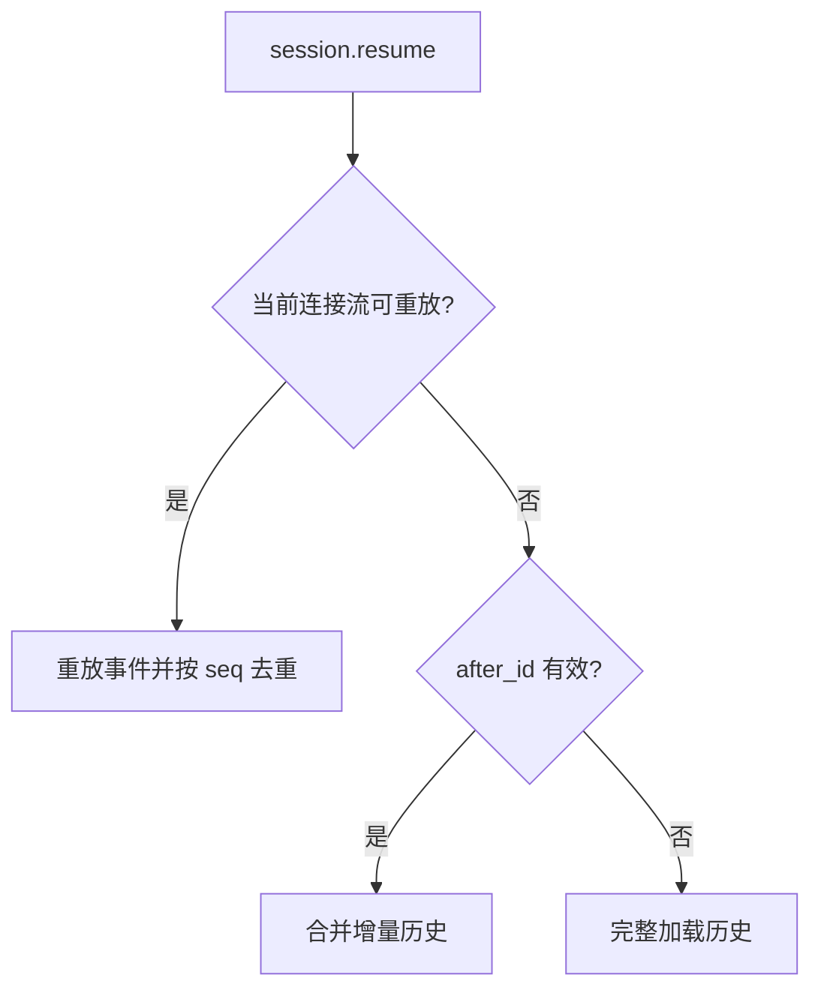
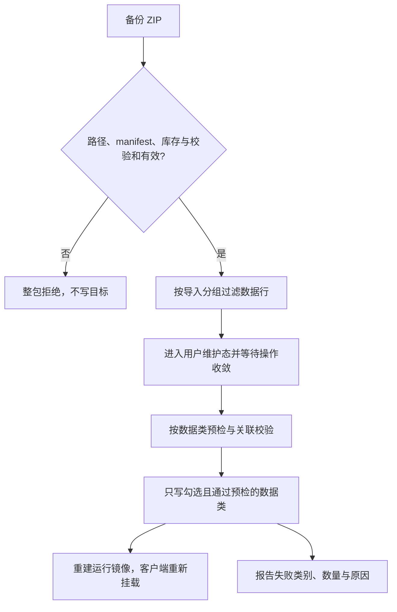

# 跨模块协议契约

本文维护通信、状态、交付、调度、安全和恢复的公共契约。字段、枚举及注册清单以链接的源码为准；模块内部实现由所属 README 维护。

## 通信与连接身份

### 传输与信封

| 链路 | 传输与鉴权 |
|---|---|
| Backend ↔ Client | `/api/chat/ws`，连接前以 Bearer JWT 请求 `POST /api/user/ws-ticket`，使用短时、`purpose=ws` 的 ticket 握手；签发与有效期见 [user.py](../backend/entrypoints/http/routes/user.py) |
| 手机浏览器 ↔ Backend | `/remote/` 同源页面，独立设备 Cookie；`POST /api/remote/ws-ticket` 签发票据后连接 `/api/remote/ws`，身份约束见 [远程访问](#远程访问) |
| Client ↔ Runner | Windows 命名管道 / macOS UDS 承载 WebSocket 帧，以本次启动 token 鉴权 |

WS 和本地 IPC 使用 JSON-RPC 2.0；REST、上传及下载不套 RPC 信封。请求带 `id`，响应以相同 `id` 返回 `result` 或 `error`；通知不带 `id`，不应被响应。Backend WS 的心跳与 `session.ack` 均使用普通 RPC 请求；Client 与 Runner 的本地连接以 WebSocket 协议层 ping/pong 探活。

### 登录、握手与心跳

ticket 关联登录记录，每张票据在 60 秒内独立消费一次，并发签发不使其他未消费票据失效；首次握手尝试即消费，后续初始化失败或后端重启后须重新取得。HTTP 与 WS 常规日志隐藏票据及资产签名参数。握手及入站处理核对用户与登录有效性。正常刷新不撤销登录，注销、另一端激活或管理员停用则清理连接与本机工具等待，已受理回合按[序号与恢复](#序号与恢复)继续执行。长效凭据不进 WS URL，握手只接受 `?ticket=`。

关闭码 `1008` 停止自动重连，表示策略拒绝，维护状态也可能使用，不能据此断言令牌失效。心跳用 `session.ping`，无入站帧超时以 `4000/heartbeat` 重连；探测间隔和超时见 [JsonRpcGatewayClient](../client/renderer/shared/lib/gateway-protocol/json-rpc-gateway.ts)。

WS 持续收包，普通业务请求按接收顺序执行；心跳、ACK、工具同步与回执、即时自主决策及声音制作与取消独立执行，自主推理和声音制作不阻塞心跳及会话恢复。每条连接的在途请求有上限，超限以 `1013` 关闭；断连取消该连接未完成的 RPC，已受理回合按[序号与恢复](#序号与恢复)继续运行。自主空间与窗口空闲表达持续等待模型结果，同类咨询在途合并，迟到结果重核上下文；处理入口见 [handlers.py](../backend/entrypoints/desktop/handlers.py)。

### 通道分工

依赖持续会话、进程内运行上下文和流式交付的操作走 WS；独立资源操作与较大载荷走 REST。REST 不要求聊天在线，但仍独立校验身份、权限与资源归属，不能因此视为可任意重试。

不持有 WS 的界面需要已有 RPC 能力时，REST 镜像须复用同一服务逻辑。聊天流走会话 emitter；需和业务状态共同提交的异步通知走 outbox，两者不能混称。

Client 决定唯一主窗口、窗口模式精灵显隐及窗口位置。Backend 提供资源和语义，不下发窗口像素指令；桌面模式的背景由 Client 交互屏视频承载，桌面呈现不创建独立悬浮精灵。普通聊天生图只交付媒体，更换场景必须走场景资源或专属工具。

## 会话与消息

### 会话种类与历史修改

`kind` 与 `system_preset_id` 是不同维度，不能互相推断；自动化标记与 `system_preset_id='automation'` 由数据库约束等价。每条会话持久化 `kind` 与非空 `system_preset_id`，预设创建后不可更改，换记忆域须切换或新建会话：固定系统对话为 special，普通及任务会话为 standard。

每用户每预设最多一条固定 special，不可删除或改名。`session.create` 必须显式提供目录内有效的 `system_preset_id` 字符串，缺失、空值、非字符串或未知预设返回参数错误；桌面和手机的新建入口展示完整预设目录，选择陪伴时创建 `kind=standard` 的普通会话，固定陪伴主会话继续承接主动消息。`system.list_presets` 只向客户端返回展示元数据，不下发提示词正文。目录见 [presets](../backend/runtime/presets.py)。

会话挂载结果的 `info.system_preset_id` 给出服务端确认的预设归属，公共对话页据此选择陪伴或专业呈现；窗口模式与桌面模式使用相同判断，列表分页或归档不改变已选会话的归属。

| 操作 | 普通会话 | 固定系统对话 | 任务会话 |
|---|---|---|---|
| 编辑任意正常用户消息（`prompt.submit` 带 `edit_message_id`） | 允许 | 允许 | 拒绝 |
| 重试最后一条未回复消息（`prompt.submit` 带 `retry_message_id`） | 允许 | 允许 | 拒绝 |
| 更换最新用户回合的完整回答（`prompt.submit` 带 `replace_reply_message_id`） | 允许 | 允许 | 拒绝 |
| 撤回（`session.undo_to_message`）、派生（`session.fork`） | 允许 | 拒绝 | 拒绝 |
| 桌面与手机提交消息（`prompt.submit`） | 允许 | 允许 | 拒绝 |
| 清空（`/clear`）、手动压缩（`/compress`、`session.compress_context`） | 允许 | 允许 | 拒绝 |
| 改名（`PATCH /api/sessions/{id}` 的 `title`） | 允许 | 拒绝 | 允许 |

任务会话的历史由自动化入口独占写入，桌面可读历史并管理任务。桌面、手机、Cron、主动与子 Agent 回合共用会话互斥；删除会话时核对整棵子任务树，仍在运行时返回 409，须先停止。停止不撤销已发生的外部副作用。

会话列表、搜索与挂载响应的 `message_count` 统计整段已保存历史的聊天气泡数，由 [formatting.py](../backend/features/conversation/formatting.py) 定义：非子 Agent 的陪伴预设会话，用户消息按空行分段去空，其它会话用户消息整段计一泡，纯图片、视频或音频输入计一泡；结构化助手回复逐泡计，其它助手消息有可见正文或媒体才计一泡。工具记录、无正文或媒体的中间帧与系统状态行不计。增量、分页截断和帧重放不改变总数，客户端不能用历史行数覆盖该字段。用户输入落库与回合结束时分别推 `session.list_changed` 刷新角标。

编辑、撤回、清空和手动压缩遵守会话锁、权限及在途回合检查。编辑可定位上下文边界之后的任意正常用户消息，只接受新文本，保留原附件，与 batch / attachments 互斥；删除源消息及其后的全部历史行与写入修订行在同一事务，校验失败不改历史。桌面在编辑较早用户消息时先确认会丢弃后续内容。编辑广播完整历史，修订行使用新 ID；应用广播时保留本地未提交或待确认的消息与附件，RPC 响应不二次覆盖已开始的回复。撤回删除锚点及其后的全部消息，并把锚点用户消息的正文与内联图片作为输入框草稿退回：RPC 响应与 `message.deleted` 事件的 `anchor` 为 `{text, attachments}`（定义见 [schemas](../backend/features/conversation/schemas.py)），`attachments` 只含可重新附加的 data URL 图片；音视频随撤回清理，不恢复。任何历史修改都不撤销已执行工具的外部副作用。

回复生成失败的 `error.retry_message_id` 指向已保存的用户消息，客户端在当前失败气泡提供重试按钮。`prompt.submit.retry_message_id` 与 text / batch / attachments / edit_message_id 互斥；服务端在会话锁内校验归属、最新用户行、上下文边界与未保存终端回复，复用原消息、附件和工具结果，只重新生成最终回复，不重复执行工具。模型选择与恢复见[模型失败与重试预算](#模型失败与重试预算)。新消息、已保存回复或历史修改使旧重试入口失效。`error.message` 面向用户：按会话语言本地化，不含失败原因枚举与内部名称，脱敏后才离开服务端；供应商错误消息经分类与脱敏后附在引导语之后。

最新用户回合的完整回答提供“换一个回答”，整组气泡共用一次操作。历史的 `can_replace_reply` 由服务端核对账户、会话、上下文边界及最新回合后给出；主动发言、自动化与子任务输出不开放。`prompt.submit.replace_reply_message_id` 指向待替换的助手消息，与 text / batch / attachments / edit_message_id / retry_message_id 互斥，沿用请求 ID 去重。生成只复用原输入、附件与工具结果，不再次执行工具；旧回答作为只读参考，完成前继续保留。成功后同事务交接媒体绑定并以新消息替换旧回答，`message.replaced` 携带 `replaced_message_id` 与完整 `message`；提交前取消或失败保留旧回答，提交后的取消不撤销新回答。`message.start`、在途快照和提交回执携带替换目标；成功替换的最终 `session.state` 同时携带已提交消息，补齐实时替换通知遗漏。生成期间不交付半成品，迟到的旧语音或媒体事件不能覆盖新消息。

派生继承源预设、自动化归属与历史工具链、媒体和时间等信息，排除界面状态行并清零用量、耗时；复制历史不同时填入输入框。历史中的上传视频随派生复制到新会话自己的附件目录并改写引用，之后源会话的清理、撤回、清空或删除不影响派生历史；源文件已被清理的引用写为清理占位。附件复制失败或请求被取消时，整个派生请求失败，不保留半成品会话。

派生会话是独立的普通会话，以 `forked_from_id` 记录来源，照常出现在会话列表与搜索中；删除来源只清空该记录。委派产生的子 Agent 会话以 `parent_id` 挂在发起会话下并随其级联删除，不出现在未归档会话列表与搜索中。字段见 [models](../backend/features/conversation/models.py)。

### 预设记忆与学习作用域

长期记忆及模型可读派生事实归属 `(user_id, system_preset_id)`，用户来自认证，会话决定固定预设；未知、缺失或越权作用域拒绝访问。即时聊天只读取当前会话历史，同预设会话共享长期记忆及所属资料；跨预设不共享检索、摘要、反思或学习技能，automation 不装配这些能力。

人工 `memory.list/update/delete` 必须且只能提供 `session_id`、`system_preset_id` 之一；跨域 ID 与不存在统一视为未找到。列表、数量、状态和证据属于同域，切换预设后丢弃旧请求结果。用户资料固定属于陪伴域，删除后可补填，不重启引导。

`memory.list` 使用服务端搜索与 `offset` 分页，返回筛选后 `total`，状态 `counts` 始终覆盖当前预设。`memory.profile.update` 只在陪伴域原子保存已登记资料字段，逐项携带编辑起点版本；空值表示明确遗忘，任一版本冲突全批拒绝。类型真源见 [共享协议](../shared/protocol.ts)，写入与遗忘语义归 [记忆模块](../backend/features/memory/README.md#修订与遗忘)。

模型记忆工具只能使用服务端验证的原始证据，证据消息须来自用户本人的对话：自动化会话与子 Agent 会话（其“用户”消息由父 Agent 撰写）不能作证；用户手写或手改的记录只有在更新的用户消息作证时才可改动；系统写入的伙伴自身记录（basis system，如夜间活动）不进入审阅；人工纠正仍保留伙伴记录归属，不转成用户明确表达。更新携当前 ID 与版本，并发冲突整批拒绝。候选、失效、过期和已遗忘内容不得作为有效事实召回。模型不得指定身份、作用域或来源；具体决策结构见 [memory_policy](../backend/features/memory/memory_policy.py)。

学习技能工具随 `tools.sync` 同步开放。Backend 派发时将 `skill_scope` 放在模型参数之外，Client 转发 `execute_scoped_tool`，Runner 在调用期间固定用户与预设目录。异步和委派继承该域，不读取界面当前选择。Runner 的 [SkillScope](../runner/spirit_agent_runner/contracts/scope.py) 只接受固定的预设 id 集合，新增或改名预设须同步，否则该预设的带域调用均被拒绝。

### 后台陪伴对话

后台陪伴上下文采集本用户陪伴预设下的全部顶层用户会话，包含固定主会话、普通及归档会话，排除自动化与子 Agent 会话。逐会话尊重清空水位，排除摘要、工具调用与界面状态，保留真实主动发言；每条对话携带角色、原文、发生时间及 `session_id`、`message_id`，按发生时间和消息 ID 稳定排序。查询和格式化入口见 [context_window.py](../backend/features/conversation/context_window.py) 与 [formatting.py](../backend/features/conversation/formatting.py)。

动态创作与评论回复、心情、闲置表达和主动搭话判断使用完整本地日期窗口：从用户本地当日零点至调用时刻，05:00 前从前一天零点开始，包含本日凌晨的新对话，不按条数或字数截断。夜间规划、反思、日记、当日活动量和七日基线使用相同会话范围，日期窗口依夜间目标日计算。

### 主动信息与来源分享

话题归属账户及陪伴预设，由夜间记忆整理后的独立阶段产生。批次首次启动时固定 `[T−24h,T)` 采集窗口，只接受有原始发布时间、文字依据和平台原文链接的内容；每天最多五条，归属夜间目标日的次日，于该用户本地午夜失效。候选独立保存，不作为用户记忆、亲身经历或尚未发生的聊天进入历史与摘要。

陪伴每次模型调用刷新当天资料及当前会话已分享的来源，历史引用跨摘要保留并尊重会话清空水位。模型以 `used_topic_ids` 标记实际讨论的内容，以 `link` 气泡的 `topic_id` 选择原文；服务端绑定标题、平台、地址与发布时间，使用记录随消息原子提交，取消和沉默不记使用。来源资格在服务端装配时冻结，模型等待跨午夜后可提交已经开始的回复，后续调用不再取得过期新候选。

反馈接口 `/api/companion/topics/{topic_id}/feedback` 只接受本人已分享来源的 `like`、`less` 或撤销值，事务内交付 `companion.topic_feedback.updated`；两端按更新时间同步，不产生伪用户消息。自然对话偏好仍按原始用户证据审阅，显式反馈独立保存并参与下一晚规划。会话备份与话题来源、反馈、使用记录成组恢复，重映射引用并核对卡片快照；过期批次不重新生效，未完成采集不在恢复后自动重放。

夜间采集按总控和独立开关执行，每次新增请求重查窗口与政策，重试也先计入持久化预算。平台失败隔离，空结果可以提交空批次，全部采集或精选失败不提供旧日储备。实现及预算入口见 [话题模块](../backend/features/topics/README.md)。

### 事件路由

Backend 事件统一使用 `method=event`，`type`、`payload`、`seq` 位于 `params`。会话事件的路由字段是 `params.session_id`，不是 JSON-RPC 顶层字段。

| 事件组 | 消费语义 |
|---|---|
| `message.start/delta/break/complete` | 开始、正文、分气泡和完成；完成帧补元数据，不重复追加全文 |
| `message.bubble` | 结构化回复逐泡交付：按气泡原顺序携带 `message_id`、`bubble_index` 与气泡，语音气泡到达时音频已保存（失败则音频为空） |
| `session.state` | 同步回合运行与终态，按提交标识避免旧终态结束新回合 |
| `session.list_changed` | 重新读取列表、预览及当前搜索，删除当前会话时回到陪伴主会话 |
| `memory.changed` | 人工编辑、遗忘与资料槽位写入同事务通知；按预设回源，保留未提交草稿与原版本 |
| `message.persisted` | 同步已保存的用户消息、消息 ID 和提交标识，各端按 ID 合并；助手 ID 随完成帧返回 |
| `message.audio` | 按会话与消息 ID 更新用户音频附件的时长或转写，并使该会话历史缓存失效 |
| `message.voice` | 更新已保存语音气泡的音频，并使对应历史快照失效 |
| `message.media` | 按消息 ID、媒体标识更新原位视频气泡，并使对应历史快照失效 |
| `message.reasoning.delta` | 独立推理展示，不进入正文或下一轮模型输入 |
| `message.edited/deleted`、`command.result`、`compress.completed` | 按各自契约替换历史、插入状态或更新消息，不统一当普通气泡追加 |
| `tool.start/complete`、`error` | 按会话路由的过程与错误 |
| `tool.call` / `tool.cancel` | 用户级设备指令，按 `call_id` 派发或撤回，不受当前可见会话过滤 |
| `companion.message/mood` | 分别交付已持久化主动台词与独立心情 |
| 形象、外观、场景、动态、日记与视频事件 | 更新对应资源或触发重新读取；不一律写入聊天历史 |
| `companion.video.progress/ready/failed/activated` | 载荷含 `packId`、`outfitId`；进度另含 `stage`，客户端按资源归属展示并重新读取状态 |
| `companion.action.catalog_changed` / `job_updated` / `play_requested` | 动作目录变更、生成进度与播放指令；目录变更带 `packId`、`catalogVersion`、`appearanceEpoch`，播放指令结构为 [ActionPlayCommand](../backend/features/actions/schemas.py)（过期时刻 `expires_at`），语义见[动作目录与播放](#动作目录与播放) |
| `companion.desktop_video.updated` / `play_requested` | 桌面组合、动作和偏好版本变化，或桌面视频播放命令；Client 重新读取桌面状态，播放命令仍须经过当前组合、呈现代次和有效期校验 |
| `system.notification` | 自动化结果通知，完整内容留在任务会话 |

- 共享业务通知面向该用户的在线端交付，不能因目标会话未打开而丢弃。
- 载荷中的 `session_id` 可用于落卡或跳转，不必然代表会话路由闸门。
- 回合帧（`message.start/delta/break/complete/persisted`、`message.bubble`、`message.reasoning.delta`、`tool.start/complete`、`error`、`compress.completed`）的转换见 [emitter](../backend/workflows/chat/emitter.py)；`message.edited/deleted`、`command.result`、`avatar.regenerated` 由 [handlers](../backend/entrypoints/desktop/handlers.py) 直接推送，`tool.call/cancel` 由 [ipc](../backend/runtime/desktop/ipc.py) 发出；`message.voice/media` 等业务事件经 `emit_ws_event` 写 outbox，载荷由各发射点定义，并与 REST 响应一样按 JSON 模式序列化，时间字段同为 ISO 8601 文本（UTC 以 `Z` 结尾）。客户端分派与消费入口见[渲染层事件路由](../client/renderer/README.md#事件与异步生命周期)。

`tool.call` 不带 `params.session_id`，但其 `payload` 含 `name`、`args`、`call_id`、信息性 `session_id`、`headless` 与 `skill_scope`（仅学习技能工具非空，见[预设记忆与学习作用域](#预设记忆与学习作用域)）。`headless=true` 照常执行，不显示桌面工作态；后台自动化和其他无头回合须由调用方显式传入，子 Agent 回合沿用父回合的标志，Client 不得靠会话类型猜测这一行为。`tool.cancel` 的 `payload` 只含 `call_id`，语义见[调用日志与未知结果](#调用日志与未知结果)。

`message.complete` 可携带 `cache_usage`，汇总本回合直接聊天调用（含工具续轮、格式修复和回退）；既有 `usage` 仍表示最后一次响应的上下文用量。缓存命中率按有效报告请求的命中 Token 总数除以其输入 Token 总数计算，并携带已报告与总请求数。缺失或非法计数为未知，零输入不计算百分比；桌面用量面板显示最近成功回合的数据，切换账户、会话或重新加载时清除，不从消息历史恢复。

### 序号与恢复

- `seq` 是当前连接的网关重放流位置，跨聊天 Session 共享；宽限期重连可复用。网关销毁、登录记录更换或服务重启后可重新开始，不是数据库消息 ID 或永久递增编号。
- `stream_id` 标识连接重放流，变更时重置旧序号；请求重放须同时带流身份与 `last_seq`。Client 按 `seq` 去重并用 `session.ack` 确认消费。ACK 只裁剪重放缓冲，不证明业务提交或工具执行；RPC 响应不属于该事件流。
- 重放、增量合并与全量替换分别处理，不能混用旧流游标。
- 已受理用户回合归账户运行态持有，桌面或远程端断连、退出、重新激活与登录授权失效只释放连接，不取消回合；重连通过 `session.resume` 恢复。只有用户显式调用 `session.interrupt` 才取消回合，终态为 `cancelled`；账户维护及 Backend 正常停机等待回合收尾。真实调用失败仍按失败处理，进程崩溃或强制终止后由重启恢复标记中断，不自动重做已执行操作。
- 历史同步复用已有会话运行时，不取消在途回合；停止回复须显式调用 `session.interrupt`。快照与流游标在同一运行态锁内取得，桌面挂载期间暂存事件，快照内已表达的回合帧不重复追加；宿主通过内部 `session.snapshot` 将同一快照同步所有 IPC 代理窗口。
- 历史携持久化消息 ID 与毫秒级创建时间。全量恢复达到防御上限时返回 `truncated` 与 `next_cursor`（本页首条 ID，未截断为 null）；可用 `session.history` 携 `before_id` 向前分页读取更早历史。
- 握手后所有事件帧（含回合帧与 `tool.call`）先暂存，直到挂载类 RPC（`session.resume`、`session.get_main`、`session.create`、`session.fork`）或约 10 秒超时后才冲刷；重放缓冲容量与时限见 [buffer](../backend/runtime/desktop/buffer.py)，恢复结果字段见 [runtime](../backend/runtime/conversation.py) 的 `SessionResumeResult`。

### 表达通道

正文只承载可读台词；`companion.mood` 更新身份区，不创建消息；视觉表达只经 `companion.action.play_requested` 派发；`companion.should_act` 返回空间意图，由 Client 计算位置。动作受当前形象能力限制，控制字段不得编码进聊天文本。

当前心情由用户陪伴回合独立更新，不由工作、自动化或主动回合顺带生成。自主视觉表达与空间咨询须通过档位、可见性与锁屏闸门，空闲视觉表达还需满足空闲条件。可见性以桌面精灵窗实际显示（表面快照 `spriteVisible`：窗口存在、未隐藏且未最小化）且未被完整入口或轻语收起为准；Client 发出 `companion.should_act` / `companion.idle_expression` 前检查，`should_act` 结果返回后再次核对。

### 结构化回复与终端交付

非子 Agent 的陪伴预设会话，包括固定与普通会话，回复采用[结构化气泡](../backend/features/conversation/replies.py)。模型输出内部对象 `{kind, bubbles}`：日常交流与情景互动用 `kind=dialogue`；只有本轮明确要求的书面故事、剧本、译文或引用使用 `kind=written`，完整正文与必要排版保存在一个文字气泡。所有供应商、模型共用后端格式处理器：日常台词按明确句末标点分泡，保留原文与顺序，不按逗号拆分；小数、常见缩写、省略号和句尾 emoji 保留。旁白不由代码删除，语义转换由模型完成；书面分支只合并文字气泡，保留正文、标点与已有排版。处理后统一校验换行、旁白标记、演绎与媒体，去除内部类型标记并保存、回灌气泡数组；客户端不再分句。由模型选择 `text / voice / image / video` 与顺序，纯媒体回复有效，不设气泡数量上限。`companion.response_preference` 保存偏好，`prompt.submit.response_preference` 携带本轮快照；客户端不据此转换消息或自动播放。

仅语音携带 `speech`，空对象表示按已选音色常态朗读。MiMo 的可选 `instruction` 是整句自然语言朗读指令，放入 TTS 的 user 消息；`styles` 是台词开头的整体风格标签；MiniMax 使用可选 `emotion` 与 `speed`。两者都可用 `segments` 表达段内控制：空数组或省略时直接朗读本泡 `text`；非空时各段 `text` 按序拼接须逐字等于本泡台词，`tag` 与 MiniMax `pause` 在所属段文字之前生效。分句前校验分段结构，未知字段与无效标记不能被重组过程丢弃。空文本段可携开头、段间或句尾声音，不能在分句时丢失；句间空白处的标记进入后一句，全文末尾的标记留在末句，跨句段在句界切开。拼接不一致进入一次模型修正，TTS 装配也校验原文一致性。整句与局部控制按实际供应商、模型能力校验，客户端不解释演绎。音色设计模型的固定音色描述与逐泡 `instruction` 合并进入 user 消息，台词不做供应商自动润色。

| 消费方 | 回复内容 |
|---|---|
| 数据库 | `content_type=companion_reply` 标识结构化回复；`content` 保存最终交付的气泡数组，内部 `kind` 不保存；`reply_json` 保存同组气泡的演绎、语音绑定、音频及服务端绑定的媒体资产与真实状态；整轮为同一条 `Message`，媒体不重复写入 `media_json` |
| 对话上下文 | 回灌 `content` 中的气泡数组，补入媒体真实状态，排除供应商绑定、资产路径和时长 |
| 客户端 | 历史与实时下发同序逐泡视图；文字／语音保留台词与音频，媒体携标识、状态及服务端资产地址；不解释演绎 |
| 内容消费 | 记忆、摘要、标题与心情逐泡读取台词和媒体真实状态，未完成媒体不能总结为已发送成功；TTS 只读取语音台词，搜索只匹配台词（多模态消息只匹配文本部分，附件地址不参与会话搜索与记忆证据检索）；`text` 正文不按 JSON 外形推断气泡或附件 |

陪伴回合非流式取得最终回复，确认无工具调用后处理、校验；聊天回合的工具步数受独立上限约束，上限用尽、连续三个工具步没有新信息（调用全部失败，或只重复本回合已有调用且结果不变）、动作型工具（播放动作、保存后续事项、切换场景等）成功后核对额度用尽，或媒体请求受理后的额度用尽时，下一次模型调用不披露工具，只依据已有结果生成最终回复，而不是报错中断（主动回合按各自上限结束）；完整响应的单层 JSON 围栏会移除，缺失的内部闭合符只在字符串原样保留、可完整解析时补齐，不抽取其他正文中的 JSON，不消费不完整终态。不能把接收 schema 参数或偶然合法 JSON 当成服务端约束生效。格式错误、取消或异常不交付未确认正文。每回合至多保存一条可见终端消息，工具中间行只保留调用结构。专业会话与自动化继续使用各自文本契约。

缓冲回合只发一次 `message.start`；逐泡交付替换等待气泡，媒体在自身位置渲染，历史使用同一视图。语音时序、收尾对账与失败降级统一在下节定义；用量使用终端值，不累加工具循环各轮计数。

### 媒体引用、验图与原位交付

媒体选择先满足本轮明确要求：听说、朗读与声音表达使用可用的 `voice`，静态画面使用图片生成，短片与连续动作画面使用视频生成；文字／语音偏好只影响台词，不替代图片或视频。陪伴预设默认提供本轮允许的基础媒体工具，其他能力按需解锁，具体集合与边界见[工具披露](../backend/workflows/chat/README.md#工具披露与记忆访问)。工具可用、生成与终端交付分开：没有产物时先使用本轮允许的工具，取得产物后才提供媒体气泡；无工具或失败时如实说明。已有产物优先交付，已受理任务先查状态，不能因用户催问重复提交。

模型只输出 `{type: "image" | "video", media_id: "工具产物标识"}`。执行层生成标识，校验当前用户、会话内已知工具产物、类型及就绪文件；视频可引用已受理任务。未知标识、类型错误、重复引用、遗漏本轮成功图片或已受理视频均按[模型失败与重试预算](#模型失败与重试预算)回退或恢复，不重复执行工具。模型不能填写 URL、路径或状态。

终端对象在分句前检查 `text` 和 `voice.text`：常见媒体文件地址（含查询串与 URL 编码）、媒体 data/blob/file 地址及内部资产路径必须原样来自本次上下文中的用户文字或工具返回，助手历史、工具参数和摘要不提供来源。台词中的内部资产路径、Markdown 图片和 HTML 媒体嵌入不能代替媒体气泡；用户明确要求的书面引用可保留资料中已有的地址或完整媒体语法。普通网页链接不受媒体地址检查；来源匹配只证明可引用，不证明生成成功。地址内部标点不参与分句。失败沿用同一回退与恢复预算，纠正伪造地址及完成宣称；仍不合法则不落库、不交付，不通过语音降级绕过。代码见 [reply_links.py](../backend/workflows/chat/reply_links.py)；该检查不判定任意自然语言的真实性或所有无扩展名外链的用途。

`image_generate` 每次调用描述一幅画面（`prompt`、`subject`、`aspect_ratio`、`outfit_override`），`n` 是同一描述的变体张数；不同画面在同一个工具步里分别调用。每回合只在一个工具步里受理图片请求，之后的新请求被拒绝；初次生成合计最多 16 张（含失败项），这是生成预算，不限制回复气泡数。派发前登记目标；完全相同的请求再次调用只返回已有状态，改变 call ID 不重新生成；已有图片结果未知时，本回合不再提交新的生成。必填项缺失、多余参数和越界取值在派发前返回说明可用参数的错误，成功项为零时顶层 `success=false` 并带 `error`，成功结果带 `next` 说明交付方式。媒体请求（图片或视频）受理后，陪伴回合最多再保留两个工具步（核对或补做一次），随后进入上述最终回复阶段。`media_inspect(media_id)` 读取真实图片，检查原请求并复用身份评分，返回绑定具体版本的检查标识与问题。`image_regenerate(media_id, inspection_id, correction)` 只接受当前版本的有效问题检查，每目标最多重做一次。原图保留，修订版本有新标识但属于同一目标，最终只交付一个版本；文本回复附加最新成功版本，重做失败保留原图。图片失败不能作为就绪产物发送，结果未知不重复提交。代码入口：批次、验图与重做见 [chat_images.py](../backend/workflows/chat/images.py)，回合媒体状态 `MediaTurnState` 见 [contracts/media.py](../backend/features/media/turn_state.py)，单个引用的校验与视频绑定见 [reply_media.py](../backend/features/conversation/reply_media.py)，逐目标唯一与遗漏校验见 [reply_delivery.py](../backend/workflows/chat/reply_delivery.py)，工具定义在 [image_generation_tool.py](../backend/entrypoints/tools/builtin/image_generation_tool.py) 与 [video_generation_tool.py](../backend/entrypoints/tools/builtin/video_generation_tool.py)。

视频每回合最多受理一个初次请求，已有 pending 任务只能查询。陪伴会话通过媒体气泡交付等待卡片，其他气泡正常发送。任务绑定消息与媒体标识，终态以 `message.media` 携 `message_id / media_id / bubble_index / bubble` 更新原卡片。落库与后台完成通过任务行锁协调；先完成后绑定读取真实终态，消息删除后不补建。重复更新幂等，终态不回退；缓存与重连恢复见 [Client](../client/README.md#历史同步)。其他文本会话使用附件及后台媒体送达机制；视频失败保存可见系统状态行，实时事件携同一消息 ID，刷新或重复事件不生成第二条失败状态。

视频工具的 `reference_image` 与 `subject` 参数见[工具定义](../backend/entrypoints/tools/builtin/video_generation_tool.py)；参考优先级及与动作包的分工见 [出镜图片与视频](PIPELINE.md#出镜图片与视频)。

备份收集嵌套媒体资产并重写恢复后的用户路径；恢复与派生会话解除任务绑定，未完成视频标记为失败，不声称恢复了生成任务。图片原版与修订资产保留；未采纳质量候选仍按各生成链清理。

### 视频排队与结果核对

所有视频入口在输入准备完成后按[全局视频队列](PIPELINE.md#全局视频队列)等待供应商密钥名额。受理立即返回原业务任务，排队不阻塞聊天回合。动作、桌面制作草稿、视频工具和状态快照提供可空的 `video_queue`；字段定义见公共媒体的[队列契约](../backend/features/media/video_queue/contracts.py)。`waiting`、`rate_limited`、`blocked` 分别展示视频排队、服务繁忙等待重试、等待核对生成结果；`next_retry_at` 是已知的下一重试时间，普通排队不承诺预计完成时间。

衣柜沿 `companion.video.progress`、桌面沿 `companion.desktop_video.updated` 同步进度；聊天使用 `video_gen.queue` 的业务任务、会话、媒体标识和 `video_queue` 更新等待卡片。重新加载从任务及媒体气泡快照恢复相同状态，队列信息不包含其他账号任务或凭据。已接单任务继续远端生成进度；未知结果仍属于未结束，不能再次提交付费请求。

管理后台通过 `GET /api/admin/video-queue` 查看各供应商密钥队列的配置名称、队列 ID、冷却与占用；密钥及指纹均不返回。`POST /api/admin/video-queue/{request_id}/resolve` 仅核对阻塞占用，携带预期修订号和核对说明，可补录远端任务 ID 后续查，或确认远端已结束／未接单后解除占用；过期修订返回 409，操作记录审计。人工解除只放行后续任务，原尝试不自动重发或切换供应商。

取消、维护、密钥轮换、重启和备份恢复的占用边界统一见[队列恢复规则](PIPELINE.md#全局视频队列)。用户删除和覆盖恢复清除业务内容后仍须由队列收尾原远端占用，备份不保存队列运行状态，也不启动付费请求。

### 音色设计与克隆

窗口、桌面、通知和恢复快照共用伙伴声音导航 `#/companion/voice`；设置的 `voice` 分类管理回复偏好与聊天录音时长。固定目录、手写设计、自主设计与克隆能力独立报告；目录为空不隐藏可用自定义能力，缺少 LLM 时仍可手写设计。

媒体模块拥有设计、克隆各一套当前方案及其不可变版本。试听候选绑定输入、账户和方案版本，确认时原子校验；描述或样本变化须重新试听，迟到、取消或旧版本结果不能覆盖当前方案。未确认候选在 24 小时后回收。生成与合成可持续等待，由账户隔离的操作标识取消；声音制作不进入普通 RPC 队列，取消记录覆盖取消先到和描述生成到试听制作之间的间隔，保留范围见 [voice_operations.py](../backend/features/media/voice_operations.py)。

克隆样本经 `POST /api/media/voice-samples` 上传为独立账户资产，不使用会话附件的配额或删除语义；上传、读取及音频转换均校验账户与实际内容。Client 主进程桥在请求前后核对鉴权会话，换号后的结果不能交给新账户。自定义音色仅使用媒体模块签发的不透明方案引用，设置和音色 ID 不携带描述或音频字节；上传限额与转换规格见 [voices.py](../backend/features/media/voices.py)。

聊天、主动语音、朗读和动态共用媒体模块的音色解析与合成入口。声音描述与朗读正文分别装配，试听不自动改写台词；历史消息引用当时的声音版本，更换方案不改变历史重试。配置或必需样本不可用时，合成明确失败；聊天回合停用语音能力并继续文字回复，不改写已选声音。

方案、候选、试听和参考音频纳入账户删除、[备份恢复](#备份校验与覆盖恢复)及资产引用追踪。已确认方案、历史消息和有效任务持有的参考音频在最后引用消失后回收。

### 语音保存与重试

用户录音经 `POST /api/media/audios` 上传到当前账户的会话，返回 URL、实际格式与时长；`audio` 附件只接受本会话已上传且仍存在的文件，回放 GET 同时校验账户与会话归属。原始录音保留，供应商请求使用按需转换的 WAV 副本。桌面录完即提交，远程页面录完作为待发附件确认提交；图片、视频与音频可混合。

存在音频的请求先按配置顺序尝试支持全部输入的原生音频模型；没有可用模型或可回退尝试耗尽时，按语音输入任务链转写，再沿原任务链尝试保留其他媒体要求的文本调用。两阶段持续等待结果，已交付正文、结果未知和取消不能触发转写回退。成功转写按会话音频引用复用，保存到原用户消息，`message.audio` 更新时长或转写；标题、记忆与心情等回合后处理按需读取同一缓存，转写失败不撤销已完成原生回复。千问按 Responses 音频协议装配，MiMo 音视频请求使用 Chat Completions 并归一化到统一消费契约。

音频与视频共享会话附件配额、派生复制、删除和备份路径重映射；清理文件前提交引用改写，有转写时保留转写，无内容时保留明确占位。重试复用原录音，不重新上传。
- 后端先保存回复，再并行合成音频。气泡按原顺序经 `message.bubble` 交付，前一泡未就绪时后续泡等待；语音在音频保存后交付，失败则保留类型、台词与演绎并以空音频交付。`message.complete` 收尾并携带完整气泡，客户端按消息 ID 与气泡索引对账补建。取消不回滚已保存回复；消息改删或合成中断时清理未提交音频。
- 音频为空的语音气泡在客户端直接显示原台词，不呈现失败语音条或整轮错误；历史与实时交付使用相同降级，后续音频更新到达时恢复语音呈现。
- 客户端点播或按独立的 `companion.autoplay_voice` 偏好顺序播放；该偏好仅控制播放，文本没有 TTS 入口。
- 缺失音频经 `POST /api/sessions/messages/{message_id}/voice/{bubble_index}` 重试，已有音频幂等复用，不重新生成台词或演绎；请求持续等待合成完成或明确错误。
- 成功写入后以 `message.voice` 更新对应气泡并使历史快照失效。
- 收听状态由本机主进程按账户、会话、消息 ID 与气泡索引持久化，通过独立 IPC 读取、更新、删除及广播；`listened` 只在播放正常结束后置为真且不回退，`positionSeconds` 保存断点，播完归零。记录不上云，不进入消息正文或模型上下文；类型见 [IPC 契约](../client/shared/ipc/contracts.ts)。
- 新语音只从首次接收的终端回复与主动消息入队，历史水合、音频更新及偏好修改不触发补播。缺失音频或播放失败保留未听并跳过，用户点播才触发合成重试。暂停、中断与其他声音抢占不算播放失败。

合成与有序提交入口为 [reply_audio.py](../backend/features/conversation/reply_audio.py)，客户端音频缓存归 Client。

主动回合使用同一结构，`kind=dialogue` 与空 `bubbles` 表示沉默、不写空消息，格式恢复同样允许沉默；常规档仅提供文字能力，不提供语音与视觉表达工具。音频准备后重新检查用户活动、租约和档位；接受时原子保存消息与 `companion.message`，拒绝或取消清理未交付音频。

### 模型失败与重试预算

- 模型调用按任务与能力解析有序链，先筛选本次输入所需能力，再沿配置顺序尝试。聊天在正文交付前遇到可回退的供应商明确失败、未完成或失败终态、应答为空或结构、分句、演绎及媒体校验失败时，仍有下一项就自动回退；合法工具调用与主动回合的合法沉默不算空回复。独立文本调用也可对未完成、空正文或要求 JSON 对象却格式无效的响应回退，视觉分析可对空结果回退。每次尝试按实际模型重算窗口、参数与输出预算；嵌入固定同一模型，失败使用关键词召回。实现见 [llm_fallback.py](../backend/infrastructure/ai/llm_fallback.py)、[error_classifier.py](../backend/infrastructure/ai/error_classifier.py) 与 [prompt_engineer.py](../backend/infrastructure/ai/prompt_engineer.py)。媒体候选择优与下载、评分边界归 [PIPELINE](PIPELINE.md#供应商选择与失败恢复)。
- 聊天仅在实际开始交付正文时锁定模型；响应到达、状态或推理事件、未交付的工具草稿不锁定。缓冲回复先核对完成状态与内容，流式拒绝与完整响应的拒绝使用相同失败语义。交付前暂存当前尝试的推理，接受结果后发布；失败时丢弃其正文、推理与工具草稿，下一项从干净的原始上下文重新装配。已交付正文、结果未知（含被 SDK 包装的响应丢失）、取消或业务守卫终止后停止回退。自动切换期间保持等待，可回退失败在整条链及可用恢复耗尽后才返回 `error` 和有效的 `retry_message_id`，按末项实际失败报告，先前模型的内容策略拦截不覆盖后续格式错误。
- 手动重试最终回复从当前配置的链首开始；用户更换回答或重新制作媒体时，从当前结果实际使用模型的下一项开始，链尾回到链首；微调图片优先使用原模型。单次操作最多遍历一圈，全部失败后由用户再次操作；单模型链每次使用同一模型。先按当前配置旋转再筛选请求能力；来源缺失或失效时从当前链首开始。无凭据来源及选择定义见 [selection.py](../backend/infrastructure/ai/selection.py)，媒体各阶段语义见 PIPELINE；结果未知、正文交付及下载恢复等停止边界不因循环选择而放宽。
- LLM、图片、视频、语音及向量调用持续等待结果或明确错误，不设响应读取、写入、流式静默或调用链时长上限；连接建立与连接池等待各保留 10 秒。媒体参考及成品传输使用相同网络策略，保留体积、协议与 SSRF 校验。聊天回合不以耗时中断，主动回合仍受意图有效期约束；用户取消、维护、停机及任务失效照常收尾。供应商句柄查询退避续查原任务，不因等待过久重新提交。桌面及手机同步等待 AI 的 REST/RPC 不设请求计时器，普通查询、握手、心跳与本机工具等待沿用各自期限。
- 同一端点的网络自动重试只用于幂等方法、显式幂等键或可确认未发送的连接失败，且请求体可重放；非幂等请求在写入或等待响应时断线按结果未知处理，不能换供应商重交。
- 聊天每次生成优先尝试下一项，只有能力筛选后实际尝试序列的末项可在同模型恢复一次：非内容过滤的不完整终态和完成但无正文的用户回复依据原输入重新生成，陪伴回复的结构、日常分句、演绎或媒体校验失败则独立格式修正。含音频输入时，原生音频与转写后文本两阶段组成同一序列，仅整个序列的末项可恢复；单模型有效链同样保留这次机会。
- 模型把完整的最终回复对象写成对未提供工具的单个调用时，参数视为本次响应的正文，走同一套校验与修正，不当作工具失败再试一轮。
- 首次请求与恢复请求共用按当前音色和可引用媒体生成的气泡 schema，无媒体时不提供媒体气泡类型；格式修正额外允许空数组表示无可恢复内容，用户回合按现有空回复校验报告格式失败，主动回合可保持沉默，均不能遗漏应交付媒体。通用语音结构中其他供应商字段的 null 或空列表不表达演绎，绑定时忽略，非空的不支持字段仍拒绝。段内演绎遵循上文 `segments` 原文与位置契约；MiniMax 停顿须跟在已说出的词之后。校验错误定位到具体气泡的 speech 字段，持久化一致性检查使用相同绑定规则。
- 格式恢复请求不提供工具，返回工具调用时仍由代码拒绝。失败草稿不是已执行操作，修复资料与指令不写入聊天历史。最终回复阶段切换模型仍使用无工具请求，复用原输入、附件与已完成工具结果重新生成，不重跑工具或媒体生成。恢复仍失败时报告回复格式错误，与供应商不可用区分。
- 格式修正以完整的未交付助手响应为唯一编辑正文，只附只读人设、校验错误、实际语音能力与可信媒体清单，不携带用户原话、历史、工具调用及结果正文或中间推理；人设只帮助保持原说话者与语气，不提供新台词。媒体地址的原始来源仍由代码核对，不作为对话传给修正模型。温度使用供应商允许的最低值。手动重试最终回复和工具步用尽后的最终回复属于重新生成，仍保留历史，并将原生工具调用与结果按顺序转换为只读资料，历史以工具记录结尾时在末尾重述用户本轮请求；原始历史不变。
- 格式修正由适配器选择 schema 接口：DeepSeek 使用原生 Responses，其余供应商先尝试 Chat Completions，仅在接口明确拒绝格式能力时依次降为 JSON 模式或普通请求，入口缺失时使用 Responses。格式校验路径不按模型或供应商分支。参数拒绝不产生模型结果，成功返回后不再切换入口或追加修正；鉴权、限流、内容过滤等失败不触发参数降级。
- 每次生成的末项尝试中，不完整终态重试与格式修正共用一次恢复预算；工具循环进入下一次生成时重新计。是否允许恢复与是否已消耗恢复分开记录，前面尝试跳过恢复不等于预算耗尽，不能因此启用降级。该预算与 HTTP 网络重试、模型回退及格式参数降级分别控制。
- 模型保留草稿的说话者、受话者、内容、顺序及有效交付类型，不重新解读用户意图或续写回答：日常台词逐句成泡，旁白的情绪与情景转为台词或可用的语音演绎；书面文字与标点保持，只调整必要排版。缺少类型时按草稿正文恢复对话或书面形式，未指定通道的台词用文字；语音不可用时保留原台词转文字。有效媒体引用与顺序保留，错误地址及完成宣称、遗漏引用按可信产物修正。无可恢复正文及应交付媒体时返回空数组，不根据用户输入另写回答。修正使用同一输出结构与交付校验，不执行工具、不再次修正；预算耗尽不增加调用，仍不合格时报告格式错误。
- 末项已消耗恢复预算后，若错误仅在语音演绎字段，将相应气泡转为原台词文字再完整校验并保存；其他气泡、媒体与顺序保留。若只是遗漏了本回合已生成且可交付的媒体（包括回复仍没有任何正文），按生成顺序补在末尾交付，已生成的产物不因模型漏引而丢失。正文、气泡结构或媒体仍无效时才报告回复格式错误。
- 模型取消或异常不交付未确认正文；失败的模型回合不写终端正文行。

### Slash 命令

Slash 元动作走 `command.dispatch`，不交给 LLM。`command.list` 返回名称、别名、说明和确认标记；clear、compress、remember 的注册与实现见 [handlers](../backend/entrypoints/desktop/handlers.py) 和 [slash_commands](../backend/features/conversation/slash_commands.py)。

`//` 或不符合命令起始规则的输入视为普通文本；符合命令形式但未识别时提示错误，不退回 `prompt.submit`。编辑消息时的斜杠按正文处理。需要确认的命令由服务端再次校验 `confirmed=true`；影响历史的命令另检查在途状态。clear 需确认，compress 无需确认；清空保留会话并写清理状态行，不等于删除长期记忆或撤销工具。remember 只写当前认证记忆域，自动化无记忆域。

响应与 `command.result` 可能同时到达，Client 幂等消费；`hydrate=true` 替换历史，否则展示状态。自动压缩在聊天调用前按上下文阈值触发，`compress.completed` 插入压缩状态，不与手动压缩的全量替换混用。摘要检查点在历史与事件中以消息 `subtype=compress_summary` 标识，正文格式不作识别依据。主动回合也保存压缩检查点，临时意图不进入摘要；无头检查点与 `compress.completed` 通知同事务写入 outbox，客户端按消息 ID 去重。管理端自动压缩开关是总闸门，用户不能覆盖关闭；阈值使用会话覆盖或系统默认，固定会话不继承普通对话的全局聊天偏好。

## 伙伴与资产

### 接口入口

| 修改范围 | 定义入口 |
|---|---|
| 对话、引导、工具同步、记忆管理、命令 | [桌面 handlers](../backend/entrypoints/desktop/handlers.py) |
| 会话 REST 与传输结构 | [会话端点](../backend/entrypoints/http/routes/sessions.py)、[schema](../backend/features/conversation/schemas.py) |
| 伙伴资料、头像与全身、角色卡、衣柜、动作包、媒体复核与资产读取 | [伙伴端点](../backend/entrypoints/http/routes/companion.py)、[伙伴 schema](../backend/features/appearance/schemas.py)、[动作包 schema](../backend/features/actions/media_contracts.py) |
| 场景 | [场景端点](../backend/entrypoints/http/routes/companion_scenes.py)、[场景 schema](../backend/features/scenes/schemas.py) |
| 桌面生活视频组合、动作、制作与播放 | [桌面生活视频端点](../backend/entrypoints/http/routes/companion_desktop_videos.py)、[schema](../backend/features/desktop_life/schemas.py) |
| 动态 | [动态端点](../backend/entrypoints/http/routes/companion_posts.py)、[schema](../backend/features/posts/schemas.py) |
| 日记 | [日记端点](../backend/entrypoints/http/routes/companion_journal.py)、[schema](../backend/features/journal/schemas.py) |
| 动作目录、设计、启停、额度与回执 | [动作端点](../backend/entrypoints/http/routes/companion_actions.py)、[schema](../backend/features/actions/schemas.py) |

引导恢复依据服务端状态及已有资产；完成条件与身份锁定范围见 [DESIGN](DESIGN.md#认识伙伴)。

### 头像、全身与确认

字段与限长见[伙伴 schema](../backend/features/appearance/schemas.py)。头像 POST 接受可选 feedback，空请求仍可生成；POST 与 `avatar.regenerate` 都不能因断连或空结果自动重发，应读当前头像恢复预览。头像、全身、外观及服装参考的上传图按实际字节校验：须是体积在限内、可完整解码的 PNG / JPEG / WebP / GIF，类型以图片内容为准，不采信客户端声明；GIF、MPO 与其他多帧图片取第一帧归一为 PNG。无法读取或超限返回 400，格式不支持返回 415。

全身和外观的生成、自备图与微调成品均为真实透明 PNG，实际 MIME 和扩展名与内容一致；上传无需预先透明，服务端校验后必要时抠图。确认及全身候选采纳只安装通过透明验收的图片，失败保留原草稿与正式状态。透明处理、背景请求及失败边界见 [PIPELINE](PIPELINE.md#全身与着装透明成品)。

| 操作 | 并发与生效条件 |
|---|---|
| `portrait/confirm` | 用户锁内核对 `expected_avatar_id`，冲突返回 409 |
| `fullbody/confirm` | 核对 `expected_url`；首次引导确认不等待分析或派生生成，分析进度归角色卡，视频启动失败归外观状态 |
| 确认后的 `/fullbody/reference`、`/reference/prompt`、`/reference/adopt` | 角色卡未就绪（分析中或失败）时返回 409，不发起生成、不产出提示词、不采纳；就绪时 `/reference`、`/reference/adopt` 只返回待采纳候选、不替换种子，`/reference/prompt` 只返回提示词；`/fullbody/candidate` 恢复最近有效候选 |
| 候选 `/analyze`、`/accept` | 前者重试身体分析；后者要求角色卡就绪（未就绪返回 409），并核对预期原图和角色卡修订（已变化返回 400），只更新身体并清旧覆盖，不重建已有外观/视频 |

完整路由见[伙伴端点](../backend/entrypoints/http/routes/companion.py)。初始资产与重复启动守卫见[生成服务](../backend/features/appearance/README.md#后台任务与初始资产)，编辑上传见 [PIPELINE](PIPELINE.md#编辑上传与身份采纳)。

### 角色卡编辑

人设 PUT 同时承接首次引导的确认保存和日常资料维护。引导保存完整资料并补写逐题提交未能保存的用户回答；资料维护提交 `expected_fields`，只接受已完成人设的四个可编辑字段，在行锁内校验原始值后合并，保留视觉与声音字段。冲突返回 409，两端保留草稿并展示最新内容。手机仅开放资料保存、角色卡修改与重新提取所需的精确接口和个人资料 RPC，继续使用设备身份及同源校验。

角色卡 GET/PATCH 读取与局部编辑，extract 发起重新提取/失败重试，见[结构](../backend/features/appearance/character_card_models.py)与[伙伴端点](../backend/entrypoints/http/routes/companion.py)。写入校验预期形象和修订，冲突 409 且 Client 保留草稿；changes 未传不变，null 恢复自动值，空字符串显式清空。

分析状态独立于已发布内容，重分析失败不撤销旧资料；`companion.character_card.updated` 与状态同事务写 outbox，客户端重读但不覆盖草稿。

### 场景任务与原位换图

路由与字段见 [场景 API](../backend/entrypoints/http/routes/companion_scenes.py) 和 [schema](../backend/features/scenes/schemas.py)。生成要求与提示词不作为成品描述，创建来源不因启用改写。内容边界、参考用途与描述恢复见 [场景创建与描述](PIPELINE.md#场景创建与描述)。

| 操作或查询 | 状态与返回语义 |
|---|---|
| `GET /api/companion/scenes` / `/scenes/state` | 分别提供资产列表与当前状态；资产和当前环境独立 |
| `POST /api/companion/scenes/{scene_id}/regenerate` | 对已有可用场景重生成图片，返回 `202` 和原场景响应，不新建场景 |
| `SceneResponse.regeneration` | 最近一次重生成任务状态 |
| `SceneStateResponse.regenerating` | 仅进行中任务提供目标场景；`pending` 保持创建／分析语义 |
| `POST /api/companion/scenes/{scene_id}/discard` | 可取消任一类进行中场景任务；取消重生成保留成品 |

- 创建、上传准备、分析与重生成共用用户级单任务限制；重生成期间原状态与图片保持可用。
- 新创建、重生成和新上传展示图固定为 `2560×1440`、`16:9`，受理时冻结；请求不携带目标尺寸，Client 不上报显示器尺寸。已有场景和已冻结任务保留原尺寸。
- 响应分别提供 `target_size`、`source_size`、`image_size`，表示交付目标、原始素材与最终展示图尺寸；上传源文件独立保存并参与备份、引用追踪和回收。
- 重生成完成同事务替换该场景图片、环境描述、来源与尺寸，保留标题，并发送 `companion.scene.updated`；不改变 `active_scene_id` 或 `scene_switch_version`。分析失败保留候选，重试只继续分析，不重复生图。
- `POST /scenes/{scene_id}/analyze` 可继续失败的重复伙伴检查或描述分析；编辑已保存信息会撤销失败的重生成候选，避免旧结果覆盖新描述。
- 异步提交校验任务标识与账户归属，角色身份变化不影响壁纸。失败或取消保留旧成品；备份恢复清除重生成运行状态。
- 输入冻结与供应商恢复见 [PIPELINE](PIPELINE.md#场景图片重绘)。

### 场景启用与授权

状态与 outbox 同事务提交。`companion.scene.updated` 通知资产/任务/政策变化，`companion.scene.activated` 才表示切换成功；两者携单调 version，Client 忽略旧事件及迟到读取。

`switch_version` 在新自动意图、任一来源的启用成功、用户再次选择当前环境、取消与当前版本一致的待处理创建任务（无论是否申请自动启用）、自动启用的创建因已有任务被拒、政策更新（含重选同值）及备份恢复时递增；后台兑现已有自动启用意图不递增。后台仅在版本、政策仍有效时自动启用，否则只留资产；重复启用当前场景幂等，但用户再次选择当前环境会撤销旧意图。

陪伴、自主回合使用 `scene_list/get/create/activate`；[对话编排](../backend/workflows/chat/README.md#提示词与运行时数据)每轮刷新环境。

| 发起方 | 授权与默认行为 |
|---|---|
| 客户端 REST | 用户显式创建/切换；页面创建与上传默认只保存 |
| 聊天工具 | LLM 自主决定，不从用户消息推断手动授权；create 默认 auto_activate=false，申请切换才传 true；activate 同样受自主政策约束 |
| 引导与夜间 | 调用方显式声明是否自动启用 |

- 每回合最多受理一次创建、一次切换，优先复用；创建并申请自动启用同时占切换额度。代码校验账户归属、锁定、额度和版本，场景变化不受打扰档位限制（见 [DESIGN](DESIGN.md#自主变化与锁定)），也不绑定角色身份或角色卡修订。
- 工具结果区分资产状态、自动启用申请、已启用及 `environment.current`；未启用不返回已到达。
- 在线自主新增按滚动 24 小时提交计额，删除不返还，复用不占。夜间使用 `scene.create/activate` 与计划预算，不依赖换装；仅启用完成才入生活事实，场景操作不自动发动态。

### 桌面生活视频与模式隔离

窗口场景和透明动作与桌景套装独立。桌景创建冻结所选场景、着装和角色参考，之后换装或切换场景不会切换桌景；同一组合允许多套。默认套装仅从初始化来源幂等建立一次，后续套装由用户选择已就绪来源和制作方式。源资料关系只用于追溯，冻结图片及文本承担继续制作依据。用户显式启用套装，未启用套装可以制作、上传和采用而不抢占桌面；删除当前套装回退可用默认套装，否则清空播放指针。

资源位于 `/api/companion/desktop-videos`，套装及分步制作接口定义见 [路由](../backend/entrypoints/http/routes/companion_desktop_videos.py)与 [schema](../backend/features/desktop_life/schemas.py)。套装创建以 `request_id` 幂等，目标固定为客户端所选显示器的实际像素尺寸；`PATCH /sets/{set_id}` 只接受必填名称。创建草稿快照保存本机显示器 ID 与制作输入，恢复和提交前复核屏幕连接及实际尺寸，尺寸变化时更新目标和请求标识。默认套装等待当前交互屏尺寸与来源资料齐备，来源未齐备时保存待创建尺寸。

推荐状态由客户端对照当前交互屏实时计算：套装目标宽高比相对屏幕宽高比的差异不超过 1% 时为“推荐”，超出为“不推荐”，屏幕尺寸不可用时为“暂无法判断”。切屏、连接和尺寸变化时重新计算；展示与使用体验归 [DESIGN](DESIGN.md#桌面生活视频)。

首次图片生成直接使用已保存的画面想法，草稿响应返回该意见。图片生成、调整、上传和确认独立于视频生成；草稿冻结目标尺寸与修订号，确认、上传、采用及放弃绑定目标套装、草稿标识、预期基准及分辨率修订，恢复时同样校验。制作与采用只校验账户及目标内容，播放另校验当前启用套装和呈现代次。

上传先按实际显示方向读取素材尺寸，比例与目标相差超过 1% 且未明确选择策略时返回结构化 `aspect_ratio_mismatch`，包含素材、目标尺寸及可选操作，不改变草稿或当前成品。图片和视频均可保留原比例或选择 `expand` 适配画幅；适配优先本地裁切，超出范围才使用图片扩展或视频参考生成，规则归 [PIPELINE](PIPELINE.md#桌面生活视频)。视频响应补充预计时长或调整不可用原因；取消不发起模型调用。显式保留原比例只影响本次图片、视频及同基准派生动作，不改写套装目标。复用旧图片及生成外部制作提示词时执行相同检查；后者保留原比例时按确认图输出，选择适配则转入图片制作。派生动作适配共享基础图时，响应指出安静相伴作为调整目标，客户端转到该动作的图片确认；已有基础图草稿须先完成或放弃，采用前保留原成品。目标尺寸和实际输入、成品尺寸分别保存并返回；`geometry_mode` 随当前成品和播放命令经 IPC 传递，`target` 允许按实际视口少量裁边，`keep` 完整显示。

视频微调的预检与提交分别由动作的 `/refine-video/preview`、`/refine-video` 接口承载。来源只可选择当前成品或待采用候选，由服务端按账户和动作解析；请求绑定成品版本、草稿、基础画面及分辨率修订，重复或过期提交不能替换新的制作。预检不改变状态，提交前重新核查素材和可用供应商；普通微调保留原比例，画幅调整使用套装目标。原片引用、实际参考视频和生成结果分别保存，所有微调结果均待采用；采用安静相伴时按新视频实际首帧更新基础图并执行既有派生失效规则。备份保留这些引用与待采用状态，在途任务恢复等待手动继续，不自动重新付费。

画面响应分离 `current`、`draft`、可播放状态和不可播放原因。已生成且待采用的视频保持 `review_pending`，检查意见通过草稿的 `review_reason` 返回，`error` 只表达制作异常；客户端显示已生成、待确认，保留检查详情和直接使用入口。基于图片制作视频前须确认图片，图像变更使确认失效；视频微调直接绑定用户选择的原片。上传图片和视频同时校验预期成品版本，旧上传页面不能覆盖期间已采用的新成品。首次普通视频通过检查后成为当前成品，已有内容的替换一律等待预览采用，外部上传同样遵守；适配上传视频和微调结果始终等待采用。失败、放弃或取消保留旧成品；旧草稿和迟到任务不能写入新内容。原文件与适配副本分别保存，桌面静音；画幅、首帧和供应商约束归 [PIPELINE](PIPELINE.md#桌面生活视频)。

安静相伴采用新基准时，原子更新当前视频、基础图和内部修订号，并作废旧播放、在途草稿与候选；旧派生动作失去手动和自主播放资格。已有成品且启用的派生动作安排重做，自动结果仍需采用；失败可单项处理，不撤销新安静相伴。仅重做同一图的视频不重建派生动作。基准依赖与转场方式独立，首尾不同的上传视频使用淡化转场；相容共享基准片段可在循环接点切换。

持续循环可由已缓存媒体直接渲染，有效认领指令优先。播放命令冻结套装代次、呈现代次、素材修订号和有效期，认领及兑现重查资格；实际 `started` 回执才表示开始显示。切换套装、基准失效或素材更新作废旧指令，单次结束、失败或中断返回仍有效的持续片段。新套装预加载失败保留已显示画面。回执失败不阻塞本地回退，重启不补播旧回应。

桌面动作工具只在实际桌面模式且存在已启用套装时装配，模型不选择内部套装标识。聊天环境、主动动作和夜间动作规划读取已启用套装确认画面；未识别上传图内容时，不将旧创建参考写成当前可见事实。窗口模式继续读取原场景和衣柜。夜间动作绑定规划时套装，切换套装或模式后拒绝旧计划；仅换装和场景库切换不使它失效。用户在其他套装明确发起的制作不因切换桌景取消。

暂停保留草稿、原始来源、上传文件及供应商句柄，并阻止启动恢复和迟到上传自动续跑。继续接口绑定草稿、基准与分辨率修订，沿原制作处理已知结果；已下载素材复用来源文件，未提交阶段仅在用户明确继续后调用模型，未知提交禁止重发。放弃清除草稿并尽可能撤销供应商任务，保留旧成品。备份覆盖目标尺寸、冻结参考、上传原图、扩展结果、当前成品和草稿，恢复不自动付费重建。

### 媒体复核与激活

首次动作采用沿用质量检查：首次整组审核存疑时保留预览与手动穿着；就绪组单独补齐动作复核存疑时，以及已有当前素材的所有重做结果，均建立待采纳项。首套初始化动作齐备后，目录发布成功、身份审核通过、冻结身份及参考仍有效，且完成时仍穿着初始着装，才自动启用。后续着装确认入柜后自动准备基础动作，完成后保留当前穿着，由用户显式穿上；已就绪但未穿着的动作组更新自身目录也不自动换装。质量检查见 [PIPELINE](PIPELINE.md#身份评分与发布复核)。

待采纳项经 `/api/companion/media-reviews` 列表、单项 GET、accept/reject 管理。制作中、就绪或失败动作组均可采纳单项，在同一事务替换当前素材；必需动作齐备时更新目录，仅当前穿着组广播可播目录变化。尚未就绪的动作组在采纳提交后沿上述身份复核与自动穿着链收尾。重做中、待确认或拒绝候选时当前素材持续可播；拒绝只作废候选，保留当前素材与未知任务恢复信息。

复核项只作用于生成它的成品；当前成品仍在收尾保存时，采纳和拒绝均保持 `pending` 并提示稍后重试。单动作重做结束仍待确认的旧复核项；素材已被替换时，采纳失败并结束该项，拒绝只结束该项、不改动作。响应中动态动作以设计名称作 `title`，系统动作以 `system_slot` 供客户端本地化；`media_type` 决定图片或视频预览。日常聊天、场景、动态、夜间媒体不建人工复核项。制作资格与原任务恢复见 [动作目录与播放](#动作目录与播放)。

### 动态与日记

动态与日记由伙伴创作。动态只由独立主动调度发起，聊天和夜间规划不提供发布入口；用户可评论和删除本人评论，不能编辑动态或删除伙伴回复。日记只由夜间流水线自主判断并发布，内容由标题和正文承载，没有聊天写入工具或发布次数额度；当天已有日记时恢复复用原文，不追加、不覆盖，也不重新变为未读。日记、召回索引与发布事件在同一事务提交，主动不写与已发布结论持久化在夜间日志中供恢复。

视频动态持续等待原任务终态；提交结果未知时保留句柄，不自动补发。动态页可查询原任务并预览成品，查询只续原句柄、下载及本地核查，不新增制作或评分；取得成品后私有视频任务停在 `review_pending`，重启不自动推进。用户明确采纳时重查账户、身份、自主开关与滚动额度，发布冻结计划；放弃由任务所有者释放未被其他内容引用的资产。未知状态在夜间账本仍为结果未知，不记成确定失败。

正文、媒体与评论独立保存，不自动写入主会话或其历史摘要。动态创作和评论回复共享人设、用户资料、全部有效普通长期记忆、最新相处理解、心情及完整[后台陪伴对话](#后台陪伴对话)。创建时另载入过去连续72小时发布的全部动态正文及制作资料；评论回复只带当前动态及截至目标评论的线程，不推测其他动态下的交流。

创作模型自主决定是否发布、主题、目的与类型。动态与日记的第一人称属于伙伴，用户生活以用户分享及伙伴回应、感受来叙述；发言、引用和转述保留实际经历主体，交流记录不证明伙伴亲身参与用户活动。自身活动依完成记录，心情、关系理解与作品叙事不独立证明外部行动。夜间记忆输入与动态共用可读的依据、话题和日期标签，区分用户表达、观察、推断与伙伴自身记录。

动态计划与日记正文通过结构校验后，使用同一任务的模型配置和原始资料审阅内容完整性、事实依据及主体、时间和状态。审阅只核对待发布文字，不把媒体制作构思当成已发生的事，也不要求主观感受和明确创作设想具有现实事件证据。发现实质问题时携草稿和指出的原文片段修订一次，再次审阅仍不合格或审阅失败则沿调用错误流程停止，不保存计划、不制作媒体或发布日记；模型也可正常决定不发布。审阅和修订均保留完整资料，夜间每次调用继续受夜间窗口限制。语法合法、供应商完成状态和正文语义完整分别检查，程序不通过补标点或静态台词冒充完整内容。

动态上下文保存其发布意图、媒体制作说明与语音文稿，用于回复和夜间回顾：意图说明分享主题与目的，制作说明描述预期画面，文稿提供语音表达内容；预期画面不保证成品细节，作品描绘的情节不证明现实经历。每次模型调用提供当前时间与用户时区，缺失时区明确按 UTC；发布与逐条评论均携带本地时间，时间差按 UTC 计算。目标评论保留原始发生时刻，并提供距发布及实际回复的间隔，排队或重试不改变评论发生时间。

文字、图片、视频和语音共用独立发布服务，不依赖桌面连接，受统一创作开关 `companion.posts_enabled` 控制，默认值与能力筛选见[发布入口](../backend/features/posts/publication.py)。正文须通过校验，媒体动态还须取得主媒体才能发布；可选旁白失败保留主媒体，主媒体失败不产生动态。媒体须为本账户的正式资产。

独立调度按账户随机间隔45–90分钟判断是否创作。滚动24小时按动态条数在事务内预留：排队和在途任务占额，未知结果按原预留时间计入窗口，明确未发布的终态释放；未知请求不重复提交。默认额度与计数条件见 [Settings](../backend/infrastructure/config.py) 和[领域存储](../backend/features/posts/store.py)。创作前装配并保存完整资料快照，已有计划恢复时复用；超过模型窗口沿调用错误流程处理，不裁剪资料或替换为摘要。

回复状态绑定触发评论，同一动态按评论顺序生成回复；失败重试原任务，删除触发评论后不写入迟到回复，已生成的伙伴回复保留。发布通过 `companion.post.created`、评论与回复状态通过 `companion.post.comment`、删除通过 `companion.post.comment.deleted` 刷新，事件与业务状态同事务提交，不发送 `companion.message`。

动态与日记的未读状态由后端逐条保存，新发布默认未读。列表加载前捕获当前账户全部未读 ID，Client 在页面成功展示且所属主窗口或桌面面板可见、聚焦、未锁屏时确认该快照；确认只更新本账户指定记录，重复提交幂等，不能按确认时刻批量清空。进入后新发布的内容在正文实际展示时单独确认，读取或确认失败保留提醒。发布、已读和遗忘事件驱动重新查询，登录、开窗、重连、聚焦与解锁补查；账户与请求生命周期守卫隔离迟到结果。

动态未读与评论无关。`GET /api/companion/posts/unread` 查询 `has_unread`，首屏列表返回 `unread_post_ids`，翻页返回空快照；`POST /api/companion/posts/read` 提交 `post_ids`。已读更新与 `companion.posts.read` 事件同事务提交；字段见[动态 schema](../backend/features/posts/schemas.py)。

日记使用 `GET /api/companion/diary/unread` 查询、`POST /api/companion/diary/read` 提交 `diary_ids`，列表返回 `unread_diary_ids`。快照涵盖全部日期，Client 只在进入页面或重载后确认；月份翻阅不重新确认全账户快照。`companion.diary.created/read/deleted` 分别通知发布、已读与遗忘，事件与业务更新同事务提交；字段见[日记 schema](../backend/features/journal/schemas.py)。

日记原文是权威内容，`diary:<日期>` 是标题及完整正文的派生记忆索引，固定属于陪伴域；按日期读取使用 `memory_recall.diary_date`，普通话题沿用向量和关键词召回。索引不能通过普通记忆编辑改写，人工遗忘索引时同事务清除日记原文及索引内容。反思保存为 `reflection:current` 的最新相处理解快照，在后续陪伴对话中自动装配；更新由全天原始交互、有效记忆及先前理解生成，纠正或撤回旧误解也须替换快照，`content:null` 仅表示无需改写。日记和反思均标为伙伴自身记录并保留所属日期，不独立证明用户事实；用户当前明确表达优先于先前理解，不改变固定人设和行为授权。正文及召回入口见[记忆模块](../backend/features/memory/README.md)。

发布时间为实际完成时刻，活动归属日由发布任务记录；夜间规划、反思和日记按动态 ID 去重归集发布事实，资料中的发布与评论时间均转换为带时区偏移的用户本地时间。评论按自身发生的本地日期归集，包括较早动态上的新评论。备份规则见[覆盖恢复](#备份校验与覆盖恢复)。

生成正文完整保存，超出容量时明确失败，不静默裁切。字段上限见[动态 schema](../backend/features/posts/schemas.py)与[日记 schema](../backend/features/journal/schemas.py)，中英文均按字符计数；反思的正文上限由 [Settings](../backend/infrastructure/config.py) 的 `reflection_max_content_chars` 控制。

### 资产访问与缓存

归属资产支持有效 Bearer JWT 或短时 URL 签名鉴权，签名当前有效期为五分钟。可续传资产支持 Range、ETag 与不可变缓存。Client 按剥离签名参数后的资源身份复用缓存，ETag 用于复验；签名变化不等于内容变化。缓存键算法与落盘范围归 [Client](../client/README.md#资产与历史缓存)。

动作目录快照或素材修订变化时须重新读取描述符和相关资源；本机缓存按后端与用户隔离，登出和换号保留，明确移除账户才清理该账户的数据。换号后的迟到结果不得写入新账户，移除后的旧写入不得恢复已删除缓存。对话生成媒体作为正式资产保存；只要仍有有效业务引用就保留，不沿用临时文件过期语义。

动作目录的 `media_ref`、`hitmask_ref` 保存 `companion-assets/<user_id>/<relative_path>` 裸路径；客户端动作加载器将其转换为 `/api/companion/asset/<user_id>/<relative_path>`，经携带当前身份的资产桥下载。完整相对路径参与签名；所有读写入口拒绝点段、编码穿越、跨账户路径和符号链接越界。目录本身的签名 URL 直接交给资产桥，短时签名不写入持久化目录。

正式资产按数据库归属分层，目录标识不随展示名称改变：

| 用户资产根目录下的位置 | 内容 |
|---|---|
| 根目录 | 头像、全身种子等身份固定资产 |
| `outfit{id}/` | 外观立绘和专属参考 |
| `outfit{id}/pack{id}/` | 动作包的冻结参考、源素材、候选、成品、封面、遮罩和目录；没有外观的导入包使用 `pack{id}/` |
| `scene{id}/` | 场景壁纸与制作资源 |
| `desktop/{set_id}/{action_id}/{generation_id}/` | 桌面生活动作的起始画面、系统下载源、用户上传原始视频、系统静音 MP4 与封面；组合、动作和生成代次固定在路径中 |
| `voices/` | 音色设计与克隆试听、独立克隆参考音频，按方案、候选及历史引用保护 |
| `YYYYMMDD/` | 聊天、动态等生成文件；按用户时区和所属消息或任务创建日冻结，跨日重试不换目录 |

编辑、撤回、清空及删除会话时，在删除引用的同一事务登记回收，并标记旧消息独占的视频任务失效；原附件由修订消息继续持有。提交后停止对应语音和媒体任务，复查消息、派生会话、身份、外观、动作、场景、动态、有效生成任务及待投递消息，再立即回收无引用文件。已送达通知不独立持有资产；共享资源只在最后一个有效引用消失后回收。文件写入至引用提交期间有任务保护，回收与新引用建立须遵守账户资产锁。

删除着装或桌景时，业务删除与立即回收登记同事务提交，并提前已有延迟待办。提交后停止相关本地任务、补扫专属目录，回收无引用文件及空目录；迟到写入在任务退出后再次清理。着装删除同时释放所属动作包的退役保护和复核素材引用，保留复核结论与计额记录。

失效任务不再提交生成、评分、下载或交付，迟到结果不能重建历史；可取消的供应商任务按原句柄撤销。远端不支持取消或已开始不可撤销时，只保证停止本地后续步骤，不声称远端已停或费用已退。清理失败保留待办，启动及每分钟补偿，每小时扫描磁盘遗漏；可重试候选、待采纳结果和必要的计额、去重记录继续保留。正常素材替换中，已发布动作版本保护 24 小时，已结束媒体复核素材保留 7 天，到期且无引用才删除。实现归 [资产领域](../backend/features/assets/README.md)。

图片附件可随 `prompt.submit` 以内联 data URL 或 HTTP(S) URL 提交，URL 由供应商拉取。视频先经 `POST /api/media/videos` 上传，再提交本会话附件 URL；视频拒绝 data URL、跨会话引用和第三方绝对 URL（公网模式须带 `public_base_url` 前缀）；文件已被配额剔除或清理的附件 URL 同样拒绝，须重新上传。公开读取端点 `/api/media/videos/...` 与临时媒体 `/api/media/files/...` 使用不可猜测文件标识，属于供供应商读取的例外，不应描述为所有媒体都要求 Bearer。

视频按会话滚动配额与历史生命周期清理，删除时同步将消息中的引用改为清理占位，不留下死链。公网 URL 与内联模式、大小限制和供应商能力筛选见 [对话编排](../backend/workflows/chat/README.md)。

## 动作目录与播放

`action_design` 制作窗口模式冻结外观包内的可复用透明能力，`video_generate` 交付一次性作品。接口与字段见 [actions API](../backend/entrypoints/http/routes/companion_actions.py)、[schema](../backend/features/actions/schemas.py)。桌面模式使用独立的 [桌面生活视频与模式隔离](#桌面生活视频与模式隔离) 契约，不共享透明背景、全身构图和命中遮罩要求。

- 合法系统槽位可上传透明图片或视频；自动制作按动作规格选择类型，drag 与左右探身为图片。图片是单张静态成品，没有时长、帧数、帧率、循环或重复规格，由基础状态决定显示与切换；动态表达当前仅接受视频。共享处理结果见 [schema](../backend/features/actions/media_contracts.py) 的 `ActionResult`。
- LLM 使用 `action_search` / `action_design` / `action_inspect` / `action_play`；系统槽位不向模型开放点播或 inspect，按不存在处理。source、用户、额度窗口、系统槽位和目标包由服务端绑定；REST 请求的 `expected_pack_id` 只作并发守卫，聊天工具不暴露该字段。用户聊天工具与 REST 设计按用户请求（user_requested）计额，主动回合及夜间提案按自主（autonomous）计额，并受自主创建开关约束。提案立即返回受理，不等评审/制作，也不进入聊天视频送达链。
- 动态动作制作额度按滚动 24 小时由独立账本记录，批准新制作及受理同名独立重做时强制，续查询、下载与发布不重复计额，删除包不返额；不设评审日限额；额度数值不进入模型上下文，超限转 deferred 的理由经动作快照与 `action_inspect` 可见，用户可经 `GET /api/companion/actions/budget` 查看。无手动播放入口；陪伴预设每次调用模型前刷新动作快照（就绪、在途和近期拒绝信息），见[动作编排](../backend/features/actions/README.md#模块入口)。
- 所有动态呈现汇入 `companion.action.play_requested`，目录和任务事件仅更新资源。Client 按 `play_id` 去重，按 `pack_id` 与 `appearance_epoch` 校验归属和代次，遵守 TTL / `repeat_count`。
- `appearance_epoch` 是服务端维护的动作包激活代次：每次激活（含换装后再穿回同一包）写入该用户已有最大代次加一；目录接口与 `catalog_changed` 携带包的当前代次，播放指令与账本记录受理时的代次。制作中保存的意图在动作就绪后（含复核项经用户采纳后就绪），仅当意图未过期、所属包仍激活且代次未变才补发并重新计算即时有效期；未过期但包或代次失效记 rejected；已过期（不论包是否失效）或动作已停用、未就绪时保持 queued、不补发。补发只针对本轮制作完成的动作，不重发其他动作未执行的即时请求。
- Client 比较指令与本地目录代次：同包旧代次说明该包已重新激活，直接认领并回执 rejected；其他不能直接播放的指令先强制刷新目录（覆盖恢复保留备份中的代次，新包代次可能低于本地旧包）。刷新后指令仍较新则不认领，交由已加载新代次的舞台或 TTL 收尾；较旧或包不同则认领后回执 rejected。本地快照未记录代次时，网络校准前不受理；换包或代次变化时作废旧播放实例。
- 播放回执按 `play_id` 幂等，同一请求只由一台可见设备执行；queued 不算完成，认领后不能播放报 rejected，抢占报 interrupted，表演事实只来自播放器回执。
- Client 主进程按 `play_id` 在本机可见舞台之间唯一认领，认领记录保留到请求过期；完整入口侧边伙伴可接收播放。收起、最小化、最大化、切窗或锁屏时中断播放并作废在途加载，恢复后回到待机，不补播旧请求。持续可见时换侧不中断；同包目录刷新不替换已受理实例的素材版本，迟到媒体事件不得生成第二种终态回执。
- 动作 REST 管目录、设计、启停、删除、额度与回执。每套着装只有一个稳定动作组，每个动作只保留当前生效素材和待采纳候选，不提供历史版本选择；换装随动作组切换，不跨组引用素材。当前穿着或仍在准备、制作及等待结果的动作组拒绝删除。采纳与自动穿着见 [媒体复核与激活](#媒体复核与激活)。
- 不同着装及同着装不同动作可并行制作。冻结参考就绪后，制作中、就绪或失败组均可按需处理已取得明确结果的动作；系统槽位及包内已有动态动作的原位制作走 `POST /api/companion/video-packs/generate`（`source_pack_id` + `action`）。同一动作排队、制作或付费结果未确定时拒绝再次发起，旧采纳素材或较早候选不代表当前尝试已取得结果；已知任务或落盘素材只续原进度，未知提交不重发，也不能通过清空句柄或删除动作组绕过。
- 整组重新制作（含上传）只在该着装没有任何已采纳动作且无任务等待结果时允许，并复用组与动作记录；重做期间保留的旧可播素材仍算就绪。动态动作明确重做按用户请求计制作额度，同名设计的日常提案可复用已有可播动作；成品待确认时同名设计只返回等待状态。
- 动作响应 `has_ready_asset`、`current_media_url` 表示当前已采纳内容，`pending_review` 表示待确认候选，预览 URL 不代表已采纳。包级 `can_regenerate` 表示冻结参考可供单项制作，动作项同名字段还反映本次结果是否明确；`can_regenerate_pack` 单独约束整组重新制作。单动作反馈按本次提交替换并回显，空串或省略均清除。
- manifest 的 `catalog_version` 标识已发布目录快照，每次发布推进，并用于目录响应、变更事件与资源缓存校验；`canvas` 只定义包统一的逻辑宽高比。clip 通过 `media_type` 区分图片与视频，共享 `media_ref`、实际像素 `width` / `height` 及命中信息。同包素材像素尺寸可不同，宽高比一致，布局以媒体解码尺寸为准；`duration_ms`、`frames`、`loopable`、`hitmask_fps` 只属于视频条目。
- clip 可选携带 `peek_geometry`（遮挡线及需保留的识别区域）和 `content_rect`（内容轮廓），坐标归一化到最终媒体画布；clip 与目录结构见 [publishing](../backend/features/actions/publishing.py) 的 `ActionClipSpec` / `ActionCatalogManifest`（客户端镜像为 [action-types.ts](../client/renderer/modules/character/actions/action-types.ts)），`PeekGeometry` 与 `content_rect` 解析见 [schema](../backend/features/actions/schemas.py)。缺少有效探身定位时不启用遮挡；侧边伙伴与桌面精灵缺少内容轮廓时优先从 alpha 遮罩推导，仍缺失按完整画布适配与落位。
- `hitmask_ref` 指向行整数按位表示列占用的 JSON，网格由 `hitmask_grid` 提供：图片是静态 `[row]`，视频是逐帧 `[frame][row]`，视频另带 `hitmask_fps`。生成见 [图片处理](../backend/infrastructure/video_processing/image.py)与 [视频处理](../backend/infrastructure/video_processing/process.py)。drag 图片在拖拽结束时切回当前基础动作，不进入播放计时或媒体结束事件逻辑；有限播放请求若指向图片须拒绝。
- [探身补齐接口](../backend/entrypoints/http/routes/companion.py)的输入见 [schema](../backend/features/actions/media_contracts.py)。仅当前激活且具有可读冻结参考的包可补齐；按包和槽位复用任务，素材成功但目录缺失时只重试发布。失败或未知结果不自动重新付费，由衣柜显式处理；无冻结参考的导入包不自动重建。
- 窗口快照见 [IPC 类型](../client/shared/ipc/contracts.ts)：窗口模式精灵宿主或当前窗口精灵舞台可读取；跟随目标跨屏只允许仍拥有舞台的宿主执行。主进程将 Runner 原生几何转换为 DIP，快照提供当前舞台视口原点供渲染层换算。绑定包含窗口标识、进程身份和 Runner 实例标识，重启使旧绑定失效；这些本机数据不进入云端自主上下文。桌面视频背景不使用该几何快照。

## 本机工具

### IPC 准入

Client 创建本地端点并生成每次启动的 256-bit token，Runner 主动连接，upgrade 鉴权失败返回 `401`。Runner 收到拒绝后丢弃缓存端点和 token，重连前重读端点文件。POSIX 套接字在 umask `077` 下创建，端点文件写入后设为 `0600`，均只允许当前用户访问。

Windows 命名管道可被本机进程枚举，token 是实际准入边界；不能因使用本地 IPC 就省略鉴权。该 token 不是 Backend 凭据。

### 握手与工具同步

Runner 的连接与可执行就绪分开：完整配置成功应用、工具清单成功读取后，Client 才发布就绪并允许新工具执行。握手（含清单读取）或运行期配置推送重试耗尽后撤销新派发资格，保留已发调用的结果与取消通道；后续配置保存、重新握手或重新启动可恢复。已就绪后配置推送成功、仅清单刷新失败时保留原清单，下次保存重试。宿主串行发送工具同步，只按当前 WS 连接已成功交付的清单去重；空清单撤销排在已发出的旧清单之后，失败不缓存，重连重新同步。

| 方法组 | 用途 |
|---|---|
| `runner_ready`、`spiritagent.info` | 握手与运行快照 |
| `get_tools` | Runner 实际工具清单 |
| `execute_tool`、`execute_scoped_tool` | 普通及带学习域的执行 |
| `spiritagent.call_result`、`spiritagent.cancel` | 查询已派发结果与取消请求 |
| `spiritagent.config.update` | 完整配置推送 |

启动和 Runner 重启均执行上述同步。`get_tools` 的工具说明按 Runner 当前配置生成（如终端说明随 `terminal.env_type`）；运行中配置推送成功后 Client 重新读取清单，有变化时按重连同样发布并由宿主重新 `tools.sync`，读取失败保留原清单。未同步或清单为空时，本机工具不可见、不可派发；撤销资格后，已派发调用仍按结果与超时收尾。Runner 握手、配置推送与 `get_tools` 由 Client 主进程的 [bridge](../client/main/runner/bridge.ts) 完成；`tools.sync` 与撤销由精灵宿主的 [host-runtime](../client/renderer/app/runtime/host-runtime.ts) 按 Runner 状态发起；Backend 侧注册见 [registry](../backend/runtime/tools/registry.py)，派发见 [tool_dispatch](../backend/workflows/chat/tool_dispatch.py)。

工具禁用在清单装配和派发边界生效。Runner 各能力通过 [ToolDefinition](../runner/spirit_agent_runner/contracts/tooling.py) 显式提供工具及所属工具集，普通调用与代码子调用共用执行器；新增或删除工具集 id 时同步 [Client 索引](../client/main/shared/lib/toolset-index.ts)、Runner 所属能力的定义与[目录过滤](../runner/spirit_agent_runner/runtime/tools.py)、[Backend 过滤](../backend/runtime/tools/toolsets.py)和[显示图标](../client/renderer/shared/lib/toolset-catalog.ts)，不能只改界面清单。

### 能力与进程代次

`capabilities` 表达能力，`capabilities_health` 表达可用性和原因；`run_generation` 每次 Runner 进程启动更新，进程内重连不更新。连续重连计数与生命周期累计计数含义不同，不混用。

当前 Client 只保存握手时的能力快照而无消费方，不读取 `run_generation`，也不处理 `runner_capabilities_changed`；本机工具门控只看桥状态、WS 连接与 `get_tools` / `tools.sync` 结果。不能将通知存在写成“运行期能力已自动更新”；接入时须同时校验连接、握手、代次和工具同步。

### 调用日志与未知结果

`call_id` 由 Backend 为每个模型工具调用生成并写入历史，不沿用供应商标识（可能缺失或跨回合重复）。Client 必须按 `call_id` 去重设备指令，并将同一标识透传 Runner；RPC `id` 不代替它。Runner 日志按设备而非用户隔离，在实际执行前查询日志并原子认领，同一标识不同工具、参数或学习域不得执行或重放。

| 查询结果 | 恢复行为 |
|---|---|
| completed | 复用已保存结果，不重新执行 |
| claimed | 仍有执行者持有，不并发重复执行 |
| failed | 返回已记录失败，不用相同标识重新执行 |
| unknown | 结果不确定，保留核对信息；不能当作失败自动重试 |
| not_found | 没有记录；也可能已清理或未成功记日志，不能单独证明从未执行 |

认领刷盘后执行，终态落盘后回复。取消、持有进程死亡或记录损坏且无可信终态时按 unknown 处理，迟到执行者不得覆盖终态。认领未获执行权时拒绝并在 `data.disposition` 标明：`unknown` 回复 `-32011`；`failed`、`claimed_elsewhere`、`conflict`（同标识不同工具、参数或学习域，即使原记录已 completed）与 `invalid_call_id` 回复 `-32000`。工具报错、参数校验失败或工具集已禁用同样回复 `-32000` 并标明 `failed`；本次执行被取消回复 `-32000 cancelled`，不带 `disposition`。Client 把 `failed`、`conflict`、`invalid_call_id` 连同 Runner 给出的原因作为明确失败回传，请求发出前 Runner 未连接回传未执行，其余（取消、超时、断连、`claimed_elsewhere`、`unknown`）回传结果未知，见 [ipc/runner.ts](../client/main/ipc/runner.ts)。`spiritagent.call_result {call_id}` 可查询日志，当前 Client 与 Backend 均未调用，结果核对依赖模型检查外部效果或询问用户。

`spiritagent.cancel` 在发起连接内按 RPC `req_id` 定位请求，省略时取消该连接全部带 `call_id` 的在途调用（Client 的窗口轮询等直调不受影响）。Runner 在途表按连接身份与 RPC 编号关联，重连复用编号不命中旧调用；断连后已开始的执行继续收尾，业务去重仍使用 `call_id`。回合被中断（对话停止、主动回合让位等）而仍在等待设备结果时，Backend 逐个下发 `tool.cancel`；宿主对尚未交给 Runner 的调用不予执行，对已在执行的按该调用的 `req_id` 取消，两种情况都不回传结果。超时与断连不下发取消，其他会话与定时任务的在途调用不受影响。请求取消不证明工作线程或外部副作用已经停止。回合中断时 Backend 仍为同批每个调用保存结果行（见 [persistence](../backend/workflows/chat/persistence.py)）：已产生结果的照实保存，运行中的记为结果未知，未开始的记为未执行；一律记为取消会让后续“继续”重做已生效的副作用。

当前终态日志保留七天；无 `call_id` 的直调不记日志，日志不可写时仍可能继续执行。因此去重是有限保障，不是任意副作用恰好执行一次的承诺。恢复、取消或更换调用标识都不能被当作已撤销外部操作。

### 后端等待与取消

等待表按 `(user_id, call_id)` 寻址，身份来自认证。派发前检查桌面和工具，发送失败快速返回；结果只兑现同用户未完成的等待，重复或迟到结果不重新启动回合。等待随回合取消时下发 `tool.cancel`，超时按结果未知回传模型。

设备调用的时限由内向外递增：Runner 工具自身时限（终端前台上限默认 600 秒）短于 Client 派发上限（[ipc/runner.ts](../client/main/ipc/runner.ts)，11 分钟），再短于 Backend 等待上限（`ipc_future_timeout_seconds`，默认 720 秒）。外层短于内层会把仍在正常执行的工具报成结果未知，调整任一层时保持次序。

断连宽限结束后以可处理错误收尾未决等待，使等待工具的回合仍能说明失败。丢弃等待不等于撤销本机执行；等待登记、超时与释放见 [ipc](../backend/runtime/desktop/ipc.py)，派发前检查见 [tool_dispatch](../backend/workflows/chat/tool_dispatch.py)，恢复决策见[调用日志与未知结果](#调用日志与未知结果)。

### 图片工具结果

截图等图片结果以 `{"_multimodal": true, "content": [...]}` 交付主回合；可附 `text_summary`，Backend 脱敏后只保留 `content`，摘要不进入模型或历史。`content` 使用 Responses 部件：`{"type": "input_text", "text": ...}` 与 `{"type": "input_image", "image_url": "data:..."}`（`image_url` 为字符串）。Backend 的脱敏、循环提示、上下文压缩和供应商输入只识别这两种部件；识别入口见 [tool_dispatch_helpers](../backend/runtime/tools/tool_dispatch_helpers.py)。

### Skills 平台过滤

技能使用 `platforms` 声明系统，规范值为 macos / windows，接受 darwin / win32 别名；未声明或空列表不额外限制平台。Client 索引与 Runner 执行入口分别过滤，Installer 与 Client 随包同步都保留完整技能文件。

平台过滤与用户 / 预设隔离分别生效，不扩大产品支持平台。解析入口见 [Client 索引](../client/main/shared/lib/skill-index.ts) 与 [Runner 技能入口](../runner/spirit_agent_runner/features/skills/skills_tool.py)。

## 配置与环境

### 配置所有权与云同步

Backend `user_settings` 是可同步偏好的真源，Client 保存带用户归属的镜像并作为 Runner 唯一配置推送方。同步采用明确白名单，未知节、机密和仅本机字段不上云，定义见 [config-sync](../client/main/shared/lib/config-sync.ts)。服务端确认音色后，主进程校验账户与鉴权会话，将单键合入镜像再广播各窗口；重复确认事件不覆盖后续选择，旧水合和在途上传不能使镜像退回确认前的音色。

保存先原子写本地镜像，Runner 相关配置变化时推送，再防抖写云端；桌面主题、窗口偏好、快捷键、伙伴偏好、语言与镜像归属变化不单独触发 Runner 推送。登录与恢复时 GET 水合，云端同名键覆盖镜像，云端缺失的允许同步本地键补传。云端按点键 upsert、不删除已有键，采用最后保存覆盖，不提供版本化离线冲突合并；不能承诺冲突时所有离线修改都保留。本地删除的键或清空的节不会上云，下次水合会被云端旧值补回，清除须写入显式值。镜像按本机账户标识隔离：归属不匹配时清理本地同步节，不上传其中的设置。本地写入落盘失败时回滚内存镜像并报告失败，不推 Runner、不上云；账户隔离清理即使落盘失败也在内存生效，磁盘残留的旧归属在下次启动或换号时再次清理；云端水合落盘失败时内存保留已取得的云端值，不恢复本地旧值。

Runner 仅内存持有配置，每次调用与 `get_tools` 固定同一代次的独立快照；更新不改写在途上下文，旧探测不得回填新配置的可用性缓存。终端执行环境按创建参数与调用快照比对：一致则复用，不一致且空闲时停止旧环境并按新配置重建，执行目标已变而旧环境仍在使用时拒绝该次调用，见 [Runner 终端与子进程](../runner/README.md#终端与子进程)。握手后、首个执行前推送 full config，重启后重新推送。用户打扰偏好可恢复，旧设备计算的生效档位不能直接当作新设备现状。

非子 Agent 的陪伴预设普通会话与固定 special 会话使用同一套预设默认；专业预设的普通 standard 会话继承用户 `agent.* / chat.*` 默认，special 使用预设默认，再叠加各会话覆盖。`session.set_settings` 只接受规定的温度、压缩阈值和推理强度；null 删除覆盖，空 patch 只读取生效值。先提交再更新运行时，“恢复默认”删除覆盖而非固化当前默认数值。推理强度按供应商支持集向下取不高于请求的最高档，档位与降档定义见 [providers/base.py](../backend/infrastructure/ai/providers/base.py)。

### 桌面呈现与本机启动器

后台宿主通过 `companion.signal` 的必填 `presentation_mode` 上报实际呈现，连接建立、模式变化时立即同步，随活动信号续期。Backend 保留带有效期的账户运行态，断连与换号使旧状态失效。桌面主对话、主动陪伴、空闲表达和空间决策使用简短自然的环境说明；模式及可用性变化使在途自主决策失效。

交互屏优先按已保存的显示器身份恢复；未选择或原屏缺失时使用操作入口所在屏幕，无可见窗口入口时使用鼠标所在屏幕。临时回退不覆盖已保存的首选屏身份，状态快照的 `displayId` 始终反映当前可用目标或实际交互屏；手动选择显示器才更新已有首选。拔屏先恢复窗口模式，再次手动启用按同一规则选屏，重接不自动接管。呈现模式、交互屏幕、窗口模式精灵置顶和 Dock 保存在 Client 独立的本机文件，不放入云同步的 ui／companion 节；桌面模式不消费精灵置顶选项。内部布局、窗口模式角色位置及输入草稿按产品账户隔离。桌面状态由主进程广播带 revision 的快照；requestedMode 表示用户偏好，effectiveMode 表示实际成功呈现，失败不能以偏好值伪装成功。`workArea` 表示 helper 确认的系统实际工作区，使用交互屏本地 DIP 矩形；尚未取得或非桌面模式为 `null`，内部布局在该区域内保留内容边距，不重复扣除底栏。字段定义见 [desktop-presentation.ts](../client/shared/ipc/desktop-presentation.ts)。窗口精灵的舞台所有权和 stageEpoch 隔离迟到动作与移动，桌面视频播放使用组合代次与 presentation revision 隔离迟到命令。

窗口模式只有一个主窗口，打开时隐藏精灵宿主与轻语，隐藏或关闭主窗口时恢复精灵，最小化不恢复。页面、设置分类、会话及消息定位共用 [AppNavigationTarget](../client/shared/ipc/desktop-presentation.ts)，通知、投喂、托盘和两种模式均消费此目标；现存主窗口通过事件导航，不重载页面。首次进入陪伴，已有状态按当前账户恢复，显式目标优先于恢复状态。

主进程按产品账户保存进程内视图快照，包含页面、设置分类、选中会话及按会话保存的主对话草稿、附件与阅读位置；轻语草稿独立。主动模式切换先向来源捕获最新快照，目标就绪且选中会话已有可读历史后完成交接；断线可使用已有本地缓存，恢复失败原位说明并重试。超时、窗口失效或账户变化使交接失败并回到来源界面。快照请求和回复都核对合法窗口、鉴权会话与请求标识，只有当前持有者可更新快照，迟到结果不能写入新账户或覆盖新界面。文件路径恢复不重新授予读取权限，仍须通过本机文件白名单。录音、转写或附件上传由主进程统一形成切换阻止原因，所有模式入口共同禁用；已提交的后台任务不阻止切换。

界面前台与窗口精灵舞台可用性分别裁决，精灵可见或置顶不能代替会话视图的活动资格。窗口精灵的轻语、文件投喂与菜单交互由主进程转交交互界面；桌面视频背景窗口不获得这些能力，也不接收桌面鼠标输入。透明界面仅命中实际交互区域，原生图标和空白处的桌面操作由 Explorer 处理，不经 Backend 或新增文件访问接口。会话活动与语音准备状态以账户会话为作用域，经主进程镜像到窗口舞台，持续活动按 [IPC 优先级](../client/shared/ipc/desktop-presentation.ts)合并；本地手势与情绪瞬态由角色模块裁决。桌面背景通过受限媒体桥接收已缓存的静音视频和播放命令，仅交互屏创建背景，双缓冲在首帧就绪后淡入，失败保留旧画面；锁屏、全屏和减少动态效果时暂停。原生预留与窗口原值进入恢复记录，退出时的系统行为见[桌面模式](DESIGN.md#桌面模式)。

主对话与轻语持独立视图控制器，同一 renderer 内同一账户同一会话共享唯一 runtime；会话事件按 session_id 更新一次，跨 renderer 仍经唯一宿主代理。视图可见、当前活动、系统前台和锁屏状态共同决定已读、录音与新语音自动入队资格，窗口存在不证明用户正在查看。隐藏页面不确认未读、不录音、不自动播放新语音，外部附件只由当前有资格的接收视图取用。换号清理旧 runtime、视图及声音资格；断连只收尾本地状态，重连恢复历史，不自动重放消息提交或本机工具。

原生运行快照带 `onDesktopDisplay`，按窗口实际显示器归属计算，最小化窗口使用最小化前位置；主进程保留全屏索引用于固定应用激活，Dock 的运行标记、动态项和窗口菜单仅投影交互屏窗口。Dock 由主进程合并固定配置与运行快照，渲染层只持有条目和窗口的不透明 ID，不接收启动目标或任意命令；拖入 File 由 preload 获取真实路径。添加、修复、固定与启动均校验目标；写盘失败保留原配置，运行快照不写盘。

程序右键菜单按需读取 Windows Jump List 的 `Task` 分类，覆盖文件目标和 `shell:AppsFolder` AUMID；仅因 `--user-data-dir` 不同而留下的同一任务历史副本由 helper 合并并保留原始顺序。任务标题、图标和不透明任务 ID 可以下发到渲染层，启动目标与参数只保留在主进程及 helper；执行时重新读取并校验任务 ID、目标和桌面资格。Jump List 缺失、损坏或无法解析时隐藏任务分组，保留窗口切换、关闭和固定操作。

激活优先恢复本屏已有窗口，固定项和目录入口仅其他屏幕有窗口时将最近窗口及必要模态对话框移到交互屏，保留最大化状态并按 DPI 适配工作区；指定窗口已消失或 Windows 拒绝移动、切换时报告失败，不重复启动。固定项和目录入口经最新枚举确认没有窗口时才提交启动请求；目录启动保留原始快捷方式或程序目标，不创建固定项或写入 Dock 配置。新启动及 Jump List 任务通过原生流程定位到交互屏，15 秒一次性监听只处理能够关联到该请求的窗口，匹配歧义、超时或拒绝移动均报告定位未完成；模式、账户或屏幕会话失效则取消监听。请求已提交不证明窗口已出现或定位成功。运行查询失败保留最近快照并显示不可用状态。

激活与关闭经呈现串行队列复核 sender、账户、桌面代次与锁屏，原生侧复核窗口身份和系统前台；离开桌面或宿主重启后旧窗口 ID 失效。关闭仅接受所选程序当前登记且仍在交互屏的窗口 ID 列表，向应用提交正常关闭请求；成功回执仅表示请求已投递，运行状态随实际窗口变化更新。

目录句柄只在本次扫描有效，重扫废弃旧句柄；图标只按已登记句柄读取。目录激活只接受不透明目录 ID，执行前复核句柄、启动目标及桌面资格；旧句柄或失败请求不自动重放。启动请求由 Dock 持有，面板失焦关闭后仍报告当前账户的失败；迟到结果不得收起新打开的面板或改动新账户。程序归并、目录扫描与固定项维护的内部规则统一见 [主进程 Dock](../client/main/README.md#dock-与应用目录)，字段由 [desktop-presentation.ts](../client/shared/ipc/desktop-presentation.ts) 定义。

### 语言与时区

语言是可同步用户偏好，Client 切换后即时更新界面与默认媒体语言，Backend 从下一次装配起使用，不中途改写已锁定回合；未知语言回落默认中文。两端语言目录须一致，入口见 [Backend constants](../backend/infrastructure/constants.py) 与 [Client locales](../client/renderer/shared/strings/locales.ts)。

时区由 Client 每次连接上报 IANA 值，用于本地日、历史展示和夜间整理；缺失时相关时间解析回落 UTC，夜间流水线跳过。时区是环境配置，不能复用语言偏好的生效语义。

## 调度

### Cron 双轨

special 触发陪伴主会话的无头回合；意图只是运行资料，不写伪用户消息。回复与沉默遵循[结构化回复与终端交付](#结构化回复与终端交付)；终端回复、下一次等待与 `companion.message` outbox 共同提交。用户发言优先取消未提交主动回合，迟到结果不能覆盖取消或修改。

standard 使用独立 automation 任务会话，可离线运行云端部分；结果和过程留在任务历史，完成或失败交付系统通知。不装配陪伴人格、长期记忆和生活空间工具，本机执行仍要求桌面在线。

同一 standard 任务串行执行，至多一个运行中和一个待执行触发，更多触发合并丢弃并记录日志；触发获得执行权后重读任务，已删除、暂停或改为 special 的丢弃，否则按当前名称与提示词运行，一次性任务触发时已删除，沿用触发时的内容。回合共用聊天编排的工具轮数上限及取消收尾，模型等待不设时长上限。入口为 [standard_turns.py](../backend/workflows/automation/standard_turns.py) 与 [orchestrator.py](../backend/workflows/chat/orchestrator.py)。

`companion_wait` 保存时间或情境条件；并存时任一满足即可成为候选，仍须通过在线和档位闸门。主动续等不能延长原有效期；单个回合最多调用 4 次，超出返回说明。Client 的 `companion.signal` 上报可用性、[实际呈现](#桌面呈现与本机启动器)及允许的事件类别，不上传窗口标题、应用名称或屏幕；信号过期、断连或不可用时停止认领，不可用同时取消在途主动回合。

修改或主动删除源任务须同步撤销旧意图；调度后自动删除一次性任务不撤销已交接意图。认领、租约与提交隔离迟到结果；未开始或仅调用查询工具的回合可重试，执行可能产生副作用后结果不明则保留待核对提示，不重放，意图到期也不抹去提示。创建、恢复及解除暂停均在用户锁内检查活跃任务配额，重启不补算未互动时长。查询工具集合由 [companion_turns.py](../backend/workflows/automation/companion_turns.py) 定义，意图结构见 [schemas_loop](../backend/features/companion/intent_contracts.py)。

等待意图参与备份，恢复清除租约和旧事件标记，重映射源任务；运行中状态按结果未知处理，不能当作新任务直接重跑。

夜间 `outreach.schedule.prompt` 保存联系目的、背景及适用条件，台词由触发时的主动回合生成。`local_time` 是目标本地日内开始等待的时刻，允许同日延迟触发；届时须重判时效与用户意愿。排程成功表示任务已创建，不代表已经发言。

### 夜间流水线

- 只为活跃账户的陪伴域启动单飞任务，专业预设的记忆由独立定期审阅维护。日志按用户、本地日唯一，扫描不等待整条流水线完成，关闭调度入口时取消并等待所属任务。
- 窗口支持跨午夜，开始与结束小时不能相同。首次启动、中断恢复、新阶段和新动作均须在用户本地窗口内；只处理刚结束的本地日，缺时区跳过，同日完成不重跑，更早未完成日志记部分失败且不重放。已提交制作可跨窗口完成并记账，窗口外不启动后续创作或叙事；已创建的次日联系独立执行。
- 夜间总控约束规划与计划执行，动态互动归集、记忆整理、反思和日记不受总控影响。每项执行前重读政策与能力；场景不依赖外观或动作阶段，失败互相隔离。
- 计划和动作账本先保存再执行，动作 ID 唯一且不改写；前置能力过滤后仍保留依赖，前置整项成功才解锁后续。规划按实际当前本地时间判断时效，不能把回顾日当作今天。文本与媒体参数执行前校验长度，不截断计划。
- 有句柄先核对原任务；未知结果保留中断事实，不重发副作用。动态创作、日记、反思与次日联系只使用账本确认的已完成事实，部分成功只提供完成部分，动作受理不代表制作完成。
- 规划、日记和反思在供应商链内校验结构输出，每阶段整条链共用一次格式修正预算，仍无效时按配置回退；空正文、未完成和拒绝响应不进入格式修正。新增调用前重查夜间窗口，窗口关闭只记阶段跳过，不保存为模型主动拒绝。阶段结果保存脱敏的调用状态、预算、用量和校验诊断，不保存对话或模型正文。
- 夜间记忆审阅、规划、日记和反思使用中等推理强度，不下发最大输出 token 限制；正文长度仍按各自契约校验。调用不设等待时长上限，未完成响应明确记为失败并按配置回退；记忆审阅的批次、修正和回退同样在新增调用前核对夜间窗口。
- 日记和反思共用目标日的[后台陪伴对话](#后台陪伴对话)、动态互动与已完成活动，无可读素材则跳过。反思仍失败保留旧理解；完成决定与业务写入同事务保存，恢复复用结果。发布与召回契约在“动态与日记”定义。

窗口与阶段实现见 [nightly](../backend/workflows/nightly/)，调度所有者见 [cron.py](../backend/entrypoints/scheduler/cron.py)。

## 远程访问

手机页面由 Backend 同源托管于 `/remote/`，地址取公网 HTTPS `public_base_url`；缺失或无效时不生成二维码，桌面显示原因。手机复用现有账户内容与会话，首次引导在桌面完成。

### 扫码、设备身份与权限

桌面主动生成五分钟有效的一次性授权码，刷新使该账户的旧待兑换码失效。授权码位于链接 fragment，手机读取后立即清除，通过 POST 原子兑换。服务端只保存凭据摘要，设备授权三十天有效；Cookie 带 `Secure`、`HttpOnly`、`SameSite=Strict` 和 `__Host-` 约束。写请求校验同源与 CSRF，WS 使用独立用途的短效单次票据。

授权与设备接口见 [remote API](../backend/entrypoints/http/routes/remote.py)。手机授权独立于桌面登录，桌面换号不改手机账户；手机扫码换号时撤销原浏览器授权并清除旧状态。账户停用、删除或安全凭据重置同步撤销手机授权，授权与提交账本不进入用户备份。

手机只获账户内容权限，不管理账户、供应商密钥、Runner 能力、工具结果或桌面活动信号。上传前鉴权，并校验请求体上限、资源归属与账户限流。撤权关闭设备连接，已受理回合按[序号与恢复](#序号与恢复)继续执行，不回滚已有副作用；独立资产任务按账户规则收尾。

### 多端会话与恢复

账户及会话统一持有运行态、互斥和工具轮数预算，各连接独立持有流序号、重放与 ACK，手机 ACK 不裁剪桌面数据。同会话忙碌时拒绝新提交；`prompt.submit` 携带持久化 `request_id`，相同标识与内容返回原受理结果，标识相同但内容不同拒绝，重连不再次执行工具。

已保存用户输入和共享业务事件同步至同账户在线端，各端按消息 ID 合并。`session.resume` 返回持久历史、运行状态和在途回合快照，生成中加入也能得到已产生的内容；历史向前分页复用 `session.history`。手机断网或切后台不取消已受理回合，返回时恢复历史和进度；服务重启后的中断回合显示实际状态，不自动重做工具。

动态、日记沿用账户已读状态；会话未读与语音收听进度按设备保存。页面聚焦重新校准数据，异步回写校验账户与页面生命周期。独立资产任务重连后查询原任务；记忆编辑绑定草稿初始版本，回源不提升该版本，冲突保留草稿。

## 安全、更新与备份

### 服务端保留参数

身份、配置、记忆与技能作用域、来源证据由服务端捕获并注入；模型同名参数先丢弃，不能覆盖运行上下文。保留集合见 [registry](../backend/runtime/tools/registry.py)。新增字段须覆盖装配、异步传递和消费者，不能只在提示词里禁止修改。`send_message_tool` 只给主人发送，不接受模型指定的外部 Webhook。

### 不可信工具资料

外部工具的文本与多模态文本段中的标签转义后由服务端重新包裹，循环提示独立追加在资料边界外。外部工具结果的资料标记仅帮助模型区分内容与指令，不赋予内容权限，也不代替用户隔离、路径、网络或工具授权检查。具体包装见 [tool_dispatch_helpers](../backend/runtime/tools/tool_dispatch_helpers.py)。

### 凭据落盘

本机按账户保存激活码、后端地址、用户 ID 与用户名，其中激活码经 Electron safeStorage 加密，其余明文；safeStorage 不可用时拒绝激活与保存。仅一个账户运行会话，JWT 只在内存。账户操作归主进程，不向渲染层或 Runner 暴露激活码；桥接能力另行准入。

跨窗口 API 请求携带 `authSessionId`，主进程在接收和等待后端就绪后核对其归属；未显式携带的内部请求冻结 IPC 入口的会话。允许同一会话刷新 JWT，换号后旧请求不得带新凭据发送；迟到响应同样不得覆盖新会话。

| 生命周期 | 必须保持的语义 |
|---|---|
| 首次读取会话 | 等待凭据恢复 |
| 会话过期或主动登出 | 保留本机账户及其缓存供重新激活 |
| 换号 | 先验证目标凭据；失败保留当前会话，成功后重建连接并切换缓存作用域，保留其他账户缓存 |
| 明确移除账户 | 删除目标账户的凭据和缓存；移除非当前账户不影响当前会话 |
| 旧会话鉴权失败 | 不得注销当前账户 |

Runner 只持工具所需本机配置。终端、SSH 密码及凭据文件不上云。供应商密钥在后端数据库明文保存，REST 不回显；管理员备份包含用户级供应商密钥，不包含远程设备凭据，数据库与备份均属于凭据边界。

### AI 配置与密钥

配置分为供应商信息库、能力模型卡片和任务调用链，以稳定 UUID 引用。信息库独占 API Key 与 Base URL，名称仅供显示，`provider_type` 决定适配器。管理页允许 `local`、`custom` 多实例，其余类型在系统和所有用户中合计一条；该限制仅由前端实施。结构、任务目录与适配器能力分别见 [ai_config.py](../backend/infrastructure/ai/config.py)、[ai_tasks.py](../backend/infrastructure/ai/tasks.py) 和 [registrations.py](../backend/bootstrap/registrations.py)。

能力卡片保存实际模型 ID、输入/输出类型和 Token 配置。LLM 必填上下文窗口与输出上限：窗口容纳输入与输出，输出包含推理与正文，数值支持 k = 1,000、M = 1,000,000。模型按供应商批量加入草稿、统一排序，保存后生效；添加时跳过当前作用域、能力和供应商下的重复模型，缺参须补全。

模型发现使用草稿或已保存凭据，页面缓存按作用域、用户、供应商与能力隔离；刷新、凭据/地址变化或配置重载时失效，过期响应不回写。元数据优先采用供应商与本地部署值，OpenRouter 公开目录只补缺、不接收供应商密钥；唯一精确匹配可自动补全，歧义须人工选择。新增与改名只按元数据填入输入输出类型，缺失字段保持未配置并要求手动补全，不根据模型名称推断能力；保存要求输入输出类型非空且满足所选能力，管理页与任务检查显示具体缺项。应用前展示来源，刷新不改已存参数，发现失败仍可手填；运行时不查询目录。

地址留空取适配器默认值；千问按能力转换标准 API 后缀并保留代理前缀。DeepSeek 对话使用原生 Responses，默认地址为 `https://api.deepseek.com`，图片支持仍由模型卡片声明。`custom` 须配置地址与模型，Base URL 填到版本前缀（如 `https://host/v1`），对话用 `/responses`、向量用 `/embeddings`。输入类型取卡片声明与适配器支持的交集，混合输入须全部满足，输出类型独立配置。本地 ComfyUI 固定 `qwen` 且无需密钥。

任务按能力分别保存模型引用顺序，按用户任务能力链 → 系统任务能力链 → 用户默认能力链 → 系统默认能力链继承；清空引用恢复继承，选定链不可用时不改取其他层。用户可引用本用户或系统条目，系统模型始终使用系统凭据。管理页按功能分组展示各能力的用途说明，不构成独立配置层；实际请求按所需媒体筛选任务链。

标题、压缩、网页摘要、即时记忆提案、委派和聊天媒体沿用发起回合的任务；主动陪伴及其媒体使用主动陪伴任务，空闲动作与移动判断同样等待结果或明确错误。独立记忆审阅、向量、夜间、动态、形象、换装、场景及动作制作使用各自任务；语音输入、伙伴回复合成、朗读试听、音色设计与声音克隆各自配置。音色设计包含 LLM 描述链和 TTS 试听链，设计专用模型筛选仅约束 TTS；克隆使用独立 TTS 链。可用性检查、提交、质量复核与恢复共用任务标识。

LLM 在实际提交时读取模型卡片，输出预算取卡片上限、请求限额与剩余窗口的最小值；完整请求参与输入估算，超限按完整批次缩减历史，仍无法容纳则报错。流式、辅助调用、格式修复与回退均重算预算，不使用默认模型或固定预算。客户端窗口容量只取后端配置或实际响应。

向量调用只用首张或任务指定的一张卡片，失败退到关键词召回，见 [记忆读取与恢复](../backend/features/memory/README.md#读取召回与恢复)。音色目录取伙伴回复链并按适配器去重，设计与克隆能力分别核对对应任务链的适配器及指定模型；演绎绑定实际供应商、模型与音色。

保存、启动与恢复均校验引用和能力，缺少必需凭据或地址的卡片不可用；被引用条目不能删除，系统变更须核查用户依赖。配置写入与恢复共用串行锁，失败不改运行态。REST 只返回密钥状态，留空按供应商 ID 保留密钥，显式清除置空；备份含用户密钥、不含系统密钥，恢复要求系统引用仍有效。媒体任务冻结供应商与模型卡片 ID、任务、模型及端点，凭据实时读取；实例或端点失效后不向其他配置发送旧句柄。

### 自更新签名

Electron 使用自身更新与平台校验链，不等同于 Runner 清单验签。Runner 入口与实现由单 wheel 交付，源码与安装版统一使用 `python -m spirit_agent_runner`。wheel 校验 ECDSA P-256 签名和 SHA-512；签名覆盖 `path|sha512`，包含版本的 wheel 原名必须与目标桌面版本匹配，安装后再核对包内 `--version`。清单 `version` 与 `size` 本身不在签名范围，分别与目标版本及实际文件大小核对。

内置技能不单独下载，随桌面安装包交付：Installer 首装时释放；桌面端版本变化后首次启动时，Client 在 Runner 自动启动前按同一规则同步到 `$SPIRITAGENT_HOME/skills`（同名文件覆盖、保留用户自装内容，存在 `.no-bundled-skills` 时跳过），全部复制成功才记录已同步版本，失败下次启动重试。

桌面更新由用户推进：

- 检查只报告可用版本；下载须用户触发，退出时不自动安装。更新源取当前保存的后端地址，换号改写地址后先按新地址重新检查再下载。
- 安装包下载后，从同一更新源预取同版本 Runner 资产并校验，全部通过才进入可重启状态；预取或校验失败按下载失败上报、不提供重启，重新下载复用已缓存的安装包。失败事件标明检查、下载或安装阶段。
- 重启安装只接受主窗口或桌面交互界面请求，且须处于已校验状态；更新退出确实开始（`before-quit-for-update`）时置退出标志，使窗口关闭不被拦截，再沿用退出时有界等待 Runner 的收尾。安装器未能启动时不退出，托盘常驻不受影响。
- macOS 发布只产出 DMG，没有更新清单；检查如实报告失败，不视为已是最新。

Runner wheel 预取时保留原名并记录已校验摘要，安装前复核暂存文件。待装资产只在版本一致的新桌面进程启动时安装，未经更新重启、仍是旧版时保留暂存。现有 venv 缺失只记安装失败、不触碰 Runner；存在时停止 Runner 并运行包内 `--check`，停止失败不安装，健康后在原 venv 安装 wheel，复验 `--check` 和版本再启动。失败后的恢复启动只针对本次确实停止的实例。`--check` 校验依赖与静态工具定义，不启动浏览器、后台线程或桌面输入。安装失败有限重试，不承诺原子切换或自动回滚；环境损坏由安装器修复。Installer 安装和快路径复用同一健康入口，不能只看完成标记。

实现见 [update IPC](../client/main/ipc/update.ts)、[auto-updater](../client/main/lifecycle/auto-updater.ts) 与 [updater](../client/main/runner/updater.ts)；更新源服务端见 [update.py](../backend/entrypoints/http/routes/update.py)：管理端上传更新 ZIP，须含 Windows 安装包、`runner/` 下唯一的同版本 wheel、同版本 `latest-runner.yml`，`manifest.json` 的 wheel 路径须与实物一致。解压及校验在暂存目录完成，通过后换入正式版本目录并写库；取消或强杀可能留下残留目录；启动时回收 `.upload_*`，未登记的合法版本目录隔离到 `.quarantine` 并记录诊断，管理员重传处理，不自动登记或发布。按库存版本生成 `latest.yml` / `latest-mac.yml`（缺少对应平台资产时 404），原样提供构建时签名的 `latest-runner.yml`。密钥管理见 [release-keys](../scripts/release-keys/README.md)。

### 备份校验与覆盖恢复

导出固定为全量数据包（含会话与消息），不提供导出侧裁剪；备份当前没有独立格式版本。导出在同一只读数据库快照中读取全部数据行，并发写入不会让会话与消息等关联表相互错位；用户文件在快照之后按资产目录、快照内的会话和行内引用收集，不属于该快照；打包期间文件消失时返回可重试错误并清理半包。整包校验通过后，按导入时选择的分组恢复兼容数据类。分组映射见 [serializers](../backend/workflows/maintenance/backup/serializers.py) 的 `BACKUP_SECTIONS`：`identity`（人设、头像、全身图与角色卡）、`conversations`、`memories`、`posts`、`diary`、`wardrobe`、`scenes`、`desktop_life`、`automation`、`settings`。未勾选类别不写入、不清理目标已有数据；基础身份等成组类别缺表时整组不恢复。`identity` 只恢复包内基础身份资料，角色卡按已有资料恢复为就绪或可重试失败，不承诺完成引导或可播放。当前声音方案和选中音色随 `settings` 恢复，历史消息依赖的声音版本及参考音频随 `conversations` 一并恢复；部分覆盖恢复保留仍被当前设置或历史消息引用的版本。动作包、场景和桌面生活需选择各自分组，恢复不自动付费补齐。

备份只支持当前表结构的包。未知表或字段按不支持的数据类别列入失败；所选类别在包内缺失一律列入失败，全量导入与子集使用相同规则。

设置和会话中的声音引用须在预检中映射到可恢复的版本；克隆参考音频须在备份或目标账户中可读。声音方案或必需样本缺失时，拒绝依赖它的设置或会话类别并保留目标原数据，不能恢复为悬空的音色引用。当前方案槽位只在用户设置成功恢复后交接；仅恢复会话或设置恢复失败时保留现有槽位，当前设置仍选中的版本及其样本持续受引用保护。

导入默认覆盖模式，另有 `merge` 模式：按唯一键、固定槽位记忆或特殊会话预设匹配已有行并保留，目标已有激活项时降级备份中的激活标记；目标固定会话非空或任一侧带上下文水位时，会话与消息成组失败并保留目标，其他类别继续恢复，不交错追加历史或接管摘要。以下规则针对覆盖模式。

对话摘要的覆盖消息引用须随消息 ID 重映射，缺少原消息或跨会话引用时拒绝相关类别恢复。摘要读取见[对话上下文约束](../backend/workflows/chat/README.md#上下文与记忆)。

动态与评论也成组预检和恢复，任一类失败不先清空目标另一类。日记备份保存原文、日期、动态关联与已读状态；已读字段须为布尔值。日记索引不独立导出，恢复日记时从原文重建；单独覆盖普通记忆时保留未恢复日记的索引。最新反思快照随记忆备份并保留所属日期。

动态备份保存已发布内容、制作上下文、已读状态与评论线程，已读字段须为布尔值，重映射动态、回复和日记关联；发布任务不导出、不恢复。动态的图片、视频与旁白须是恢复后归属目标账户的资产：包内资产按目标账户路径恢复，预检与写入使用同一映射；引用的资产既不在包内又不属于目标账户（如跨账户恢复时文件缺失）时，动态与评论按类失败，日记不再关联这些动态，其他类别照常恢复。目标已有未恢复的日记仍关联动态时，动态与评论成组报告无法覆盖，保留目标原数据。未完成的评论回复恢复为可手动重试的失败状态，不自动创作；校验与转换见 [serializers](../backend/workflows/maintenance/backup/serializers.py)。

导出只收集元数据归属该用户的临时媒体。收集文件引用与改写恢复路径时会解析行内以 JSON 保存的文本，嵌套层数上限见 [file_packing](../backend/workflows/maintenance/backup/file_packing.py) 的 `_MAX_JSON_DEPTH`；导出不深入收集更深层文件引用，恢复时超出深度的类别明确失败。正式资产恢复时同时映射目标账户与新外观、动作包、场景 ID；共享素材复制到各目标包目录，嵌套 JSON 和正文链接同步改写。所有可识别的资产引用必须属于源账户，跨账户与越界路径拒绝；合法但已清理的历史媒体改写为目标账户的失效引用并报告附件失败，身份及其他必需媒体缺失仍使所属类别失败。用户模型配置与用户设置值须能按运行时规则解析才通过预检，失败原因只列字段，不回显配置值。覆盖只清理本次勾选、通过预检且准备写入的数据类，其余类别保留；会破坏未恢复关联数据的类别不得先清空。会话与消息成对恢复，特殊会话按预设去重，普通会话独立映射，无法映射的附件单独报告。派生来源无法映射时置空，子 Agent 会话则须映射到同域发起会话。

只复制勾选且通过恢复校验的数据行引用的文件，临时媒体正文与元数据成对复制，校验归属、路径、大小、类型与时间，并为恢复副本分配新标识；缺正文时不复制元数据。未选类别的文件不写入目标。文件恢复按目标相对路径处理：目标文件已存在时跳过复制，并将备份中的引用映射到该文件；导入不会覆盖同名文件或另建冲突副本。会话附件仅在会话类别被勾选且会话恢复成功时映射；未勾选会话时不写附件，也不计入失败。

动作包与动作记录成对备份、预检及覆盖，重映射身份、外观、生成上下文及参考指纹；就绪包按新 ID 和资源路径重建播放清单与哈希。已采纳素材快照保留，制作尝试未完成或待复核时旧采纳版本仍参与目录重建；已确认外观的排队或处理中描述转为可手动重试失败。未完成及待人工复核的任务转为待手动处理的失败状态，保留已有产物；视频尝试建立新的生成代次，清除队列引用与远端句柄，不触发付费生成，原队列独立收尾未决占用。图片及视频按 `media_type` 校验并恢复，图片不填充视频参数。缺少必需动作的包恢复为未启用的失败状态，成功素材可在手动重做时复用。

覆盖前检查路径归属、引用文件与素材哈希；图片另须为可解码的 PNG 或静态 WebP，尺寸与处理结果一致。动作数据不兼容、缺少动作记录或引用的身份、外观无法安全覆盖时，报告失败并保留目标已有动作包及其引用的头像、外观；仅有磁盘素材不代表可呈现状态已恢复。

桌景套装、动作和偏好整组备份与恢复，重映射仍存在的身份、着装和场景关系，并校验冻结参考哈希、视频和封面；来源库删除不影响套装自有的冻结图片与文本。系统生成视频按 MP4 规则校验，上传视频按实际可读性和桌面播放器能力校验，不要求 16:9 或封面与视频同尺寸。保留已采纳素材、待确认候选及已完成图片链的结果；排队和制作中任务转为可手动处理的失败状态，在途供应商句柄不恢复。套装按创建请求标识、动作按套装和动作键处理合并，播放选择和偏好重映射，播放实例清空并推进状态版本；提案与播放账本不导出。保留的桌景套装会阻止其引用的身份、衣柜或场景被单独覆盖；实现见 [桌面恢复](../backend/features/desktop_life/backup_assets.py)。

导入前进入用户维护态，拒绝新操作并等待已进入操作、可中断任务及已提交付费任务按规则收敛，再写入数据。维护期间只收敛已提交任务和本地落盘，禁止下一次付费提交或评分；结束后由各任务所有者重读持久状态和适用门禁再恢复安全排队项，已计额任务不重复计额；备份恢复的未完成任务仍需手动处理，删除用户时不恢复。结束后清理旧运行镜像并从数据库恢复，Client 重新挂载会话，不能继续使用已删除 ID。细节见 [Backend](../backend/README.md#数据与运行可靠性)。

角色卡随所属头像备份，恢复时重映射身份引用并保留自动值与用户覆盖；候选分析内容与在途执行状态不恢复为运行任务。未完成初次分析的卡恢复为可重试失败，已有有效资料的卡恢复为就绪。场景不绑定形象或衣柜，尺寸元数据和上传源文件随场景备份；恢复的在途场景关闭自动启用并转为可手动处理的状态，供应商临时结果地址、能力链执行进度与生成参考不恢复。在线生图提交账本不导出、不恢复，不因资产覆盖重置已用额度。

## 错误与标识

### 错误信封

REST 错误多为 `{"detail": …}`，`detail` 可为文本、校验错误列表或包含 `error` 的对象，`reason`、`status` 或 `status_code` 是否存在由各接口定义；`reason` 既可能为分类也可能为自由文本（供应商分类与缺少配置见 [_http_errors](../backend/entrypoints/http/routes/_http_errors.py)）；限流 429 与未处理 500 在顶层使用 `{error, reason, status}`，其中 `error` 为消息、`reason` 为分类。RPC 错误使用 `error:{code,message,data?}`。JSON-RPC 标准错误与业务错误并存：前者处理报文与方法调用错误，后者表达确认、忙碌和执行状态等语义。`prompt.submit` 回合在途返回 `-32004`，`data.reason=turn_busy`；客户端按错误码重试，不能匹配文案。

桌面代理 RPC 通过 IPC 成功返回结构化结果信封，保留宿主取得的业务错误 `message/code/data`，代理窗口恢复同一错误类型后按码处理；不依赖 Electron 的异常序列化保留自定义字段。主进程产生的超时、断连、宿主失效及无效响应仍作为普通错误拒绝，不伪造业务错误码。

错误码以 [Backend constants](../backend/infrastructure/constants.py)、[Runner 调用管理](../runner/spirit_agent_runner/runtime/calls.py)与 [RPC 边界](../runner/spirit_agent_runner/transport/rpc.py)为准；未知执行结果的恢复语义见[调用日志](#调用日志与未知结果)，不能合并成普通失败。

错误离开边界前必须脱敏，不包含凭据、数据库连接或服务端本地路径。恢复策略由错误类别和操作语义决定：超时、断连和取消均不能单独证明副作用未发生。

### ID 语义

| 标识 | 范围与用途 |
|---|---|
| RPC `id` | 一次传输请求与响应的关联，不表示工具业务身份 |
| `conversation_id` / `session_id` | 数据库会话 ID 及其字符串形式，跨连接保持 |
| `message_id` | 持久化消息身份，用于历史操作与业务去重 |
| `seq` | 当前用户网关重放流位置，跨聊天会话共享，可随网关生命周期重置 |
| `call_id` | 一次工具业务调用，由 Backend 生成，贯穿历史、派发、等待和日志；Backend 等待表按用户隔离，Runner 日志按设备隔离 |
| `task_id` | 异步供应商任务，需结合用户与供应商解释 |
| `run_generation` | Runner 进程代次，重连不等于新代次 |

传输去重、业务消息去重与副作用去重分别使用适当标识，不能互相替代。

## 维护与验证

跨端变更核对生产方、消费方、持久化与恢复，覆盖重复事件、断线、未知结果、取消后迟到回写、换号和越权。新增可选字段仍须检查旧消费者的枚举与默认行为；破坏性变更明确受影响版本和迁移方式。通用验证要求见 [RULES](../RULES.md#代码验证规范)。
