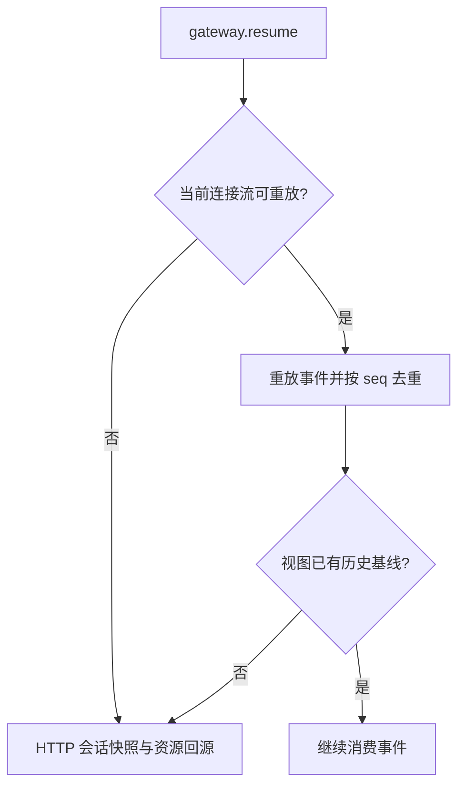
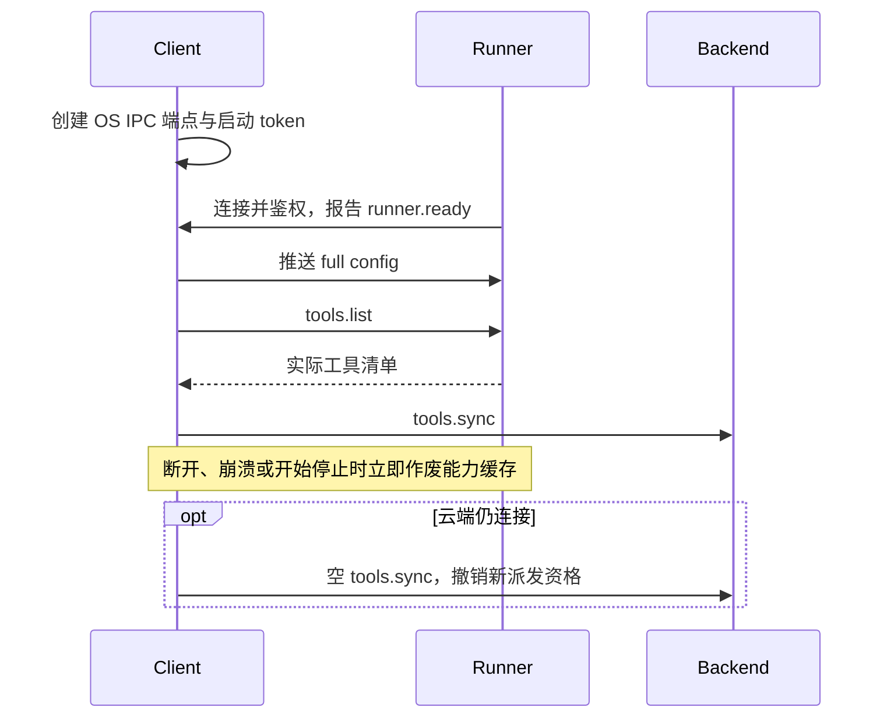

# 跨模块协议契约

本文维护通信、状态、交付、调度、安全和恢复的公共契约。字段、枚举及注册清单以链接的源码为准；模块内部实现由所属 README 维护。

## 通信与连接身份

### 传输与信封

| 链路 | 传输与鉴权 |
|---|---|
| Backend ↔ Client | 主进程以 Bearer JWT 调用业务 HTTP；`POST /api/gateway/ticket` 签发一次性不透明票据后连接 `/api/gateway/ws`；签发与有效期见 [gateway](../backend/features/accounts/gateway.py) |
| 手机浏览器 ↔ Backend | `/remote/` 同源页面，独立设备 Cookie；`POST /api/gateway/ticket` 签发票据后连接 `/api/gateway/ws`，身份约束见 [远程访问](#远程访问) |
| Client ↔ Runner | Windows 命名管道 / macOS UDS 承载 WebSocket 帧，以本次启动 token 鉴权 |

云端控制 WS 与 Client / Runner 本地连接使用 JSON-RPC 2.0；业务 HTTP、上传、下载及 Electron IPC 不套 RPC 信封。RPC 请求带 `id`，响应以相同 `id` 返回 `result` 或 `error`；通知不带 `id`，不应被响应。Backend WS 的心跳与 `gateway.ack` 均使用普通 RPC 请求；Client 与 Runner 的本地连接以 WebSocket 协议层 ping/pong 探活。

### 登录、握手与心跳

ticket 关联登录记录，每张票据在 60 秒内独立消费一次，并发签发不使其他未消费票据失效；首次握手尝试即消费，后续初始化失败或后端重启后须重新取得。HTTP 与 WS 常规日志隐藏票据及资产签名参数。握手及入站处理核对用户与登录有效性。正常刷新不撤销登录，注销、另一端激活或管理员停用则清理连接与本机工具等待，已受理回合按[序号与恢复](#序号与恢复)继续执行。长效凭据不进 WS URL，握手只接受 `?ticket=`。

关闭码 `1008` 或 `4403` 停止自动重连并显示策略拒绝，不能据此清除登录；票据失效 `4401` 重新签发票据。仅 HTTP 明确返回本站登录失效才退出账户。账户维护使用 `1012`，客户端退避重连，维护期间票据请求返回 503。心跳用 `gateway.ping`，无入站帧超时以 `4000/heartbeat` 重连；探测间隔和超时见 [GatewayConnection](../shared/gateway.ts)。

WS 只处理连接恢复、ACK、心跳、工具同步、结果回执与桌面情境信号，方法和并发策略归 [RPC 契约](../backend/entrypoints/desktop/contracts.py)。每条连接的在途控制请求有上限，超限以 `1013` 关闭；断连取消该连接未完成的控制请求。自主决策和空闲表达通过 HTTP 调用，同类咨询在途合并，迟到结果重核上下文。

### 通道分工

路由的稳定 `operationId` 和 `operation_policy` 共同定义操作、身份、编码、载荷与等待策略。[生成器](../scripts/generate_protocol.py) 从 OpenAPI、控制 RPC、事件、Runner 契约与后端预设目录生成[跨端类型与操作映射](../shared/api.generated.ts)，分别反映输入必填规则与响应序列化。调用方按操作标识提交参数，主进程不接受渲染层指定任意业务路径；检查入口见 [Scripts](../scripts/README.md#按改动选择验证)。

聊天提交、停止、快照、命令与资源操作统一走业务 HTTP，实时事件与设备指令走 WS。HTTP 不要求 WS 在线，仍独立校验身份、权限与资源归属。已受理回合由账户运行态持有；网络失败不证明操作未受理，不能自动重做副作用。

聊天流走会话 emitter；需和业务状态共同提交的异步通知走 outbox，两者不能混称。

Client 决定唯一主窗口、窗口模式精灵显隐及窗口位置。Backend 提供资源和语义，不下发窗口像素指令；桌面模式的背景由 Client 交互屏视频承载，桌面呈现不创建独立悬浮精灵。普通聊天生图只交付媒体，更换场景必须走场景资源或专属工具。

## 会话与消息

### 会话种类与历史修改

`kind` 区分系统与普通会话，取值只有 `special` 与 `standard`；任务会话是 `standard` 加自动化标志，不构成第三种取值。`special` 对应每用户唯一的陪伴主会话，其他预设不自动创建会话；手动创建的会话均为普通会话，包括陪伴预设。`system_preset_id` 决定不可变的预设和记忆域；自动化任务使用专属预设。创建须显式选择有效预设，挂载以服务端返回为准。预设目录是跨端约定的唯一来源，目录项决定提示词体、记忆域与工具边界。定义见 [presets](../backend/runtime/presets.py)、[models](../backend/features/conversation/models.py) 与 [schemas](../backend/features/conversation/schemas.py)。

| 操作 | 普通会话 | 系统对话 | 任务会话 |
|---|---|---|---|
| 发言、编辑、重试、更换回答、清空与压缩 | 允许 | 允许 | 拒绝 |
| 派生 | 允许 | 允许 | 拒绝 |
| 撤回 | 允许 | 拒绝 | 拒绝 |
| 改名 | 允许 | 拒绝 | 允许 |

任务会话的只读约束作用于会话正文：改名、删除、置顶与归档与普通会话相同。系统对话不可删除、改名、置顶或归档；列表标题从当前伙伴资料投影，角色改名与列表刷新通知同事务提交，搜索使用相同名称。普通会话使用自身标题。任务历史由自动化入口写入。所有入口共用会话互斥，删除前须停止整棵仍在运行的子任务树；停止和历史修改均不撤销外部副作用。

编辑只替换正常用户消息的文字并保留附件，在同一事务删除原消息及后续历史、写入新消息；修改较早消息须确认。撤回返回锚点文字和可重新附加的图片草稿，音视频不恢复。广播按消息 ID 合并，保留未提交草稿，迟到响应不能覆盖新回复。

重试只生成最后未回复消息的最终回答，复用原输入、附件与工具结果；新消息、终端回复或历史修改使入口失效。“换一个回答”只开放最新用户回合，生成期间保留原回答，成功后原子交接媒体并替换整组气泡，失败或提交前取消保留原回答。资格由服务端给出，各提交方式互斥。

派生复制历史、工具链与媒体并重置用量；附件独立复制，失败不留半成品。派生是独立普通会话，删除来源只清空来源关系；委派子会话随父会话级联删除，不进入普通列表和搜索。

`message_count` 是已保存历史的可见气泡总数，规则归 [formatting.py](../backend/features/conversation/formatting.py)，客户端不得用分页行数或增量帧数覆盖。

### 预设记忆与学习作用域

长期记忆及模型可读派生事实归属 `(user_id, system_preset_id)`：用户来自认证，会话固定预设；即时历史只属于当前会话，同预设共享长期资料，跨预设隔离，automation 不装配记忆或学习技能。

人工接口必须显式提供预设，越权 ID 按未找到处理。列表、证据和草稿随预设切换；资料保存携带编辑起点版本，冲突整批拒绝，空值表示遗忘。字段归 [共享协议](../shared/protocol.ts)，修订语义归 [记忆模块](../backend/features/memory/README.md#修订与遗忘)。

模型只能使用服务端验证的用户原始证据。自动化和子 Agent 消息不能作证，伙伴自身记录不能证明用户事实；人工记录的自动修改须有更新的用户依据。更新校验 ID、版本及作用域，候选、失效、过期和遗忘内容不作有效事实。决策结构见 [memory_policy](../backend/features/memory/memory_policy.py)。

学习工具的 `skill_scope` 由 Backend 在模型参数之外捕获，经 Client 透传至 Runner；异步和委派继承发起域，不读取界面选择。[SkillScope](../runner/spirit_agent_runner/contracts/scope.py) 定义允许预设；后端预设目录与该契约的一致性由[生成器](../scripts/generate_protocol.py)校验，不一致时生成失败，目录外的预设不会进入带域调用。

### 后台陪伴对话

后台陪伴上下文采集本用户陪伴预设下的全部顶层用户会话，包含固定主会话、普通及归档会话，排除自动化与子 Agent 会话。逐会话尊重清空水位，排除摘要、工具调用与界面状态，保留真实主动发言；每条对话携带角色、原文、发生时间及 `session_id`、`message_id`，按发生时间和消息 ID 稳定排序。查询和格式化入口见 [context_window.py](../backend/features/conversation/context_window.py) 与 [formatting.py](../backend/features/conversation/formatting.py)。

动态创作与评论回复、心情、闲置表达和主动搭话判断使用完整本地日期窗口：从用户本地当日零点至调用时刻，05:00 前从前一天零点开始，包含本日凌晨的新对话，不按条数或字数截断。夜间规划、反思、日记、当日活动量和七日基线使用相同会话范围，日期窗口依夜间目标日计算。

### 主动信息与来源分享

话题归属账户及陪伴预设，由夜间记忆整理后的独立阶段产生。批次首次启动时固定 `[T−24h,T)` 采集窗口，只接受有原始发布时间、文字依据和平台原文链接的内容；每天最多五条，归属夜间目标日的次日，于该用户本地午夜失效。候选独立保存，不作为用户记忆、亲身经历或尚未发生的聊天进入历史与摘要。

陪伴每次模型调用刷新当天资料及当前会话已分享的来源，历史引用跨摘要保留并尊重会话清空水位。模型以 `used_topic_ids` 标记实际讨论的内容，以 `link` 气泡的 `topic_id` 选择原文；服务端绑定标题、平台、地址与发布时间，使用记录随消息原子提交，取消和沉默不记使用。来源资格在服务端装配时冻结，模型等待跨午夜后可提交已经开始的回复，后续调用不再取得过期新候选。

反馈接口 `PUT /api/companion/topics/{topic_id}/feedback` 只接受本人已分享来源的 `like`、`less` 或撤销值，`GET /api/companion/topics/feedback` 按标识批量读取；事务内交付 `companion.topic_feedback.updated`；两端按更新时间同步，不产生伪用户消息。自然对话偏好仍按原始用户证据审阅，显式反馈独立保存并参与下一晚规划。会话备份与话题来源、反馈、使用记录成组恢复，重映射引用并核对卡片快照；过期批次不重新生效，未完成采集不在恢复后自动重放。

夜间采集按总控与账户已配置来源执行，没有独立检索开关。账户每个平台至多保存一个连接，平台能力与原文规则由 [平台注册表](../backend/infrastructure/web/social_platforms.py)定义。每次新增请求重查窗口、政策和该平台凭证修订，重试也先计入持久化预算；清除或替换凭证后停止旧凭证的新请求，已发出请求的结果可继续进入原批次，已取得的内容继续精选和分享。平台失败隔离，登录失效只标记相应连接；空结果可以提交空批次，全部采集或精选失败不提供旧日储备。检查点保留平台修订而不保存凭证。实现及预算入口见 [话题模块](../backend/features/topics/README.md)。

客户端通过 `/api/social-accounts` 管理当前账户的资讯来源，普通配置与公开响应不包含平台凭证。扫码会话绑定账户、平台和独立登录修订，刷新、取消及清除只作用对应连接；凭证保存提交后才确认清理采集服务中的完成结果。客户端关闭不取消已受理登录，Backend 从持久会话恢复查询；平台服务重启丢失的会话需重新扫码。验证码只交给该会话，不保存或自动重复提交。凭证与来源服务部署归 [Backend](../backend/README.md#免费社交资讯来源)。

### 事件路由

业务事件以 `method=event` 交付，类型、载荷和序号位于 `params`，会话路由使用 `params.session_id`。共享资源通知面向同账户在线端，页面未打开也须消费；载荷中的信息性 `session_id` 不等于路由闸门。

| 事件入口 | 消费要求 |
|---|---|
| [聊天 emitter](../backend/workflows/chat/emitter.py) | 开始、增量、气泡、完成与回合状态；完成帧用于对账，不重复追加正文 |
| [会话操作](../backend/workflows/chat/operations.py) | 编辑、撤回和命令经业务 HTTP 受理，结果以 `message.edited`、`message.deleted`、`command.result` 事件下发 |
| outbox 业务通知 | 按消息/资源身份更新及失效缓存，时间与 REST 一样按 JSON 模式序列化 |
| [工具 IPC](../backend/runtime/desktop/ipc.py) | 设备指令按 `call_id` 派发，不受可见会话过滤；无头标记只抑制工作态，学习域独立传递 |

心情、动作、影像与自动化通知使用独立消费入口，不自动追加聊天消息。类型与载荷见 [生成契约](../shared/api.generated.ts)、[RPC 契约](../backend/entrypoints/desktop/contracts.py)，消费入口见 [渲染层](../client/renderer/README.md#事件与异步生命周期)。

### 序号与恢复

- `seq` 是当前连接的网关重放流位置，跨聊天 Session 共享；宽限期重连可复用。网关销毁、登录记录更换或服务重启后可重新开始，不是数据库消息 ID 或永久递增编号。
- `stream_id` 标识连接重放流；`gateway.resume` 携带流身份与 `last_seq`，Client 按 `seq` 去重并用 `gateway.ack` 确认消费。ACK 只裁剪重放缓冲，不证明业务提交或工具执行。HTTP 与 RPC 响应不属于事件流，快照水位不推进连接消费游标。
- 桌面流绑定登录记录，Remote 每个浏览器连接持有独立流。签发票据时可申请恢复当前身份的断线流；活跃标签页、其他设备或其他账户的流不能被接管。宽限期过后或服务重启回源恢复。
- 已受理用户回合归账户运行态持有，断连、HTTP 请求结束、退出或登录失效不取消回合。显式停止使用 `POST /api/sessions/{session_id}/turns/{request_id}/cancel`，迟到停止不能取消新回合。停止先于受理时保留原请求的停止意图，受理后补交；确认终态前显示等待，只查询原回执，不重发提交。账户维护及 Backend 正常停机等待收尾；进程崩溃后标记中断，不自动重做已执行操作。
- `GET /api/sessions/{session_id}/snapshot` 在会话发布锁内先固定可选流水位，再读取历史与在途回合；无 WS 时水位为空。读取期间新发布的媒体变化保留在水位之后。挂载期间缓冲会话事件，先应用快照，再按原序交付尚未被覆盖的帧；受众与恢复分类归事件契约。主进程合并同一会话的在途快照请求，以完整基线向各窗口发布内部 `session.snapshot`；成功重放且视图已有基线时不重拉历史，流切换后重新取得所属基线。
- 历史携持久化消息 ID 与毫秒级创建时间。全量恢复达到防御上限时返回 `truncated` 与 `next_cursor`（本页首条 ID，未截断为 null）；可用 `GET /api/sessions/{id}/history` 携 `before_id` 向前分页读取更早历史。
- 握手后事件帧先暂存，`gateway.resume` 完成重放或冲刷后才报告连接就绪；握手 hold 另有防御性时限。重放容量与时限见 [buffer](../backend/runtime/desktop/buffer.py)，快照字段见 [HTTP 契约](../backend/features/conversation/http_contracts.py)。

### 表达通道

正文只承载可读台词；`companion.mood` 更新身份区，不创建消息；影像播放指令经 `companion.visual.play` 派发，实际回执以 `companion.visual.playback` 更新呈现事实；移动决策 HTTP 返回空间意图，由 Client 计算位置。动作受当前形象能力限制，控制字段不得编码进聊天文本。

当前心情由用户陪伴回合独立更新，不由工作、自动化或主动回合顺带生成。自主视觉表达与空间咨询须通过档位、可见性与锁屏闸门，空闲视觉表达还需满足空闲条件。可见性以桌面精灵窗实际显示（表面快照 `spriteVisible`：窗口存在、未隐藏且未最小化）且未被完整入口或轻语收起为准；Client 发出移动决策或空闲表达请求前检查，决策返回后再次核对。

### 结构化回复与终端交付

非子 Agent 的陪伴会话使用[结构化气泡](../backend/features/conversation/replies.py)。日常台词按明确句末标点分泡，校验后去掉首尾空白；台词含圆括号、星号、换行或反斜杠时服务端判为格式错误，要求模型去除排版符号并保留其中的台词文字，演绎旁白按语音能力处理或移除。引用地址仍按来源规则完整保留。明确要求的书面内容逐字保留文字、标点及首尾空白、缩进和空行，保存与恢复不作排版优化。内部类型标记不落库，客户端不二次分句，纯媒体回复有效。

已保存的结构化快照与原文逐字一致，读取时按严格比较校验：气泡数量、类型、正文、演绎和媒体引用任一不符即判失败。消息原文不改写，也不修补空白、正文、类型或媒体差异。新交付按完整原文限长，原文与气泡须严格一致。

语音演绎只属于语音气泡，按实际供应商、模型与音色校验。分段文字须逐字拼接为原台词，分句不得丢失空段声音和句界标记；TTS 不自动润色，客户端不解释演绎。结构与绑定见 [replies.py](../backend/features/conversation/replies.py)、[speech.py](../backend/features/media/speech.py)。

整轮保存一条消息，终端气泡、演绎、音频和真实媒体状态统一绑定。上下文只回灌可读内容与真实状态；摘要、记忆、搜索与心情不能把未完成媒体记为已发送，也不按普通文本的 JSON 外形猜测结构。

陪伴只交付无工具调用且完整校验的终端回复。工具循环不设轮数上限；媒体受理后的额度耗尽或无进展守卫（连续没有新信息、动作型工具成功后的额度用尽）触发时转无工具最终回复，复用已有结果。取消、异常和不完整结果不交付草稿；工具中间行只保存调用结构，专业和自动化使用各自文本契约。

实时只发一次开始事件，再有序交付气泡，完成帧补齐遗漏。语音失败见[语音保存与重试](#语音保存与重试)，恢复见[模型失败与重试预算](#模型失败与重试预算)。

### 媒体引用、验图与原位交付

媒体类型服从本轮明确要求，文字/语音偏好不替代图片或视频。能力、产物与交付分开：已有产物优先交付，已受理任务先查询，失败如实说明。开放规则见[工具披露](../backend/workflows/chat/README.md#工具披露与记忆访问)。

模型只引用签发的 `media_id`，视频可引用已受理任务，不填写地址或状态；服务端核对账户、会话、类型、文件、唯一性与应交付目标。台词媒体地址须来自本轮用户文字或工具结果，内部路径及媒体嵌入不能代替气泡。来源核查不证明生成成功，也不判断任意自然语言真实性；见 [reply_links.py](../backend/workflows/chat/reply_links.py)、[reply_media.py](../backend/features/conversation/reply_media.py)。

图片按目标登记去重，在同一工具步受理；验图绑定具体版本，有真实问题且额度允许才重做。保留原图，每目标最终交付一个版本，未知结果不重新提交。预算与版本资格见 [images.py](../backend/workflows/chat/images.py)、[MediaTurnState](../backend/features/media/turn_state.py)，参数见 [图片工具](../backend/entrypoints/tools/builtin/image_generation_tool.py)。

每回合至多受理一个初次视频请求。陪伴先交付等待卡，再以 `message.media` 原位更新；完成与绑定由行锁协调，消息删除不补建，重复事件幂等，终态不回退。其他文本会话使用附件及后台送达。参考职责见 [PIPELINE](PIPELINE.md#出镜图片与视频)，参数见 [视频工具](../backend/entrypoints/tools/builtin/video_generation_tool.py)。

备份恢复和派生重写历史媒体引用、解除执行绑定，未完成视频显示中断状态，不自动重发付费请求；任务资料的保留与核对见 [备份恢复](#备份校验与覆盖恢复)。原版与修订按引用保留，落选候选由所属生成链清理。

### 视频排队与结果核对

所有视频入口在输入准备完成后按[全局视频队列](PIPELINE.md#全局视频队列)等待供应商密钥名额。受理立即返回原业务任务，排队不阻塞聊天回合。影像制作工作项、视频工具和状态快照提供可空的 `video_queue`；字段定义见公共媒体的[队列契约](../backend/features/media/video_queue/contracts.py)。`waiting`、`rate_limited`、`blocked` 分别展示视频排队、服务繁忙等待重试、等待核对生成结果；`next_retry_at` 是已知的下一重试时间，普通排队不承诺预计完成时间。

影像进度沿 `companion.visual.updated` 同步；聊天使用 `video_gen.queue` 的业务任务、会话、媒体标识和 `video_queue` 更新等待卡片。重新加载从任务及媒体气泡快照恢复相同状态，队列信息不包含其他账号任务或凭据。已接单任务继续远端生成进度；未知结果仍属于未结束，不能再次提交付费请求。

管理后台通过 `GET /api/admin/video-queue` 查看各供应商密钥队列的配置名称、队列 ID、冷却与占用；密钥及指纹均不返回。请求行支持取消任务：未提交的立即离队；已提交的显示取消中，由队列尝试取消远端并等待确定终态，迟到结果不再交付或触发供应商回退；原凭据不可用或提交结果未知时保留占用直到恢复或人工核对。冷却中的队列支持立即重试，仅清除冷却并按原顺序继续处理，未知结果不会重新提交。取消、重试接口及审计入口见 [管理路由](../backend/entrypoints/http/routes/admin.py)。

`POST /api/admin/video-queue/{request_id}/resolve` 仅核对阻塞占用，携带预期修订号和核对说明，可补录远端任务 ID 后续查，或确认远端已结束／未接单后解除占用；过期修订返回 409，操作记录审计。人工解除只放行后续任务，原尝试不自动重发或切换供应商。

取消、维护、密钥轮换、重启和备份恢复的占用边界统一见[队列恢复规则](PIPELINE.md#全局视频队列)。用户删除和覆盖恢复清除业务内容后仍须由队列收尾原远端占用，备份不保存队列运行状态，也不启动付费请求。

### 音色设计与克隆

窗口、桌面、通知和恢复快照共用伙伴声音导航 `#/companion/voice`；设置的 `voice` 分类管理回复偏好与聊天录音时长。固定目录、手写设计、AI设计与克隆能力独立报告；目录为空不隐藏可用自定义能力，缺少 LLM 时仍可手写设计。

媒体模块拥有设计、克隆各一套当前方案及其不可变版本。试听候选绑定输入、账户和方案版本，确认时原子校验；描述或样本变化须重新试听，迟到、取消或旧版本结果不能覆盖当前方案。未确认候选在 24 小时后回收。生成与合成可持续等待，由账户隔离的操作标识取消；取消记录覆盖取消先到和描述生成到试听制作之间的间隔，保留范围见 [voice_operations.py](../backend/features/media/voice_operations.py)。

克隆样本经 `POST /api/media/voice-samples` 上传为独立账户资产，不使用会话附件的配额或删除语义；上传、读取及音频转换均校验账户与实际内容。Client 主进程桥在请求前后核对鉴权会话，换号后的结果不能交给新账户。自定义音色仅使用媒体模块签发的不透明方案引用，设置和音色 ID 不携带描述或音频字节；上传限额与转换规格见 [voices.py](../backend/features/media/voices.py)。

聊天、主动语音、朗读和动态共用媒体模块的音色解析与合成入口。声音描述与朗读正文分别装配，试听不自动改写台词；历史消息引用当时的声音版本，更换方案不改变历史重试。配置或必需样本不可用时，合成明确失败；聊天回合停用语音能力并继续文字回复，不改写已选声音。

方案、候选、试听和参考音频纳入账户删除、[备份恢复](#备份校验与覆盖恢复)及资产引用追踪。已确认方案、历史消息和有效任务持有的参考音频在最后引用消失后回收。

### 语音保存与重试

用户录音经 `POST /api/media/audios` 上传到当前账户的会话，返回 URL、实际格式与时长；`audio` 附件只接受本会话已上传且仍存在的文件，回放 GET 同时校验账户与会话归属。原始录音保留，供应商请求使用按需转换的 WAV 副本。桌面录完即提交，远程页面录完作为待发附件确认提交；图片、视频与音频可混合。

存在音频的请求先按配置顺序尝试支持全部输入的原生音频模型；没有可用模型或可回退尝试耗尽时，按语音输入任务链转写，再沿原任务链尝试保留其他媒体要求的文本调用。两阶段持续等待结果，已交付正文、结果未知和取消不能触发转写回退。成功转写按会话音频引用复用，保存到原用户消息，`message.audio` 更新时长或转写；标题、记忆与心情等回合后处理按需读取同一缓存，转写失败不撤销已完成原生回复。千问按 Responses 音频协议装配，MiMo 音视频请求使用 Chat Completions 并归一化到统一消费契约。

音频与视频共享会话附件配额、派生复制、删除和备份路径重映射；清理文件前提交引用改写，有转写时保留转写，无内容时保留明确占位。重试复用原录音，不重新上传。
- 后端先保存回复，再并行合成音频。气泡按原顺序经 `message.bubble` 交付，前一泡未就绪时后续泡等待；语音在音频保存后交付，失败则保留类型、台词与演绎并以空音频交付。`message.complete` 收尾并携带完整气泡，客户端按消息 ID 与气泡索引对账补建。取消不回滚已保存回复；消息改删或合成中断时清理未提交音频。
- 音频为空的语音气泡在客户端直接显示原台词，不呈现失败语音条或整轮错误；历史与实时交付使用相同降级，后续音频更新到达时恢复语音呈现。
- 客户端点播或按独立的 `companion.autoplay_voice` 偏好顺序播放；该偏好仅控制播放，文本没有 TTS 入口。
- 缺失音频经 `POST /api/sessions/messages/{message_id}/voice/{bubble_index}` 重试，已有音频幂等复用，不重新生成台词或演绎；请求持续等待合成完成或明确错误。
- 成功写入后以 `message.voice` 更新对应气泡并使历史快照失效。
- 收听状态由本机主进程按账户、会话、消息 ID 与气泡索引持久化，通过独立 IPC 读取、更新、删除及广播；`listened` 只在播放正常结束后置为真且不回退，`positionSeconds` 保存断点，播完归零。记录不上云，不进入消息正文或模型上下文；类型见 [IPC 契约](../client/shared/ipc/contracts.ts)。
- 新语音只从首次接收的终端回复与主动消息入队，历史水合、音频更新及偏好修改不触发补播。缺失音频或播放失败保留未听并跳过，用户点播才触发合成重试。暂停、中断与其他声音抢占不算播放失败。

合成与有序提交入口为 [reply_audio.py](../backend/features/conversation/reply_audio.py)，客户端音频缓存归 Client。

主动回合使用同一结构，`kind=dialogue` 与空 `bubbles` 表示沉默、不写空消息，格式恢复同样允许沉默；常规档仅提供文字能力，不提供语音与视觉表达工具。音频准备后重新检查用户活动、租约和档位；接受时原子保存消息与 `companion.message`，拒绝或取消清理未交付音频。

### 模型失败与重试预算

调用按输入能力筛选任务链，再依配置尝试，每项重算窗口与输出预算。正文交付前的明确供应商失败、不完整/空结果及交付校验失败可回退；非流式辅助调用在链内统一识别兼容协议拒绝、供应商拦截码与扩展字段，以及正文中的完整拒绝信封和诊断，不按当前供应商名称限制信号来源。真实响应状态与拒绝字段先检查；结构化正文先按业务契约验收，仅契约失败时检查正文是否为供应商拒绝，拒绝不进入格式修正。调用方提供的输出校验也在接受结果前执行。普通文字拒答、错误码解释和引用不独立触发回退，合法工具调用和主动沉默有效。正文已交付、结果未知、已生成素材下载失败、取消或业务守卫终止后停止回退。嵌入固定单模型，失败退关键词召回。入口见 [llm_fallback.py](../backend/infrastructure/ai/llm_fallback.py)、[error_classifier.py](../backend/infrastructure/ai/error_classifier.py)。

失败尝试的正文、推理和工具草稿丢弃，下一项从原上下文装配；实际交付正文才锁定模型。最终错误按末项真实原因脱敏报告，手动重试复用输入和工具结果。

手动重试最终回复从链首开始；更换回答和媒体重新制作从当前成品实际模型的下一项开始，单次最多一圈；图片微调优先原模型，来源失效从链首开始。见 [selection.py](../backend/infrastructure/ai/selection.py)、[媒体恢复](PIPELINE.md#供应商选择与失败恢复)。

LLM、媒体、语音、向量及素材传输等待结果或明确错误，不按读取、写入、静默或整链耗时中断；建连和连接池等待有界。取消、维护、停机及意图有效期继续生效，查询、握手、心跳和本机工具使用自身期限。网络自动重试限可确认未发送、幂等方法或显式幂等键且请求体可重放的情况；非幂等提交写出后断线视为结果未知。

每次生成仅实际尝试序列末项可恢复一次：不完整/空回复重新生成，陪伴结构、分句、演绎和媒体错误独立格式修正。原生音频与转写文本组成同一序列。工具循环的下一次生成重新计预算；网络重试、模型回退及格式参数降级分别控制。

格式修正不提供工具，以未交付草稿为唯一编辑正文，只补只读人设、错误、语音能力和可信媒体清单，不带历史或用户原话续写。保留主体、内容、顺序与有效媒体，书面内容保留排版；无可恢复内容返回空。修正完整校验且不再次修正，只有明确拒绝格式参数才降级接口；鉴权、限流、内容过滤不触发参数降级。

末项恢复耗尽后，仅演绎错误可转为原台词文字，仅遗漏可交付媒体可按生成顺序补齐；其他正文、结构或媒体仍不合法则不落库、不交付，并区分格式失败与供应商不可用。绑定与恢复细节见[对话编排](../backend/workflows/chat/README.md)。

### Slash 命令

Slash 元动作走 `POST /api/sessions/{session_id}/commands`，不交给 LLM。`GET /api/commands` 返回名称、别名、说明和确认标记；注册与实现见 [slash_commands](../backend/features/conversation/slash_commands.py)，执行与确认由会话业务操作校验。

`//` 或不符合命令起始规则的输入视为普通文本；符合命令形式但未识别时提示错误，不作为普通回合提交。编辑消息时的斜杠按正文处理。需要确认的命令由服务端再次校验 `confirmed=true`；影响历史的命令另检查在途状态。clear 需确认，compress 无需确认；清空保留会话，成功后历史为空且不显示成功提示，消息删除与列表刷新通知同事务提交，不等于删除长期记忆或撤销工具。remember 只写当前认证记忆域，自动化无记忆域。

响应与 `command.result` 可能同时到达，Client 幂等消费；`hydrate=true` 替换历史，否则展示状态。自动压缩在聊天调用前按上下文阈值触发，`compress.completed` 插入压缩状态，不与手动压缩的全量替换混用。摘要检查点在历史与事件中以消息 `subtype=compress_summary` 标识，正文格式不作识别依据。主动回合也保存压缩检查点，临时意图不进入摘要；无头检查点与 `compress.completed` 通知同事务写入 outbox，客户端按消息 ID 去重。管理端自动压缩开关是总闸门，用户不能覆盖关闭；各类会话的阈值统一遵循[参数继承规则](#配置所有权与云同步)。

## 伙伴与资产

### 接口入口

| 修改范围 | 定义入口 |
|---|---|
| 对话与命令、实时交付与工具同步 | [会话 HTTP](../backend/entrypoints/http/routes/sessions.py)、[网关 handlers](../backend/entrypoints/desktop/handlers.py)、[控制契约](../backend/entrypoints/desktop/contracts.py) |
| 目录、记忆、引导与声音 | [资源目录](../backend/entrypoints/http/routes/resource_catalog.py)、[引导](../backend/entrypoints/http/routes/onboarding.py)、[声音](../backend/entrypoints/http/routes/voices.py) |
| 会话 REST 与传输结构 | [会话端点](../backend/entrypoints/http/routes/sessions.py)、[schema](../backend/features/conversation/schemas.py) |
| 伙伴资料、头像与全身、角色卡、衣柜、媒体检查与资产读取 | [伙伴端点](../backend/entrypoints/http/routes/companion.py)、[伙伴 schema](../backend/features/appearance/schemas.py) |
| 场景 | [场景端点](../backend/entrypoints/http/routes/companion_scenes.py)、[场景 schema](../backend/features/scenes/schemas.py) |
| 动作素材与影像成品、制作与播放 | [动作端点](../backend/entrypoints/http/routes/companion_actions.py)、[影像端点](../backend/entrypoints/http/routes/companion_visuals.py)、[动作 schema](../backend/features/action_library/schemas.py)、[影像 schema](../backend/features/visuals/schemas.py) |
| 动态 | [动态端点](../backend/entrypoints/http/routes/companion_posts.py)、[schema](../backend/features/posts/schemas.py) |
| 日记 | [日记端点](../backend/entrypoints/http/routes/companion_journal.py)、[schema](../backend/features/journal/schemas.py) |

引导恢复依据服务端状态及已有资产；完成条件与身份锁定范围见 [DESIGN](DESIGN.md#认识伙伴)。

### 头像、全身与确认

字段与限长见[伙伴 schema](../backend/features/appearance/schemas.py)。头像 POST 以 `source` 区分生成与参考图，生成请求可带 `feedback` 和迭代 `mode`；制作不能因断连或空结果自动重发，应读当前头像恢复预览。头像、全身、外观及服装参考的上传图按实际字节校验：须是体积在限内、可完整解码的 PNG / JPEG / WebP / GIF，类型以图片内容为准，不采信客户端声明；GIF、MPO 与其他多帧图片取第一帧归一为 PNG。无法读取或超限返回 400，格式不支持返回 415。

全身和外观的生成、自备图与微调成品均为真实透明 PNG，实际 MIME 和扩展名与内容一致；上传无需预先透明。首次引导确认先持久化用户原图和角色准备任务，即可继续声音步骤；后台透明验收通过后才发布处理后的全身图、默认造型素材及后续角色分析。任务失败保留原图，复用角色资料重试与恢复。已发布身份的全身候选采纳仍只安装通过透明验收的图片，失败保留原草稿与正式状态。透明处理、背景请求及失败边界见 [PIPELINE](PIPELINE.md#全身与造型透明成品)。

| 操作 | 并发与生效条件 |
|---|---|
| `portrait/confirm` | 用户锁内核对 `expected_avatar_id`，冲突返回 409 |
| `fullbody/confirm` | 核对 `expected_url`；首次引导确认不等待分析或派生生成，分析进度归角色卡，视频启动失败归外观状态 |
| 确认后的 `/fullbody/reference`、`/reference/prompt`、`/reference/adopt` | 角色卡未就绪（分析中或失败）时返回 409，不发起生成、不产出提示词、不采纳；就绪时 `/reference`、`/reference/adopt` 只返回待采纳候选、不替换种子，`/reference/prompt` 只返回提示词；`/fullbody/candidate` 恢复最近有效候选 |
| 候选 `/analyze`、`/accept` | 前者重试身体分析；后者要求角色卡就绪（未就绪返回 409），并核对预期原图和角色卡修订（已变化返回 400），只更新身体并清旧覆盖，不重建已有外观/视频 |

完整路由见[伙伴端点](../backend/entrypoints/http/routes/companion.py)。初始资产与重复启动守卫见[生成服务](../backend/features/appearance/README.md#后台任务与初始资产)，编辑上传见 [PIPELINE](PIPELINE.md#编辑上传与身份采纳)。

### 角色卡编辑

人设 PUT 同时承接首次引导的确认保存和日常资料维护。引导保存完整资料并补写逐题提交未能保存的用户回答；资料维护提交 `expected_fields`，只接受已完成人设的四个可编辑字段，在行锁内校验原始值后合并，保留视觉与声音字段。冲突返回 409，两端保留草稿并展示最新内容。手机仅开放资料保存、角色卡修改与重新提取所需的业务 HTTP，继续使用设备身份及同源校验。

角色卡 GET/PATCH 读取与局部编辑，extract 发起重新提取/失败重试，见[结构](../backend/features/appearance/character_card_contracts.py)与[伙伴端点](../backend/entrypoints/http/routes/companion.py)。写入校验预期形象和修订，冲突 409 且 Client 保留草稿；changes 未传不变，null 恢复自动值，空字符串显式清空。

分析状态独立于已发布内容，重分析失败不撤销旧资料；`companion.character_card.updated` 与状态同事务写 outbox，客户端重读但不覆盖草稿。

### 场景任务与原位换图

资产列表与当前环境独立，创建、上传准备、分析和重生成共用账户单任务限制；接口见 [场景 API](../backend/entrypoints/http/routes/companion_scenes.py)、[schema](../backend/features/scenes/schemas.py)。

生成目标固定 2560×1440、16:9，受理后冻结，不读取窗口显示器尺寸。目标、原始素材和展示尺寸分别保存，上传源文件独立保留；要求不冒充成品描述，输入与检查归 [PIPELINE](PIPELINE.md#场景创建与描述)。

创建失败可在原场景上手动重试，保留原要求、提示词、参考图与目标尺寸；没有可续处理结果时按当前配置重新选择图片链，已有候选或待保存结果继续原阶段。手动重试只保存结果，不自动启用；提交结果未知时须先核对，不能直接重发。

重生成原位更新图片、描述、来源和尺寸并保留标题；期间原图可用，完成不改变启用指针或切换版本。检查/分析失败保留候选，只重试对应阶段；编辑撤销失败候选，取消保留成品。异步回写核对任务和账户，壁纸不绑定角色身份，恢复清除重生成运行状态。

### 场景素材与自主添置

场景是环境素材：创建、上传准备、分析和重生成共用账户单任务限制；接口见 [场景 API](../backend/entrypoints/http/routes/companion_scenes.py)、[schema](../backend/features/scenes/schemas.py)。不保存"当前环境"，呈现环境由当前影像的冻结素材决定。

衣柜与环境的自主开关只表示是否允许伙伴自主添置素材：客户端 REST 由用户显式创建与上传；聊天工具、引导与夜间始终受自主政策约束，不能从消息内容推断手动授权。自主新增滚动计额，删除不返还；复用已有素材不计生图。素材不受打扰档位限制，仍受归属与政策约束。

### 生活状态与生活事件

每个账户只有一份生活状态，记录活动、开始时间、心情、情景及聚焦事项。`LifeContext` 向聊天、影像、动态、夜间和日记提供相同的只读背景。活动与事件明确区分意向、虚拟生活情景、实际执行和已确认成果；模型只能直接改变前两类，执行和成果由业务结果写入。虚拟阅读、播放画面、制作受理及时间流逝都不能证明完成了外部活动。

持续事项可以进行、暂停、完成或放弃，并记录理由、时间与发起来源。用户暂停的事项只能按用户要求恢复；伙伴自行暂停时可以保存最早复查时间。暂停阻止尚未受理的下一步，已受理工作继续收尾；放弃取消未提交步骤并释放聚焦，但保留在途及未知结果。迟到成果仍属于原事项，不重新激活它。改变方向在同一事务放弃旧事项并关联新目标，保留原目标和历史。完成须由真实成功结果支持，且不存在待执行、执行中或未知步骤；成功的一步不自动完成整项事情。保持现状只延后复查，不接受附带的活动、心情或行动修改。

可读的下一步说明不直接执行。生活判断可同时登记类型化动作，由执行器按时间和条件认领，支持影像、环境、衣柜、动作设计和内容阅读。一次只推进账户的一个步骤，认领、配额和事项状态在生活状态锁内核对，业务受理前再次校验。同一事项、同一能力失败后，新登记的自主步骤至少等待 15 分钟，明确指定的更晚执行时间继续生效。日间与夜间共用每账户本地日执行额度及其中的创作额度，由后端管理页配置，默认值见 [配置定义](../backend/infrastructure/config.py)，0 表示禁止新的相应动作；能力开关和更严格的配额继续生效。额度按请求计数，重放不重复计数，开始执行后的失败不退还额度。规划、反思和日记整理不占该额度，供应商内部重试仍受制作预算约束。夜间未提交步骤不越过原窗口补跑。

请求身份、步骤与业务对象在受理事务中关联，成果与步骤在采纳事务中结算。断线、维护和重启沿用原请求；已认领但未受理的步骤可继续，未知提交只核对原结果。覆盖恢复保留额度和提交事实，不能重投已经提交的旧计划。步骤完成唤醒事项复查，模型判断目标是否达成，代码校验证据。阅读可使用账户已保存资讯或公开网页，单步最多一次搜索、三份资料；实际读取内容、来源时间、范围和笔记长期保存，摘要与截断保持其限定，不放入会清理的任务检查点。

事件按账户及稳定事件键幂等，保留来源、主体、时间、事实性质和结果引用。有意义记录经装配端口形成可重建的伙伴记忆；伙伴记录不能证明用户事实。离线和静止档不停止生活判断与已允许的云端执行，实时呈现仍遵守显示资格；维护态停止新操作并收敛所属任务。模型调用在事务外，提交核对修订，失败判断退避后复查。

HTTP 保持只读：`/api/companion/life`、`/pursuits`、`/pursuits/{id}`、`/steps/{id}` 和 `/events`。事项详情包含步骤与成果摘要，阅读笔记附来源和阅读范围；完整读取文本保留在持久结果中。聊天通过陪伴域的查询与调整工具修改事项，重复工具请求复用原结果。`companion.life.updated` 通知两端刷新，浏览不触发判断或制作。

### 影像成品与模式隔离

生活活动或情景变化后通过事务 outbox 请求轻量呈现评估，按最新修订合并；该路径只选择已有相符或中性成品，不发起制作。无匹配成品时冻结已有造型与环境作静态呈现，素材不足时展示准备状态。选择结果提交时复核生活与呈现修订，保留当前画面也须撤销旧待播指令；加载失败保留诊断并退避重评，重复失败回执不延后重试。上线、重连和模式切换重新核对静态呈现资格，以新请求身份恢复原冻结素材；恢复不依赖自主档位、不调用模型，也不播回已经被静态目标取代的旧循环。迟到回执被拒绝后客户端回源，生活或状态修订冲突复用恢复入口收敛，同一显示代次保留加载失败的原重试期限；回执冲突不当作图片加载失败。已接受回执的重复投递保持幂等，不恢复旧呈现。静态素材引用受到资产保护，实际显示回执不产生生活完成事件。

影像只收录专门用于伙伴呈现的组合成品：衣柜、环境、动作三份素材经伙伴决策组合制作，产生图片或视频成品；聊天配图、动态媒体和素材参考图不自动入库。图片、视频分别是一份可呈现影像，制作视频时产生的合格起始图独立入库；同账户重复引用同一张生成图片只产生一条图片记录。封面、缩略图等技术派生物不单独成为影像。

组合快照冻结伙伴身份、三份素材的 ID／修订／冻结引用及描述、具体制作计划、目标画幅和生成要求；素材关联可在素材删除后置空，冻结快照及文件引用继续有效。视频保存其真实输入图的冻结引用，输入图片后来重做不改变已有视频的依赖。正式保存裸路径，签名 URL 只在响应出口生成。组合组织在 workflow 完成，各业务模块经公开查询和 DTO 协作。

制作工作项与当前成品分离：新建或重做都是一条工作项，保存预期成品版本、冻结输入、阶段、供应商进度、候选、修复预算、暂停和错误状态。重做默认沿用所选影像的冻结组合、媒体类型及已保存要求，可补充修改要求；视频重做优先复用原合格起始图，要求明确涉及画面变化时重新准备并检查图片。等待、失败、暂停和取消均保留旧成品；新结果合格后在事务内核对目标 ID、预期版本和工作项归属再替换所选影像，未被选中的影像重做完成后不抢占当前画面。重做图片不联动重做引用它的其他视频。旧文件在播放、其他成品或制作工作项仍有引用时继续保护，无引用后交统一回收。

呈现状态每账户一份：当前影像、保留的持续影像、静态素材的待显示与实际显示快照、待执行指令及相关代次。图片作为持续画面；视频按动作定义区分持续循环和短动作，短动作结束后返回此前保留的有效持续画面，不由程序随机选择其他活动。可自然衔接时依据冻结输入图及其实际一致性判断，其他切换使用淡化。播放指令绑定账户、影像 ID／版本、呈现代次、状态代次及有效期；换号、模式切换和迟到指令均重新校验。`queued` 只表示受理，实际回执才更新呈现事实；回执区分完整图片、视频、窗口静态投影与桌面静态投影，静态投影不能被记录为视频动作已经表演。正式呈现由伙伴生活判断发起，影像库只提供库内预览和制作维护；重连和窗口重建只恢复有效持续画面，不补播过期短动作，不触发制作。接口见 [影像端点](../backend/entrypoints/http/routes/companion_visuals.py)、[schema](../backend/features/visuals/schemas.py)，制作规格归 [PIPELINE](PIPELINE.md#组合影像制作)。

自主制作在对话、主动陪伴和夜间均可由伙伴按需要发起，优先复用已有影像；制作工具不要求先存在当前呈现或可播影像，空库也能开始第一次制作。不在列表读取、页面挂载或素材更新时自动补齐组合。重复请求、暂停、重启、列表刷新均不得重置预算或重复提交付费任务；结果未知保留占用与原句柄，不重投。首次资料和素材就绪时触发一次伙伴决策，完成回调不继续发起下一轮制作。用户在影像页可浏览、预览和重做；库内预览不产生正式播放回执，不改变当前呈现。

自主创作按一次执行请求幂等，素材组合不充当永久请求身份：同一请求重放返回原工作项，工作项结束后新的创作请求可复用相同组合。在途、暂停和结果未知的相同冻结组合复用既有制作，冻结比较包含身份、素材修订、画幅和要求。受理与绑定、业务终态与全部关联步骤结算各自共用事务，每个请求保留实际工作项关联。

聊天、动态、夜间和出镜媒体统一经公开「实际呈现快照」读取状态：只读取开播回执保存的冻结版本，没有快照表示尚无呈现事实，恢复播放须重新登记并等待回执。伙伴的生活和影像决策使用模式无关的成品冻结画面与素材资料；窗口使用实际显示的静态造型和环境资料，桌面使用成品画面描述。不能把视频里的道具、姿态或动作当作窗口已经显示的事实。

### 媒体检查与发布

衣柜全身图通过透明验收后确认入柜；素材本身不决定呈现，呈现只由影像播放完成。窗口呈现不依赖视频检查或动作发布；图片解码失败不伪造呈现事实，也不覆盖已显示画面。

影像和动态沿所属业务的检查、发布事务推进；已通过检查的结果仍须重核任务、来源及版本。重做失败保留旧成品，客户端预览或页面停留不决定制作是否继续。质量检查见 [PIPELINE](PIPELINE.md#身份评分与发布复核)。

### 动态与日记

动态由独立主动调度创作，聊天及夜间规划不提供发布工具；日记由夜间自主判断。两者的正文、阅读状态、附件和内容引用统一由 entries 领域保存，创作与发布政策仍分别归动态和日记模块。用户可评论和删除本人评论，不能修改动态或伙伴回复。两者不自动写聊天历史，发布保持静默；入口见[动态模块](../backend/features/posts/README.md)、[日记服务](../backend/features/journal/journal_service.py)。

创作/回复使用人设、用户资料、有效记忆、相处理解、心情与完整[后台陪伴对话](#后台陪伴对话)。动态创建读取近期发布内容和制作资料，评论回复只读当前线程；资料快照完整保存用于恢复，不裁剪成摘要。发言保留主体、时间和完成状态，伙伴作品和感受不独立证明现实行动或用户事实。

计划/日记经过结构和语义审阅，必要时修订一次再审；失败不制作或发布。预期画面不冒充成品，评论时刻不因重试改变。正文完整保存，超限失败，不补标点或静态台词冒充交付；见[动态 schema](../backend/features/posts/schemas.py)、[日记 schema](../backend/features/journal/schemas.py)。

动态受统一开关与滚动制作额度约束；最近24小时发布、在途及受理24小时内的结果未知任务共同占额，放弃释放制作预留。恢复复用计划与原任务，主媒体失败不发布，可选旁白失败保留主媒体。出镜视频仅在有效身份分达到门槛后自动发布；低分或检查缺失时失败，不允许人工放行。付费结果未知独立保存为 `result_unknown`，可查询原任务或放弃；查询取回成品后完成必要检查，经发布服务重核当前身份、政策及额度后自动发布，不重新生成视频或补做旁白。聊天出镜视频未达身份门槛时同样失败，不能作为就绪媒体交付。

评论顺序处理，每个模型返回后在任务链内校验正文非空与长度，合格结果才保存；整链失败标记原评论回复失败，手动重试原任务，触发评论删除后拒绝迟到回复。动态列表提供评论数量，评论正文独立游标分页；待核对的视频发布任务按创建时间和 ID 游标分页，返回 `next_cursor` 和 `has_more`。发布、评论、删除和已读事件同事务交付，不当主动聊天消息。

未读逐条保存并随账户同步。加载前捕获未读 ID，内容成功展示且可见、聚焦、未锁屏才确认，之后新增内容实际展示时单独确认；失败保留，换号和页面生命周期隔离迟到结果。会话未读和收听按设备保存。

日记原文为权威，日期索引从原文派生，遗忘同事务清原文与索引；已发布恢复复用，不覆盖或再次置未读。反思保存最新相处理解，当前用户表达优先；自身记录不改变人设、授权或成为用户证据。详见[记忆模块](../backend/features/memory/README.md)。

发布时间取实际完成，活动归属日由任务记录，动态按 ID 去重、评论按自身发生日归集。内容、线程及发布任务的关联恢复遵循[备份契约](#备份校验与覆盖恢复)。

### 资产访问与缓存

正式资产按账户以 Bearer JWT 或短时签名读取，支持的资源提供 Range、ETag 与不可变缓存。签名变化不表示内容变化，素材与影像保存裸引用，经受控资产桥下载；签名不持久化。路径拒绝穿越、跨账户及符号链接越界。布局和引用归[资产领域](../backend/features/assets/README.md)，本机缓存归 [Client](../client/README.md#资产与历史缓存)。

缓存按后端和账户隔离，登出/换号保留，明确移除才删除；迟到写入不得污染新账户或复活缓存。正式生成媒体按业务引用保留，不用临时过期语义。

历史修改在同事务改引用、登记回收及作废独占媒体任务，提交后停止任务。素材与影像删除补扫专属目录与迟到写入。共享素材、派生会话与有效任务持有引用，最后引用消失才删；落盘至引用提交间受任务保护。资产登记和回收共用数据库资产行锁，回收跳过正在采纳的记录；目录操作另由账户资产锁保护。

失效任务不得继续生成、评分、下载或交付，远端尽力按原句柄取消；无法取消只保证本地停止。失败保留清理待办，由启动和周期补偿恢复；已发布媒体及其替换素材受保留期保护。

图片可内联或 HTTP(S)，音视频先上传本会话；跨会话、清理或不支持地址拒绝。供供应商读取的不可猜测视频/临时 URL 是鉴权例外。附件按配额和历史生命周期清理，先改消息占位再删文件；见[对话编排](../backend/workflows/chat/README.md)。

## 动作素材与影像播放

动作素材是独立的动作语义定义：动作内容、适用条件、持续／短动作类型与时长，不绑定衣柜、环境或成品视频；同一动作可被不同组合使用，具体环境与道具是否满足要求在组合制作时判断。登记定义本身不启动图片或视频制作。名称不承担跨来源唯一身份，内容不同但名称相同的定义各自独立。接口与字段见 [动作端点](../backend/entrypoints/http/routes/companion_actions.py)及[动作素材 schema](../backend/features/action_library/schemas.py)。

动作语义评审独立进行，依据角色身体能力和动作含义；评审中断转为暂缓，需手动重试，不自动重新付费。编辑动作回到待评审，不追溯已生成影像，也不触发批量重做。

伙伴动作工具面向动作定义：`action_search`、`action_inspect`、`action_design` 查询与登记语义，不表示可播视频；影像工具 `visual_search`、`visual_inspect`、`visual_generate`、`visual_play` 分别查询成品、查看状态、提交组合制作、请求呈现。模型能够查询衣柜与环境素材。素材本身不提供呈现操作；呈现只由影像播放完成。

播放只在有效桌面呈现中执行，指令与回执语义见[影像成品与模式隔离](#影像成品与模式隔离)。重复指令按播放 ID 去重，过期、隐藏和被抢占分别收尾。重做期间已有成品继续可用；已提交任务保留句柄直至取得明确结果，不能通过删除业务条目或清空句柄绕过未知结果占用。

## 本机工具

### IPC 准入

Client 创建本地端点并生成每次启动的 256-bit token，Runner 主动连接，upgrade 鉴权失败返回 `401`。Runner 收到拒绝后丢弃缓存端点和 token，重连前重读端点文件。POSIX 套接字在 umask `077` 下创建，端点文件写入后设为 `0600`，均只允许当前用户访问。

Windows 命名管道可被本机进程枚举，token 是实际准入边界；不能因使用本地 IPC 就省略鉴权。该 token 不是 Backend 凭据。

### 握手与工具同步

Runner 的连接与可执行就绪分开：完整配置成功应用、工具清单成功读取后，Client 才发布就绪并允许新工具执行。握手（含清单读取）或运行期配置推送重试耗尽后撤销新派发资格，保留已发调用的结果与取消通道；后续配置保存、重新握手或重新启动可恢复。已就绪后配置推送成功、仅清单刷新失败时保留原清单，下次保存重试。主进程串行发送工具同步，只按当前 WS 连接已成功交付的清单去重；空清单撤销排在已发出的旧清单之后，失败不缓存，重连重新同步。

工具说明随 Runner 当前配置生成，运行期保存配置后重新读取；未同步或清单为空时不得新派发，已派发调用继续按结果与超时收尾。配置与清单同步由 Client 的 [bridge](../client/main/runner/bridge.ts) 完成，云端能力同步与撤销归[主进程网关](../client/main/backend/gateway.ts)；Backend 侧注册见 [registry](../backend/runtime/tools/registry.py)，派发见 [tool_dispatch](../backend/workflows/chat/tool_dispatch.py)。方法与载荷定义见 [Runner 契约](../runner/spirit_agent_runner/contracts/rpc.py)。

工具禁用在清单装配和派发边界生效。Runner 各能力通过 [ToolDefinition](../runner/spirit_agent_runner/contracts/tooling.py) 显式提供工具及所属工具集，普通调用与代码子调用共用执行器；新增或删除工具集 id 时同步 [Client 索引](../client/main/shared/lib/toolset-index.ts)、Runner 所属能力的定义与[目录过滤](../runner/spirit_agent_runner/runtime/tools.py)、[Backend 过滤](../backend/runtime/tools/toolsets.py)和[显示图标](../client/renderer/shared/lib/toolset-catalog.ts)，不能只改界面清单。

### 能力与进程代次

`capabilities` 表达能力，`capabilities_health` 表达可用性和原因；`run_generation` 每次 Runner 进程启动更新，进程内重连不更新。连续重连计数与生命周期累计计数含义不同，不混用。

本机工具准入以桥状态、WS 连接和清单同步为准；当前 Client 不消费运行期能力通知，握手能力快照与 `run_generation` 不参与门控。

### 调用日志与未知结果

`call_id` 由 Backend 生成并贯穿历史、Client 去重、Runner 执行和结果，RPC `id` 仅关联传输。Runner 日志按设备隔离，执行前原子认领，同标识不同工具、参数或学习域拒绝执行/重放。

| 日志结果 | 处理 |
|---|---|
| completed | 重放保存结果 |
| claimed | 不与持有者并发执行 |
| failed | 返回记录失败 |
| unknown | 保留核对，不自动重试 |
| not_found | 无记录不能证明未执行 |

认领刷盘后执行、终态落盘后回复；取消、死亡或损坏记录无可信终态时视为未知，迟到者不得覆盖。日志有保留期，无标识直调不记日志，不可写时仍可能执行，不承诺副作用恰好一次。Client 恢复服务端未决回执时调用 `calls.get` 查询原结果，仍在执行则继续等待；未知或无记录须核对外部效果，不重新调用执行入口。

取消可按发起连接与 RPC 编号定位，也可按 `call_id` 定位重连前仍在执行的同一调用；请求只能选择一种标识。断线/超时不证明停止，线程可继续收尾；Backend 中断逐个发取消，未交 Runner 不执行、已执行尽力取消。同批结果分别保存已完成、未知和未执行，不能全部记取消导致继续时重复副作用。

错误 disposition、保留和取消范围见 [calls.py](../runner/spirit_agent_runner/runtime/calls.py)、[journal.py](../runner/spirit_agent_runner/runtime/journal.py)、[Client IPC](../client/main/ipc/runner.ts)，结果保存见 [persistence](../backend/workflows/chat/persistence.py)。

### 后端等待与取消

等待表按 `(user_id, call_id)` 寻址，身份来自认证。派发前检查桌面和工具，发送失败快速返回；`tool.result` 返回 `accepted` 或 `no_longer_pending`，重复或迟到回执不重新启动回合。主进程保留完成结果直至确认，断线及确认超时只补发结果；流 ACK 不代替该确认。等待随回合取消时下发 `tool.cancel`，超时按结果未知回传模型。

设备调用的时限由内向外递增：Runner 工具自身时限（终端前台上限默认 600 秒）短于 Client 派发上限（[ipc/runner.ts](../client/main/ipc/runner.ts)，11 分钟），再短于 Backend 等待上限（`ipc_future_timeout_seconds`，默认 720 秒）。外层短于内层会把仍在正常执行的工具报成结果未知，调整任一层时保持次序。

断连宽限结束后以可处理错误收尾未决等待，使等待工具的回合仍能说明失败。丢弃等待不等于撤销本机执行；等待登记、超时与释放见 [ipc](../backend/runtime/desktop/ipc.py)，派发前检查见 [tool_dispatch](../backend/workflows/chat/tool_dispatch.py)，恢复决策见[调用日志与未知结果](#调用日志与未知结果)。

### 图片工具结果

截图等图片结果以 `{"_multimodal": true, "content": [...]}` 交付主回合；可附 `text_summary`，Backend 脱敏后只保留 `content`，摘要不进入模型或历史。`content` 使用 Responses 部件：`{"type": "input_text", "text": ...}` 与 `{"type": "input_image", "image_url": "data:..."}`（`image_url` 为字符串）。Backend 的脱敏、循环提示、上下文压缩和供应商输入只识别这两种部件；识别入口见 [tool_dispatch_helpers](../backend/runtime/tools/tool_dispatch_helpers.py)。

### Skills 平台过滤

技能使用 `platforms` 声明系统，规范值为 macos / windows，接受 darwin / win32 别名；未声明或空列表不额外限制平台。Client 索引与 Runner 执行入口分别过滤，Installer 与 Client 随包同步都保留完整技能文件。

平台过滤与用户 / 预设隔离分别生效，不扩大产品支持平台。解析入口见 [Client 索引](../client/main/shared/lib/skill-index.ts) 与 [Runner 技能入口](../runner/spirit_agent_runner/features/skills/skills_tool.py)。

## 配置与环境

### 配置所有权与云同步

Backend 用户设置是可同步偏好真源，Client 保存账户镜像并推 Runner；白名单、机密和本机字段归 [config-sync](../client/main/shared/lib/config-sync.ts)。声音确认核对账户/鉴权会话后仅合对应键，迟到水合不得覆盖后续选择。

保存先原子写本地，再按需推 Runner 和防抖写云端，本地失败不推送。水合云端同名键优先，缺失白名单键可补传；归属不匹配清旧同步节，不上传旧账户设置。云端点键 upsert、最后保存优先，没有离线冲突合并；本地删键不清云端，须写显式值。水合落盘失败仍保留云端内存值。

Runner 仅内存持配置，调用和清单固定独立快照；更新不改在途上下文，旧探测不得回填新代次。重启首个执行前推 full config，环境切换见 [Runner](../runner/README.md#终端与子进程)，生效档位由当前设备计算。

系统与普通会话共用参数继承规则：当前会话显式覆盖优先，其次用户全局设置，最后系统通用默认值；预设不定义推理参数。会话仅覆盖温度、推理深度和压缩阈值，恢复默认删除覆盖，null 删除单项；读取生效值不持久化为覆盖。先提交再更新运行态，后续回合重读全局设置，在途回合保持起点快照。覆盖字段见[会话运行时契约](../backend/runtime/conversation.py)的 `SessionSettingsPatch`，推理降档见[供应商能力](../backend/infrastructure/ai/providers/base.py)。

### 桌面呈现与本机启动器

宿主上报代次并续期，断连、换号或可用性变化作废旧呈现指令。偏好与实际成功模式分开；行为和恢复归 [DESIGN](DESIGN.md#桌面模式)，字段归 [desktop-presentation.ts](../client/shared/ipc/desktop-presentation.ts)，实现归[主进程](../client/main/README.md#桌面承载与恢复)。

模式、交互屏、置顶和 Dock 是本机配置，视图/草稿按账户隔离。临时屏幕回退不覆盖首选；实际工作区统一投影为交互屏本地左上原点 DIP：Windows 采用 helper 确认的工作区，不重复扣底栏；macOS 采用 Electron 系统工作区，渲染层另派生避让底栏的产品内容区，工作区变化独立刷新。Windows 底部预留请求沿用共享布局的 96 DIP，AppBar 计入已有系统占用，集成托盘不额外增加预留。窗口舞台与桌面呈现代次分别隔离迟到命令。

主窗口、精灵和轻语按可见性规则交接，导航共用目标结构。模式切换捕获来源视图，目标恢复成功才完成；超时、换号或失效回到来源。快照核对发送者、账户和请求 ID，恢复路径不授予读取权限。录音/转写/上传期间禁切，已提交任务继续。

同 renderer 同账户同会话共享 runtime，视图控制器独立，事件只更新一次。可见、活动、前台及锁屏裁决未读/录音/新语音资格，窗口存在不证明查看；换号清旧 runtime，重连不重放提交或工具。

透明 UI 只命中交互区域，图标与空白操作归系统桌面。Windows 原生宿主将交互屏任务栏平移到 Dock 槽位，仅裁剪出托盘与右侧滚动视口的交集，保持原生子树；图标、菜单与系统面板仍由 Windows 处理。任务栏背景透明，原生托盘在完整 Dock 玻璃背景上方接收输入，界面不挖除该背景。样式会话绑定 host 创建身份、Explorer 与任务栏身份，应用明暗主题同步原生前景，第三方位图保留原图并添加独立浅色底片；失效时恢复原值。

helper 上报托盘固有物理尺寸与实际可见性，主进程校验并换算为 DIP，通过可空的 `systemTray` 发布 `width`、`height`、`visible`；界面不持有系统托盘的绝对位置、原生窗口句柄或图标回调。renderer 通过 `setTrayLayout` 提交当前呈现代次、测量时的视口尺寸及交互屏本地 DIP 的完整槽位 `bounds`、可见视口 `clip`，主进程核验发送者、账户、代次、有限几何与显示器范围后转换为物理坐标交给 helper；底部预留生效时系统会把铺屏窗口压回工作区，按旧视口测得的布局作废，主进程丢弃该测量并等待重新测量，不按越界拒绝；空布局收起原生行。滚动只更新槽位与裁剪，不改变固有尺寸或将内容迁移到其他屏幕。退出、失败和换代清除旧投影与布局；具体类型归 [desktop-presentation.ts](../client/shared/ipc/desktop-presentation.ts)。

背景经受限媒体桥播放静音缓存，首帧就绪后切换，失败保留旧画面；Windows 系统预留、窗口区域和异常恢复由原生宿主管理；macOS 仅管理自有表面，进入原生挂载前记录会话标记，正常退出清除，异常残留使下次启动停留窗口模式。

Dock 由可信侧汇总固定与运行项，渲染层只持不透明 ID。启动目标、参数和 Jump List 执行信息留可信侧，执行前复核账户、代次、锁屏、窗口及交互屏。固定写盘失败保留配置，运行快照不落盘，查询失败保留快照并示不可用。

激活优先本屏窗口，本屏激活保留尺寸、最大化和全屏布局；固定/目录入口可迁移异屏最近窗口及模态框，最新枚举无窗口才启动。接受只表示请求已登记，不证明出现、定位或置前；启动窗口关联有界且一次消费，迁移按原生调用回执与实际窗口状态确认，处理耗时不作为拒绝证据。执行繁忙保留意图待名额释放，前台暂空等待已知状态，授权期间目标变化须重新规划并取得新授权。等待不阻塞宿主心跳和停止，用户继续操作或会话失效后不再校正与抢前台；关联歧义和实际调用失败如实报告，旧请求不重放。关闭仅向本屏选定窗口提交正常关闭，不绕过保存提示。macOS AX 操作在后台有界执行，超时可能已有部分系统调用完成，保留未知结果原因且不重放；用户继续操作、换号、Space 或呈现代次变化使后续步骤失效。macOS 无辅助功能权限时，运行投影为不可用并提供授权入口；固定与目录经可信 `.app` 目标直接提交普通启动，不把未知运行状态视为空列表，也不声称完成窗口定位。

目录句柄限当次扫描，图标只按已登记句柄读取；迟到结果不得关闭新面板或改新账户。内部规则见 [Dock 与应用目录](../client/main/README.md#dock-与应用目录)。

### 语言与时区

语言是可同步用户偏好，Client 切换后即时更新界面与默认媒体语言，Backend 从下一次装配起使用，不中途改写已锁定回合；未知语言回落默认中文。两端语言目录须一致，入口见 [Backend constants](../backend/infrastructure/constants.py) 与 [Client locales](../client/renderer/shared/strings/locales.ts)。

时区由 Client 每次连接上报 IANA 值，用于本地日、历史展示和夜间整理；缺失时相关时间解析回落 UTC，夜间流水线跳过。时区是环境配置，不能复用语言偏好的生效语义。

## 调度

### Cron 双轨

special 触发陪伴主会话的无头回合；意图只是运行资料，不写伪用户消息。回复与沉默遵循[结构化回复与终端交付](#结构化回复与终端交付)；终端回复、下一次等待与 `companion.message` outbox 共同提交。用户发言优先取消未提交主动回合，迟到结果不能覆盖取消或修改。

standard 使用独立 automation 任务会话，可离线运行云端部分；结果和过程留在任务历史，完成或失败交付系统通知。不装配陪伴人格、长期记忆和生活空间工具，本机执行仍要求桌面在线。

同一 standard 任务串行执行，至多一个运行中和一个待执行触发，更多触发合并丢弃并记录日志；触发获得执行权后重读任务，已删除、暂停或改为 special 的丢弃，否则按当前名称与提示词运行，一次性任务触发时已删除，沿用触发时的内容。回合共用聊天编排的循环收束与取消收尾，模型等待不设时长上限。入口为 [standard_turns.py](../backend/workflows/automation/standard_turns.py) 与 [orchestrator.py](../backend/workflows/chat/orchestrator.py)。

`companion_wait` 保存时间或情境条件；并存时任一满足即可成为候选，仍须通过在线和档位闸门。主动续等不能延长原有效期；单个回合最多调用 4 次，超出返回说明。Client 的 `companion.signal` 上报可用性、[实际呈现](#桌面呈现与本机启动器)及允许的事件类别，不上传窗口标题、应用名称或屏幕；信号过期、断连或不可用时停止认领，不可用同时取消在途主动回合。

修改或主动删除源任务须同步撤销旧意图；调度后自动删除一次性任务不撤销已交接意图。认领、租约与提交隔离迟到结果；未开始或仅调用查询工具的回合可重试，执行可能产生副作用后结果不明则保留待核对提示，不重放，意图到期也不抹去提示。创建、恢复及解除暂停均在用户锁内检查活跃任务配额，重启不补算未互动时长。查询工具集合由 [companion_turns.py](../backend/workflows/automation/companion_turns.py) 定义，意图结构见 [intent_contracts](../backend/features/companion/intent_contracts.py)。

等待意图参与备份，恢复清除租约和旧事件标记，重映射源任务；运行中状态按结果未知处理，不能当作新任务直接重跑。

夜间 `outreach.schedule` 保存联系目的、背景及适用条件，其中 `prompt` 参数承载联系缘由；台词由触发时的主动回合生成。`local_time` 是目标本地日内开始等待的时刻，允许同日延迟触发；届时须重判时效与用户意愿。排程成功表示任务已创建，不代表已经发言。

### 夜间流水线

- 只为活跃账户的陪伴域启动单飞任务，专业预设的记忆由独立定期审阅维护。日志按用户、本地日唯一，扫描不等待整条流水线完成，关闭调度入口时取消并等待所属任务。
- 窗口支持跨午夜，开始与结束小时不能相同。首次启动、中断恢复、新阶段和新动作均须在用户本地窗口内；只处理刚结束的本地日，缺时区跳过，同日完成不重跑，更早未完成日志记部分失败且不重放。已提交制作可跨窗口完成并记账，窗口外不启动后续创作或叙事；已创建的次日联系独立执行。
- 夜间总控约束规划与计划执行，动态互动归集、记忆整理、反思和日记不受总控影响。每项执行前重读政策与能力；场景不依赖外观或动作阶段，失败互相隔离。
- 计划和动作账本先保存再执行，动作 ID 唯一且不改写；前置能力过滤后仍保留依赖，前置整项成功才解锁后续。规划按实际当前本地时间判断时效，不能把回顾日当作今天。文本与媒体参数执行前校验长度，不截断计划。
- 有句柄先核对原任务；未知结果保留中断事实，不重发副作用。动态创作、日记、反思与次日联系只使用账本确认的已完成事实，部分成功只提供完成部分，动作受理不代表制作完成。
- 规划、日记和反思在供应商链内校验结构输出，每阶段整条链共用一次格式修正预算，仍无效时按配置回退；空正文、未完成和拒绝响应不进入格式修正。新增调用前重查夜间窗口，窗口关闭只记阶段跳过，不保存为模型主动拒绝。阶段结果保存脱敏的调用状态、预算、用量和校验诊断，不保存对话或模型正文。
- 夜间记忆审阅、规划、日记和反思使用中等推理强度，不下发最大输出 token 限制；正文长度仍按各自契约校验。调用不设等待时长上限，未完成响应明确记为失败并按配置回退；记忆审阅的批次、修正和回退同样在新增调用前核对夜间窗口。
- 日记和反思共用目标日的[后台陪伴对话](#后台陪伴对话)、动态互动与已完成活动，无可读素材则跳过。反思仍失败保留旧理解；完成决定与业务写入同事务保存，恢复复用结果。发布与召回契约在“动态与日记”定义。

窗口与阶段实现见 [nightly](../backend/workflows/nightly/)，调度所有者见 [cron.py](../backend/entrypoints/scheduler/cron.py)。

## 远程访问

手机页面由 Backend 同源托管于 `/remote/`，`public_base_url` 支持手机可访问的 HTTP 或 HTTPS 根地址；缺失、无效或指向本机回环地址时不生成二维码，桌面显示原因。HTTP 禁用网页录音，HTTPS 按浏览器能力与麦克风权限提供。手机复用现有账户内容与会话，首次引导在桌面完成。

### 扫码、设备身份与权限

桌面主动生成五分钟有效的一次性授权码，刷新使该账户的旧待兑换码失效。授权码位于链接 fragment，手机读取后立即清除，通过 POST 原子兑换。服务端只保存凭据摘要，设备授权三十天有效；Cookie 始终带 `HttpOnly`、`SameSite=Strict`，限定当前主机及根路径。HTTPS 使用 `__Host-` 前缀与 `Secure`，HTTP 使用独立普通 Cookie；策略及 HTTP/WS 的 Origin 校验均以 `public_base_url` 为准，不受代理内部协议影响。切换协议后须重新扫码，两种 Cookie 不互相回退；HTTP 中凭据与内容明文传输。

已登录页面的 HTTP 请求携带 CSRF 头并绑定当前 Cookie；其他标签页换号后，旧页面读取返回本站登录失效并清理旧状态。首次读取授权与无请求头的媒体读取仍可使用 Cookie。写请求另校验同源，CSRF 失败返回权限错误；WS 使用独立用途的短效单次票据。

授权与设备接口见 [remote API](../backend/entrypoints/http/routes/remote.py)。手机授权独立于桌面登录，桌面换号不改手机账户；手机扫码换号时撤销原浏览器授权并清除旧状态。账户停用、删除或安全凭据重置同步撤销手机授权，设备授权记录不进入用户备份；消息受理账本随会话组恢复，规则见 [备份恢复](#备份校验与覆盖恢复)。

手机只获账户内容权限，不管理账户、供应商密钥、Runner 能力、工具结果或桌面活动信号。上传前鉴权，并校验请求体上限、资源归属与账户限流。撤权关闭设备连接，已受理回合按[序号与恢复](#序号与恢复)继续执行，不回滚已有副作用；独立资产任务按账户规则收尾。

### 多端会话与恢复

账户及会话统一持有运行态与互斥，各连接独立持有流序号、重放与 ACK，手机 ACK 不裁剪桌面数据。同会话忙碌时拒绝新提交；HTTP 回合提交携带持久化 `request_id`，相同标识与内容返回原受理结果，标识相同但内容不同拒绝。响应不明时按标识查询回执，重连不再次执行工具。

已保存用户输入和共享业务事件同步至同账户在线端，各端按消息 ID 合并。HTTP 会话快照返回持久历史、运行状态和在途回合，生成中加入也能得到已产生的内容；历史向前分页使用 `GET /api/sessions/{id}/history`。手机断网或切后台不取消已受理回合，返回时恢复历史和进度；服务重启后的中断回合显示实际状态，不自动重做工具。

动态、日记沿用账户已读状态；会话未读与语音收听进度按设备保存。页面聚焦重新校准数据，异步回写校验账户与页面生命周期。独立资产任务重连后查询原任务；记忆编辑绑定草稿初始版本，回源不提升该版本，冲突保留草稿。

## 安全、更新与备份

### 服务端保留参数

身份、配置、记忆与技能作用域、来源证据由服务端捕获并注入；模型同名参数先丢弃，不能覆盖运行上下文。保留集合见 [registry](../backend/runtime/tools/registry.py)。新增字段须覆盖装配、异步传递和消费者，不能只在提示词里禁止修改。`send_message_tool` 只给主人发送，不接受模型指定的外部 Webhook。

### 不可信工具资料

外部工具的文本与多模态文本段中的标签转义后由服务端重新包裹，循环提示独立追加在资料边界外。外部工具结果的资料标记仅帮助模型区分内容与指令，不赋予内容权限，也不代替用户隔离、路径、网络或工具授权检查。具体包装见 [tool_dispatch_helpers](../backend/runtime/tools/tool_dispatch_helpers.py)。

### 凭据落盘

本机按账户保存激活码、后端地址、用户 ID 与用户名，其中激活码经 Electron safeStorage 加密，其余明文；safeStorage 不可用时拒绝激活与保存。仅一个账户运行会话，JWT 只在内存。账户操作归主进程，不向渲染层或 Runner 暴露激活码；桥接能力另行准入。

跨窗口 API 请求携带 `authSessionId`，主进程在接收和等待后端就绪后核对其归属；未显式携带的内部请求冻结 IPC 入口的会话。允许同一会话刷新 JWT，换号后旧请求不得带新凭据发送；迟到响应同样不得覆盖新会话。

| 生命周期 | 必须保持的语义 |
|---|---|
| 首次读取会话 | 等待凭据恢复 |
| 会话过期或主动登出 | 保留本机账户及其缓存供重新激活 |
| 换号 | 先验证目标凭据；失败保留当前会话，成功后重建连接并切换缓存作用域，保留其他账户缓存 |
| 明确移除账户 | 删除目标账户的凭据和缓存；移除非当前账户不影响当前会话 |
| 旧会话鉴权失败 | 不得注销当前账户 |

Runner 只持工具所需本机配置。终端、SSH 密码及凭据文件不上云。供应商密钥和账户资讯来源凭证在后端数据库明文保存，REST 不回显；管理员备份包含用户级供应商密钥和资讯来源凭证，不包含远程设备凭据，数据库与备份均属于凭据边界。资讯来源合并恢复保留目标已有连接，覆盖恢复采用备份连接；扫码会话不恢复，凭证修订重新生成。

### AI 配置与密钥

供应商库、能力模型卡片和任务链以稳定 UUID 关联；供应商独占密钥/地址，类型决定适配器，名称仅展示。定义见 [配置](../backend/infrastructure/ai/config.py)、[任务目录](../backend/infrastructure/ai/tasks.py)、[装配](../backend/bootstrap/registrations.py)。

卡片显式声明模型 ID、输入/输出能力、上下文和输出上限，不按名称猜能力；预算计入完整输入和推理/正文。目录发现只辅助草稿，来源和歧义先展示，不修改已存参数，运行不查询目录；缓存按账户/作用域/供应商隔离，凭据变化使其失效，密钥不送公开补缺目录。

任务按用户任务、系统任务、用户默认、系统默认逐层继承，清空恢复继承；已选链不可用不改取其他层。用户只引用本人或系统项，系统模型用系统凭据。请求须满足全部输入能力，完整批次缩历史仍放不下则失败；具体任务分配由目录和领域维护。

保存、启动和恢复校验引用与能力，被引用项不可删，系统变更核对用户依赖。写入/恢复串行，失败不改运行态；REST 只回密钥状态，密钥留空时按供应商 ID 保留原值，显式清除才置空。备份含用户密钥、不含系统密钥，系统引用须有效。

媒体冻结任务、配置身份、模型和端点，凭据实时读取；失效不能向其他配置发送旧句柄。回退归[模型失败与重试预算](#模型失败与重试预算)，本地操作归 [Backend](../backend/README.md#本地供应商)。

### 自更新签名

Electron 使用平台校验链，Runner wheel 独立验 ECDSA P-256/SHA-512；签名覆盖路径和摘要，wheel 原名、清单版本、实际大小及安装后版本须一致。入口和实现同 wheel 交付，构建/签名见 [Scripts](../scripts/README.md#构建安装器)、[发布密钥](../scripts/release-keys/README.md)。

用户推进检查、下载和重启。桌面包下载后须从同源预取并验证同版本 Runner，全成功才允许重启；错误标检查/下载/安装。修改更新源后先重查，退出不自动安装；macOS 无应用内清单，如实报告检查失败。

Runner 暂存保留原名与摘要，安装前复核，仅版本一致的新桌面安装。停止失败不安装，健康检查后更新现有 venv，再验入口与版本。失败有限重试，不承诺原子切换或回滚，环境损坏走安装器修复。见 [更新 IPC](../client/main/ipc/update.ts)、[桌面更新](../client/main/lifecycle/auto-updater.ts)、[Runner 更新](../client/main/runner/updater.ts)。

技能随桌面包交付，首装释放，版本变化后在 Runner 启动前同步；同名覆盖、保留自装、跳过标记生效，全成功才记版本，失败重试。

服务端暂存校验 ZIP 的平台包、唯一同版本 wheel、签名清单及 manifest，成功换入版本目录登记。启动清上传残留、隔离未登记目录等管理员重传，不自动发布；对应资产缺失不提供平台清单。见 [update.py](../backend/entrypoints/http/routes/update.py)。

### 备份校验与覆盖恢复

备份清单必须声明 `schema="0001"` 并包含当前完整表集合。数据行来自同一只读快照，正式文件按资产库存及业务引用收集；文件消失时终止导出并清理半包。导入先校验路径、manifest、文件库存、校验和及所选数据关系；不符合格式或关系约束时不清理目标数据。

恢复类别由 [serializers](../backend/workflows/maintenance/backup/serializers.py) 统一定义。动态和日记属于同一内容组；身份、衣柜与环境等分组包含其必需关系，任务和资产库存按账户身份合并。所选关系图在事务中整体预检，全部通过后原子写入；失败保留目标，不能只写入一半父子关系。共享任务、资产及未选择内容仍引用的记录受到保护。

导入进入账户维护态，拒绝新操作并收敛正在执行的任务；不能因为恢复开始就认定已提交副作用不存在。覆盖目标中尚未明确终态的任务保留共享控制行、业务详情和必要资产关系；被替换的业务目标可解除关联，远端尝试和核对资料继续保留。已知终态可压缩为合法的最小任务身份，未知状态不能改写为成功。维护结束后重建运行镜像，客户端重新读取资源及版本。

`merge` 按 `source_key`、业务唯一键和固定槽位复用已有记录，重复导入不重复创建内容、消息、请求或附件关系。已存在的记录保留当前状态；系统会话的唯一性、上下文水位和预设边界仍须通过业务校验。`overwrite` 只清理所选且允许替换的业务记录；共享资产和任务身份按关系保留，不破坏其他内容的引用。

| 类别 | 关联和恢复要求 |
|---|---|
| 会话、消息、话题 | 映射请求、消息顺序、摘要水位、分享来源及附件；子 Agent 和分叉引用须保持账户与预设边界。尚未交付的历史媒体解除执行绑定并呈现真实中断状态。 |
| 形象、衣柜与声音 | 形象资料包含特征和人工覆盖，分析任务、待采纳候选与附件分别连接；声音版本和引用的样本须可核对。身份资料存在不代表引导或呈现已经完成。 |
| 动态、日记与评论 | 正文、日期、阅读状态、附件与日记来源一起恢复；评论在途回复恢复为可手动重试的失败。日记记忆索引按最终保留的正文批量重建，并移除失去正文的派生索引。 |
| 任务、环境与影像 | jobs 父表和 joined-table 详情复用同一新 ID；类型必须匹配，不允许同一任务对应多个冲突详情。环境指针、影像身份、不可变版本、播放记录与文件关系一并重映射。 |
| 播放与呈现 | 播放记录随具体版本恢复，在途播放标为中断；呈现代次推进，待播命令清空，快照由版本重建，不接受恢复前的迟到回执。 |
| 记忆与证据 | 当前内容、证据、修订和遗忘指纹分别恢复并核对来源；与既有记忆匹配时不追加备份中的陈旧证据。向量不随备份复制，由当前模型配置补齐。 |
| 设置、意图与自动化 | 校验配置与系统引用；租约和实时连接不恢复，不能从导入记录直接重放已执行动作。 |

任务的未知事实和供应商诊断可以保留，但备份不复制远端队列占用、设备登录凭据或进程内连接。导入的未完成制作进入 `unknown`，不自动重新提交、评分或发布；查询原结果仍须复核实际供应商记录、当前身份和业务条件。最小终态身份用于保持请求幂等，不代表存在可继续执行的任务详情。

文件映射核对源/目标账户、资产 ID、内容哈希与可读性。正式资产按内容哈希规划目标路径，已有文件只有字节哈希一致才复用；临时媒体正文与元数据成对处理。只复制最终选择记录引用的文件，必需文件缺失或越界时拒绝恢复。复制取消时等待写入线程退出，失败只清理本次创建的文件；递归和路径规则见 [file_packing](../backend/workflows/maintenance/backup/file_packing.py)。

物理关系、删除规则与循环外键处理见 [数据库设计](DATABASE.md#删除与恢复)；表贡献者及恢复入口见 [backup.py](../backend/bootstrap/backup.py) 与 [恢复流程](../backend/workflows/maintenance/backup/restoration.py)。

## 错误与标识

### 错误信封

HTTP 错误统一返回 `{error:{code,message,details,request_id}}`，校验细节只包含字段位置、原因和类型，不返回原始输入。回合忙碌返回 HTTP 409 与 `turn_busy`。控制 RPC 保留 JSON-RPC 数字错误码，`error.data` 使用同一业务错误结构。供应商鉴权失败使用 `provider_auth`，上游状态保留在详情；本站 `401 / unauthenticated` 才代表登录失效。HTTP 业务错误经 IPC 在调用端还原为同一 `ApiError`，客户端按码处理，不匹配文案；本机处理失败保留诊断原因，与网络失败区分。公开模型与脱敏逻辑见 [api_errors](../backend/infrastructure/api_errors.py)。

主进程通过结构化 IPC 传递业务 HTTP 结果，渲染层还原同一业务错误类型。网络失败、取消和断连独立表达，不伪造业务受理结果。

错误码以 [Backend constants](../backend/infrastructure/constants.py)、[Runner 调用管理](../runner/spirit_agent_runner/runtime/calls.py)与 [RPC 边界](../runner/spirit_agent_runner/transport/rpc.py)为准；未知执行结果的恢复语义见[调用日志](#调用日志与未知结果)，不能合并成普通失败。

错误离开边界前必须脱敏，不包含凭据、数据库连接或服务端本地路径。恢复策略由错误类别和操作语义决定：超时、断连和取消均不能单独证明副作用未发生。

客户端与手机端把失败归入同一组类别，类别只由 [error-classification](../shared/error-classification.ts) 判定：优先取业务错误码与 HTTP 状态，缺少结构化信息时才回落到消息文本。归类结果为 `network`（断连与超时）、`rate_limited`（限流与配额）、`provider`（供应商鉴权或不可用）、`server`（服务端内部错误）、`unauthorized`（登录失效）与 `unknown`。两端据此给出同一套中文说明，说明文本由 [ui-copy](../shared/ui-copy.ts) 统一定义；未归类的失败保留原始正文。归类只影响对外说明，不改变错误码、恢复策略与副作用判定。

### ID 语义

数据库资源主键使用 `BIGINT`，HTTP、WS 和跨端资源快照中统一使用规范十进制字符串。后端在边界校验并转换为整数；JavaScript 不把资源 ID 转成 `Number`，也不依赖其字典序表示数值顺序。定义见 [ResourceId](../backend/infrastructure/api_ids.py)。

| 标识 | 范围与用途 |
|---|---|
| RPC `id` | 一次传输请求与响应的关联，按传输协议取值，不表示数据库或工具业务身份 |
| `conversation_id` / `session_id` | 同一持久会话身份，资源接口均使用十进制字符串，跨连接保持 |
| `message_id`、资源 `id`、`job_id` | 数据库消息、资源和持久任务身份，JSON 使用十进制字符串 |
| `source_key` | 记录在备份中的稳定身份，按账户用于重复导入，不替代界面资源 ID |
| `request_id`、`call_id`、`play_id` | 请求、工具业务调用和播放指令的不透明身份，各自按其业务作用域去重 |
| `provider_task_id` / 供应商 `task_id` | 外部供应商句柄，必须结合账户、供应商和原请求解释，不能当作数据库主键 |
| `seq` | 当前网关重放流位置，跨聊天会话共享，可随网关生命周期重置；保持数值类型 |
| 气泡索引、修订号、`presentation_epoch`、`run_generation` | 索引、并发修订与运行代次，保持数值类型，不按资源 ID 编码 |

传输去重、业务消息去重与副作用去重分别使用适当标识，不能互相替代。计数、尺寸、时间间隔和分页条数也保持数值类型。

## 维护与验证

跨端变更核对生产方、消费方、持久化与恢复，覆盖重复事件、断线、未知结果、取消后迟到回写、换号和越权。契约变化同步受影响的生产方、消费方和恢复入口。通用验证要求见 [RULES](../RULES.md#代码验证规范)。
